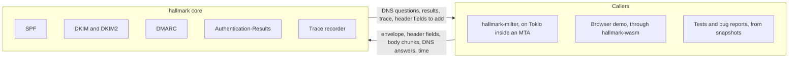
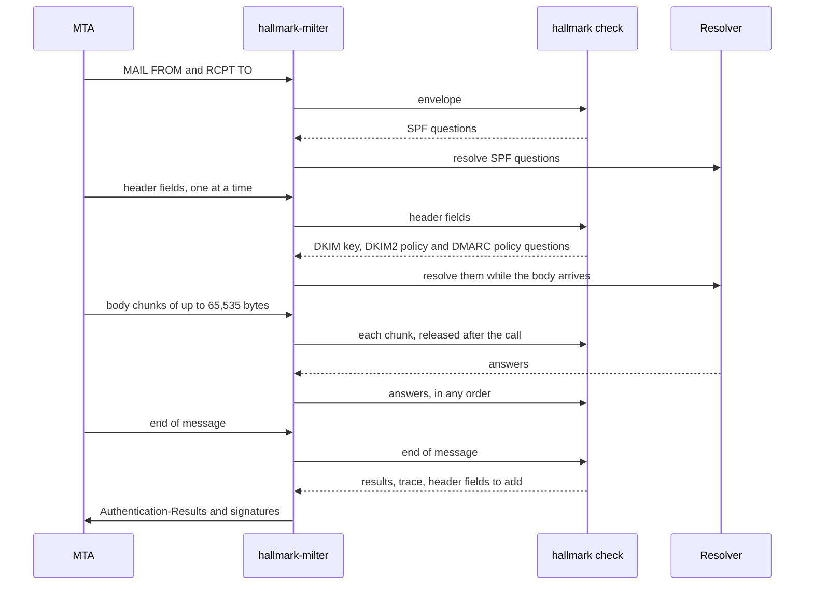
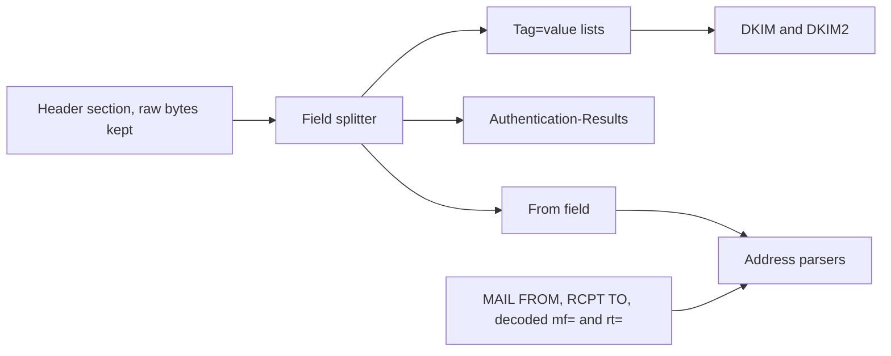
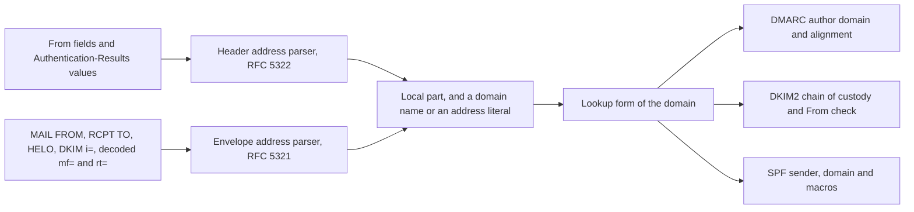
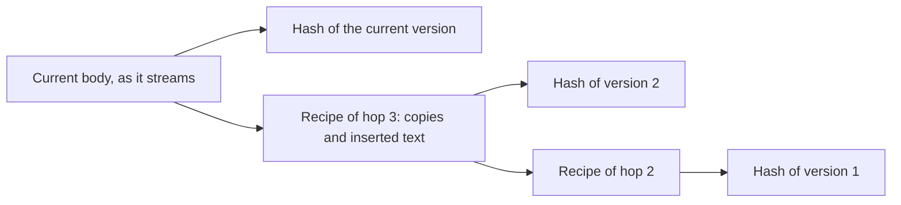
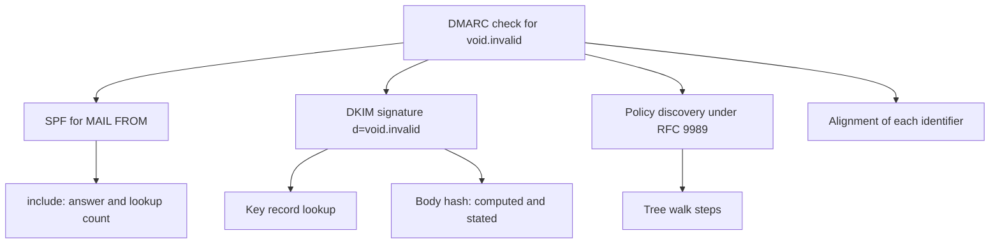

# Architecture

hallmark checks whether a message comes from the domain it claims, and explains how it decided. The [requirements](../reference/requirements.md) list what hallmark must do, and the [ADRs](../adr/README.md) record each decision.

## The parts

The core sits in the middle and talks to nothing on its own. Everything outside it arrives through its callers. hallmark-milter brings mail from an MTA and answers DNS questions with a native resolver. The demo brings a pasted message and answers through DNS over HTTPS or through records pasted into the page. Tests answer from saved snapshots. The same core code runs in all three ([ADR 0001](../adr/0001-the-core-does-no-io-and-the-caller-drives-it.md)).

DMARC builds on the other two. It takes the SPF result for the MAIL FROM domain and the DKIM result for each signature, finds the author domain in the From header field, and checks whether any authenticated domain aligns with it.

## The caller drives each check

A check is a state machine. The caller feeds it input in the order mail arrives, and the check answers with the DNS questions it needs next. It never waits: when it needs an answer it doesn't have, it says so and returns.

This shape has three effects:

- Any runtime can drive a check. The check holds no future and no socket, so Tokio, the browser's promises, and blocking code can all drive it. A driver in the library covers the common case of running a check to the end with a resolver the caller implements.
- DNS lookups overlap the body. The DKIM selectors, the domains whose DKIM2 Domain Policy Records the From check may need, and the DMARC domain are all known once the header fields are complete, so a milter can resolve them while the body is still arriving. SPF needs only the envelope.
- Every check can be replayed. A check depends on nothing but its inputs. Save the message, the DNS answers, and the time, and the check gives the same result and the same trace anywhere.

## Streaming without holding the body

An MTA hands a milter the body in fixed-size chunks and cuts wherever the buffer fills: in the middle of a word, among trailing spaces, or between the `\r` and `\n` of a line ending. A body hash depends on canonicalization, and canonicalization depends on where lines end, so the canonicalizer can't decide about the last bytes of a chunk until the next chunk arrives.

The canonicalizer carries a small state from one chunk to the next instead of the bytes themselves:

| Pending at the end of a chunk | State kept | Settled when |
|---|---|---|
| Spaces or tabs (relaxed) | One flag | Text follows: one space is hashed. A line ending follows: they are dropped. |
| A `\r` without its `\n` | One flag | The next byte shows whether a line ended |
| Empty lines | A count of line endings not yet hashed | Text follows: they are all hashed. The body ends: they are dropped. |

The state stays the same size however large the message is, and the core never keeps a chunk after the call that delivered it. Tests feed each message split at every chunk size, from 1 byte to the whole message, and require the same hash every time (STR-005).

Header fields arrive whole, one per call, so they need no carry-over. The core does keep all header fields of a message, because DKIM picks signed fields from the bottom up and DKIM2 header recipes rebuild earlier header sets. The header limits (SAF-002) bound that memory.

## Reading header fields

DKIM, DKIM2 and DMARC read header fields, and SPF reads only the envelope. Each kind of field has its own grammar. hallmark keeps the raw header section and parses it in two layers ([ADR 0011](../adr/0011-header-parsers-follow-the-abnf-and-never-repair-input.md)).

For fields that arrive one at a time from a milter, hallmark first rebuilds those bytes from each name and value (STR-008). The field splitter finds where each field starts and ends. A field is a pair of positions in the raw bytes, so splitting copies nothing, and `simple` canonicalization hashes those bytes unchanged. A parser that needs the unfolded value of a folded field builds it from the same bytes. The parser for each kind of field works on those positions and returns decoded values along with positions back into the raw bytes, so the trace can point at the exact text a decision came from. The From field and the envelope addresses go to the address parsers, described in the next section.

No parser repairs its input. A From field that doesn't parse gives DMARC no author domain, and hallmark ignores a DKIM-Signature field that doesn't parse, as RFC 6376 §6.1.1 requires. Either way, the trace records the rule that failed and where. hallmark reads no MIME structure: bodies are octets, and display names keep their encoded words ([ADR 0012](../adr/0012-hallmark-reads-no-mime-structure.md)).

## Reading addresses

hallmark reads addresses in two grammars. Header fields follow RFC 5322, with display names, comments, groups and the obsolete forms of §4.4. The SMTP envelope follows RFC 5321, with angle brackets, the null path `<>` and source routes. The checks then compare what they found across both: DMARC aligns the MAIL FROM domain with the From domain, and DKIM2 matches `mf=` against MAIL FROM and the From domain against `d=`. To make those comparisons possible, hallmark has one parser per grammar, and both return the same parts. A DKIM `i=` value uses the RFC 5321 local part (RFC 6376 §2.9), so the envelope parser reads it.

Each part keeps the text it had in the input, because the trace shows it and because some checks compare it exactly. A local part also carries its value with the quoting removed. A domain name carries a lookup form, in which every U-label becomes an A-label under RFC 5891, and every DNS question and comparison uses that form. Domain names outside addresses, such as DKIM `d=` and the domains SPF reaches, get the same lookup form. hallmark does the conversion itself, with tables for one fixed Unicode version, and maps nothing ([ADR 0013](../adr/0013-hallmark-converts-domain-names-to-a-labels-with-its-own-rfc-5891-code.md)). hallmark never makes a DNS question for an address literal.

The two grammars differ in the characters a domain may hold. A header domain may hold any ASCII that RFC 5322 allows, and hallmark looks it up as written ([ADR 0015](../adr/0015-hallmark-looks-up-header-domains-as-written-whatever-ascii-they-hold.md)). An envelope domain holds only letters, digits and hyphens, as RFC 5321 says.

An ADR records hallmark's reading wherever the RFCs leave a case open: a From address with a domain literal gives DMARC no author domain ([ADR 0014](../adr/0014-a-from-domain-literal-gives-dmarc-no-author-domain.md)), SPF macros expand the local part as written ([ADR 0016](../adr/0016-spf-macros-expand-the-local-part-as-written.md)), and the DKIM2 chain of custody compares local parts as written and ignores source routes ([ADR 0017](../adr/0017-dkim2-compares-local-parts-as-written-and-ignores-source-routes.md)). The DKIM2 reading stays under review in [hallmark#4](https://github.com/photom/hallmark/issues/4) until a revision of the draft settles it.

## DKIM2 chains in one pass

A DKIM2 hop that changes a message records a recipe for undoing the change. To check the signature of an earlier hop, the verifier rebuilds that hop's version of the body from the current one and hashes it. Draft-09 §5.1 and §5.2 require the copy steps of a recipe to be in ascending order and not to overlap, so each earlier version takes its lines from the version after it in the order they stream past.

Each rebuild keeps only its position in its recipe, and the lines of the recipe's `d` and `u` steps, which arrived with the header fields. A `d` step holds lines as UTF-8 text, and a `u` step holds them in base64 when they aren't valid UTF-8 (draft-09 §5.2). One pass over the body checks the whole chain, with no storage and no random access (DK2-006). Recipe line numbers count the raw body, including the empty lines at its end ([ADR 0008](../adr/0008-dkim2-recipe-line-numbers-count-the-raw-body.md)).

## The trace

The code that makes each decision records it in the trace at that moment ([ADR 0002](../adr/0002-the-code-that-decides-writes-the-trace.md)). A trace is a tree of steps. Each step holds what was checked, the inputs, the outcome, and the section of the RFC or draft that required it.

Because the trace comes from the deciding code, it can't disagree with the result. Facts and hints stay apart: a fact says what the check found, and a hint is a labeled guess about the cause, such as a mailing list footer that changed the body. The caller chooses how much to record. At the off level, the trace costs nothing, which matters for a milter that checks mail all day. The body appears as hashes and counts unless the caller asks for content, and private keys never appear at all.

## Where hallmark-milter fits

hallmark-milter is a separate program that depends on the published hallmark crate. It receives mail from rust-milter's callbacks, feeds each piece to a hallmark check, resolves DNS with a native resolver, and adds the Authentication-Results field and the signatures at the end of the message. Its own constraints, such as the leading space that MTAs strip from header values and the header size limits of the next hop, are listed in [requirements.md](../reference/requirements.md#relationship-to-hallmark-milter).
