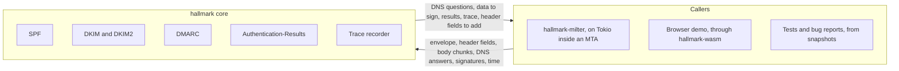
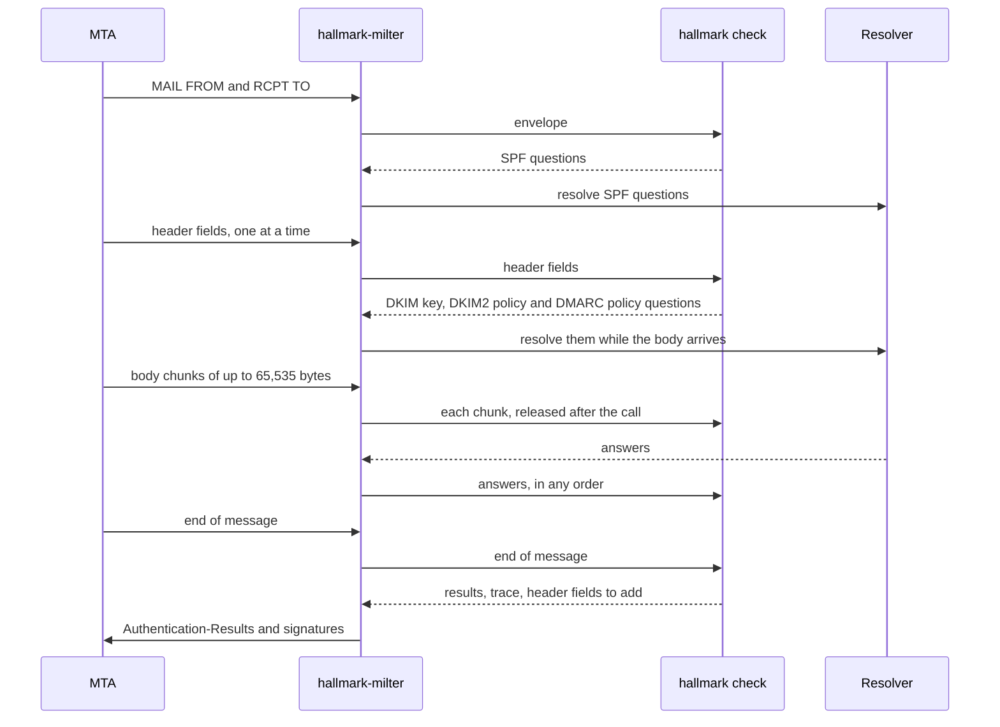
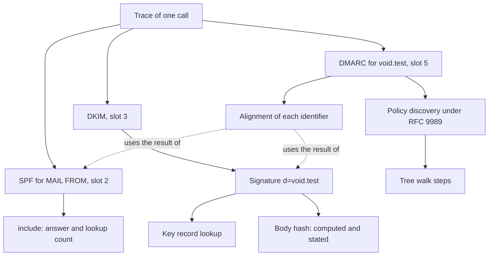

# External architecture

What hallmark looks like from outside: the systems around it, what a caller hands it and gets back, and the rules a caller can rely on. Each rule here holds within a major version (STB-001), except the DKIM2 rules, which can change in any release while the `unstable-dkim2` feature lasts (DK2-005). [Internal architecture](internal-architecture.md) explains how hallmark meets these rules, and the [requirements](../reference/requirements.md) state each one with an ID.

## Contents

- [The parts](#the-parts)
- [The caller drives each check](#the-caller-drives-each-check)
- [Streaming](#streaming)
- [Header fields](#header-fields)
- [Addresses](#addresses)
- [DNS records](#dns-records)
- [DKIM2 chains](#dkim2-chains)
- [The trace](#the-trace)
- [Where hallmark-milter fits](#where-hallmark-milter-fits)

## The parts

The core sits in the middle and talks to nothing on its own. Everything outside it arrives through its callers. hallmark-milter brings mail from an MTA and answers DNS questions with a native resolver. The demo brings a pasted message and answers through DNS over HTTPS or through records pasted into the page. Tests answer from saved snapshots. The same core code runs in all three ([ADR 0017](../adr/0017-the-core-does-no-io-and-the-caller-drives-it.md)). Signing goes the same way: the core hands the data to sign to a signer that the caller chooses, which can keep its key in memory, in a hardware security module or in a key service. A caller that wants to catch a signer using the wrong key can have the core verify each signature before it goes out ([ADR 0042](../adr/0042-signing-goes-through-a-signer-the-caller-supplies-and-the-caller-can-have-each-signature-verified.md)).

DMARC builds on the other two. It takes the SPF result for the MAIL FROM domain and the DKIM result for each signature, finds the author domain in the From header field, and checks whether any authenticated domain aligns with it.

hallmark is a library, so it reports and its callers act. A DMARC result carries the policy the domain published and whether the domain is testing, and the caller decides whether to reject, quarantine or deliver the message. The same goes for a DKIM key published in test mode ([ADR 0020](../adr/0020-test-modes-are-reported-and-the-caller-decides-what-they-mean.md)).

[Crates](../reference/design/crates.md) lists the crates of the workspace, the public interface of the `hallmark` crate, and the traits that a caller implements.

## The caller drives each check

A check is a state machine. The caller feeds it input in the order mail arrives, and the check answers with the DNS questions it needs next. It never waits: when it needs an answer it doesn't have, it says so and returns. DMARC under RFC 7489 also asks for the public suffix of each domain it compares, and the caller answers from the list it keeps, so the caller chooses the list and updates it while it runs ([ADR 0038](../adr/0038-in-rfc-7489-mode-the-caller-answers-public-suffix-questions.md)).

This shape has three effects:

- Any runtime can drive a check. The check holds no future and no socket, so Tokio, the browser's promises, and blocking code can all drive it. A driver in the library covers the common case of running a check to the end with a resolver, and for signing a signer, that the caller implements.
- DNS lookups overlap the body. The DKIM selectors, the domains whose DKIM2 Domain Policy Records the From check may need, and the DMARC domain are all known once the header fields are complete, so a milter can resolve them while the body is still arriving. SPF needs only the envelope.
- Every check can be replayed. A check depends on nothing but its inputs. Save the message, the DNS answers, and the time, and the check gives the same result and the same trace anywhere. The order in which answers arrive changes nothing, because each answer lands under the step that asked its question.

## Streaming

A caller passes the body in chunks of any size, cut anywhere, even between the `\r` and `\n` of a line ending. The check reads each chunk during the call and keeps no reference to it afterwards, so a milter can release the chunk's memory as soon as the call returns (STR-007). The results are the same whatever the chunk sizes (STR-005), and memory doesn't grow with the body (STR-001). A message with an empty body may bring no chunks at all, and only the end of the message tells the check that the body is complete (CHK-001).

The core takes CRLF line endings and no other. A bare CR or LF is an octet of the body or of the header line that holds it, and the trace records a caution for it ([ADR 0037](../adr/0037-the-core-takes-crlf-line-endings-only-and-a-bare-cr-or-lf-in-the-body-is-an-octet.md), [ADR 0051](../adr/0051-a-bare-cr-or-lf-in-the-header-section-is-an-octet-of-the-line-that-holds-it.md)). A caller with LF line endings, as in many `.eml` files, converts them before the check.

Header fields arrive whole, one per call, or as one raw header section. The check keeps them until it finishes, within the header limits (SAF-002). [Internal architecture](internal-architecture.md#streaming-without-holding-the-body) shows the small state that carries the canonicalization from one chunk to the next.

## Header fields

No parser repairs its input ([ADR 0010](../adr/0010-header-parsers-follow-the-abnf-and-never-repair-input.md)). A From field that doesn't parse gives DMARC no author domain, and hallmark ignores a DKIM-Signature field that doesn't parse, as RFC 6376 §6.1.1 requires. Either way, the trace records the rule that failed and where. hallmark reads no MIME structure: bodies are octets, and display names keep their encoded words ([ADR 0011](../adr/0011-hallmark-reads-no-mime-structure.md)).

The specifications leave three cases of header hashing open to more than one reading, and an ADR fixes hallmark's reading of each, because each one changes a result:

- A DKIM `h=` that names `dkim-signature` once more than the message has older signatures selects the signature's own field, which fails the signature, and the trace adds a caution that names the rule the signer broke ([ADR 0028](../adr/0028-dkim-h-selection-counts-the-signatures-own-dkim-signature-field.md)).
- A line that isn't a header field stays out of the DKIM2 header hash ([ADR 0029](../adr/0029-the-dkim2-header-hash-leaves-out-lines-that-are-not-header-fields.md)).
- If the input ends inside the last header field, that field still counts, and its canonical form ends with CRLF ([ADR 0030](../adr/0030-a-last-header-line-without-a-line-ending-is-a-header-field-that-canonicalization-ends-with-crlf.md)).

[Internal architecture](internal-architecture.md#reading-header-fields) shows how the parsers split and hash the fields.

## Addresses

Header fields hold addresses in the grammar of RFC 5322, and the SMTP envelope in the grammar of RFC 5321. hallmark reads each with its own grammar, and compares what it finds across both: DMARC aligns the MAIL FROM domain with the From domain, and DKIM2 matches `mf=` against MAIL FROM and the From domain against `d=`. A DKIM `i=` value uses the RFC 5321 local part (RFC 6376 §2.9).

Every DNS question and every comparison of domain names uses the lookup form, in which each U-label becomes an A-label under RFC 5891. hallmark makes no DNS question for an address literal. A header domain may hold any ASCII that RFC 5322 allows, and hallmark looks it up as written ([ADR 0014](../adr/0014-hallmark-looks-up-header-domains-as-written-whatever-ascii-they-hold.md)). An envelope domain holds only letters, digits and hyphens, as RFC 5321 says.

An ADR fixes hallmark's reading wherever the RFCs leave a case open: a From address with a domain literal gives DMARC no author domain ([ADR 0013](../adr/0013-a-from-domain-literal-gives-dmarc-no-author-domain.md)), SPF macros expand the local part as written ([ADR 0015](../adr/0015-spf-macros-expand-the-local-part-as-written.md)), and the DKIM2 chain of custody compares local parts as written and ignores source routes ([ADR 0016](../adr/0016-dkim2-compares-local-parts-as-written-and-ignores-source-routes.md)). The DKIM2 reading stays under review in [hallmark#2](https://github.com/photom/hallmark/issues/2) until a revision of the draft settles it. [Internal architecture](internal-architecture.md#reading-addresses) shows the two parsers.

## DNS records

Whoever runs a zone controls its records, so hallmark treats a DNS answer as hostile input, as it does a message. The resolver hands over each TXT record as the strings it was published in, and the core joins them, so a resolver needs to know no protocol rule (DNS-006). Each check keeps the records its specification selects. A syntax error gets the result that the check's specification gives for it, and the trace names the rule and the offset.

The record specifications leave more cases open than the header field ones, and in places they contradict themselves. Three passages of RFC 9989 disagree about a record with an invalid policy tag ([ADR 0023](../adr/0023-dmarc-follows-rfc-9989-section-4-10-1-for-invalid-policy-tags-and-section-4-7-for-nonexistent-subdomains.md)), and RFC 6376 both permits and calls undefined a selector with several key records. ADRs 0021 to 0027 record hallmark's reading of each such case. Two of them keep the result independent of things a verifier shouldn't let decide it: the order of the records in an answer ([ADR 0025](../adr/0025-a-dkim-selector-with-several-key-records-passes-if-any-of-them-verifies-the-signature.md)), and a local part that a sender chose to break an SPF target name ([ADR 0022](../adr/0022-an-spf-target-name-that-macro-expansion-makes-invalid-matches-nothing.md)). [Internal architecture](internal-architecture.md#reading-dns-records) shows the path from an answer to a parsed record.

## DKIM2 chains

A DKIM2 hop that changes a message records a recipe for undoing the change, and a verifier rebuilds each earlier version of the body to check the signature of that hop. hallmark checks the whole chain in one pass over the body, with no storage and no random access (DK2-006). Recipe line numbers count the raw body, including the empty lines at its end ([ADR 0008](../adr/0008-dkim2-recipe-line-numbers-count-the-raw-body.md)). [Internal architecture](internal-architecture.md#dkim2-chains-in-one-pass) shows how each rebuild follows the stream.

## The trace

A trace is a tree of steps. Each step holds what was checked, the inputs, the outcome, and the section of the RFC or draft that required it. Each step goes out as one event, which carries the step's position in the tree: the path of child numbers from the root. Each kind of check, and the header section that the checks share, has a fixed slot under the root, so a DMARC alignment step can point at the SPF or DKIM result it used, even when that check ran in another call.

At the full level, each event goes out as soon as its step finishes. A milter can write the events to its log while the check runs, and a check that stalls on a DNS answer still leaves everything it recorded. DNS answers arrive in any order, so the events do too, but a step's position comes only from the inputs: sorted by position, the events give the same trace in the same bytes every time. At the summary level, hallmark holds the events back and sends only the path that decided each result, once the check finishes. Every event carries the ID that the caller gave the message, such as the MTA's queue ID, which joins the trace with the MTA's and the milter's logs. Each event is one I-JSON text in a JSON text sequence, as the [trace format](../reference/trace-format.md) describes, with a version of its own ([ADR 0033](../adr/0033-trace-events-are-i-json-texts-in-a-json-text-sequence.md)).

Facts and hints stay apart: a fact says what the check found, and a hint is a labeled guess about the cause, such as a mailing list footer that changed the body. A fact that a specification warns about, such as a signature that passed with a 1024-bit RSA key, carries a caution that cites the section. Each step holds codes and parameters, and the words a person reads come from them, so tests match codes and the demo can show the trace in another language. Values that a sender or a DNS publisher controls carry a mark, and whoever displays them escapes them for their output. The caller chooses how much to record. At the off level, the trace costs nothing, which matters for a milter that checks mail all day. The body appears as hashes, counts and places, never as content: a caller that wants to see what a check hashed passes the body through the library's canonicalizer ([ADR 0041](../adr/0041-the-trace-records-places-in-the-body-and-a-separate-api-streams-the-canonical-body.md)). Private keys never appear at all. [Internal architecture](internal-architecture.md#recording-the-trace) shows who records each step.

## Where hallmark-milter fits

hallmark-milter is a separate program that depends on the published hallmark crate. It receives mail from rust-milter's callbacks, feeds each piece to a hallmark check, resolves DNS with a native resolver, and adds the Authentication-Results field and the signatures at the end of the message. Its own constraints, such as the leading space that MTAs strip from header values and the header size limits of the next hop, are listed in [requirements.md](../reference/requirements.md#relationship-to-hallmark-milter).
