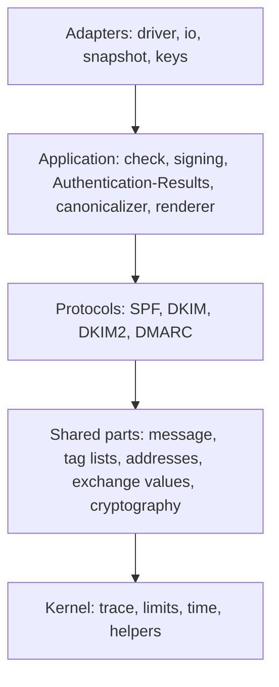
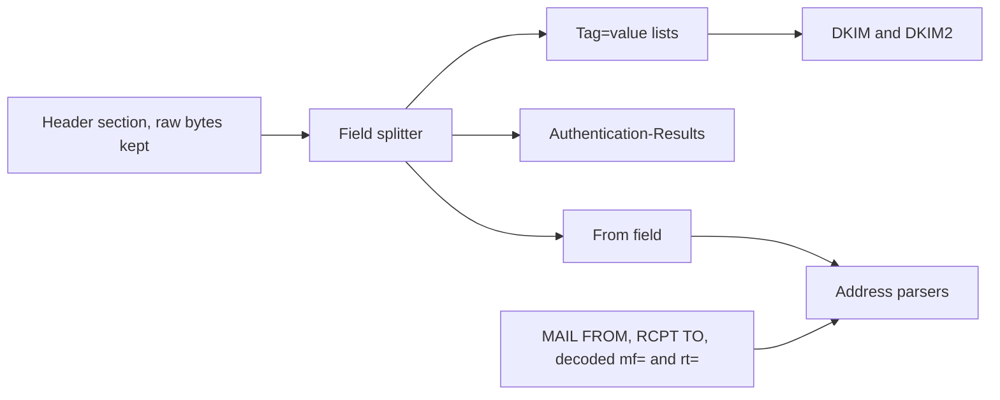
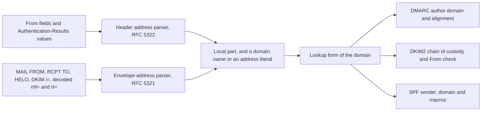
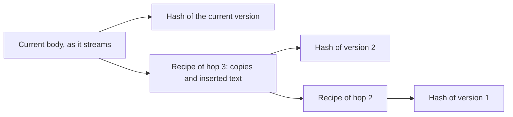

# Internal architecture

How hallmark meets the rules of its [external architecture](external-architecture.md): how the code is divided, and how the core streams, parses and records. A caller can't rely on anything here, which can change in any release as long as the external rules hold. [Modules](../reference/design/modules.md) gives the modules and their dependency rules.

## Contents

- [How the code is divided](#how-the-code-is-divided)
- [What a check fixes](#what-a-check-fixes)
- [How the protocols meet](#how-the-protocols-meet)
- [Streaming without holding the body](#streaming-without-holding-the-body)
- [Reading header fields](#reading-header-fields)
- [Hashing header fields](#hashing-header-fields)
- [Reading addresses](#reading-addresses)
- [Reading DNS records](#reading-dns-records)
- [DKIM2 chains in one pass](#dkim2-chains-in-one-pass)
- [Recording the trace](#recording-the-trace)

## How the code is divided

The code follows the specifications. SPF, DKIM, DKIM2 and DMARC each have a module tree of their own, with the words of their specification, and no protocol uses another. A new DKIM2 draft or a DMARC erratum then changes one tree. What several protocols share, such as the header section, tag lists, addresses and cryptography, sits below the protocols, and the trace recorder, the limits and a few helpers sit below everything. The check and the signing sit above the protocols and drive them, and the drivers, the blocking adapters, snapshots and the memory signer sit above them. Dependencies point only downward ([ADR 0059](../adr/0059-the-modules-of-the-hallmark-crate-are-bounded-contexts-in-five-layers.md)).

## What a check fixes

A check fixes most of what it holds. The options decide, when the verifying caller creates the check, which evaluations it runs, and that set never changes. Each input that the check keeps, such as the envelope or the header section, goes into a slot that takes one value and never gives it up. Only the evaluations' own states move. To follow a check, you read one state machine at a time: the check's own for the order of the input, and each protocol's for its steps. A signing fixes its signings and its header section in the same way ([ADR 0063](../adr/0063-checks-and-signings-fix-their-evaluations-when-created-and-each-input-once-it-arrives.md)).

## How the protocols meet

No protocol sees the values of another protocol, and none sees a question ID. DMARC gets authenticated identifiers from the check, which builds them from the SPF and DKIM results. A protocol asks for a DNS record by type and name, and the check's question table numbers the questions and hands the answers back. When two protocols need the same record, the table asks once and gives both the same answer.

## Streaming without holding the body

An MTA hands a milter the body in fixed-size chunks and cuts wherever the buffer fills: in the middle of a word, among trailing spaces, or between the `\r` and `\n` of a line ending. A body hash depends on canonicalization, and canonicalization depends on where lines end, so the canonicalizer can't decide about the last bytes of a chunk until the next chunk arrives.

The canonicalizer carries a small state from one chunk to the next instead of the bytes themselves, and settles what is still pending once the body ends:

| Pending at the end of a chunk | State kept | Settled when |
|---|---|---|
| Spaces or tabs (relaxed) | One flag | Text follows: one space is hashed. A line ending follows, or the body ends: they are dropped. |
| A `\r` without its `\n` | One flag | A `\n` follows: a line ended. Another byte follows, or the body ends: the `\r` is a bare CR, which is hashed as an octet of the body (STR-011). |
| Empty lines | A count of line endings not yet hashed | Text follows: they are all hashed. The body ends: they are dropped. |
| A line with bytes hashed and no line ending yet | One flag | A line ending follows: the flag clears. The body ends: a CRLF is hashed, because RFC 6376 §3.4.3 and §3.4.4 and draft-09 §6.1 add one to a body without a trailing CRLF. `simple` and the DKIM2 body hash also hash one for a body that has nothing else to hash. |

The state stays the same size however large the message is. One body pipeline holds a canonicalizer for each distinct body form that the signatures need, so every chunk passes through each of them once, and the protocols hash what comes out. Tests feed each message split at every chunk size, from 1 byte to the whole message, and require the same hash every time (STR-005).

Header fields arrive whole, so they need no carry-over. The core keeps all header fields of a message, because DKIM picks signed fields from the bottom up and DKIM2 header recipes rebuild earlier header sets. [External architecture](external-architecture.md#streaming) gives the streaming rules that a caller relies on.

## Reading header fields

Each kind of field has its own grammar. hallmark keeps the raw header section and parses it in two layers ([ADR 0010](../adr/0010-header-parsers-follow-the-abnf-and-never-repair-input.md)).

For fields that arrive one at a time from a milter, hallmark first rebuilds those bytes from each name and value (STR-008). The field splitter finds where each field starts and ends. A field is a pair of positions in the raw bytes, so splitting copies nothing, and `simple` canonicalization hashes those bytes unchanged. A parser that needs the unfolded value of a folded field builds it from the same bytes. The parser for each kind of field works on those positions and returns decoded values along with positions back into the raw bytes, so the trace can point at the exact text a decision came from. [External architecture](external-architecture.md#header-fields) gives what happens to a field that doesn't parse.

## Hashing header fields

DKIM and DKIM2 hash each header field in a canonical form. DKIM's `relaxed` form and DKIM2's header hash lowercase the field name, unfold the value and reduce its white space, so a mail system can refold a long field in transit and the hash stays the same. DKIM's `simple` form takes the raw bytes as they arrived, which is why the parser keeps them.

The hash inputs differ in the fields they take. DKIM takes the fields that the signer named in `h=`, picking instances from the bottom up, and ends with the signature field itself. DKIM2 takes every field except its own and those that §4 of the draft lists, such as trace fields and other signatures, and sorts them by name, so it needs no list of names. Its signature then covers only the Message-Instance and DKIM2-Signature fields, which already hold the hashes of everything else. The module of the Message context makes the canonical forms, and the protocol whose specification picks the fields builds each hash input. [External architecture](external-architecture.md#header-fields) gives the three readings that change a result.

## Reading addresses

hallmark has one parser per grammar, and both return the same parts, so a check can compare an envelope domain with a header domain.

Each part keeps the text it had in the input, because the trace shows it and because some checks compare it exactly. A local part also carries its value with the quoting removed. A domain name carries its lookup form, and domain names outside addresses, such as DKIM `d=` and the domains SPF reaches, get the same form. hallmark does the conversion to A-labels itself, with tables for one fixed Unicode version, and maps nothing ([ADR 0012](../adr/0012-hallmark-converts-domain-names-to-a-labels-with-its-own-rfc-5891-code.md)). [External architecture](external-architecture.md#addresses) gives which grammar applies where, and the readings of open cases.

## Reading DNS records

Each check reads the records it fetches with a parser of its own, written from its specification's grammar. The core joins the strings of each TXT record before the check selects records, and keeps the strings too, so the trace can show the record both as published and as read. A parsed record keeps the byte range of each value, so a step can point at the text it read. [External architecture](external-architecture.md#dns-records) gives how hallmark treats a record and the readings of open cases.

## DKIM2 chains in one pass

To check the signature of an earlier hop, the verifier rebuilds that hop's version of the body from the current one and hashes it. Draft-09 §5.1 and §5.2 require the copy steps of a recipe to be in ascending order and not to overlap, so each earlier version takes its lines from the version after it in the order they stream past.

Each rebuild keeps only its position in its recipe, and the lines of the recipe's `d` and `u` steps, which arrived with the header fields. A `d` step holds lines as UTF-8 text, and a `u` step holds them in base64 when they aren't valid UTF-8 (draft-09 §5.2). The DKIM2 module turns each recipe into copy and insert steps, and the Message context applies them to the stream. [External architecture](external-architecture.md#dkim2-chains) gives what a caller can rely on.

## Recording the trace

The code that makes each decision records it in the trace at that moment ([ADR 0031](../adr/0031-the-code-that-decides-writes-the-trace-as-events-with-tree-positions.md)), so the trace can't disagree with the result. Each protocol records only its own codes, and the English renderer, which has to know all of them, sits with the check ([ADR 0061](../adr/0061-each-context-owns-its-trace-codes-and-the-english-renderer-sits-in-the-application-layer.md)). One recorder writes every event in the fixed form of the trace format, counts its bytes against the trace limit, and at the summary level holds the events back until the check finishes. The recorder never feeds back into a decision, so the trace level and the trace limit change no result (INV-009). [External architecture](external-architecture.md#the-trace) gives what the trace holds and how a caller reads it.
