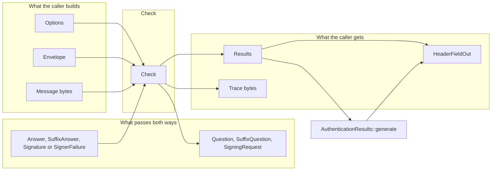

# API reference

The public API of the `hallmark` crate: each type and method, what it takes and gives, and the rules it checks, with the error code each broken rule gives. The names follow the [domain model](../design/domain-model.md) and are a first draft until the first release (STB-001).

## Contents

- [Documents](#documents)
- [Overview](#overview)
- [How to read an entry](#how-to-read-an-entry)
- [Conventions](#conventions)

## Documents

| Document | APIs | Rules |
|---|---|---|
| [check.md](check.md) | `Check`, `Envelope` | VAL-101 to VAL-161 |
| [options.md](options.md) | `Options`, `VerificationTime`, `Limits`, `DocumentLimits`, `DkimSigning`, `Dkim2Signing` | VAL-201 to VAL-242 |
| [dns.md](dns.md) | `Request`, `Question`, `Answer`, `Record`, `SuffixQuestion`, `SuffixAnswer` | Checked by `Check` |
| [results.md](results.md) | `Results` and the result of each kind, `Signing`, `HeaderFieldOut` | VAL-301, VAL-302 |
| [signing.md](signing.md) | `SignerStatement`, `SigningRequest`, `Signature`, `SignerFailure`, `MemorySigner`, `RandomSource` | VAL-401 to VAL-412 |
| [trace.md](trace.md) | `sort_trace`, `Event` | VAL-501 to VAL-512 |
| [canonicalizer.md](canonicalizer.md) | `Canonicalizer` | VAL-601 to VAL-616 |
| [authentication-results.md](authentication-results.md) | `AuthservId`, `AuthenticationResults` | VAL-701 to VAL-720 |
| [driver.md](driver.md) | `Resolver`, `SuffixSource`, `Signer`, `drive`, `io::read_message`, `io::write_trace` | VAL-801 to VAL-821 |
| [snapshot.md](snapshot.md) | `Snapshot`, `SnapshotResolver`, `PastedRecords` | VAL-901 to VAL-923 |
| [errors.md](errors.md) | The error model, the error types and every error code | |

## Overview

| Tool | Works on | Document |
|---|---|---|
| `drive` and the three traits | A check, with the caller's resolver, suffix source and signer | [driver.md](driver.md) |
| `io::read_message`, `io::write_trace` | A check, with a standard blocking reader and writer | [driver.md](driver.md) |
| `Canonicalizer` | A body, outside any check | [canonicalizer.md](canonicalizer.md) |
| `sort_trace`, `Event` | Trace bytes | [trace.md](trace.md) |
| `Snapshot`, `SnapshotResolver`, `PastedRecords` | DNS answers kept for replay | [snapshot.md](snapshot.md) |
| `MemorySigner` | Keys held in memory | [signing.md](signing.md) |

## How to read an entry

Each document starts with a table of its APIs:

| Column | Content |
|---|---|
| API or Method | The type and method, such as `Check::answer` |
| Takes | The arguments |
| Gives | The value a successful call returns, and the error type |
| Accepted in | The states in which a call is allowed, for types with states ([Lifecycle](../design/lifecycle.md)) |
| Requirements | The requirements the API serves |

Each API then has a validation table, also when it has no rule to check:

| Column | Content |
|---|---|
| ID | `VAL-` and three digits, unique across these documents. Each document has a block of a hundred numbers |
| Input | The argument or the state that the rule reads |
| Rule | The condition that must hold |
| Error code | The code from [errors.md](errors.md#error-codes) that a broken rule gives, or "Not an error" and what happens instead |
| Requirement | The requirement or the section of a specification behind the rule |
| Scenario | The test: an `API-` scenario in [api.md](../../testing/api.md) with the rule's number, or a scenario in another file |

## Conventions

| Item | Convention |
|---|---|
| Rule order | A method checks its rules in the order its table lists them and gives the code of the first one broken |
| Strong types | A rule that a type already enforces, such as a 32-octet key or a `Kind` that exists only with `unstable-dkim2`, gets no row |
| Bytes and text | "Bytes" may hold any octet. "Text" is UTF-8 |
| Code | None: these are reference documents. Examples belong in tutorials and how-to guides |
| `unstable-dkim2` | APIs and fields marked with the feature exist only when it is on, and can change in any release (DK2-005) |
