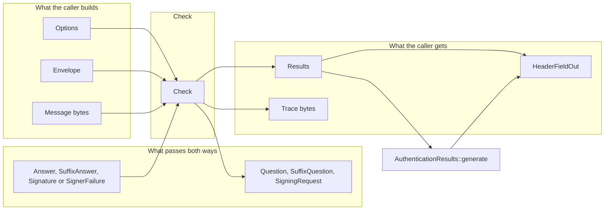

# API reference

The public API of the `hallmark` crate: each type with its fields or variants, each function and method with its signature, and the rules each one checks, with the error code each broken rule gives. The names follow the [domain model](../design/domain-model.md) and are a first draft until the first release (STB-001).

## Contents

- [Documents](#documents)
- [Overview](#overview)
- [How to read an entry](#how-to-read-an-entry)
- [Conventions](#conventions)
- [Rust types](#rust-types)

## Documents

| Document | APIs | Rules |
|---|---|---|
| [check.md](check.md) | `Check`, `Envelope`, `Request`, `QuestionId`, `RequestId`, `TraceRead`, `Waiting`, `ExpectedInput` | VAL-101 to VAL-161 |
| [options.md](options.md) | `Options`, `Kind`, `VerificationTime`, `Level`, `FieldForm`, `DmarcMode`, `SpfSource`, `DkimSource`, `Limits`, `DocumentLimits`, `Limit`, `DkimSigning`, `Dkim2Signing` and their parts | VAL-201 to VAL-242 |
| [dns.md](dns.md) | `Question`, `QuestionType`, `Answer`, `Record`, `SuffixQuestion`, `SuffixAnswer` | Checked by `Check` |
| [results.md](results.md) | `Results` and the result of each kind, `Domain`, `Signing`, `HeaderFieldOut` | VAL-301, VAL-302 |
| [signing.md](signing.md) | `Algorithm`, `SignerStatement`, `SigningRequest`, `Signature`, `SignerFailure`, `MemorySigner`, `RandomSource` | VAL-401 to VAL-412 |
| [trace.md](trace.md) | `sort_trace`, `Event`, `Position`, `Value`, `Data`, `Place` | VAL-501 to VAL-512 |
| [canonicalizer.md](canonicalizer.md) | `Canonicalizer`, `CanonicalizerMode`, `Rebuild` | VAL-601 to VAL-616 |
| [authentication-results.md](authentication-results.md) | `AuthservId`, `AuthenticationResults` | VAL-701 to VAL-720 |
| [driver.md](driver.md) | `Resolver`, `SuffixSource`, `Signer`, `drive`, `io::read_message`, `io::write_trace` | VAL-801 to VAL-821 |
| [snapshot.md](snapshot.md) | `Snapshot`, `SnapshotResolver`, `PastedRecords` | VAL-901 to VAL-923 |
| [errors.md](errors.md) | The error model, the error types with their variants, `ParseError`, and every error code | |

## Overview

| Tool | Works on | Document |
|---|---|---|
| `drive` and the three traits | A check, with the caller's resolver, suffix source and signer | [driver.md](driver.md) |
| `io::read_message`, `io::write_trace` | A check, with a standard blocking reader and writer | [driver.md](driver.md) |
| `Canonicalizer` | A body, outside any check | [canonicalizer.md](canonicalizer.md) |
| `sort_trace`, `Event` | Trace bytes | [trace.md](trace.md) |
| `Snapshot`, `SnapshotResolver`, `PastedRecords` | DNS answers kept for replay | [snapshot.md](snapshot.md) |
| `MemorySigner` | Keys held in memory | [signing.md](signing.md) |

## How to read an entry

Each document gives its functions and methods in a signatures table:

| Column | Content |
|---|---|
| API | The type and the function or method, such as `Check::answer` |
| Signature | The Rust signature: the receiver, each parameter's name and type in order, and the return type |
| Returns | What a successful call returns |
| Accepted in | The states in which a call is allowed, for types with states ([Lifecycle](../design/lifecycle.md)) |
| Requirements | The requirements the API serves |

A parameters table follows, with one row for each parameter: the API, the parameter's name, and its meaning and form. Each type then has a table of its fields, for a struct, or of its variants, for an enum:

| Column | Content |
|---|---|
| Field or Variant | The name, as in Rust |
| Type or Carries | The field's type, or the data the variant holds |
| Meaning | What the value says, and its form |
| Requirements | The requirements behind it |

Each function and method then has a validation table, also when it has no rule to check:

| Column | Content |
|---|---|
| ID | `VAL-` and three digits, unique across these documents. Each document has a block of a hundred numbers |
| Input | The parameter or the state that the rule reads |
| Rule | The condition that must hold |
| Error code | The code from [errors.md](errors.md#error-codes) that a broken rule gives, or "Not an error" and what happens instead |
| Requirement | The requirement or the section of a specification behind the rule |
| Scenario | The test: an `API-` scenario in [api.md](../../testing/api.md) with the rule's number, or a scenario in another file |

## Conventions

| Item | Convention |
|---|---|
| Signatures | Each signature is written in inline code and defines the API. It isn't example code. Documents hold no code blocks, and examples belong in tutorials and how-to guides |
| Rule order | A method checks its rules in the order its table lists them and gives the code of the first one broken |
| Strong types | A rule that a type already enforces, such as a 32-octet key or a `Kind` that exists only with `unstable-dkim2`, gets no row |
| Errors | A function that can fail returns `Result`, and its error type is an enum with one variant for each code ([Errors](errors.md#error-types)) |
| Panics | No function or method panics on any input (SAF-001, [ADR 0004](../../adr/0004-no-input-makes-hallmark-panic.md)), so no entry has a Panics section |
| Closures | No API takes a closure, a function pointer or a type bound on `Fn` ([ADR 0003](../../adr/0003-rust-code-is-written-in-a-procedural-style.md)). A caller supplies behavior by implementing a trait |
| `unstable-dkim2` | APIs, fields and variants marked with the feature exist only when it is on, and can change in any release (DK2-005) |

## Rust types

| Written in a signature or a table | Meaning |
|---|---|
| `&[u8]` | Bytes the call borrows and doesn't keep past its return (STR-007). Any octet is allowed unless the parameter's row says otherwise |
| `Vec<u8>` | Bytes a value owns |
| `&str`, `String` | UTF-8 text, borrowed or owned |
| `&mut [u8]` | A buffer the call writes into, from its start |
| `Option<T>` | The value may be absent |
| `Vec<T>` | A list in the order its row gives |
| `u8`, `u16`, `u32`, `u64`, `usize` | Unsigned integers. `usize` counts bytes in memory, `u64` counts octets and positions in input, and the smaller types hold values whose range the row gives |
| `IpAddr`, `Ipv4Addr`, `Ipv6Addr` | The types of `std::net` |

| Rule | Why |
|---|---|
| Plain data types have public fields | The caller reads each field by name, as rustdoc lists them |
| Types that hallmark builds, such as results and requests, are `#[non_exhaustive]`: the caller reads their fields and can't build them | A minor version can add a field (STB-001) |
| Types that the caller builds, such as `Envelope`, are `#[non_exhaustive]` and implement `Default`. The caller starts from the default and sets the public fields | A minor version can add a field with a default (STB-001) |
| Enums whose values a specification fixes, such as `SpfOutcome`, are exhaustive. Reason enums and error enums are `#[non_exhaustive]` | STB-001 |
| An enum with a variant that exists only with `unstable-dkim2`, such as `Kind`, is `#[non_exhaustive]` | Another crate in the build can turn the feature on, and a `match` without a wildcard arm would then stop compiling |
| Every public type implements `Debug`. Plain data types also implement `Clone`, `PartialEq` and `Eq` where their fields do | Tests compare requests and results |
| Types that hold a private key implement neither `Debug` nor `Clone` | SEC-001, SEC-002 |
| [Concurrency](../design/concurrency.md#send-and-sync) gives which types are `Send` and `Sync` | |
