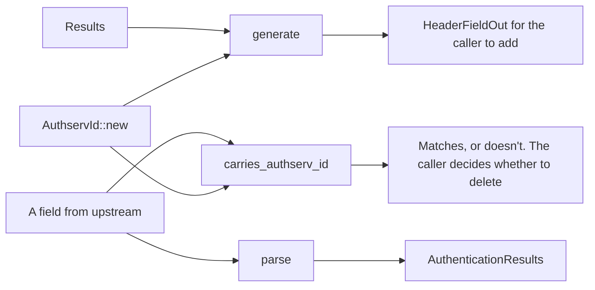

# Authentication-Results

The APIs that write an Authentication-Results header field from results, read one, and tell whether one carries the caller's authserv-id (RFC 8601).

## Contents

- [APIs](#apis)
- [Validation](#validation)
  - [`AuthservId::new`](#authservidnew)
  - [`AuthenticationResults::generate`](#authenticationresultsgenerate)
  - [`AuthenticationResults::parse`](#authenticationresultsparse)
  - [`AuthenticationResults::carries_authserv_id`](#authenticationresultscarries_authserv_id)

## APIs

| API | Takes | Gives | Requirements |
|---|---|---|---|
| `AuthservId::new` | Bytes | `AuthservId`, or `AuthResError` | AR-001 |
| `AuthenticationResults::generate` | `Results`, an `AuthservId` and a `FieldForm` | A `HeaderFieldOut` named Authentication-Results | AR-001, AR-002, AR-004, TIM-005, STR-009 |
| `AuthenticationResults::parse` | A field value and `Limits` | `AuthenticationResults`: the authserv-id, the version, and each result with its method, reason and properties, or `AuthResError` | AR-003, HDR-009 |
| `AuthenticationResults::carries_authserv_id` | A field value, an `AuthservId` and `Limits` | Whether the field carries that authserv-id, or `AuthResError` | AR-005 |

| Rule | Requirements |
|---|---|
| `generate` builds each `reason` and comment from the typed reasons, so it works at every trace level | AR-002 |
| `generate` writes `dkim2=none` for a message without DKIM2 fields, when the results hold DKIM2 | AR-004 |
| `generate` adds a comment that says time checks were off, when they were | TIM-005 |
| `carries_authserv_id` compares after converting A-labels to U-labels, as RFC 8601 §5 asks for internationalized messages, so a field that names the caller's ID in either form matches | AR-005 |
| hallmark deletes no field | AR-005, GEN-006 |

## Validation

### `AuthservId::new`

| ID | Input | Rule | Error code | Requirement | Scenario |
|---|---|---|---|---|---|
| VAL-701 | `id` | Matches `value` of RFC 2045 §5.1, a token or a quoted-string, with the UTF-8 of RFC 6532 | `authres.authserv_id_invalid` | AR-001, HDR-009, RFC 8601 §2.2 | API-701 |
| VAL-702 | `id` | Each A-label in it converts to a U-label | `authres.authserv_id_invalid` | AR-005, RFC 8601 §5 | API-702 |

### `AuthenticationResults::generate`

| ID | Input | Rule | Error code | Requirement | Scenario |
|---|---|---|---|---|---|
| | `results`, `id`, `form` | No rule: each is valid by its type | | AR-001 | ARH-008 |

### `AuthenticationResults::parse`

| ID | Input | Rule | Error code | Requirement | Scenario |
|---|---|---|---|---|---|
| VAL-710 | `value` | At most `header_field_size` octets | `authres.syntax`, naming the limit | SAF-002 | API-710 |
| VAL-711 | `value` | Matches `authres-payload` of RFC 8601 §2.2 | `authres.syntax`, with the rule and the offset | HDR-009, PAR-001 | ARH-001 to ARH-007 |
| VAL-712 | `value` | Comments nest at most `comment_depth` levels | `authres.syntax`, naming the limit | HDR-011 | API-712 |

### `AuthenticationResults::carries_authserv_id`

| ID | Input | Rule | Error code | Requirement | Scenario |
|---|---|---|---|---|---|
| VAL-720 | `value` | The rules of VAL-710 to VAL-712, up to the authserv-id | `authres.syntax` | AR-005 | API-720 |

A field whose authserv-id doesn't parse can't be matched. The error says so, and the caller decides what to do with the field (GEN-006).
