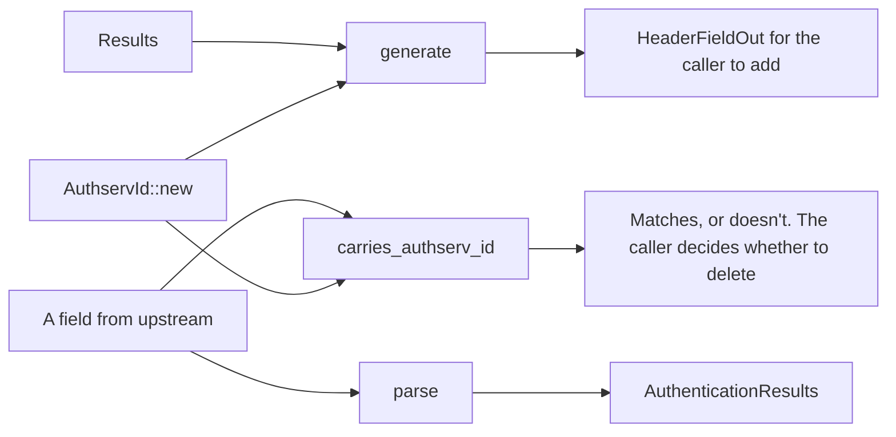

# Authentication-Results

The APIs that write an Authentication-Results header field from results, read one, and tell whether one carries the caller's authserv-id (RFC 8601).

## Contents

- [Flow](#flow)
- [Signatures](#signatures)
- [Parameters](#parameters)
- [Types](#types)
- [Validation](#validation)
  - [`AuthservId::new`](#authservidnew)
  - [`AuthenticationResults::generate`](#authenticationresultsgenerate)
  - [`AuthenticationResults::parse`](#authenticationresultsparse)
  - [`AuthenticationResults::carries_authserv_id`](#authenticationresultscarries_authserv_id)

## Flow

## Signatures

| API | Signature | Returns | Requirements |
|---|---|---|---|
| `AuthservId::new` | `fn new(id: &[u8]) -> Result<AuthservId, AuthResError>` | The caller's authserv-id | AR-001 |
| `AuthservId::as_bytes` | `fn as_bytes(&self) -> &[u8]` | The authserv-id as `new` took it | AR-001 |
| `AuthenticationResults::generate` | `fn generate(results: &Results, id: &AuthservId, form: FieldForm) -> HeaderFieldOut` | A field named Authentication-Results ([Results](results.md#signing)) | AR-001, AR-002, AR-004, TIM-005, STR-009 |
| `AuthenticationResults::parse` | `fn parse(value: &[u8], limits: &Limits) -> Result<AuthenticationResults, AuthResError>` | The parsed field | AR-003, HDR-009 |
| `AuthenticationResults::carries_authserv_id` | `fn carries_authserv_id(value: &[u8], id: &AuthservId, limits: &Limits) -> Result<bool, AuthResError>` | Whether the field carries that authserv-id | AR-005 |

## Parameters

| API | Parameter | Meaning and form |
|---|---|---|
| `AuthservId::new` | `id` | An authserv-id: a `value` of RFC 2045 §5.1, a token or a quoted-string, with the UTF-8 of RFC 6532 |
| `AuthenticationResults::generate` | `results` | The results of a check |
| `AuthenticationResults::generate`, `carries_authserv_id` | `id` | The caller's authserv-id |
| `AuthenticationResults::generate` | `form` | The form of the value ([FieldForm](options.md#fieldform)) |
| `AuthenticationResults::parse`, `carries_authserv_id` | `value` | The value of one Authentication-Results field: the octets after the colon, with any folds, without the line ending that ends the field |
| `AuthenticationResults::parse`, `carries_authserv_id` | `limits` | The limits that apply: `header_field_size` and `comment_depth` |

## Types

`AuthservId` has a private field, and `new` checks it. `AuthenticationResults` and the types it holds are built by `parse`, and are `#[non_exhaustive]` with public fields.

| Type | Field | Type | Meaning | Requirements |
|---|---|---|---|---|
| `AuthenticationResults` | `authserv_id` | `Vec<u8>` | The authserv-id, without the quotes of a quoted-string | HDR-009 |
| `AuthenticationResults` | `version` | `Option<String>` | `authres-version`, as its digits | RFC 8601 §2.2 |
| `AuthenticationResults` | `results` | `Vec<MethodResult>` | Each result, in order. Empty for `none` | RFC 8601 §2.2 |
| `MethodResult` | `method` | `String` | The method, such as `dkim` | RFC 8601 §2.2 |
| `MethodResult` | `method_version` | `Option<String>` | The method version, as its digits | RFC 8601 §2.2 |
| `MethodResult` | `result` | `String` | The result value, such as `pass` | RFC 8601 §2.2 |
| `MethodResult` | `reason` | `Option<Vec<u8>>` | The reason's value, without the quotes of a quoted-string | AR-002 |
| `MethodResult` | `properties` | `Vec<Property>` | Each property, in order | RFC 8601 §2.2 |
| `Property` | `ptype` | `String` | The property type, such as `header` | RFC 8601 §2.2 |
| `Property` | `property` | `String` | The property, such as `d` | RFC 8601 §2.2 |
| `Property` | `value` | `Vec<u8>` | The value, without the quotes of a quoted-string | RFC 8601 §2.2 |

Comments don't appear in these types.

| Rule | Requirements |
|---|---|
| `generate` builds each `reason` and comment from the typed reasons, so it works at every trace level | AR-002 |
| `generate` writes `dkim2=none` for a message without DKIM2 fields, when the results hold DKIM2 | AR-004 |
| `generate` adds a comment that says time checks were off, when they were | TIM-005 |
| `carries_authserv_id` compares after converting A-labels to U-labels, as RFC 8601 §5 asks for internationalized messages, so a field that names the caller's ID in either form matches | AR-005 |
| hallmark deletes no field | AR-005, GEN-006 |

## Validation

### `AuthservId::new`

| ID | Input | Rule | Error code | Requirement | Scenario |
|---|---|---|---|---|---|
| VAL-701 | `id` | Matches `value` of RFC 2045 §5.1, a token or a quoted-string, with the UTF-8 of RFC 6532 | `authres.authserv_id_invalid` | AR-001, HDR-009, RFC 8601 §2.2 | API-701 |
| VAL-702 | `id` | Each A-label in it converts to a U-label | `authres.authserv_id_invalid` | AR-005, RFC 8601 §5 | API-702 |

### `AuthenticationResults::generate`

| ID | Input | Rule | Error code | Requirement | Scenario |
|---|---|---|---|---|---|
| | `results`, `id`, `form` | No rule: each is valid by its type | | AR-001 | ARH-008 |

### `AuthenticationResults::parse`

| ID | Input | Rule | Error code | Requirement | Scenario |
|---|---|---|---|---|---|
| VAL-710 | `value` | At most `header_field_size` octets | `authres.syntax`, naming the limit | SAF-002 | API-710 |
| VAL-711 | `value` | Matches `authres-payload` of RFC 8601 §2.2 | `authres.syntax`, with the rule and the offset | HDR-009, PAR-001 | ARH-001 to ARH-007 |
| VAL-712 | `value` | Comments nest at most `comment_depth` levels | `authres.syntax`, naming the limit | HDR-011 | API-712 |

### `AuthenticationResults::carries_authserv_id`

| ID | Input | Rule | Error code | Requirement | Scenario |
|---|---|---|---|---|---|
| VAL-720 | `value` | The rules of VAL-710 to VAL-712, up to the authserv-id | `authres.syntax` | AR-005 | API-720 |

A field whose authserv-id doesn't parse can't be matched. The error says so, and the caller decides what to do with the field (GEN-006).
