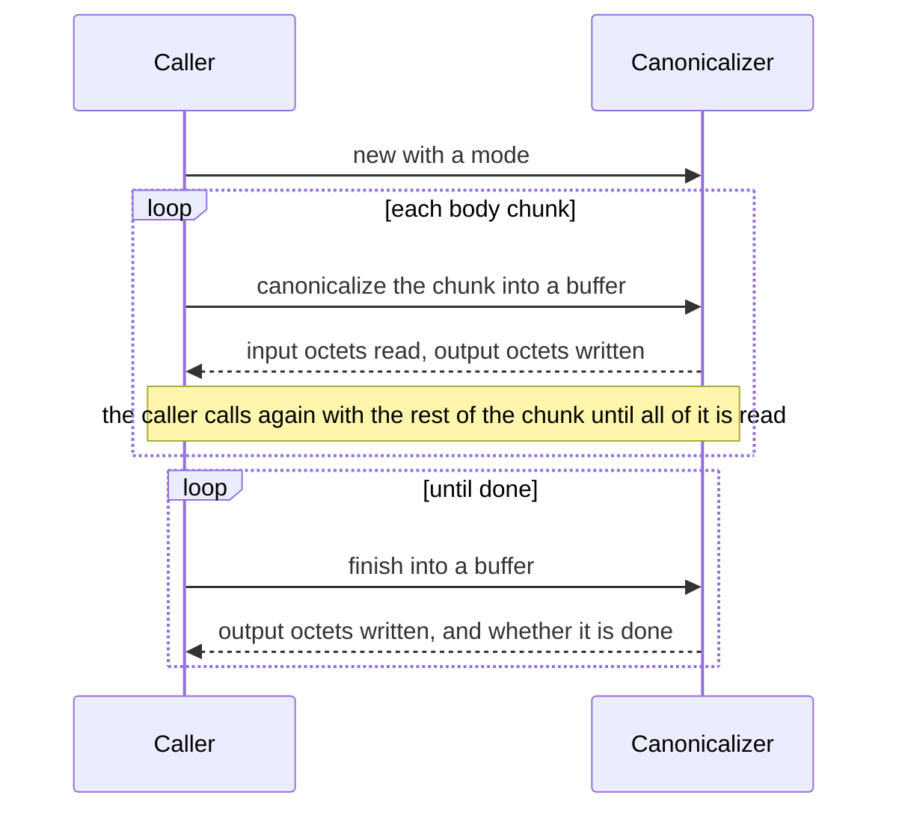

# Canonicalizer

`Canonicalizer` streams out the canonical body that a check hashes, for callers that want to see it, such as the demo (STR-012, [ADR 0041](../../adr/0041-the-trace-records-places-in-the-body-and-a-separate-api-streams-the-canonical-body.md)). It runs the same code as the checks and is separate from any check. [Lifecycle](../design/lifecycle.md#canonicalizer) gives its states.

## Contents

- [Flow](#flow)
- [Signatures](#signatures)
- [Parameters](#parameters)
- [Types](#types)
- [Validation](#validation)
  - [`Canonicalizer::new`](#canonicalizernew)
  - [`Canonicalizer::canonicalize`](#canonicalizercanonicalize)
  - [`Canonicalizer::finish`](#canonicalizerfinish)

## Flow

## Signatures

| API | Signature | Returns | Accepted in | Requirements |
|---|---|---|---|---|
| `Canonicalizer::new` | `fn new(mode: CanonicalizerMode, length: Option<u64>, rebuild: Option<Rebuild>, limits: &Limits) -> Result<Canonicalizer, CanonicalizerError>` | A canonicalizer in Streaming | | STR-012 |
| `Canonicalizer::canonicalize` | `fn canonicalize(&mut self, chunk: &[u8], output: &mut [u8]) -> Result<Progress, CanonicalizerError>` | How many octets of `chunk` it read and how many it wrote into `output` | Streaming | STR-001, STR-005 |
| `Canonicalizer::finish` | `fn finish(&mut self, output: &mut [u8]) -> Result<Finish, CanonicalizerError>` | How many octets it wrote into `output`, and whether the output is complete | Streaming, Ended | STR-012 |
| `Rebuild::new` | `fn new(version: u64, instances: Vec<Vec<u8>>) -> Rebuild`, with `unstable-dkim2` | The earlier version to rebuild | DK2-006 |

## Parameters

| API | Parameter | Meaning and form |
|---|---|---|
| `Canonicalizer::new` | `mode` | The canonical form to stream |
| `Canonicalizer::new` | `length` | The `l=` length in octets, to cut the canonical body at |
| `Canonicalizer::new` | `rebuild` | The earlier DKIM2 version to stream instead of the current body |
| `Canonicalizer::new` | `limits` | The limits that apply to the recipes: `message_instances`, `recipe_steps`, `recipe_size` and `recipe_depth` |
| `Canonicalizer::canonicalize` | `chunk` | The next body bytes, with CRLF line endings, cut anywhere (STR-011) |
| `Canonicalizer::canonicalize`, `Canonicalizer::finish` | `output` | Where the canonical bytes go, from the start of the buffer |
| `Rebuild::new` | `version` | The `m=` of the Message-Instance whose body to rebuild |
| `Rebuild::new` | `instances` | Message-Instance field values, each without the field name and the final CRLF, from the highest down to `version` |

## Types

| Type | Field or variant | Type or carries | Meaning | Requirements |
|---|---|---|---|---|
| `CanonicalizerMode` | `Simple` | Nothing | The body of RFC 6376 §3.4.3, cut at `length` if given | STR-012 |
| `CanonicalizerMode` | `Relaxed` | Nothing | The body of RFC 6376 §3.4.4, cut at `length` if given | STR-012 |
| `CanonicalizerMode` | `Dkim2` | Nothing | The DKIM2 body hash input of draft-09 §6.1, of the current body or of the version that `rebuild` names, with `unstable-dkim2` | STR-012, DK2-006 |
| `Rebuild` | `version` | `u64` | As `Rebuild::new` takes it | DK2-006 |
| `Rebuild` | `instances` | `Vec<Vec<u8>>` | As `Rebuild::new` takes it | DK2-006 |
| `Progress` | `read` | `usize` | Octets of `chunk` read, from its start | STR-001 |
| `Progress` | `written` | `usize` | Octets written into `output`, from its start | STR-003 |
| `Finish` | `written` | `usize` | Octets written into `output`, from its start | STR-003 |
| `Finish` | `complete` | `bool` | The output is complete, and later calls write nothing | STR-012 |

`CanonicalizerMode` is a `#[non_exhaustive]` enum, `Copy`. `Rebuild` is `#[non_exhaustive]` with public fields, built with `new`. `Progress` and `Finish` are `#[non_exhaustive]` with public fields, and hallmark builds them.

| Rule | Requirements |
|---|---|
| Between calls, the canonicalizer holds counts and flags of fixed size and no input octet | STR-001, STR-007 |
| The output doesn't depend on where the chunks are cut | STR-005 |
| A bare CR or LF is an octet of the body | STR-011 |
| A call that returns an error changes nothing. A canonicalizer that has reported a recipe error gives that error from then on | DK2-007 |

## Validation

### `Canonicalizer::new`

| ID | Input | Rule | Error code | Requirement | Scenario |
|---|---|---|---|---|---|
| VAL-601 | `length` | `Some` only with `Simple` or `Relaxed` | `canonicalizer.length_not_allowed` | STR-012, draft-09 §6.1 | API-601 |
| VAL-602 | `rebuild` | `Some` only with `Dkim2` | `canonicalizer.rebuild_not_allowed` | STR-012 | API-602 |
| VAL-603 | `rebuild` | Each Message-Instance value parses, at most `message_instances` of them | `canonicalizer.instance_invalid`, with the parse error | DK2-006, SAF-002 | API-603 |
| VAL-604 | `rebuild` | `version` is below the highest instance, and every instance from the highest down to `version` is given | `canonicalizer.instance_missing` | DK2-006 | API-604 |
| VAL-605 | `rebuild` | No recipe on the way is a null body recipe | `canonicalizer.null_recipe` | DK2-007 | API-605 |
| VAL-606 | `rebuild` | Each recipe keeps its `c` steps in ascending order without overlap, and stays within `recipe_steps`, `recipe_size` and `recipe_depth` | `canonicalizer.recipe_invalid`, with the step or the limit | DK2-007, SAF-002, draft-09 §5.2 | API-606 |

### `Canonicalizer::canonicalize`

| ID | Input | Rule | Error code | Requirement | Scenario |
|---|---|---|---|---|---|
| VAL-610 | The call | The canonicalizer is in Streaming | `canonicalizer.ended` | STR-012 | API-610 |
| VAL-611 | `output` | Holds at least 1 byte | `canonicalizer.buffer_empty` | STR-003 | API-611 |

### `Canonicalizer::finish`

| ID | Input | Rule | Error code | Requirement | Scenario |
|---|---|---|---|---|---|
| VAL-615 | `output` | Holds at least 1 byte | `canonicalizer.buffer_empty` | STR-003 | API-615 |
| VAL-616 | `rebuild` | Every line that a recipe copies lies within the body | `canonicalizer.recipe_invalid`, with the step | DK2-007 | API-616 |

The first call of `finish` moves the canonicalizer to Ended. Once the output is complete, `finish` writes nothing and gives `complete` as true.
