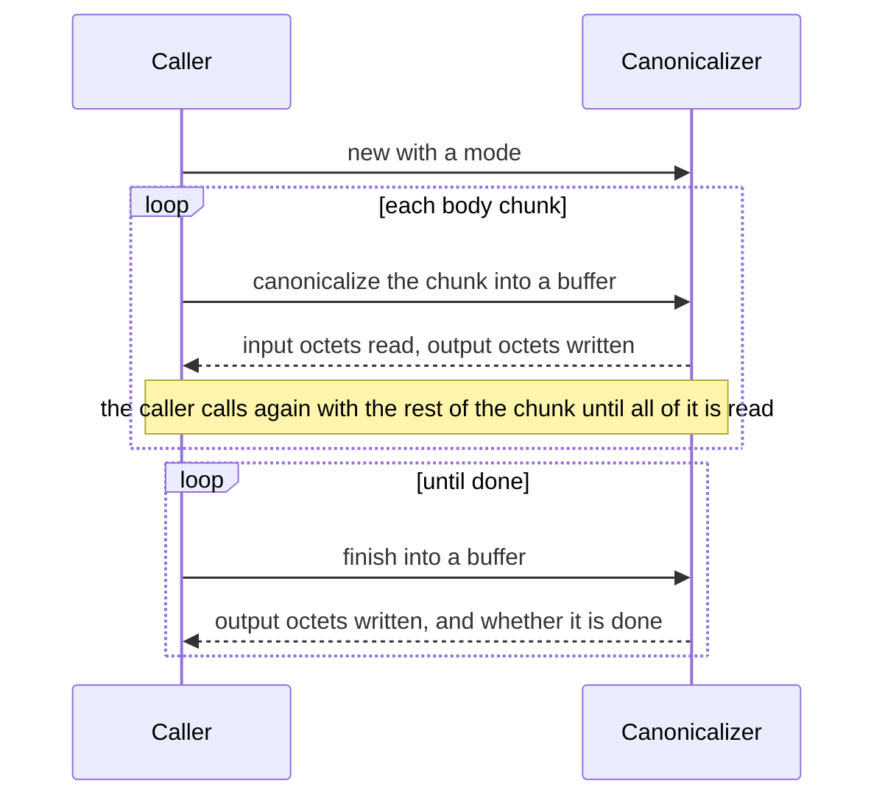

# Canonicalizer

`Canonicalizer` streams out the canonical body that a check hashes, for callers that want to see it, such as the demo (STR-012, [ADR 0041](../../adr/0041-the-trace-records-places-in-the-body-and-a-separate-api-streams-the-canonical-body.md)). It runs the same code as the checks and is separate from any check. [Lifecycle](../design/lifecycle.md#canonicalizer) gives its states.

## Contents

- [APIs](#apis)
- [Modes](#modes)
- [Validation](#validation)
  - [`Canonicalizer::new`](#canonicalizernew)
  - [`Canonicalizer::canonicalize`](#canonicalizercanonicalize)
  - [`Canonicalizer::finish`](#canonicalizerfinish)

## APIs

| API | Takes | Gives | Accepted in | Requirements |
|---|---|---|---|---|
| `Canonicalizer::new` | A mode, an optional `l=` length, an optional earlier DKIM2 version to rebuild, and `Limits` | A canonicalizer in Streaming, or `CanonicalizerError` | | STR-012 |
| `Canonicalizer::canonicalize` | A body chunk and an output buffer | The input octets read and the output octets written, or `CanonicalizerError` | Streaming | STR-001, STR-005 |
| `Canonicalizer::finish` | An output buffer | The output octets written and whether the output is complete, or `CanonicalizerError` | Streaming, Ended | STR-012 |

| Rule | Requirements |
|---|---|
| Between calls, the canonicalizer holds counts and flags of fixed size and no input octet | STR-001, STR-007 |
| The output doesn't depend on where the chunks are cut | STR-005 |
| A bare CR or LF is an octet of the body | STR-011 |
| A call that returns an error changes nothing. A canonicalizer that has reported a recipe error gives that error from then on | DK2-007 |

## Modes

| Mode | Output | Requirements |
|---|---|---|
| `simple` | The body of RFC 6376 §3.4.3, cut at `l=` if given | STR-012 |
| `relaxed` | The body of RFC 6376 §3.4.4, cut at `l=` if given | STR-012 |
| `dkim2` | The DKIM2 body hash input of draft-09 §6.1, with `unstable-dkim2` | STR-012 |
| `dkim2` with a rebuild | The DKIM2 body hash input of an earlier version, rebuilt by the recipes of the Message-Instance field values given, with `unstable-dkim2` | STR-012, DK2-006 |

## Validation

### `Canonicalizer::new`

| ID | Input | Rule | Error code | Requirement | Scenario |
|---|---|---|---|---|---|
| VAL-601 | `length` | Given only with `simple` or `relaxed` | `canonicalizer.length_not_allowed` | STR-012, draft-09 §6.1 | API-601 |
| VAL-602 | `rebuild` | Given only with `dkim2` | `canonicalizer.rebuild_not_allowed` | STR-012 | API-602 |
| VAL-603 | `rebuild` | Each Message-Instance value parses, at most `message_instances` of them | `canonicalizer.instance_invalid`, with the parse error | DK2-006, SAF-002 | API-603 |
| VAL-604 | `rebuild` | The version asked for is below the highest instance, and every instance between them is given | `canonicalizer.instance_missing` | DK2-006 | API-604 |
| VAL-605 | `rebuild` | No recipe on the way is a null body recipe | `canonicalizer.null_recipe` | DK2-007 | API-605 |
| VAL-606 | `rebuild` | Each recipe keeps its `c` steps in ascending order without overlap, and stays within `recipe_steps`, `recipe_size` and `recipe_depth` | `canonicalizer.recipe_invalid`, with the step or the limit | DK2-007, SAF-002, draft-09 §5.2 | API-606 |

### `Canonicalizer::canonicalize`

| ID | Input | Rule | Error code | Requirement | Scenario |
|---|---|---|---|---|---|
| VAL-610 | The call | The canonicalizer is in Streaming | `canonicalizer.ended` | STR-012 | API-610 |
| VAL-611 | `output` | Holds at least 1 byte | `canonicalizer.buffer_empty` | STR-003 | API-611 |

### `Canonicalizer::finish`

| ID | Input | Rule | Error code | Requirement | Scenario |
|---|---|---|---|---|---|
| VAL-615 | `output` | Holds at least 1 byte | `canonicalizer.buffer_empty` | STR-003 | API-615 |
| VAL-616 | `rebuild` | Every line that a recipe copies lies within the body | `canonicalizer.recipe_invalid`, with the step | DK2-007 | API-616 |

Once the output is complete, `finish` writes nothing and says it is done.
