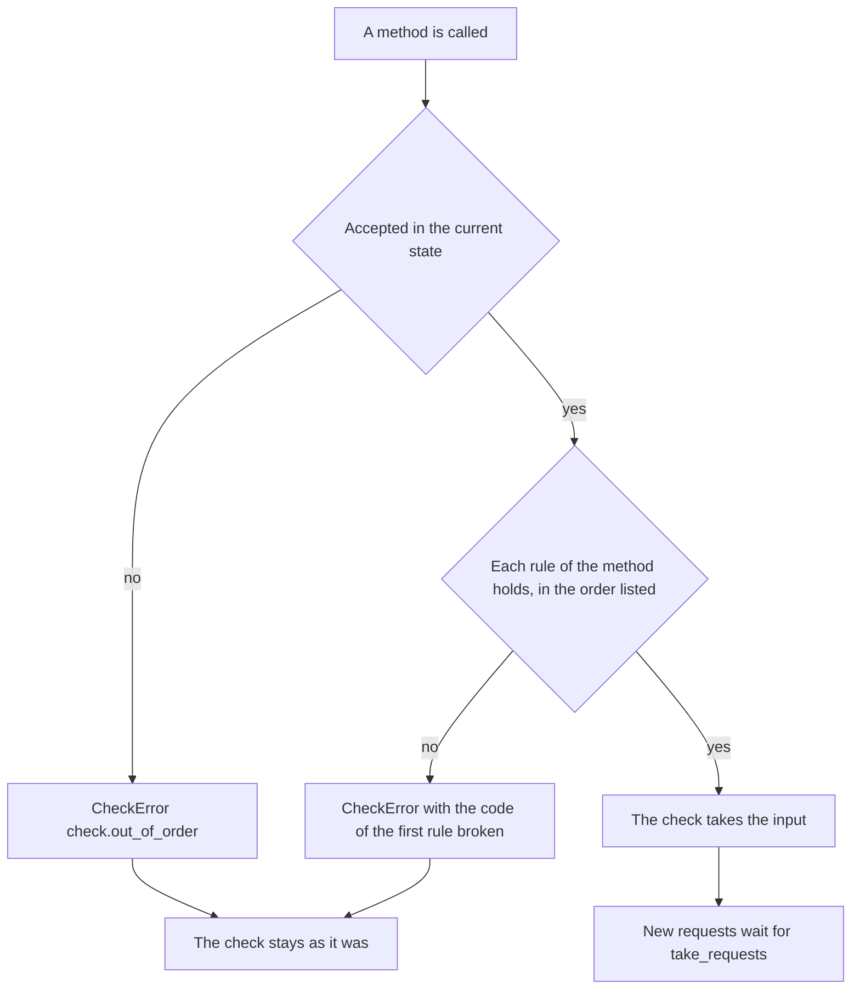

# Check

`Check` is the one type that a caller creates and feeds ([ADR 0047](../../adr/0047-one-check-type-runs-any-set-of-checks-and-shares-their-dns-answers.md)). This page gives each method, the states it accepts and its validation rules. [Lifecycle](../design/lifecycle.md#check) draws the states, and [Errors](errors.md) lists the codes.

## Contents

- [Methods](#methods)
- [How a call is checked](#how-a-call-is-checked)
- [Envelope](#envelope)
- [Validation](#validation)
  - [`Check::new`](#checknew)
  - [`Check::envelope`](#checkenvelope)
  - [`Check::header_field`](#checkheader_field)
  - [`Check::end_of_header_fields`](#checkend_of_header_fields)
  - [`Check::header_section`](#checkheader_section)
  - [`Check::whole_message`](#checkwhole_message)
  - [`Check::body_chunk`](#checkbody_chunk)
  - [`Check::end_of_message`](#checkend_of_message)
  - [`Check::take_requests`](#checktake_requests)
  - [`Check::answer`](#checkanswer)
  - [`Check::answer_suffix`](#checkanswer_suffix)
  - [`Check::answer_signing`](#checkanswer_signing)
  - [`Check::read_trace`](#checkread_trace)
  - [`Check::waiting`](#checkwaiting)
  - [`Check::take_results`](#checktake_results)
  - [`Check::options`](#checkoptions)

## Methods

| Method | Takes | Gives | Accepted in | Requirements |
|---|---|---|---|---|
| `Check::new` | `Options` ([Options](options.md)) | A `Check` in Created, or `OptionsError` | | GEN-001, PAR-004 |
| `Check::envelope` | `Envelope` | Nothing, or `CheckError` | Created | CHK-001, GEN-002 |
| `Check::header_field` | A field name and a value, as bytes, in the form that `field_form` states | Nothing, or `CheckError` | Envelope, Headers | STR-008, HDR-005 |
| `Check::end_of_header_fields` | Nothing | Nothing, or `CheckError` | Envelope, Headers | CHK-001 |
| `Check::header_section` | The raw header section, as bytes | Nothing, or `CheckError` | Envelope | HDR-001 |
| `Check::whole_message` | The header section and the body, as bytes | Nothing, or `CheckError` | Envelope | GEN-003 |
| `Check::body_chunk` | Body bytes, any number from 0 | Nothing, or `CheckError` | Body | STR-001, STR-007 |
| `Check::end_of_message` | Nothing | Nothing, or `CheckError` | Body | CHK-001 |
| `Check::take_requests` | Nothing | The requests that appeared since the last call, in the order they appeared | Every state | CHK-001 |
| `Check::answer` | `QuestionId`, `Answer` ([DNS](dns.md)) | Nothing, or `CheckError` | Every state | DNS-002, DNS-007 |
| `Check::answer_suffix` | `QuestionId`, `SuffixAnswer` ([DNS](dns.md#suffix-questions-and-answers)) | Nothing, or `CheckError` | Every state | DMC-010 |
| `Check::answer_signing` | `RequestId`, and a `Signature` or a `SignerFailure` ([Signing](signing.md)) | Nothing, or `CheckError` | Every state | SGN-004 |
| `Check::read_trace` | A buffer to write into | `TraceRead`: the bytes written, and whether the trace is complete | Every state | TRC-004, STR-002 |
| `Check::waiting` | Nothing | `Waiting`: the input the check still expects and the IDs of the open requests | Every state | CHK-002 |
| `Check::take_results` | Nothing | `Results` ([Results](results.md)), or `CheckError` | Every state, giving results only in Finished | CHK-002 |
| `Check::options` | Nothing | The options the check was created with | Every state | INV-015 |

Every method that changes a check takes it by unique reference ([Concurrency](../design/concurrency.md#inside-one-check)).

## How a call is checked

| Rule | Requirements |
|---|---|
| A method that returns an error changes nothing in the check, and the caller can go on | CHK-004, INV-003 |
| A caller error never becomes a protocol result, and a protocol result never comes back as an error | INV-010 |
| A rule whose error code reads "Not an error" never stops the call. The check takes the input and applies the rule named | CHK-004 |
| Syntax inside the message, the envelope and DNS records is no caller error. The parsers read it, and the check applies the rule of the requirement that covers it | PAR-001, ADS-020 to ADS-023 |

## Envelope

| Field | Type | Meaning | Requirements |
|---|---|---|---|
| `client_ip` | IPv4 or IPv6 address, optional | The SMTP client's address | GEN-002, RFC 7208 §4.1 |
| `helo` | Bytes, optional | The HELO or EHLO name as the client sent it | ADS-022 |
| `mail_from` | Bytes, optional | The reverse-path with its angle brackets and without Mail-parameters, `<>` included | ADS-020 |
| `rcpt_to` | List of bytes | Each forward-path with its angle brackets and without Rcpt-parameters | ADS-021 |

A check whose kinds need no envelope part, such as DKIM alone, takes an envelope with every field empty. A check whose kinds are all SPF is in Ended once it takes the envelope, so it refuses message input with `check.out_of_order` ([Lifecycle](../design/lifecycle.md#check)).

## Validation

### `Check::new`

| ID | Input | Rule | Error code | Requirement | Scenario |
|---|---|---|---|---|---|
| | `options` | Every rule of [Options](options.md#validation-at-checknew), VAL-210 to VAL-242, in that order | The code of the first rule broken | GEN-001, PAR-004 | See each rule |

### `Check::envelope`

| ID | Input | Rule | Error code | Requirement | Scenario |
|---|---|---|---|---|---|
| VAL-101 | The call | The check is in Created | `check.out_of_order` | CHK-004 | API-101 |
| VAL-102 | `client_ip` | Present when the kinds hold SPF HELO or SPF MAIL FROM | `check.envelope_incomplete` | GEN-002, RFC 7208 §4.1 | API-102 |
| VAL-103 | `helo` | Present when the kinds hold SPF HELO, or hold SPF MAIL FROM and `mail_from` is `<>` | `check.envelope_incomplete` | ADS-023, RFC 7208 §2.4 | API-103 |
| VAL-104 | `mail_from` | Present when the kinds hold SPF MAIL FROM or DKIM2 | `check.envelope_incomplete` | GEN-002, draft-09 §14.4 | API-104 |
| VAL-105 | `rcpt_to` | At least one path when the kinds hold DKIM2 | `check.envelope_incomplete` | GEN-002, draft-09 §14.4 | API-105 |
| VAL-106 | `rcpt_to` | At most `rcpt_to` paths ([Limits](../design/limits.md#limits-of-a-check)) | `check.rcpt_to_limit` | SAF-004 | API-106 |

The syntax of `helo`, `mail_from` and each `rcpt_to` path is not checked here. A malformed one gets the rule of ADS-020 to ADS-023, and the trace records the parse error.

### `Check::header_field`

| ID | Input | Rule | Error code | Requirement | Scenario |
|---|---|---|---|---|---|
| VAL-107 | The call | The check is in Envelope or Headers | `check.out_of_order` | CHK-004 | API-107 |

The check rebuilds the raw bytes from the name, the value and `field_form`, and reads them with the parser of a raw header section (HDR-005, FLD-060). A name that isn't a field name gives a malformed line, as it would in a raw header section (HDR-004). A bare CR or LF in the value, outside the line breaks that `field_form` states, stays an octet of the field (HDR-012). A field over `header_field_size` reaches that limit ([Limits](../design/limits.md#limits-of-a-check)).

### `Check::end_of_header_fields`

| ID | Input | Rule | Error code | Requirement | Scenario |
|---|---|---|---|---|---|
| VAL-108 | The call | The check is in Envelope or Headers | `check.out_of_order` | CHK-004 | API-108 |

### `Check::header_section`

| ID | Input | Rule | Error code | Requirement | Scenario |
|---|---|---|---|---|---|
| VAL-109 | The call | The check is in Envelope | `check.out_of_order` | CHK-004 | API-109 |
| VAL-110 | `raw` | No empty line before its last line. The empty line that ends the header section may be its last line, or may be left out | `check.body_in_header_section` | HDR-001 | API-110 |

### `Check::whole_message`

| ID | Input | Rule | Error code | Requirement | Scenario |
|---|---|---|---|---|---|
| VAL-111 | The call | The check is in Envelope | `check.out_of_order` | CHK-004 | API-111 |

The check splits the input at the first empty line (HDR-001). Input with no empty line is a header section with no body, which still has a body hash (CHK-001).

### `Check::body_chunk`

| ID | Input | Rule | Error code | Requirement | Scenario |
|---|---|---|---|---|---|
| VAL-112 | The call | The check is in Body | `check.out_of_order` | CHK-004 | RUN-005 |

### `Check::end_of_message`

| ID | Input | Rule | Error code | Requirement | Scenario |
|---|---|---|---|---|---|
| VAL-113 | The call | The check is in Body | `check.out_of_order` | CHK-004 | API-113 |

### `Check::take_requests`

| ID | Input | Rule | Error code | Requirement | Scenario |
|---|---|---|---|---|---|
| | None | No rule: the method takes no input | | CHK-001 | RUN-001 |

Each request it gives moves from Waiting to Taken ([Lifecycle](../design/lifecycle.md#requests)).

### `Check::answer`

| ID | Input | Rule | Error code | Requirement | Scenario |
|---|---|---|---|---|---|
| VAL-120 | `id` | Names a DNS question that `take_requests` gave | `check.unknown_question` | CHK-004 | RUN-006 |
| VAL-121 | `id` | The question has no answer yet | `check.already_answered` | CHK-004 | RUN-007 |
| VAL-122 | `answer` | Every record has the question's type | `check.answer_type_mismatch` | DNS-006 | API-122 |
| VAL-123 | `answer` | An answer with records holds at least one | `check.answer_malformed` | DNS-002 | API-123 |
| VAL-124 | `answer` | Each TXT string holds at most 255 octets | `check.answer_malformed` | DNS-006, RFC 1035 §3.3 | API-124 |
| VAL-125 | `answer` | The record data and the description hold at most `answer_size` octets in total | Not an error: the check takes the answer as a temporary failure that names the limit | SAF-004, GEN-005 | API-125 |

### `Check::answer_suffix`

| ID | Input | Rule | Error code | Requirement | Scenario |
|---|---|---|---|---|---|
| VAL-130 | `id` | Names a public suffix question that `take_requests` gave | `check.unknown_question` | CHK-004 | API-130 |
| VAL-131 | `id` | The question has no answer yet | `check.already_answered` | CHK-004 | API-131 |
| VAL-132 | `answer` | A suffix answer has from 1 to as many labels as the domain | `check.suffix_out_of_range` | DMC-011 | DMR-067 |
| VAL-133 | `answer` | A list name is UTF-8 of 1 to 256 octets | `check.list_name_invalid` | DMC-010, RFC 7493 §2.1 | API-133 |

### `Check::answer_signing`

| ID | Input | Rule | Error code | Requirement | Scenario |
|---|---|---|---|---|---|
| VAL-140 | `id` | Names a signing request that `take_requests` gave | `check.unknown_request` | CHK-004 | API-140 |
| VAL-141 | `id` | The request has no answer yet | `check.already_answered` | CHK-004 | API-141 |
| VAL-142 | The signature | It has the size that its algorithm and the stated key give | Not an error: signing stops with `signing.wrong_size` in the results | SGN-004 | SIGN-007 |
| VAL-143 | The signature | It verifies with the stated public key, when `verify_signatures` is on | Not an error: signing stops with `signing.not_verified` in the results | SGN-006 | SIGN-016 |

A `SignerFailure` stops that signing with `signing.signer_failed` in the results (SGN-004, SIGN-008). The check keeps the failure's description for the error and writes none of it into the trace.

### `Check::read_trace`

| ID | Input | Rule | Error code | Requirement | Scenario |
|---|---|---|---|---|---|
| VAL-150 | `buffer` | Holds at least 1 byte | `check.buffer_empty` | STR-002 | API-150 |

`TraceRead` says the trace is complete once the check is Finished and the caller has read every byte. At the off level, the trace is complete as soon as the check is Finished, with no byte to read (TRC-004).

### `Check::waiting`

| ID | Input | Rule | Error code | Requirement | Scenario |
|---|---|---|---|---|---|
| | None | No rule: the method takes no input | | CHK-002 | RUN-003 |

### `Check::take_results`

| ID | Input | Rule | Error code | Requirement | Scenario |
|---|---|---|---|---|---|
| VAL-160 | The call | The check is Finished | `check.not_finished`, which carries `Waiting` | CHK-002 | RUN-003 |
| VAL-161 | The call | The results haven't been taken | `check.results_taken` | CHK-002 | API-161 |

The trace stays readable after the results are taken.

### `Check::options`

| ID | Input | Rule | Error code | Requirement | Scenario |
|---|---|---|---|---|---|
| | None | No rule: the method takes no input | | INV-015 | SIGN-018 |
