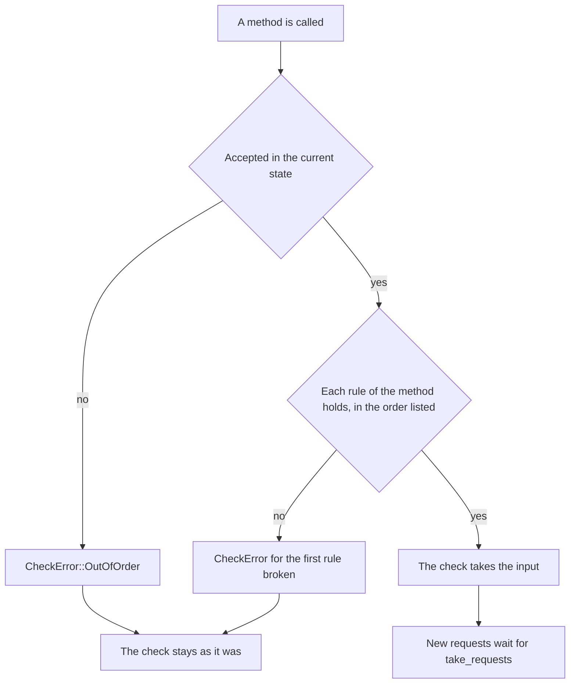

# Check

`Check` is the one type that a caller creates and feeds ([ADR 0047](../../adr/0047-one-check-type-runs-any-set-of-checks-and-shares-their-dns-answers.md)). This page gives each method with its signature, the states it accepts, the types it takes and gives, and its validation rules. [Lifecycle](../design/lifecycle.md#check) draws the states, and [Errors](errors.md) lists the codes.

## Contents

- [Signatures](#signatures)
- [Parameters](#parameters)
- [How a call is checked](#how-a-call-is-checked)
- [Types](#types)
  - [`Envelope`](#envelope)
  - [`Request`](#request)
  - [`QuestionId` and `RequestId`](#questionid-and-requestid)
  - [`TraceRead`](#traceread)
  - [`Waiting` and `ExpectedInput`](#waiting-and-expectedinput)
- [Validation](#validation)
  - [`Check::new`](#checknew)
  - [`Check::envelope`](#checkenvelope)
  - [`Check::header_field`](#checkheader_field)
  - [`Check::end_of_header_fields`](#checkend_of_header_fields)
  - [`Check::header_section`](#checkheader_section)
  - [`Check::whole_message`](#checkwhole_message)
  - [`Check::body_chunk`](#checkbody_chunk)
  - [`Check::end_of_message`](#checkend_of_message)
  - [`Check::take_requests`](#checktake_requests)
  - [`Check::answer`](#checkanswer)
  - [`Check::answer_suffix`](#checkanswer_suffix)
  - [`Check::answer_signing`](#checkanswer_signing)
  - [`Check::read_trace`](#checkread_trace)
  - [`Check::waiting`](#checkwaiting)
  - [`Check::take_results`](#checktake_results)
  - [`Check::options`](#checkoptions)

## Signatures

| API | Signature | Returns | Accepted in | Requirements |
|---|---|---|---|---|
| `Check::new` | `fn new(options: Options) -> Result<Check, OptionsError>` | A check in Created | | GEN-001, PAR-004 |
| `Check::envelope` | `fn envelope(&mut self, envelope: Envelope) -> Result<(), CheckError>` | Nothing | Created | CHK-001, GEN-002 |
| `Check::header_field` | `fn header_field(&mut self, name: &[u8], value: &[u8]) -> Result<(), CheckError>` | Nothing | Envelope, Headers | STR-008, HDR-005 |
| `Check::end_of_header_fields` | `fn end_of_header_fields(&mut self) -> Result<(), CheckError>` | Nothing | Envelope, Headers | CHK-001 |
| `Check::header_section` | `fn header_section(&mut self, raw: &[u8]) -> Result<(), CheckError>` | Nothing | Envelope | HDR-001 |
| `Check::whole_message` | `fn whole_message(&mut self, message: &[u8]) -> Result<(), CheckError>` | Nothing | Envelope | GEN-003 |
| `Check::body_chunk` | `fn body_chunk(&mut self, chunk: &[u8]) -> Result<(), CheckError>` | Nothing | Body | STR-001, STR-007 |
| `Check::end_of_message` | `fn end_of_message(&mut self) -> Result<(), CheckError>` | Nothing | Body | CHK-001 |
| `Check::take_requests` | `fn take_requests(&mut self) -> Vec<Request>` | The requests that appeared since the last call, in the order they appeared | Every state | CHK-001 |
| `Check::answer` | `fn answer(&mut self, id: QuestionId, answer: Answer) -> Result<(), CheckError>` | Nothing | Every state | DNS-002, DNS-007 |
| `Check::answer_suffix` | `fn answer_suffix(&mut self, id: QuestionId, answer: SuffixAnswer) -> Result<(), CheckError>` | Nothing | Every state | DMC-010 |
| `Check::answer_signing` | `fn answer_signing(&mut self, id: RequestId, answer: Result<Signature, SignerFailure>) -> Result<(), CheckError>` | Nothing | Every state | SGN-004 |
| `Check::read_trace` | `fn read_trace(&mut self, buffer: &mut [u8]) -> Result<TraceRead, CheckError>` | How many bytes it wrote into `buffer`, and whether the trace is complete | Every state | TRC-004, STR-002 |
| `Check::waiting` | `fn waiting(&self) -> Waiting` | The input the check still expects and the IDs of its open requests | Every state | CHK-002 |
| `Check::take_results` | `fn take_results(&mut self) -> Result<Results, CheckError>` | The results ([Results](results.md)) | Every state, giving results only in Finished | CHK-002 |
| `Check::options` | `fn options(&self) -> &Options` | The options the check was created with | Every state | INV-015 |

Every method that changes a check takes it by `&mut self`, so a check takes one call at a time ([Concurrency](../design/concurrency.md#inside-one-check)). No method keeps a reference into a byte slice it takes after it returns (STR-007, INV-004).

## Parameters

| API | Parameter | Meaning and form |
|---|---|---|
| `Check::new` | `options` | The options, which the check keeps unchanged ([Options](options.md)) |
| `Check::envelope` | `envelope` | The SMTP envelope ([Envelope](#envelope)) |
| `Check::header_field` | `name` | One field name as a milter receives it: the octets before the colon, without the colon |
| `Check::header_field` | `value` | That field's value in the form `options.field_form` states ([FieldForm](options.md#fieldform)), without the line ending that ends the field |
| `Check::header_section` | `raw` | The raw header section with CRLF line endings: every header field, then the empty line that ends the section, which may be left out |
| `Check::whole_message` | `message` | The whole message with CRLF line endings: the header section, the empty line and the body |
| `Check::body_chunk` | `chunk` | The next body bytes, any number from 0, cut anywhere. The body has CRLF line endings, and a CRLF may span two chunks (STR-011) |
| `Check::answer` | `id` | The ID of a DNS question from `take_requests` |
| `Check::answer` | `answer` | Its answer ([DNS](dns.md#answers)) |
| `Check::answer_suffix` | `id` | The ID of a public suffix question from `take_requests` |
| `Check::answer_suffix` | `answer` | Its answer ([DNS](dns.md#suffix-questions-and-answers)) |
| `Check::answer_signing` | `id` | The ID of a signing request from `take_requests` |
| `Check::answer_signing` | `answer` | `Ok` with the signature the signer made, or `Err` with the signer's failure ([Signing](signing.md#types)) |
| `Check::read_trace` | `buffer` | Where the check writes the next trace bytes, from the start of the buffer |

## How a call is checked

| Rule | Requirements |
|---|---|
| A method that returns an error changes nothing in the check, and the caller can go on | CHK-004, INV-003 |
| A caller error never becomes a protocol result, and a protocol result never comes back as an error | INV-010 |
| A rule whose error code reads "Not an error" never stops the call. The check takes the input and applies the rule named | CHK-004 |
| Syntax inside the message, the envelope and DNS records is no caller error. The parsers read it, and the check applies the rule of the requirement that covers it | PAR-001, ADS-020 to ADS-023 |

## Types

### `Envelope`

`Envelope` is `#[non_exhaustive]` with public fields, and implements `Default` with every field empty. The caller starts from `Envelope::default()` and sets the fields its kinds need.

| Field | Type | Meaning | Requirements |
|---|---|---|---|
| `client_ip` | `Option<IpAddr>` | The SMTP client's address | GEN-002, RFC 7208 §4.1 |
| `helo` | `Option<Vec<u8>>` | The HELO or EHLO name as the client sent it | ADS-022 |
| `mail_from` | `Option<Vec<u8>>` | The reverse-path with its angle brackets and without Mail-parameters, `<>` included | ADS-020 |
| `rcpt_to` | `Vec<Vec<u8>>` | Each forward-path with its angle brackets and without Rcpt-parameters | ADS-021 |

A check whose kinds need no envelope part, such as DKIM alone, takes `Envelope::default()`. A check whose kinds are all SPF is in Ended once it takes the envelope, so it refuses message input with `check.out_of_order` ([Lifecycle](../design/lifecycle.md#check)).

### `Request`

`Request` is a `#[non_exhaustive]` enum. Each value is one thing the check needs from the caller.

| Variant | Carries | Meaning | Requirements |
|---|---|---|---|
| `Question` | `Question` ([DNS](dns.md#questions)) | A DNS question, for `Check::answer` | DNS-001 |
| `Suffix` | `SuffixQuestion` ([DNS](dns.md#suffix-questions-and-answers)) | A public suffix question, for `Check::answer_suffix` | DMC-010 |
| `Signing` | `SigningRequest` ([Signing](signing.md#types)) | A signature to make, for `Check::answer_signing` | SGN-002 |

### `QuestionId` and `RequestId`

Both are `Copy`, `Eq`, `Ord` and `Hash`, and have no public field or constructor: the caller gets them only from requests.

| Type | Names | Unique within | Requirements |
|---|---|---|---|
| `QuestionId` | A DNS question or a public suffix question. The two kinds share one ID space | The check | DNS-007, INV-002 |
| `RequestId` | A signing request | The check | CHK-004 |

A check numbers its requests in the order they appear, so an ID depends on when a question was asked, and the trace never shows it (TRC-008).

### `TraceRead`

`TraceRead` is `#[non_exhaustive]` with public fields.

| Field | Type | Meaning | Requirements |
|---|---|---|---|
| `written` | `usize` | The bytes written into `buffer`, from its start. 0 when the check has no new byte yet | STR-002 |
| `complete` | `bool` | The check is Finished and every trace byte has been read. At the off level, true as soon as the check is Finished | TRC-004 |

### `Waiting` and `ExpectedInput`

`Waiting` is `#[non_exhaustive]` with public fields.

| Field | Type | Meaning | Requirements |
|---|---|---|---|
| `input` | `Option<ExpectedInput>` | The message input the check still expects, or `None` in Ended and Finished | CHK-002 |
| `questions` | `Vec<QuestionId>` | The DNS and public suffix questions without an answer, waiting or taken, in the order they appeared | CHK-002 |
| `signing` | `Vec<RequestId>` | The signing requests without an answer, waiting or taken, in the order they appeared | CHK-002 |

`ExpectedInput` is an exhaustive enum, `Copy`.

| Variant | State | Calls it accepts |
|---|---|---|
| `Envelope` | Created | `envelope` |
| `Header` | Envelope | `header_field`, `end_of_header_fields`, `header_section`, `whole_message` |
| `MoreHeaderFields` | Headers | `header_field`, `end_of_header_fields` |
| `Body` | Body | `body_chunk`, `end_of_message` |

## Validation

### `Check::new`

| ID | Input | Rule | Error code | Requirement | Scenario |
|---|---|---|---|---|---|
| | `options` | Every rule of [Options](options.md#validation-at-checknew), VAL-210 to VAL-242, in that order | The code of the first rule broken | GEN-001, PAR-004 | See each rule |

### `Check::envelope`

| ID | Input | Rule | Error code | Requirement | Scenario |
|---|---|---|---|---|---|
| VAL-101 | The call | The check is in Created | `check.out_of_order` | CHK-004 | API-101 |
| VAL-102 | `client_ip` | `Some` when the kinds hold `SpfHelo` or `SpfMailFrom` | `check.envelope_incomplete` | GEN-002, RFC 7208 §4.1 | API-102 |
| VAL-103 | `helo` | `Some` when the kinds hold `SpfHelo`, or hold `SpfMailFrom` and `mail_from` is `<>` | `check.envelope_incomplete` | ADS-023, RFC 7208 §2.4 | API-103 |
| VAL-104 | `mail_from` | `Some` when the kinds hold `SpfMailFrom` or `Dkim2` | `check.envelope_incomplete` | GEN-002, draft-09 §14.4 | API-104 |
| VAL-105 | `rcpt_to` | At least one path when the kinds hold `Dkim2` | `check.envelope_incomplete` | GEN-002, draft-09 §14.4 | API-105 |
| VAL-106 | `rcpt_to` | At most `rcpt_to` paths ([Limits](../design/limits.md#limits-of-a-check)) | `check.rcpt_to_limit` | SAF-004 | API-106 |

The syntax of `helo`, `mail_from` and each `rcpt_to` path is not checked here. A malformed one gets the rule of ADS-020 to ADS-023, and the trace records the parse error.

### `Check::header_field`

| ID | Input | Rule | Error code | Requirement | Scenario |
|---|---|---|---|---|---|
| VAL-107 | The call | The check is in Envelope or Headers | `check.out_of_order` | CHK-004 | API-107 |

The check rebuilds the raw bytes from `name`, a colon, `value` and `field_form`, and reads them with the parser of a raw header section (HDR-005, FLD-060). A `name` that isn't a field name gives a malformed line, as it would in a raw header section (HDR-004). A bare CR or LF in `value`, outside the folds that `field_form` states, stays an octet of the field (HDR-012). A field over `header_field_size` reaches that limit ([Limits](../design/limits.md#limits-of-a-check)).

### `Check::end_of_header_fields`

| ID | Input | Rule | Error code | Requirement | Scenario |
|---|---|---|---|---|---|
| VAL-108 | The call | The check is in Envelope or Headers | `check.out_of_order` | CHK-004 | API-108 |

### `Check::header_section`

| ID | Input | Rule | Error code | Requirement | Scenario |
|---|---|---|---|---|---|
| VAL-109 | The call | The check is in Envelope | `check.out_of_order` | CHK-004 | API-109 |
| VAL-110 | `raw` | No empty line before its last line. The empty line that ends the header section may be its last line, or may be left out | `check.body_in_header_section` | HDR-001 | API-110 |

### `Check::whole_message`

| ID | Input | Rule | Error code | Requirement | Scenario |
|---|---|---|---|---|---|
| VAL-111 | The call | The check is in Envelope | `check.out_of_order` | CHK-004 | API-111 |

The check splits `message` at the first empty line (HDR-001). Input with no empty line is a header section with no body, which still has a body hash (CHK-001).

### `Check::body_chunk`

| ID | Input | Rule | Error code | Requirement | Scenario |
|---|---|---|---|---|---|
| VAL-112 | The call | The check is in Body | `check.out_of_order` | CHK-004 | RUN-005 |

### `Check::end_of_message`

| ID | Input | Rule | Error code | Requirement | Scenario |
|---|---|---|---|---|---|
| VAL-113 | The call | The check is in Body | `check.out_of_order` | CHK-004 | API-113 |

### `Check::take_requests`

| ID | Input | Rule | Error code | Requirement | Scenario |
|---|---|---|---|---|---|
| | None | No rule: the method takes no input | | CHK-001 | RUN-001 |

Each request it gives moves from Waiting to Taken ([Lifecycle](../design/lifecycle.md#requests)). A call with no new request gives an empty list.

### `Check::answer`

| ID | Input | Rule | Error code | Requirement | Scenario |
|---|---|---|---|---|---|
| VAL-120 | `id` | Names a DNS question that `take_requests` gave | `check.unknown_question` | CHK-004 | RUN-006 |
| VAL-121 | `id` | The question has no answer yet | `check.already_answered` | CHK-004 | RUN-007 |
| VAL-122 | `answer` | Every record has the question's type | `check.answer_type_mismatch` | DNS-006 | API-122 |
| VAL-123 | `answer` | `Answer::Records` holds at least one record | `check.answer_malformed` | DNS-002 | API-123 |
| VAL-124 | `answer` | Each TXT string holds at most 255 octets | `check.answer_malformed` | DNS-006, RFC 1035 §3.3 | API-124 |
| VAL-125 | `answer` | The record data and the description hold at most `answer_size` octets in total | Not an error: the check takes the answer as a temporary failure that names the limit | SAF-004, GEN-005 | API-125 |

### `Check::answer_suffix`

| ID | Input | Rule | Error code | Requirement | Scenario |
|---|---|---|---|---|---|
| VAL-130 | `id` | Names a public suffix question that `take_requests` gave | `check.unknown_question` | CHK-004 | API-130 |
| VAL-131 | `id` | The question has no answer yet | `check.already_answered` | CHK-004 | API-131 |
| VAL-132 | `answer` | `labels` is from 1 to the number of labels in the question's domain | `check.suffix_out_of_range` | DMC-011 | DMR-067 |
| VAL-133 | `answer` | `list`, when given, holds 1 to 256 octets | `check.list_name_invalid` | DMC-010, RFC 7493 §2.1 | API-133 |

### `Check::answer_signing`

| ID | Input | Rule | Error code | Requirement | Scenario |
|---|---|---|---|---|---|
| VAL-140 | `id` | Names a signing request that `take_requests` gave | `check.unknown_request` | CHK-004 | API-140 |
| VAL-141 | `id` | The request has no answer yet | `check.already_answered` | CHK-004 | API-141 |
| VAL-142 | `answer` | An `Ok` signature has the size that its algorithm and the stated key give | Not an error: signing stops with `signing.wrong_size` in the results | SGN-004 | SIGN-007 |
| VAL-143 | `answer` | An `Ok` signature verifies with the stated public key, when `verify_signatures` is on | Not an error: signing stops with `signing.not_verified` in the results | SGN-006 | SIGN-016 |

An `Err` stops that signing with `signing.signer_failed` in the results (SGN-004, SIGN-008). The check keeps the failure's description for the error and writes none of it into the trace.

### `Check::read_trace`

| ID | Input | Rule | Error code | Requirement | Scenario |
|---|---|---|---|---|---|
| VAL-150 | `buffer` | Holds at least 1 byte | `check.buffer_empty` | STR-002 | API-150 |

### `Check::waiting`

| ID | Input | Rule | Error code | Requirement | Scenario |
|---|---|---|---|---|---|
| | None | No rule: the method takes no input | | CHK-002 | RUN-003 |

### `Check::take_results`

| ID | Input | Rule | Error code | Requirement | Scenario |
|---|---|---|---|---|---|
| VAL-160 | The call | The check is Finished | `check.not_finished`, which carries `Waiting` | CHK-002 | RUN-003 |
| VAL-161 | The call | The results haven't been taken | `check.results_taken` | CHK-002 | API-161 |

The trace stays readable after the results are taken.

### `Check::options`

| ID | Input | Rule | Error code | Requirement | Scenario |
|---|---|---|---|---|---|
| | None | No rule: the method takes no input | | INV-015 | SIGN-018 |
