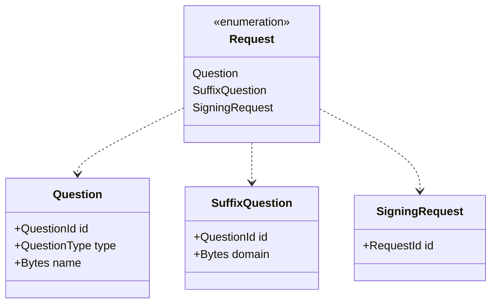

# DNS questions and answers

The values a check hands the caller when it needs DNS records or a public suffix, and the values the caller hands back ([ADR 0017](../../adr/0017-the-core-does-no-io-and-the-caller-drives-it.md), [ADR 0038](../../adr/0038-in-rfc-7489-mode-the-caller-answers-public-suffix-questions.md)). The rules for an answer sit with the methods that take it, in [Check](check.md#checkanswer).

## Contents

- [Requests](#requests)
- [Questions](#questions)
- [Answers](#answers)
- [Suffix questions and answers](#suffix-questions-and-answers)
- [Validation](#validation)

## Requests

`Check::take_requests` gives a list of `Request` values. Each is one of three:

[Signing](signing.md#types) describes `SigningRequest`.

## Questions

| Member | Type | Meaning | Requirements |
|---|---|---|---|
| `id` | `QuestionId` | Unique within the check. It depends on when the question was asked, so the trace never shows it | DNS-007, TRC-008 |
| `type` | `QuestionType` | `TXT`, `A`, `AAAA`, `MX` or `PTR` | DNS-001 |
| `name` | Bytes | The name in lookup form, built by the check, without a final dot | DNS-008, ADS-002 |

A check holds each type and name once (INV-001), so the caller never gets the same question twice.

## Answers

| `Answer` | Carries | Meaning | Requirements |
|---|---|---|---|
| `Records` | The records, in the order the resolver gave them | Records found | DNS-002, DNS-006 |
| `NameNotFound` | Nothing | The name doesn't exist (NXDOMAIN) | DNS-002 |
| `NoRecords` | Nothing | The name exists with no records of this type (NODATA) | DNS-002 |
| `TemporaryFailure` | An optional description, as bytes | The resolver couldn't get an answer, such as on a timeout or SERVFAIL | DNS-009 |

| `Record` | Carries | Requirements |
|---|---|---|
| `Txt` | Its character-strings, in order and not joined | DNS-006, RFC 1035 §3.3.14 |
| `A` | An IPv4 address | DNS-006 |
| `Aaaa` | An IPv6 address | DNS-006, RFC 3596 §2.2 |
| `Mx` | A preference from 0 to 65,535 and an exchange name | DNS-006, RFC 1035 §3.3.9 |
| `Ptr` | A name | DNS-006, RFC 1035 §3.3.12 |

The resolver needs to know no protocol rule. The check joins TXT strings itself (DNS-006), and a name in a record that doesn't parse gets the rule of the protocol that read it.

## Suffix questions and answers

In RFC 7489 mode, the check asks for the public suffix of each domain whose organizational domain it may need (DMC-010). RFC 9989 mode asks none.

| Value | Members | Meaning | Requirements |
|---|---|---|---|
| `SuffixQuestion` | `id`, `domain` | The domain in lookup form | DMC-010 |
| `SuffixAnswer::Suffix` | `labels`, and `list`, optional | The public suffix has `labels` labels, the x of RFC 7489 §3.2 step 3. `list` names the list, such as its date or a hash | DMC-010, DMC-011 |
| `SuffixAnswer::Unavailable` | Nothing | The caller has no suffix for the domain. It gives `temperror` if the result depends on that organizational domain | DMC-011 |

Suffix questions share the ID space of DNS questions.

## Validation

These values are plain data, and building one checks nothing. A check checks each answer when the caller hands it back.

| Value | Checked by | Rules |
|---|---|---|
| `Answer`, `Record` | `Check::answer` | [VAL-120 to VAL-125](check.md#checkanswer) |
| `SuffixAnswer` | `Check::answer_suffix` | [VAL-130 to VAL-133](check.md#checkanswer_suffix) |
| `Answer` from a resolver | The driver, through `Check::answer` | [VAL-804](driver.md#drive) |
| `Answer` in a snapshot | `Snapshot::parse` | [VAL-901 to VAL-908](snapshot.md#snapshotparse) |
