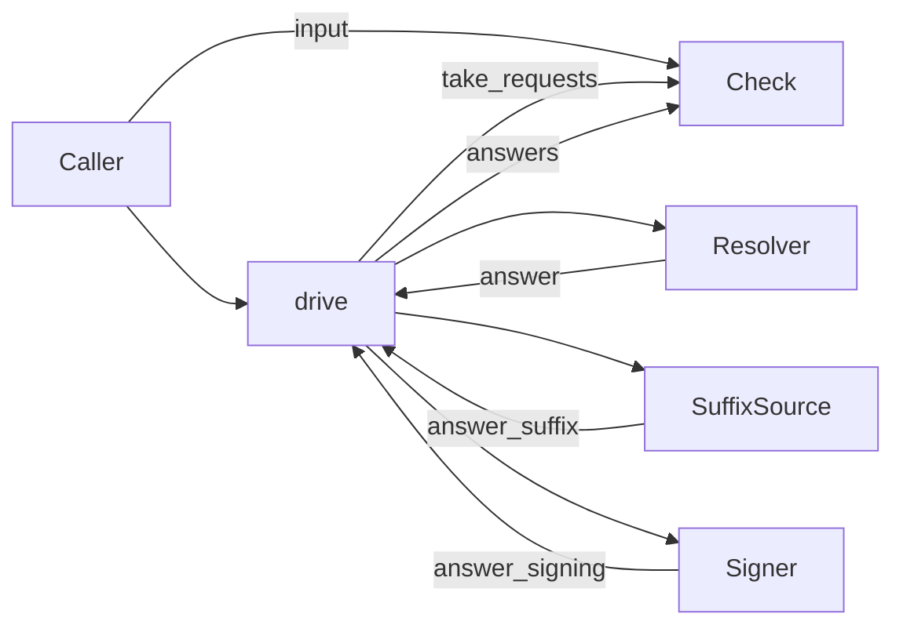

# Driver and adapters

The traits a caller implements to let the driver run a check, the driver itself, and the adapters for blocking readers and writers ([ADR 0017](../../adr/0017-the-core-does-no-io-and-the-caller-drives-it.md), [ADR 0048](../../adr/0048-the-resolver-the-suffix-source-and-the-signer-return-futures-that-are-send.md)). [Lifecycle](../design/lifecycle.md#driver) gives the driver's states, and [Concurrency](../design/concurrency.md#the-driver) its rules.

## Contents

- [Flow](#flow)
- [Traits](#traits)
- [Signatures](#signatures)
- [Parameters](#parameters)
- [Validation](#validation)
  - [`drive`](#drive)
  - [`io::read_message`](#ioread_message)
  - [`io::write_trace`](#iowrite_trace)

## Flow

## Traits

Each trait requires `Send` and `Sync`, and each method returns a future that is `Send`, so the driver can hold a shared reference across an await and its own future is `Send` (ADR 0048). A method takes its request by value, so the future owns what it needs.

| Trait | Method signature | The future gives | Requirements |
|---|---|---|---|
| `Resolver` | `fn resolve(&self, question: Question) -> impl Future<Output = Answer> + Send` | The answer to the question ([DNS](dns.md#answers)) | DNS-001, DNS-003 |
| `SuffixSource` | `fn suffix(&self, question: SuffixQuestion) -> impl Future<Output = SuffixAnswer> + Send` | The public suffix answer ([DNS](dns.md#suffix-questions-and-answers)) | DMC-010 |
| `Signer` | `fn sign(&self, request: SigningRequest) -> impl Future<Output = Result<Signature, SignerFailure>> + Send` | The signature, or the signer's failure ([Signing](signing.md#types)) | SGN-001 |

| Type | Implements | Requirements |
|---|---|---|
| `SnapshotResolver` | `Resolver`, `SuffixSource` ([Snapshot](snapshot.md)) | DNS-004 |
| `MemorySigner` | `Signer` ([Signing](signing.md#memorysigner)) | SGN-005 |
| `NoSuffixSource` | `SuffixSource`. An enum with no variant, for a caller that passes no suffix source and names the type in `None::<&NoSuffixSource>` | CHK-005 |
| `NoSigner` | `Signer`. An enum with no variant, for a caller that passes no signer and names the type in `None::<&NoSigner>` | CHK-005 |

## Signatures

| API | Signature | Returns | Requirements |
|---|---|---|---|
| `drive` | `async fn drive<R: Resolver, S: SuffixSource, G: Signer>(check: &mut Check, resolver: &R, suffix_source: Option<&S>, signer: Option<&G>, in_flight: u32) -> Result<(), DriveError>`. Its future is `Send` | Nothing, once the check has no open request | CHK-005, DNS-003 |
| `io::read_message` | `fn read_message<R: std::io::Read>(check: &mut Check, reader: &mut R, buffer: &mut [u8]) -> Result<(), StreamError>` | Nothing, once the check has taken the end of the message | STR-004, STR-006 |
| `io::write_trace` | `fn write_trace<W: std::io::Write>(check: &mut Check, writer: &mut W, buffer: &mut [u8]) -> Result<(), StreamError>` | Nothing, once it has written every trace byte the check has now | STR-004, STR-006 |

`drive` is a function of the crate root, and the adapters are functions of the module `io`.

## Parameters

| API | Parameter | Meaning and form |
|---|---|---|
| `drive` | `check` | The check to run. Its message input may be complete or still to come |
| `drive` | `resolver` | Resolves each DNS question |
| `drive` | `suffix_source` | Answers each public suffix question. Needed for DMARC in RFC 7489 mode |
| `drive` | `signer` | Signs each signing request. Needed for DKIM and DKIM2 signing |
| `drive` | `in_flight` | How many futures the driver keeps pending at once, the `driver_in_flight` of [Limits](../design/limits.md#limits-outside-a-check) |
| `io::read_message` | `check` | A check in Envelope |
| `io::read_message` | `reader` | Gives the whole message, with CRLF line endings |
| `io::read_message`, `io::write_trace` | `buffer` | The caller's buffer for each read or write |
| `io::write_trace` | `check` | Any check |
| `io::write_trace` | `writer` | Takes the trace bytes |

| Rule | Requirements |
|---|---|
| `drive` returns once the check has no open request. The check is then Finished if its input was complete | CHK-005 |
| `drive` hands each answer to the check as its future completes | CHK-003 |
| A signer failure is an answer, and `drive` goes on | SGN-004 |
| `drive` reads no clock. The resolver applies its own time limits | DNS-009 |
| `io::read_message` passes the header section in one call, then the body in chunks the size of `buffer`, then the end of the message | STR-004, CHK-001 |
| `io::write_trace` writes the bytes the check has now, and returns when none is left | STR-004 |

## Validation

### `drive`

| ID | Input | Rule | Error code | Requirement | Scenario |
|---|---|---|---|---|---|
| VAL-801 | `in_flight` | From 1 to 1,024, the range of `driver_in_flight` | `driver.in_flight_out_of_range` | CHK-005 | API-801 |
| VAL-802 | `suffix_source` | `Some` when the check runs DMARC in RFC 7489 mode | `driver.suffix_source_missing` | DMC-010, CHK-005 | API-802 |
| VAL-803 | `signer` | `Some` when the check runs DKIM or DKIM2 signing | `driver.signer_missing` | SGN-001, CHK-005 | API-803 |
| VAL-804 | Each answer a future gives | The check takes it: the rules of VAL-120 to VAL-143 | `driver.answer_refused`, which carries the `CheckError` | CHK-004 | API-804 |

`drive` checks VAL-801 to VAL-803 before it takes any request.

### `io::read_message`

| ID | Input | Rule | Error code | Requirement | Scenario |
|---|---|---|---|---|---|
| VAL-810 | `buffer` | Holds at least 1 byte | `stream.buffer_empty` | STR-004 | API-810 |
| VAL-811 | `check` | In Envelope (VAL-109) | `stream.check_refused`, which carries the `CheckError` | CHK-004 | API-811 |
| VAL-812 | `reader` | Reads without error | `stream.source_failed`, which names the reader's error kind | STR-006 | API-812 |
| VAL-813 | The header section | Ends within `header_section_size` octets | Not an error: the adapter passes the first `header_section_size` + 1 octets as the header section, which reaches the limit, then the end of the message, and reads no more | SAF-002, SAF-004 | API-813 |

### `io::write_trace`

| ID | Input | Rule | Error code | Requirement | Scenario |
|---|---|---|---|---|---|
| VAL-820 | `buffer` | Holds at least 1 byte | `stream.buffer_empty` | STR-004 | API-820 |
| VAL-821 | `writer` | Writes without error | `stream.sink_failed`, which names the writer's error kind | STR-006 | API-821 |

A stream error never becomes a protocol result (STR-006). The check stays as the last successful call left it.
