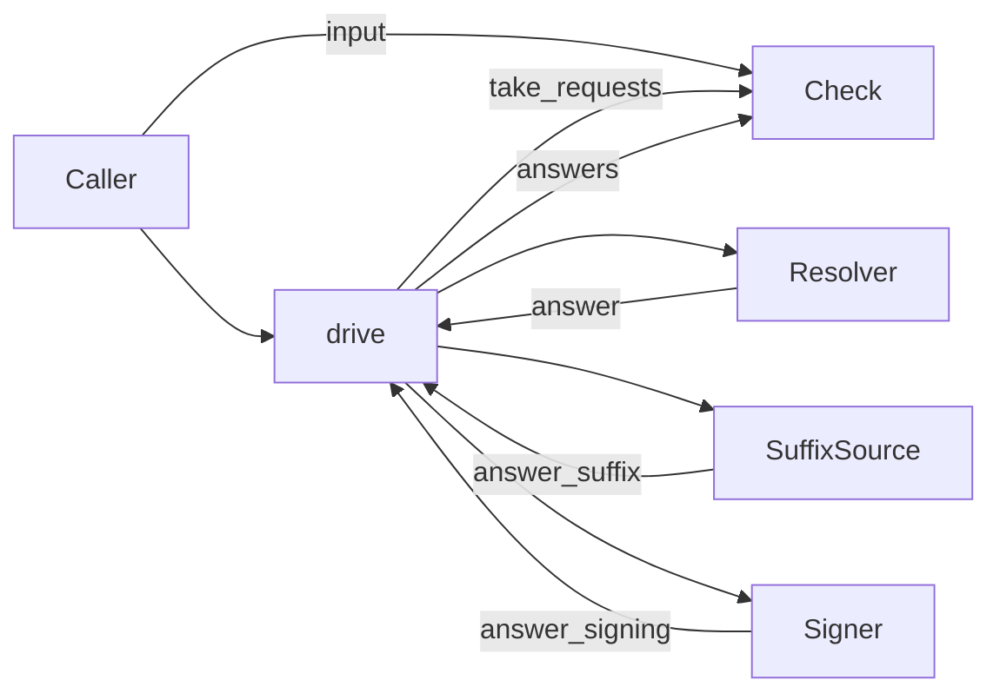

# Driver and adapters

The traits a caller implements to let the driver run a check, the driver itself, and the adapters for blocking readers and writers ([ADR 0017](../../adr/0017-the-core-does-no-io-and-the-caller-drives-it.md), [ADR 0048](../../adr/0048-the-resolver-the-suffix-source-and-the-signer-return-futures-that-are-send.md)). [Lifecycle](../design/lifecycle.md#driver) gives the driver's states, and [Concurrency](../design/concurrency.md#the-driver) its rules.

## Contents

- [Traits](#traits)
- [APIs](#apis)
- [Validation](#validation)
  - [`drive`](#drive)
  - [`io::read_message`](#ioread_message)
  - [`io::write_trace`](#iowrite_trace)

## Traits

| Trait | Method | Takes | Gives | Requirements |
|---|---|---|---|---|
| `Resolver` | `resolve` | A `Question` | A `Send` future of `Answer` | DNS-001, DNS-003 |
| `SuffixSource` | `suffix` | A `SuffixQuestion` | A `Send` future of `SuffixAnswer` | DMC-010 |
| `Signer` | `sign` | A `SigningRequest` | A `Send` future of `Signature` or `SignerFailure` | SGN-001 |

Each trait requires `Send` and `Sync`, so the driver can hold a shared reference across an await (ADR 0048). `SnapshotResolver` implements `Resolver` and `SuffixSource`, and `MemorySigner` implements `Signer`.

## APIs

| API | Takes | Gives | Requirements |
|---|---|---|---|
| `drive` | A check by unique reference, a resolver, an optional suffix source, an optional signer, and the number of futures to keep pending | A `Send` future of nothing, or `DriveError` | CHK-005, DNS-003 |
| `io::read_message` | A check in Envelope, a standard blocking reader and a buffer | Nothing, or `StreamError` | STR-004, STR-006 |
| `io::write_trace` | A check, a standard blocking writer and a buffer | Nothing, or `StreamError` | STR-004, STR-006 |

| Rule | Requirements |
|---|---|
| `drive` returns once the check has no open request. The check is then Finished if its input was complete | CHK-005 |
| `drive` hands each answer to the check as its future completes | CHK-003 |
| A signer failure is an answer, and `drive` goes on | SGN-004 |
| `drive` reads no clock. The resolver applies its own time limits | DNS-009 |
| `io::read_message` passes the header section in one call, then the body in chunks the size of the buffer, then the end of the message | STR-004, CHK-001 |
| `io::write_trace` writes the bytes the check has now, and returns when none is left | STR-004 |

## Validation

### `drive`

| ID | Input | Rule | Error code | Requirement | Scenario |
|---|---|---|---|---|---|
| VAL-801 | `in_flight` | From 1 to 1,024, the range of `driver_in_flight` | `driver.in_flight_out_of_range` | CHK-005 | API-801 |
| VAL-802 | `suffix_source` | Given when the check runs DMARC in RFC 7489 mode | `driver.suffix_source_missing` | DMC-010, CHK-005 | API-802 |
| VAL-803 | `signer` | Given when the check runs DKIM or DKIM2 signing | `driver.signer_missing` | SGN-001, CHK-005 | API-803 |
| VAL-804 | Each answer a future gives | The check takes it: the rules of VAL-120 to VAL-143 | `driver.answer_refused`, which carries the `CheckError` | CHK-004 | API-804 |

`drive` checks VAL-801 to VAL-803 before it takes any request.

### `io::read_message`

| ID | Input | Rule | Error code | Requirement | Scenario |
|---|---|---|---|---|---|
| VAL-810 | `buffer` | Holds at least 1 byte | `stream.buffer_empty` | STR-004 | API-810 |
| VAL-811 | `check` | In Envelope (VAL-109) | `stream.check_refused`, which carries the `CheckError` | CHK-004 | API-811 |
| VAL-812 | The reader | Reads without error | `stream.source_failed`, which names the reader's error kind | STR-006 | API-812 |
| VAL-813 | The header section | Ends within `header_section_size` octets | Not an error: the adapter passes the first `header_section_size` + 1 octets as the header section, which reaches the limit, then the end of the message, and reads no more | SAF-002, SAF-004 | API-813 |

### `io::write_trace`

| ID | Input | Rule | Error code | Requirement | Scenario |
|---|---|---|---|---|---|
| VAL-820 | `buffer` | Holds at least 1 byte | `stream.buffer_empty` | STR-004 | API-820 |
| VAL-821 | The writer | Writes without error | `stream.sink_failed`, which names the writer's error kind | STR-006 | API-821 |

A stream error never becomes a protocol result (STR-006). The check stays as the last successful call left it.
