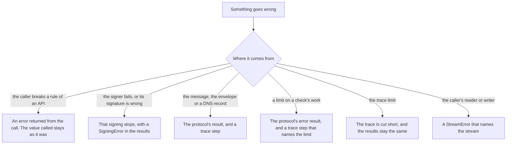

# Errors

Each kind of failure and where it goes, the error types with their methods and variants, and every error code with the APIs and rules that give it.

## Contents

- [Error model](#error-model)
- [Error types](#error-types)
- [What an error carries](#what-an-error-carries)
- [Error codes](#error-codes)
- [Signing errors in the results](#signing-errors-in-the-results)
- [Parse errors](#parse-errors)
- [Stability](#stability)

## Error model

| Rule | Requirements |
|---|---|
| An error returned from a call never becomes a protocol result, and a protocol result never comes back as an error | CHK-004, INV-010 |
| A call that returns an error changes nothing in the value called | CHK-004, INV-003 |
| Input from a sender or a DNS publisher never gives a returned error. It gives a protocol result | GEN-005, SAF-001 |
| No input makes hallmark panic | SAF-001 |

## Error types

Each error type except `SignerFailure` is a `#[non_exhaustive]` enum with one variant for each of its codes. [Error codes](#error-codes) gives each variant and the data it carries. `SignerFailure` is a struct ([Signing](signing.md#types)).

| Type | Returned by | Code prefix | Requirements |
|---|---|---|---|
| `CheckError` | Every method of `Check` except `new` | `check.` | CHK-004 |
| `OptionsError` | `Check::new`, `VerificationTime::from_unix_seconds` | `options.` | GEN-001 |
| `LimitsError` | The setters of `Limits` and `DocumentLimits` | `limits.` | PAR-004 |
| `ResultsError` | `HeaderFieldOut::read_value` | `results.` | STR-002 |
| `SigningError` | Held in `Signing::Stopped` in the results | `signing.` | SGN-004 |
| `KeyError` | `MemorySigner::add_rsa_key`, `add_ed25519_key`, `add_mldsa44_key` | `key.` | SGN-005 |
| `SignerFailure` | `MemorySigner::sign`, and `Signer` for `MemorySigner` | `signer.` | SGN-004, SGN-005 |
| `TraceError` | `sort_trace`, `Event::parse` | `trace.` | TRC-007 |
| `CanonicalizerError` | Every method of `Canonicalizer` | `canonicalizer.` | STR-012 |
| `AuthResError` | `AuthservId::new`, `AuthenticationResults::parse`, `carries_authserv_id` | `authres.` | AR-003, AR-005 |
| `DriveError` | `drive` | `driver.` | CHK-005 |
| `StreamError` | `io::read_message`, `io::write_trace` | `stream.` | STR-006 |
| `DocumentError` | `Snapshot::parse`, `Snapshot::from_trace`, `PastedRecords::parse` | `document.` | DNS-004, DNS-010 |

Each enum has these methods and implementations:

| API | Signature or trait | Gives | Requirements |
|---|---|---|---|
| `code` | `fn code(&self) -> &'static str` | The error's code, such as `check.out_of_order` | STB-001 |
| `Display` | `std::fmt::Display` | English text, written from the code and the data | TRC-011 |
| `Error` | `std::error::Error`. `source` gives the error that a variant carries, such as the `CheckError` of `DriveError::AnswerRefused` | | PAR-001 |

## What an error carries

| Part | Content | Requirements |
|---|---|---|
| Code | One of the codes below, which a program matches on through the variant or `code` | STB-001 |
| Data | The values the code needs, in the variant's fields: the limit, the offset, the line, the member, or the error underneath | PAR-001 |
| English text | `Display` writes it from the code and the data | TRC-011 |

| Rule | Requirements |
|---|---|
| No error, in its text, its data or its `Debug` output, holds a byte of a private key | SEC-002, THR-012 |
| An error names input by its role and offset, such as the header field and the byte, and doesn't copy body content | PAR-001, TRC-010 |
| `SignerFailure` keeps the signer's description only in the error. The trace says that the signer failed, without the description | SGN-004, SEC-002 |

## Error codes

A variant written without fields carries no data.

| Code | Variant | Meaning | APIs | Rules | Requirements |
|---|---|---|---|---|---|
| `check.out_of_order` | `CheckError::OutOfOrder` | Message input in a state that doesn't accept it | `envelope`, `header_field`, `end_of_header_fields`, `header_section`, `whole_message`, `body_chunk`, `end_of_message` | VAL-101, VAL-107 to VAL-109, VAL-111 to VAL-113 | CHK-004 |
| `check.envelope_incomplete` | `CheckError::EnvelopeIncomplete { field: EnvelopeField }`, with `EnvelopeField` one of `ClientIp`, `Helo`, `MailFrom`, `RcptTo` | The envelope lacks a part that a kind needs | `envelope` | VAL-102 to VAL-105 | GEN-002 |
| `check.rcpt_to_limit` | `CheckError::RcptToLimit` | More RCPT TO paths than `rcpt_to` | `envelope` | VAL-106 | SAF-004 |
| `check.body_in_header_section` | `CheckError::BodyInHeaderSection` | An empty line inside the raw header section | `header_section` | VAL-110 | HDR-001 |
| `check.unknown_question` | `CheckError::UnknownQuestion` | No question with that ID was handed out | `answer`, `answer_suffix` | VAL-120, VAL-130 | CHK-004 |
| `check.unknown_request` | `CheckError::UnknownRequest` | No signing request with that ID was handed out | `answer_signing` | VAL-140 | CHK-004 |
| `check.already_answered` | `CheckError::AlreadyAnswered` | The request has its answer | `answer`, `answer_suffix`, `answer_signing` | VAL-121, VAL-131, VAL-141 | CHK-004 |
| `check.answer_type_mismatch` | `CheckError::AnswerTypeMismatch` | A record of another type than the question's | `answer` | VAL-122 | DNS-006 |
| `check.answer_malformed` | `CheckError::AnswerMalformed` | An empty list of records, or a TXT string over 255 octets | `answer` | VAL-123, VAL-124 | DNS-002, DNS-006 |
| `check.suffix_out_of_range` | `CheckError::SuffixOutOfRange` | A suffix of 0 labels, or of more labels than the domain | `answer_suffix` | VAL-132 | DMC-011 |
| `check.list_name_invalid` | `CheckError::ListNameInvalid` | A list name of 0 octets or over 256 | `answer_suffix` | VAL-133 | DMC-010 |
| `check.buffer_empty` | `CheckError::BufferEmpty` | A buffer of 0 bytes | `read_trace` | VAL-150 | STR-002 |
| `check.not_finished` | `CheckError::NotFinished(Waiting)` | The check isn't Finished. Carries what it waits for | `take_results` | VAL-160 | CHK-002 |
| `check.results_taken` | `CheckError::ResultsTaken` | The results were taken before | `take_results` | VAL-161 | CHK-002 |
| `options.time_out_of_range` | `OptionsError::TimeOutOfRange` | A time over 999,999,999,999 seconds | `VerificationTime::from_unix_seconds` | VAL-201 | TIM-001 |
| `options.no_kind` | `OptionsError::NoKind` | No kind of check | `Check::new` | VAL-210 | GEN-001 |
| `options.source_kind_missing` | `OptionsError::SourceKindMissing` | DMARC takes an identifier from a kind the check doesn't run | `Check::new` | VAL-211, VAL-212 | DMC-005 |
| `options.earlier_result_invalid` | `OptionsError::EarlierResultInvalid` | An earlier SPF result for the HELO identity | `Check::new` | VAL-213 | DMC-005 |
| `options.message_id_invalid` | `OptionsError::MessageIdInvalid` | A message ID of 0 octets or over 256 | `Check::new` | VAL-214 | TRC-014 |
| `options.receiving_host_invalid` | `OptionsError::ReceivingHostInvalid` | A receiving host with no lookup form | `Check::new` | VAL-215 | REC-014 |
| `options.signing_mismatch` | `OptionsError::SigningMismatch` | A signing kind without its signing options, or the reverse | `Check::new` | VAL-216, VAL-217 | GEN-001 |
| `options.signing_domain_invalid` | `OptionsError::SigningDomainInvalid` | A `d=` or `nd=` domain with no lookup form | `Check::new` | VAL-220, VAL-230, VAL-240 | ADS-002 |
| `options.selector_invalid` | `OptionsError::SelectorInvalid` | A selector that breaks RFC 6376 §3.1 or makes a key name too long | `Check::new` | VAL-221, VAL-232 | DNS-008 |
| `options.selector_repeated` | `OptionsError::SelectorRepeated` | One selector twice in a DKIM2 signature | `Check::new` | VAL-233 | DK2-009 |
| `options.algorithm_not_allowed` | `OptionsError::AlgorithmNotAllowed` | `Mldsa44` for DKIM | `Check::new` | VAL-222 | DKS-001 |
| `options.public_key_invalid` | `OptionsError::PublicKeyInvalid` | A stated public key that doesn't decode for its algorithm | `Check::new` | VAL-223, VAL-234 | SGN-003 |
| `options.rsa_key_too_small` | `OptionsError::RsaKeyTooSmall` | A stated RSA key under 1,024 bits | `Check::new` | VAL-224, VAL-235 | SGN-003 |
| `options.rsa_key_too_large` | `OptionsError::RsaKeyTooLarge` | A stated RSA key over `rsa_key_bits` | `Check::new` | VAL-225, VAL-235 | SAF-002 |
| `options.rsa_exponent_not_65537` | `OptionsError::RsaExponentNot65537` | A stated DKIM2 RSA key whose exponent isn't 65537 | `Check::new` | VAL-236 | SGN-003 |
| `options.header_name_invalid` | `OptionsError::HeaderNameInvalid` | A name to sign that isn't a field name | `Check::new` | VAL-226 | DKS-003 |
| `options.from_not_signed` | `OptionsError::FromNotSigned` | A list of fields to sign without From | `Check::new` | VAL-227 | DKS-003 |
| `options.expiration_invalid` | `OptionsError::ExpirationInvalid` | An expiration of 0, or one that makes `x=` longer than twelve digits | `Check::new` | VAL-228 | DKS-004 |
| `options.no_signer` | `OptionsError::NoSigner` | DKIM2 signing with no group, or an empty group | `Check::new` | VAL-231 | DK2-009 |
| `options.dkim2_envelope_invalid` | `OptionsError::Dkim2EnvelopeInvalid` | `nd=` together with `mf=` or `rt=`, or neither | `Check::new` | VAL-237 | DK2-003 |
| `options.path_invalid` | `OptionsError::PathInvalid` | An outgoing path that isn't a Reverse-path or a Forward-path | `Check::new` | VAL-238 | ADS-020, ADS-021 |
| `options.rcpt_to_limit` | `OptionsError::RcptToLimit` | More outgoing RCPT TO paths than `rcpt_to` | `Check::new` | VAL-239 | SAF-004 |
| `options.nonce_invalid` | `OptionsError::NonceInvalid` | An `n=` over 64 characters, or with a character outside printable ASCII or a `;` | `Check::new` | VAL-241 | DK2-003 |
| `options.revision_invalid` | `OptionsError::RevisionInvalid` | A revision whose `Unchanged` ranges are empty, overlap or go backwards | `Check::new` | VAL-242 | DK2-014 |
| `limits.out_of_range` | `LimitsError::OutOfRange { limit: Limit }` | A limit outside its range | `Limits` and `DocumentLimits` setters | VAL-202, VAL-204 | PAR-004 |
| `limits.conflict` | `LimitsError::Conflict` | `header_field_size` over `header_section_size` | `Limits` setters | VAL-203 | PAR-004 |
| `results.buffer_empty` | `ResultsError::BufferEmpty` | A buffer of 0 bytes | `HeaderFieldOut::read_value` | VAL-301 | STR-002 |
| `results.offset_out_of_range` | `ResultsError::OffsetOutOfRange` | An offset past the end of the value | `HeaderFieldOut::read_value` | VAL-302 | STR-002 |
| `key.invalid` | `KeyError::Invalid` | Key data that doesn't decode | `add_rsa_key` | VAL-401 | SGN-005 |
| `key.rsa_size` | `KeyError::RsaSize` | An RSA key outside 1,024 to 16,384 bits | `add_rsa_key` | VAL-402 | DKS-001 |
| `key.duplicate` | `KeyError::Duplicate` | A key the signer already holds | `add_rsa_key`, `add_ed25519_key`, `add_mldsa44_key` | VAL-403 to VAL-405 | SGN-005 |
| `signer.key_unknown` | `SignerFailure` whose description names the code | No key for the request's statement | `MemorySigner::sign`, `Signer` | VAL-410 | SGN-005 |
| `signer.random_mismatch` | `SignerFailure` whose description names the code | A random value missing for `Mldsa44`, or given for another algorithm | `MemorySigner::sign` | VAL-411 | SGN-005 |
| `signer.random_unavailable` | `SignerFailure` whose description names the code | An `Mldsa44` request through the trait with no `RandomSource`, or one that failed | `Signer` | VAL-412 | SGN-005 |
| `trace.too_large` | `TraceError::TooLarge` | A trace over `document_size` | `sort_trace` | VAL-501 | SAF-004 |
| `trace.record_malformed` | `TraceError::RecordMalformed { offset: u64 }` | Bytes that aren't RS, one JSON text and LF | `sort_trace`, `Event::parse` | VAL-502, VAL-510 | TRC-007 |
| `trace.event_malformed` | `TraceError::EventMalformed { offset: u64 }` | A record that isn't an event of the format | `sort_trace`, `Event::parse` | VAL-503, VAL-505, VAL-511, VAL-512 | TRC-007 |
| `trace.too_deep` | `TraceError::TooDeep { offset: u64 }` | An event nested deeper than `document_depth` | `sort_trace`, `Event::parse` | VAL-503, VAL-511 | PAR-005 |
| `trace.version_unknown` | `TraceError::VersionUnknown { offset: u64 }` | An event of a major version other than 1 | `sort_trace`, `Event::parse` | VAL-504, VAL-511 | TRC-007 |
| `trace.position_repeated` | `TraceError::PositionRepeated { position: Position }` | Two events at one position | `sort_trace` | VAL-506 | TRC-012 |
| `canonicalizer.length_not_allowed` | `CanonicalizerError::LengthNotAllowed` | An `l=` length in `Dkim2` mode | `Canonicalizer::new` | VAL-601 | STR-012 |
| `canonicalizer.rebuild_not_allowed` | `CanonicalizerError::RebuildNotAllowed` | A rebuild outside `Dkim2` mode | `Canonicalizer::new` | VAL-602 | STR-012 |
| `canonicalizer.instance_invalid` | `CanonicalizerError::InstanceInvalid(ParseError)` | A Message-Instance value that doesn't parse, or too many | `Canonicalizer::new` | VAL-603 | DK2-006 |
| `canonicalizer.instance_missing` | `CanonicalizerError::InstanceMissing` | The version asked for, or an instance on the way to it, is missing | `Canonicalizer::new` | VAL-604 | DK2-006 |
| `canonicalizer.null_recipe` | `CanonicalizerError::NullRecipe` | A null body recipe on the way to the version asked for | `Canonicalizer::new` | VAL-605 | DK2-007 |
| `canonicalizer.recipe_invalid` | `CanonicalizerError::RecipeInvalid { step: Option<u64>, limit: Option<Limit> }` | A recipe that breaks the order of draft-09 §5.2, a recipe limit, or the end of the body. Names the step, counted from 1, or the limit | `Canonicalizer::new`, `finish` | VAL-606, VAL-616 | DK2-007 |
| `canonicalizer.ended` | `CanonicalizerError::Ended` | A chunk after `finish` | `canonicalize` | VAL-610 | STR-012 |
| `canonicalizer.buffer_empty` | `CanonicalizerError::BufferEmpty` | An output buffer of 0 bytes | `canonicalize`, `finish` | VAL-611, VAL-615 | STR-003 |
| `authres.authserv_id_invalid` | `AuthResError::AuthservIdInvalid` | An authserv-id that isn't a `value`, or holds a bad A-label | `AuthservId::new` | VAL-701, VAL-702 | AR-001, AR-005 |
| `authres.syntax` | `AuthResError::Syntax(ParseError)` | A field value that doesn't parse, or reaches a limit | `parse`, `carries_authserv_id` | VAL-710 to VAL-712, VAL-720 | HDR-009, PAR-001 |
| `driver.in_flight_out_of_range` | `DriveError::InFlightOutOfRange` | A count of pending futures outside 1 to 1,024 | `drive` | VAL-801 | CHK-005 |
| `driver.suffix_source_missing` | `DriveError::SuffixSourceMissing` | No suffix source for DMARC in RFC 7489 mode | `drive` | VAL-802 | DMC-010 |
| `driver.signer_missing` | `DriveError::SignerMissing` | No signer for a signing kind | `drive` | VAL-803 | SGN-001 |
| `driver.answer_refused` | `DriveError::AnswerRefused(CheckError)` | The check refused an answer from a future | `drive` | VAL-804 | CHK-004 |
| `stream.buffer_empty` | `StreamError::BufferEmpty` | A buffer of 0 bytes | `io::read_message`, `io::write_trace` | VAL-810, VAL-820 | STR-004 |
| `stream.check_refused` | `StreamError::CheckRefused(CheckError)` | The check refused the message input | `io::read_message` | VAL-811 | CHK-004 |
| `stream.source_failed` | `StreamError::SourceFailed(std::io::ErrorKind)` | The reader gave an error of that kind | `io::read_message` | VAL-812 | STR-006 |
| `stream.sink_failed` | `StreamError::SinkFailed(std::io::ErrorKind)` | The writer gave an error of that kind | `io::write_trace` | VAL-821 | STR-006 |
| `document.too_large` | `DocumentError::TooLarge { limit: Limit }` | A document or pasted text over its limit | `Snapshot::parse`, `PastedRecords::parse` | VAL-901, VAL-920 | SAF-004 |
| `document.syntax` | `DocumentError::Syntax(ParseError)` | Bytes that aren't one I-JSON object | `Snapshot::parse` | VAL-902 | PAR-001 |
| `document.too_deep` | `DocumentError::TooDeep` | A document nested deeper than `document_depth` | `Snapshot::parse` | VAL-903 | PAR-005 |
| `document.version_unknown` | `DocumentError::VersionUnknown` | A document of a major version other than 1 | `Snapshot::parse` | VAL-904 | TRC-007 |
| `document.type_mismatch` | `DocumentError::TypeMismatch` | A `type` other than `snapshot` | `Snapshot::parse` | VAL-905 | DNS-004 |
| `document.member_invalid` | `DocumentError::MemberInvalid { member: String }` | A member missing, of the wrong shape or out of range | `Snapshot::parse` | VAL-906, VAL-908 | DNS-004 |
| `document.order` | `DocumentError::Order` | Answers out of order, or one type and name twice | `Snapshot::parse` | VAL-907 | DNS-004 |
| `document.trace_invalid` | `DocumentError::TraceInvalid(TraceError)` | A trace that breaks a rule of `sort_trace` | `Snapshot::from_trace` | VAL-910 | TRC-007 |
| `document.trace_incomplete` | `DocumentError::TraceIncomplete` | A trace below the full level, or cut short | `Snapshot::from_trace` | VAL-911 | TRC-008 |
| `document.trace_inconsistent` | `DocumentError::TraceInconsistent` | Two steps record different answers to one question | `Snapshot::from_trace` | VAL-912 | DNS-007 |
| `document.line_invalid` | `DocumentError::LineInvalid { line: u64, error: ParseError }` | A pasted line that isn't a record of RFC 1035 §5.1 that hallmark reads. `line` counts from 1 | `PastedRecords::parse` | VAL-921 to VAL-923 | DNS-010 |

## Signing errors in the results

A `SigningError` stops one kind of signing. The other kinds still finish, and no header field of the stopped kind comes out (SGN-004). A signer is named by its domain and selector.

| Code | Variant | Meaning | Raised at | Rules | Requirements | Scenario |
|---|---|---|---|---|---|---|
| `signing.signer_failed` | `SigningError::SignerFailed { domain: String, selector: Vec<u8>, description: String }` | The signer answered with a `SignerFailure`. Keeps its description | `answer_signing` | | SGN-004 | SIGN-008 |
| `signing.wrong_size` | `SigningError::WrongSize { domain: String, selector: Vec<u8>, expected: usize, actual: usize }` | The signature doesn't have the size its algorithm and key give | `answer_signing` | VAL-142 | SGN-004 | SIGN-007 |
| `signing.not_verified` | `SigningError::NotVerified { domain: String, selector: Vec<u8> }` | The signature doesn't verify with the stated key | `answer_signing`, with `verify_signatures` on | VAL-143 | SGN-006 | SIGN-016 |
| `signing.header_limit` | `SigningError::HeaderLimit(Limit)` | The header section reached a header limit | The header section ends | | SAF-002 | SIGN-027 |
| `signing.exploded_first_signature` | `SigningError::ExplodedFirstSignature` | The `exploded` flag on a message with no DKIM2-Signature yet | The header section ends | | draft-09 §12.5 | SIGN-026 |
| `signing.revision_mismatch` | `SigningError::RevisionMismatch` | The earlier version rebuilt from the revision has hashes other than those in the highest Message-Instance | The message ends | | DK2-014 | SIGN-022, SIGN-023 |

## Parse errors

A `ParseError` names the rule of the grammar that failed, the byte offset and the input that the parser read (PAR-001). It sits inside `authres.syntax`, `document.syntax`, `document.line_invalid` and `canonicalizer.instance_invalid`, and in `SpfReason::Syntax` in the results. Inside a check, parse errors of the message, the envelope and DNS records go into the trace and the results, never into a returned error (HDR-010).

`ParseError` is `#[non_exhaustive]` with public fields, and hallmark builds it.

| Field | Type | Meaning | Requirements |
|---|---|---|---|
| `rule` | `String` | The name of the grammar rule that failed, as its specification writes it, such as `authres-payload` | PAR-001 |
| `offset` | `u64` | The offset of the first octet that broke the rule, from the start of the input | PAR-001 |
| `input` | `String` | The input the parser read, by its role, such as `Authentication-Results field` | PAR-001 |
| `limit` | `Option<Limit>` | The limit the input reached, when a limit stopped the parser | SAF-002 |

## Stability

| Rule | Requirements |
|---|---|
| A code keeps its meaning within a major version of the crate. A minor version can add codes and variants, and the error enums are `#[non_exhaustive]` | STB-001 |
| The codes of DKIM2 features can change in any release while `unstable-dkim2` lasts | DK2-005 |
| Error codes are separate from trace codes, and the trace format's version doesn't cover them | STB-001 |
