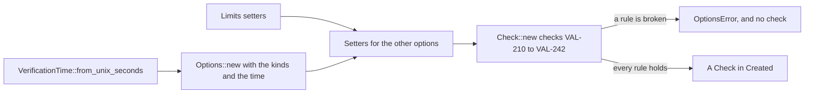

# Options

`Options` holds everything a caller fixes when it creates a check, and nothing changes them later (INV-015). This page gives each option with its default, the value types it uses, and the rules that `Check::new` and the constructors check.

## Contents

- [Building options](#building-options)
- [Each option](#each-option)
- [Value types](#value-types)
- [DKIM signing](#dkim-signing)
- [DKIM2 signing](#dkim2-signing)
- [Validation at construction](#validation-at-construction)
  - [`VerificationTime::from_unix_seconds`](#verificationtimefrom_unix_seconds)
  - [`Limits` setters](#limits-setters)
  - [`DocumentLimits` setters](#documentlimits-setters)
- [Validation at `Check::new`](#validation-at-checknew)

## Building options

| API | Takes | Gives | Validation |
|---|---|---|---|
| `Options::new` | The kinds and a `VerificationTime` | `Options` with every other option at its default | At `Check::new` |
| A setter for each option | The option's value | Nothing | At `Check::new` |
| `VerificationTime::from_unix_seconds` | Seconds since 1970-01-01T00:00:00Z | `VerificationTime`, or `OptionsError` | [VAL-201](#verificationtimefrom_unix_seconds) |
| `Limits::default` and a setter for each limit | A limit's value | Nothing, or `LimitsError` | [VAL-202, VAL-203](#limits-setters) |
| `DocumentLimits::default` and a setter for each limit | A limit's value | Nothing, or `LimitsError` | [VAL-204](#documentlimits-setters) |

A `Limits` or `DocumentLimits` value is always valid, because each setter checks its rules. An API that takes one checks nothing more about it.

## Each option

| Option | Type | Default | Meaning | Requirements |
|---|---|---|---|---|
| `kinds` | Set of `Kind` | None: `Options::new` takes it | The kinds of check to run | GEN-001 |
| `time` | `VerificationTime` | None: `Options::new` takes it | The time the message was received | TIM-001 |
| `time_checks` | Boolean | On | Whether signature times are compared with `time` | TIM-002 |
| `trace_level` | `Level` | `summary` | Off, summary or full | TRC-004 |
| `message_id` | Text, optional | None | The caller's ID for the message, in every event | TRC-014 |
| `limits` | `Limits` | The defaults of [Limits](../design/limits.md#limits-of-a-check) | The limits of the check | PAR-004 |
| `field_form` | `FieldForm` | CRLF, leading space kept | The form of field values that `header_field` takes and that generated fields come out in | STR-008, STR-009 |
| `receiving_host` | Domain name, optional | None, so `%{r}` expands to `unknown` | The name of the receiving host for SPF's `%{r}` | REC-014 |
| `dmarc_mode` | `DmarcMode` | `rfc9989` | The DMARC specification to evaluate under | DMC-001 |
| `dmarc_spf` | `SpfSource` | Same check | The source of DMARC's SPF identifier | DMC-005 |
| `dmarc_dkim` | `DkimSource` | Same check | The source of DMARC's DKIM identifiers | DMC-005 |
| `several_author_domains` | Boolean | Off | Whether DMARC evaluates a message with several author domains | DMC-002 |
| `dkim_signing` | List of `DkimSigning` | Empty | The DKIM signatures to add | DKS-002 |
| `dkim2_signing` | `Dkim2Signing`, optional | None | The DKIM2 signature to add | DK2-003 |
| `verify_signatures` | Boolean | Off | Whether each signature from the signer is verified before its field is written | SGN-006 |

## Value types

| Type | Values | Requirements |
|---|---|---|
| `Kind` | `spf_helo`, `spf_mail_from`, `dkim`, `dkim2`, `dmarc`, `dkim_sign`, `dkim2_sign`. `dkim2` and `dkim2_sign` exist only with the `unstable-dkim2` feature | GEN-001, DK2-001 |
| `VerificationTime` | Seconds since 1970-01-01T00:00:00Z, from 0 to 999,999,999,999 | TIM-001 |
| `Level` | `off`, `summary`, `full` | TRC-004 |
| `FieldForm` | LF or CRLF between folded lines, and one leading space removed or kept | STR-008, STR-009 |
| `DmarcMode` | `rfc9989`, `rfc7489` | DMC-001 |
| `SpfSource` | Same check, an earlier `SpfResult` for the MAIL FROM identity, or none | DMC-005 |
| `DkimSource` | Same check, a list of earlier `DkimResult` values, or none | DMC-005 |
| `Limits` | The limits of a check, named as in [Limits](../design/limits.md#limits-of-a-check) | SAF-002 |
| `DocumentLimits` | `pasted_records_size`, `document_size` and `document_depth` ([Limits](../design/limits.md#limits-outside-a-check)) | DNS-004, DNS-010 |

An earlier result carries its position in the trace of the check that made it, and DMARC's alignment steps name it by that position (DMC-005).

## DKIM signing

Each `DkimSigning` adds one DKIM-Signature field (DKS-002).

| Field | Type | Default | Meaning | Requirements |
|---|---|---|---|---|
| `domain` | Domain name | None: the constructor takes it | `d=` | RFC 6376 §3.5 |
| `selector` | Bytes | None: the constructor takes it | `s=` | RFC 6376 §3.1 |
| `statement` | `SignerStatement` ([Signing](signing.md#types)) | None: the constructor takes it | The signer's algorithm and public key | SGN-003 |
| `headers` | List of field names | From, Reply-To, Subject, Date, To, Cc, Resent-Date, Resent-From, Resent-To, Resent-Cc, In-Reply-To, References, List-Id, List-Help, List-Unsubscribe, List-Subscribe, List-Post, List-Owner, List-Archive | The fields to sign, from RFC 6376 §5.4.1 | DKS-003 |
| `oversign` | Boolean | Off | Sign one more instance of each listed field than the message has, DKIM-Signature excepted | DKS-003, DKS-006 |
| `canonicalization` | Header and body: `simple` or `relaxed` each | `relaxed/relaxed` | `c=` | DKS-003 |
| `expiration` | Seconds after `t=`, optional | None, so no `x=` | `x=` is `t=` plus this | DKS-004 |

`t=` comes from `time` (DKS-004). hallmark never writes `l=`.

## DKIM2 signing

`Dkim2Signing` adds one DKIM2-Signature field, and the Message-Instance field that a Reviser needs (DK2-014). It exists only with the `unstable-dkim2` feature.

| Field | Type | Default | Meaning | Requirements |
|---|---|---|---|---|
| `domain` | Domain name | None: the constructor takes it | `d=` | draft-09 §10.8 |
| `groups` | List of groups, each a list of `Dkim2Signer`: a selector and a `SignerStatement` | None: the constructor takes it | `s=`: a group passes when all its signers pass, and the field passes when any group does | draft-09 §10.9, DK2-009 |
| `mail_from` | Bytes, optional | None | `mf=`: the reverse-path of the outgoing SMTP transaction | draft-09 §10.5 |
| `rcpt_to` | List of bytes | Empty | `rt=`: the forward-paths of the outgoing SMTP transaction | draft-09 §10.6 |
| `next_domain` | Domain name, optional | None | `nd=`, which replaces `mf=` and `rt=` | draft-09 §10.7 |
| `nonce` | Bytes, optional | None | `n=` | draft-09 §10.3 |
| `flags` | `feedback`, `feedhere`, `exploded`, each on or off | All off | `f=` | draft-09 §10.10 |
| `revision` | `Revision`, optional | None, so the message is unchanged | The changes a Reviser made: lines of the new body that came unchanged from the earlier version, earlier lines removed or replaced with their content, the earlier value of each header field changed or removed, or a null body recipe | DK2-014 |

## Validation at construction

### `VerificationTime::from_unix_seconds`

| ID | Input | Rule | Error code | Requirement | Scenario |
|---|---|---|---|---|---|
| VAL-201 | `seconds` | At most 999,999,999,999, the largest `t=` of twelve digits | `options.time_out_of_range` | TIM-001, DKS-004, RFC 6376 §3.5 | API-201 |

### `Limits` setters

| ID | Input | Rule | Error code | Requirement | Scenario |
|---|---|---|---|---|---|
| VAL-202 | The value | Within the range that [Limits](../design/limits.md#limits-of-a-check) gives for the limit | `limits.out_of_range` | PAR-004 | API-202 |
| VAL-203 | `header_field_size`, `header_section_size` | `header_field_size` at most `header_section_size`, after the change | `limits.conflict` | PAR-004 | API-203 |

### `DocumentLimits` setters

| ID | Input | Rule | Error code | Requirement | Scenario |
|---|---|---|---|---|---|
| VAL-204 | The value | Within the range that [Limits](../design/limits.md#limits-outside-a-check) gives for the limit | `limits.out_of_range` | PAR-004 | API-204 |

## Validation at `Check::new`

`Check::new` checks these rules in order and gives the code of the first one broken. Rules for a DMARC source apply only when the kinds hold DMARC.

| ID | Input | Rule | Error code | Requirement | Scenario |
|---|---|---|---|---|---|
| VAL-210 | `kinds` | Holds at least one kind | `options.no_kind` | GEN-001 | API-210 |
| VAL-211 | `dmarc_spf` | Same check only when the kinds hold SPF MAIL FROM | `options.source_kind_missing` | DMC-005 | API-211 |
| VAL-212 | `dmarc_dkim` | Same check only when the kinds hold DKIM | `options.source_kind_missing` | DMC-005 | API-212 |
| VAL-213 | `dmarc_spf` | An earlier result is for the MAIL FROM identity | `options.earlier_result_invalid` | DMC-005 | API-213 |
| VAL-214 | `message_id` | UTF-8 of 1 to 256 octets | `options.message_id_invalid` | TRC-014, RFC 7493 §2.1 | API-214 |
| VAL-215 | `receiving_host` | A domain name with a lookup form | `options.receiving_host_invalid` | REC-014, ADS-002 | API-215 |
| VAL-216 | `kinds`, `dkim_signing` | The kinds hold DKIM signing exactly when the list isn't empty | `options.signing_mismatch` | GEN-001, DKS-002 | API-216 |
| VAL-217 | `kinds`, `dkim2_signing` | The kinds hold DKIM2 signing exactly when `dkim2_signing` is given | `options.signing_mismatch` | GEN-001, DK2-003 | API-217 |
| VAL-220 | `DkimSigning.domain` | A domain name with a lookup form | `options.signing_domain_invalid` | ADS-002, RFC 6376 §3.5 | API-220 |
| VAL-221 | `DkimSigning.selector` | Matches `selector` of RFC 6376 §3.1, and the key name `<selector>._domainkey.<domain>` fits ADS-004 | `options.selector_invalid` | DNS-008, RFC 6376 §3.1 | API-221 |
| VAL-222 | `DkimSigning.statement` | The algorithm is `rsa-sha256` or `ed25519-sha256` | `options.algorithm_not_allowed` | DKS-001 | API-222 |
| VAL-223 | `DkimSigning.statement` | The public key decodes for its algorithm: an RSAPublicKey or a SubjectPublicKeyInfo that holds one, or 32 octets of Ed25519 | `options.public_key_invalid` | SGN-003, RFC 8463 §4.2 | API-223 |
| VAL-224 | `DkimSigning.statement` | An RSA modulus has at least 1,024 bits | `options.rsa_key_too_small` | SGN-003, RFC 8301 §3.2 | SIGN-004 |
| VAL-225 | `DkimSigning.statement` | An RSA modulus has at most `rsa_key_bits` bits | `options.rsa_key_too_large` | SAF-002 | API-225 |
| VAL-226 | `DkimSigning.headers` | Each name matches `field-name` of RFC 5322 §3.6.8 | `options.header_name_invalid` | DKS-003 | API-226 |
| VAL-227 | `DkimSigning.headers` | Holds From, in any case | `options.from_not_signed` | DKS-003, RFC 6376 §5.4 | API-227 |
| VAL-228 | `DkimSigning.expiration` | At least 1, and `time` plus it at most 999,999,999,999 | `options.expiration_invalid` | DKS-004, RFC 6376 §3.5 | API-228 |
| VAL-230 | `Dkim2Signing.domain` | A domain name with a lookup form | `options.signing_domain_invalid` | ADS-002, draft-09 §10.8 | API-230 |
| VAL-231 | `Dkim2Signing.groups` | At least one group, and at least one signer in each | `options.no_signer` | draft-09 §10.9 | API-231 |
| VAL-232 | `Dkim2Signing.groups` | Each selector matches `selector` of RFC 6376 §3.1 and fits ADS-004 in its key name | `options.selector_invalid` | dns-03 §3 | API-232 |
| VAL-233 | `Dkim2Signing.groups` | No selector appears twice | `options.selector_repeated` | draft-09 §10.9 | API-233 |
| VAL-234 | `Dkim2Signing.groups` | Each public key decodes for its algorithm: RSA as in VAL-223, 32 octets of Ed25519, or 1,312 octets of ML-DSA-44 | `options.public_key_invalid` | DK2-011, dns-03 §4 | API-234 |
| VAL-235 | `Dkim2Signing.groups` | An RSA modulus has from 1,024 to `rsa_key_bits` bits | `options.rsa_key_too_small` or `options.rsa_key_too_large` | SGN-003, draft-09 §3.2 | API-235 |
| VAL-236 | `Dkim2Signing.groups` | An RSA public exponent is 65537 | `options.rsa_exponent_not_65537` | SGN-003, draft-09 §3.2 | SIGN-005 |
| VAL-237 | `Dkim2Signing` | Either `next_domain` with no `mail_from` and no `rcpt_to`, or `mail_from` and at least one `rcpt_to` with no `next_domain` | `options.dkim2_envelope_invalid` | draft-09 §10.7 | API-237 |
| VAL-238 | `Dkim2Signing.mail_from`, `rcpt_to` | `mail_from` is a Reverse-path and each `rcpt_to` a Forward-path, with angle brackets and without parameters | `options.path_invalid` | ADS-020, ADS-021, draft-09 §10.5, §10.6 | API-238 |
| VAL-239 | `Dkim2Signing.rcpt_to` | At most `rcpt_to` paths | `options.rcpt_to_limit` | SAF-004 | API-239 |
| VAL-240 | `Dkim2Signing.next_domain` | A domain name with a lookup form | `options.signing_domain_invalid` | ADS-002, draft-09 §10.7 | API-240 |
| VAL-241 | `Dkim2Signing.nonce` | At most 64 characters of printable ASCII other than `;` | `options.nonce_invalid` | draft-09 §10.3 | API-241 |
| VAL-242 | `Dkim2Signing.revision` | Unchanged line ranges in ascending order without overlap, from line 1, and either a body description or a null body recipe | `options.revision_invalid` | DK2-014, draft-09 §5.2 | API-242 |

Signing rules that depend on the message, such as an `exploded` flag on the first DKIM2-Signature (draft-09 §12.5) or a revision that misses a body change (SIGN-022), stop signing with an error in the results ([Errors](errors.md#signing-errors-in-the-results)).
