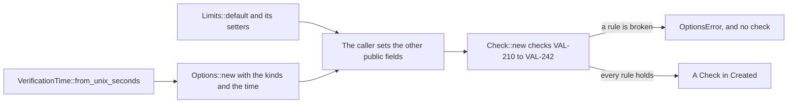

# Options

`Options` holds everything a caller fixes when it creates a check, and nothing changes them later (INV-015). This page gives `Options` and each type it holds, the limits, the signing options, and the rules that `Check::new` and the constructors check.

## Contents

- [Building options](#building-options)
- [Signatures](#signatures)
- [Parameters](#parameters)
- [Options](#options-1)
- [Value types](#value-types)
  - [`Kind`](#kind)
  - [`VerificationTime`](#verificationtime)
  - [`Level`](#level)
  - [`FieldForm`](#fieldform)
  - [`DmarcMode`](#dmarcmode)
  - [`SpfSource` and `DkimSource`](#spfsource-and-dkimsource)
- [Limits](#limits)
- [DKIM signing](#dkim-signing)
- [DKIM2 signing](#dkim2-signing)
- [Validation at construction](#validation-at-construction)
  - [`VerificationTime::from_unix_seconds`](#verificationtimefrom_unix_seconds)
  - [`Limits` setters](#limits-setters)
  - [`DocumentLimits` setters](#documentlimits-setters)
- [Validation at `Check::new`](#validation-at-checknew)

## Building options

`Options` checks nothing while the caller builds it. `Check::new` checks every rule at once. A `Limits` or `DocumentLimits` value is always valid, because each setter checks its rules, and an API that takes one checks nothing more about it.

## Signatures

| API | Signature | Returns | Requirements |
|---|---|---|---|
| `Options::new` | `fn new(kinds: Vec<Kind>, time: VerificationTime) -> Options` | `Options` with every other field at its default | GEN-001, TIM-001 |
| `VerificationTime::from_unix_seconds` | `fn from_unix_seconds(seconds: u64) -> Result<VerificationTime, OptionsError>` | The time | TIM-001 |
| `VerificationTime::unix_seconds` | `fn unix_seconds(self) -> u64` | The seconds it was built from | TIM-001 |
| `Limits::default` | `fn default() -> Limits` | Every limit of a check at the default of [Limits](../design/limits.md#limits-of-a-check) | PAR-004 |
| `Limits::set_<limit>` | `fn set_<limit>(&mut self, value: u32) -> Result<(), LimitsError>`, one for each limit of a check, such as `set_header_fields` | Nothing. The limit takes the value | PAR-004 |
| `Limits::<limit>` | `fn <limit>(&self) -> u32`, one for each limit of a check, such as `header_fields` | The limit's value | PAR-004 |
| `DocumentLimits::default` | `fn default() -> DocumentLimits` | `pasted_records_size`, `document_size` and `document_depth` at the defaults of [Limits](../design/limits.md#limits-outside-a-check) | DNS-004, DNS-010 |
| `DocumentLimits::set_<limit>` | `fn set_<limit>(&mut self, value: u32) -> Result<(), LimitsError>`, one for each of its three limits | Nothing. The limit takes the value | PAR-004 |
| `DocumentLimits::<limit>` | `fn <limit>(&self) -> u32`, one for each of its three limits | The limit's value | PAR-004 |
| `Limit::name` | `fn name(self) -> &'static str` | The limit's name as [Limits](../design/limits.md) writes it, such as `header_fields` | SAF-002 |
| `DkimSigning::new` | `fn new(domain: String, selector: Vec<u8>, statement: SignerStatement) -> DkimSigning` | One DKIM signature to add, with the other fields at their defaults | DKS-002 |
| `Dkim2Signing::new` | `fn new(domain: String, groups: Vec<Vec<Dkim2Signer>>) -> Dkim2Signing`, with `unstable-dkim2` | The DKIM2 signature to add, with the other fields at their defaults | DK2-003 |
| `Dkim2Signer::new` | `fn new(selector: Vec<u8>, statement: SignerStatement) -> Dkim2Signer`, with `unstable-dkim2` | One signer of a DKIM2 group | DK2-009 |

## Parameters

| API | Parameter | Meaning and form |
|---|---|---|
| `Options::new` | `kinds` | The kinds of check to run, in any order. A kind listed twice counts once |
| `Options::new` | `time` | The time the message was received (TIM-001) |
| `VerificationTime::from_unix_seconds` | `seconds` | Seconds since 1970-01-01T00:00:00Z |
| `Limits::set_<limit>`, `DocumentLimits::set_<limit>` | `value` | The new value, within the range that [Limits](../design/limits.md) gives |
| `DkimSigning::new` | `domain` | `d=`, as UTF-8 text: A-labels, or U-labels that RFC 8616 §5 allows |
| `DkimSigning::new` | `selector` | `s=`, as bytes |
| `DkimSigning::new` | `statement` | The signer's algorithm and public key ([Signing](signing.md#types)) |
| `Dkim2Signing::new` | `domain` | `d=`, as UTF-8 text |
| `Dkim2Signing::new` | `groups` | `s=`: each group a list of signers. A group passes when all its signers pass, and the field passes when any group does |
| `Dkim2Signer::new` | `selector` | The signer's selector, as bytes |
| `Dkim2Signer::new` | `statement` | The signer's algorithm and public key |

## Options

`Options` is `#[non_exhaustive]` with public fields. The caller builds it with `Options::new` and sets the other fields.

| Field | Type | Default | Meaning | Requirements |
|---|---|---|---|---|
| `kinds` | `Vec<Kind>` | None: `Options::new` takes it | The kinds of check to run | GEN-001 |
| `time` | `VerificationTime` | None: `Options::new` takes it | The time the message was received | TIM-001 |
| `time_checks` | `bool` | `true` | Whether signature times are compared with `time` | TIM-002 |
| `trace_level` | `Level` | `Level::Summary` | Off, summary or full | TRC-004 |
| `message_id` | `Option<String>` | `None` | The caller's ID for the message, in every event | TRC-014 |
| `limits` | `Limits` | `Limits::default()` | The limits of the check | PAR-004 |
| `field_form` | `FieldForm` | `FieldForm::default()`: CRLF, leading space kept | The form of the values that `Check::header_field` takes and that generated fields come out in | STR-008, STR-009 |
| `receiving_host` | `Option<String>` | `None`, so `%{r}` expands to `unknown` | The name of the receiving host for SPF's `%{r}`, as UTF-8 text | REC-014 |
| `dmarc_mode` | `DmarcMode` | `DmarcMode::Rfc9989` | The DMARC specification to evaluate under | DMC-001 |
| `dmarc_spf` | `SpfSource` | `SpfSource::SameCheck` | The source of DMARC's SPF identifier | DMC-005 |
| `dmarc_dkim` | `DkimSource` | `DkimSource::SameCheck` | The source of DMARC's DKIM identifiers | DMC-005 |
| `several_author_domains` | `bool` | `false` | Whether DMARC evaluates a message with several author domains | DMC-002 |
| `dkim_signing` | `Vec<DkimSigning>` | Empty | The DKIM signatures to add | DKS-002 |
| `dkim2_signing` | `Option<Dkim2Signing>`, with `unstable-dkim2` | `None` | The DKIM2 signature to add | DK2-003 |
| `verify_signatures` | `bool` | `false` | Whether each signature from the signer is verified before its field is written | SGN-006 |

## Value types

### `Kind`

`Kind` is a `#[non_exhaustive]` enum, `Copy`, because two of its variants exist only with `unstable-dkim2`.

| Variant | Meaning | Requirements |
|---|---|---|
| `SpfHelo` | SPF for the HELO identity | SPF-002 |
| `SpfMailFrom` | SPF for the MAIL FROM identity | SPF-001 |
| `Dkim` | DKIM verification | DKV-001 |
| `Dkim2` | DKIM2 verification, with `unstable-dkim2` | DK2-003 |
| `Dmarc` | DMARC evaluation | DMC-001 |
| `DkimSign` | DKIM signing | DKS-001 |
| `Dkim2Sign` | DKIM2 signing, with `unstable-dkim2` | DK2-003 |

### `VerificationTime`

`VerificationTime` is `Copy` and has no public field. It holds seconds since 1970-01-01T00:00:00Z, from 0 to 999,999,999,999 (TIM-001, VAL-201).

### `Level`

`Level` is an exhaustive enum, `Copy`.

| Variant | Meaning | Requirements |
|---|---|---|
| `Off` | No trace, and nothing allocated for one | TRC-004 |
| `Summary` | The deciding paths and every caution, once the check finishes | TRC-004 |
| `Full` | Every event, as each step finishes | TRC-004 |

### `FieldForm`

`FieldForm` is a struct with two public fields, `Copy`. Its default is `LineBreak::Crlf` and `LeadingSpace::Kept`.

| Field | Type | Requirements |
|---|---|---|
| `folds` | `LineBreak`: `Lf` or `Crlf` | STR-008, STR-009 |
| `leading_space` | `LeadingSpace`: `Removed` or `Kept` | STR-008, STR-009 |

A value never holds the line ending that ends the field. Each variant means:

| Field | Variant | A value that `Check::header_field` takes | A value that hallmark generates |
|---|---|---|---|
| `folds` | `Crlf` | Its folds are CRLF followed by WSP | Its folds are CRLF followed by WSP |
| `folds` | `Lf` | Its folds are LF followed by WSP. The check reads each LF that WSP follows as CRLF | Its folds are LF followed by WSP |
| `leading_space` | `Kept` | It is the field body as the message holds it, from the octet after the colon. The check adds nothing | It starts with one SP, so the name, a colon and the value give `Name: value` |
| `leading_space` | `Removed` | The receiving side removed the first octet of the field body if that octet was SP. The check can't tell whether it did, adds one SP after the colon, and records that assumption in the trace (STR-008) | It has no leading SP, for a receiving side that adds one |

### `DmarcMode`

`DmarcMode` is an exhaustive enum, `Copy`.

| Variant | Meaning | Requirements |
|---|---|---|
| `Rfc9989` | DMARC under RFC 9989, the default | DMC-001 |
| `Rfc7489` | DMARC under RFC 7489, with public suffix questions to the caller | DMC-001, DMC-010 |

### `SpfSource` and `DkimSource`

Both are exhaustive enums.

| Enum | Variant | Carries | Meaning | Requirements |
|---|---|---|---|---|
| `SpfSource` | `SameCheck` | Nothing | The SPF MAIL FROM kind of this check gives the identifier | GEN-001 |
| `SpfSource` | `Earlier` | `SpfResult` ([Results](results.md#spf)) | A result from another check, for the MAIL FROM identity | DMC-005 |
| `SpfSource` | `Absent` | Nothing | No SPF identifier | RFC 9989 §5.3.3 |
| `DkimSource` | `SameCheck` | Nothing | The DKIM kind of this check gives the identifiers | GEN-001 |
| `DkimSource` | `Earlier` | `Vec<DkimResult>` ([Results](results.md#dkim)) | Results from another check | DMC-005 |
| `DkimSource` | `Absent` | Nothing | No DKIM identifier | RFC 9989 §5.3.3 |

An earlier result carries its position in the trace of the check that made it, and DMARC's alignment steps name it by that position (DMC-005).

## Limits

`Limits` and `DocumentLimits` have private fields, and each setter checks its rules (VAL-202 to VAL-204). [Limits](../design/limits.md) gives each limit's default, range and effect. All the values fit in `u32`.

| Type | Limits it holds |
|---|---|
| `Limits` | `header_fields`, `header_field_size`, `header_section_size`, `comment_depth`, `mailboxes`, `address_size`, `rcpt_to`, `rt_entries`, `dkim_signatures`, `key_records`, `rsa_key_bits`, `rsa_exponent_bits`, `author_domains`, `dns_questions`, `answer_size`, `dkim2_signatures`, `message_instances`, `recipe_steps`, `recipe_size`, `recipe_depth`, `spf_void_lookups`, `trace_size`, `trace_places` |
| `DocumentLimits` | `pasted_records_size`, `document_size`, `document_depth` |

`Limit` is a `#[non_exhaustive]` enum, `Copy`, that names one limit in errors and results. It has one variant for each limit above and for `driver_in_flight`, named in UpperCamelCase, such as `Limit::HeaderFields` and `Limit::DriverInFlight`.

## DKIM signing

`DkimSigning` adds one DKIM-Signature field (DKS-002). It is `#[non_exhaustive]` with public fields.

| Field | Type | Default | Meaning | Requirements |
|---|---|---|---|---|
| `domain` | `String` | None: `DkimSigning::new` takes it | `d=` | RFC 6376 §3.5 |
| `selector` | `Vec<u8>` | None: `DkimSigning::new` takes it | `s=` | RFC 6376 §3.1 |
| `statement` | `SignerStatement` ([Signing](signing.md#types)) | None: `DkimSigning::new` takes it | The signer's algorithm and public key | SGN-003 |
| `headers` | `Vec<String>` | From, Reply-To, Subject, Date, To, Cc, Resent-Date, Resent-From, Resent-To, Resent-Cc, In-Reply-To, References, List-Id, List-Help, List-Unsubscribe, List-Subscribe, List-Post, List-Owner, List-Archive | The names of the fields to sign, from RFC 6376 §5.4.1 | DKS-003 |
| `oversign` | `bool` | `false` | Sign one more instance of each listed field than the message has, DKIM-Signature excepted | DKS-003, DKS-006 |
| `canonicalization` | `DkimCanonicalization` | `relaxed/relaxed` | `c=` | DKS-003 |
| `expiration` | `Option<u64>` | `None`, so no `x=` | Seconds after `t=`. `x=` is `t=` plus this | DKS-004 |

`DkimCanonicalization` is a struct with the public fields `header` and `body`, `Copy`. Each is a `CanonAlgorithm`: `Simple` or `Relaxed` (RFC 6376 §3.4).

`t=` comes from `time` (DKS-004). hallmark never writes `l=`.

## DKIM2 signing

`Dkim2Signing` adds one DKIM2-Signature field, and the Message-Instance field that a Reviser needs (DK2-014). It and every type in this section exist only with the `unstable-dkim2` feature. Each struct here is `#[non_exhaustive]` with public fields.

| Field | Type | Default | Meaning | Requirements |
|---|---|---|---|---|
| `domain` | `String` | None: `Dkim2Signing::new` takes it | `d=` | draft-09 §10.8 |
| `groups` | `Vec<Vec<Dkim2Signer>>` | None: `Dkim2Signing::new` takes it | `s=`: a group passes when all its signers pass, and the field passes when any group does | draft-09 §10.9, DK2-009 |
| `mail_from` | `Option<Vec<u8>>` | `None` | `mf=`: the reverse-path of the outgoing SMTP transaction, with its angle brackets | draft-09 §10.5 |
| `rcpt_to` | `Vec<Vec<u8>>` | Empty | `rt=`: the forward-paths of the outgoing SMTP transaction, each with its angle brackets | draft-09 §10.6 |
| `next_domain` | `Option<String>` | `None` | `nd=`, which replaces `mf=` and `rt=` | draft-09 §10.7 |
| `nonce` | `Option<String>` | `None` | `n=` | draft-09 §10.3 |
| `flags` | `Dkim2Flags` | Every flag `false` | `f=` | draft-09 §10.10 |
| `revision` | `Option<Revision>` | `None`, so the message is unchanged | The changes a Reviser made | DK2-014 |

| Type | Field or variant | Type or carries | Meaning | Requirements |
|---|---|---|---|---|
| `Dkim2Signer` | `selector` | `Vec<u8>` | The signer's selector | dns-03 §3 |
| `Dkim2Signer` | `statement` | `SignerStatement` | The signer's algorithm and public key | SGN-003 |
| `Dkim2Flags` | `feedback`, `feedhere`, `exploded` | `bool` each | The flags of `f=`. `Dkim2Flags` implements `Default` | draft-09 §10.10 |
| `Revision` | `body` | `Option<BodyRevision>` | The change to the body, or `None` when the body is unchanged | DK2-014 |
| `Revision` | `header_fields` | `Vec<FieldRevision>` | One entry for each field name whose fields the Reviser changed, added or removed | DK2-014 |
| `BodyRevision` | `Earlier` | `Vec<EarlierLines>` | The earlier body, from its first line to its last | DK2-014, draft-09 §5.2 |
| `BodyRevision` | `NullRecipe` | Nothing | The earlier body can't be rebuilt. hallmark writes a null body recipe | DK2-007, draft-09 §5.2 |
| `EarlierLines` | `Unchanged` | `first: u64`, `last: u64` | Lines `first` to `last` of the new body, counted from 1 as DK2-008 counts them, came unchanged from the earlier body | DK2-014 |
| `EarlierLines` | `Replaced` | `Vec<Vec<u8>>` | Lines of the earlier body that the new body doesn't hold, each without its CRLF | DK2-014 |
| `FieldRevision` | `name` | `String` | The field name | draft-09 §5.1 |
| `FieldRevision` | `earlier_values` | `Vec<Vec<u8>>` | The values of the fields with this name in the earlier header section, each without its final CRLF, from the bottom of the header section up. Empty when the earlier header section had none | draft-09 §5.1 |

`BodyRevision` and `EarlierLines` are exhaustive enums. `Revision` implements `Default`: no body change and no field change.

## Validation at construction

### `VerificationTime::from_unix_seconds`

| ID | Input | Rule | Error code | Requirement | Scenario |
|---|---|---|---|---|---|
| VAL-201 | `seconds` | At most 999,999,999,999, the largest `t=` of twelve digits | `options.time_out_of_range` | TIM-001, DKS-004, RFC 6376 §3.5 | API-201 |

### `Limits` setters

| ID | Input | Rule | Error code | Requirement | Scenario |
|---|---|---|---|---|---|
| VAL-202 | `value` | Within the range that [Limits](../design/limits.md#limits-of-a-check) gives for the limit | `limits.out_of_range` | PAR-004 | API-202 |
| VAL-203 | `value` of `set_header_field_size` or `set_header_section_size` | `header_field_size` at most `header_section_size`, after the change | `limits.conflict` | PAR-004 | API-203 |

### `DocumentLimits` setters

| ID | Input | Rule | Error code | Requirement | Scenario |
|---|---|---|---|---|---|
| VAL-204 | `value` | Within the range that [Limits](../design/limits.md#limits-outside-a-check) gives for the limit | `limits.out_of_range` | PAR-004 | API-204 |

## Validation at `Check::new`

`Check::new` checks these rules in order and gives the code of the first one broken. Rules for a DMARC source apply only when the kinds hold DMARC.

| ID | Input | Rule | Error code | Requirement | Scenario |
|---|---|---|---|---|---|
| VAL-210 | `kinds` | Holds at least one kind | `options.no_kind` | GEN-001 | API-210 |
| VAL-211 | `dmarc_spf` | `SameCheck` only when the kinds hold SPF MAIL FROM | `options.source_kind_missing` | DMC-005 | API-211 |
| VAL-212 | `dmarc_dkim` | `SameCheck` only when the kinds hold DKIM | `options.source_kind_missing` | DMC-005 | API-212 |
| VAL-213 | `dmarc_spf` | An `Earlier` result is for the MAIL FROM identity | `options.earlier_result_invalid` | DMC-005 | API-213 |
| VAL-214 | `message_id` | 1 to 256 octets, when given | `options.message_id_invalid` | TRC-014, RFC 7493 §2.1 | API-214 |
| VAL-215 | `receiving_host` | A domain name with a lookup form | `options.receiving_host_invalid` | REC-014, ADS-002 | API-215 |
| VAL-216 | `kinds`, `dkim_signing` | The kinds hold `DkimSign` exactly when the list isn't empty | `options.signing_mismatch` | GEN-001, DKS-002 | API-216 |
| VAL-217 | `kinds`, `dkim2_signing` | The kinds hold `Dkim2Sign` exactly when `dkim2_signing` is `Some` | `options.signing_mismatch` | GEN-001, DK2-003 | API-217 |
| VAL-220 | `DkimSigning.domain` | A domain name with a lookup form | `options.signing_domain_invalid` | ADS-002, RFC 6376 §3.5 | API-220 |
| VAL-221 | `DkimSigning.selector` | Matches `selector` of RFC 6376 §3.1, and the key name `<selector>._domainkey.<domain>` fits ADS-004 | `options.selector_invalid` | DNS-008, RFC 6376 §3.1 | API-221 |
| VAL-222 | `DkimSigning.statement` | The algorithm is `RsaSha256` or `Ed25519Sha256` | `options.algorithm_not_allowed` | DKS-001 | API-222 |
| VAL-223 | `DkimSigning.statement` | The public key decodes for its algorithm: an RSAPublicKey or a SubjectPublicKeyInfo that holds one, or 32 octets of Ed25519 | `options.public_key_invalid` | SGN-003, RFC 8463 §4.2 | API-223 |
| VAL-224 | `DkimSigning.statement` | An RSA modulus has at least 1,024 bits | `options.rsa_key_too_small` | SGN-003, RFC 8301 §3.2 | SIGN-004 |
| VAL-225 | `DkimSigning.statement` | An RSA modulus has at most `rsa_key_bits` bits | `options.rsa_key_too_large` | SAF-002 | API-225 |
| VAL-226 | `DkimSigning.headers` | Each name matches `field-name` of RFC 5322 §3.6.8 | `options.header_name_invalid` | DKS-003 | API-226 |
| VAL-227 | `DkimSigning.headers` | Holds From, in any case | `options.from_not_signed` | DKS-003, RFC 6376 §5.4 | API-227 |
| VAL-228 | `DkimSigning.expiration` | At least 1, and `time` plus it at most 999,999,999,999 | `options.expiration_invalid` | DKS-004, RFC 6376 §3.5 | API-228 |
| VAL-230 | `Dkim2Signing.domain` | A domain name with a lookup form | `options.signing_domain_invalid` | ADS-002, draft-09 §10.8 | API-230 |
| VAL-231 | `Dkim2Signing.groups` | At least one group, and at least one signer in each | `options.no_signer` | draft-09 §10.9 | API-231 |
| VAL-232 | `Dkim2Signing.groups` | Each selector matches `selector` of RFC 6376 §3.1 and fits ADS-004 in its key name | `options.selector_invalid` | dns-03 §3 | API-232 |
| VAL-233 | `Dkim2Signing.groups` | No selector appears twice | `options.selector_repeated` | draft-09 §10.9 | API-233 |
| VAL-234 | `Dkim2Signing.groups` | Each public key decodes for its algorithm: RSA as in VAL-223, 32 octets of Ed25519, or 1,312 octets of ML-DSA-44 | `options.public_key_invalid` | DK2-011, dns-03 §4 | API-234 |
| VAL-235 | `Dkim2Signing.groups` | An RSA modulus has from 1,024 to `rsa_key_bits` bits | `options.rsa_key_too_small` or `options.rsa_key_too_large` | SGN-003, draft-09 §3.2 | API-235 |
| VAL-236 | `Dkim2Signing.groups` | An RSA public exponent is 65537 | `options.rsa_exponent_not_65537` | SGN-003, draft-09 §3.2 | SIGN-005 |
| VAL-237 | `Dkim2Signing` | Either `next_domain` with no `mail_from` and no `rcpt_to`, or `mail_from` and at least one `rcpt_to` with no `next_domain` | `options.dkim2_envelope_invalid` | draft-09 §10.7 | API-237 |
| VAL-238 | `Dkim2Signing.mail_from`, `rcpt_to` | `mail_from` is a Reverse-path and each `rcpt_to` a Forward-path, with angle brackets and without parameters | `options.path_invalid` | ADS-020, ADS-021, draft-09 §10.5, §10.6 | API-238 |
| VAL-239 | `Dkim2Signing.rcpt_to` | At most `rcpt_to` paths | `options.rcpt_to_limit` | SAF-004 | API-239 |
| VAL-240 | `Dkim2Signing.next_domain` | A domain name with a lookup form | `options.signing_domain_invalid` | ADS-002, draft-09 §10.7 | API-240 |
| VAL-241 | `Dkim2Signing.nonce` | At most 64 characters of printable ASCII other than `;` | `options.nonce_invalid` | draft-09 §10.3 | API-241 |
| VAL-242 | `Dkim2Signing.revision` | The `Unchanged` ranges have `first` at most `last`, start at line 1 or later, and go in ascending order without overlap | `options.revision_invalid` | DK2-014, draft-09 §5.2 | API-242 |

Signing rules that depend on the message, such as an `exploded` flag on the first DKIM2-Signature (draft-09 §12.5) or a revision that misses a body change (SIGN-022), stop signing with an error in the results ([Errors](errors.md#signing-errors-in-the-results)).
