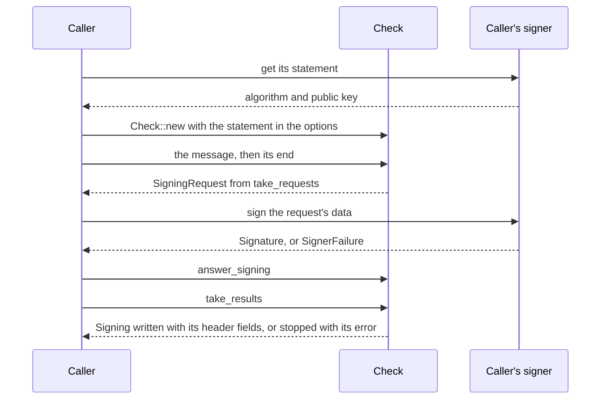
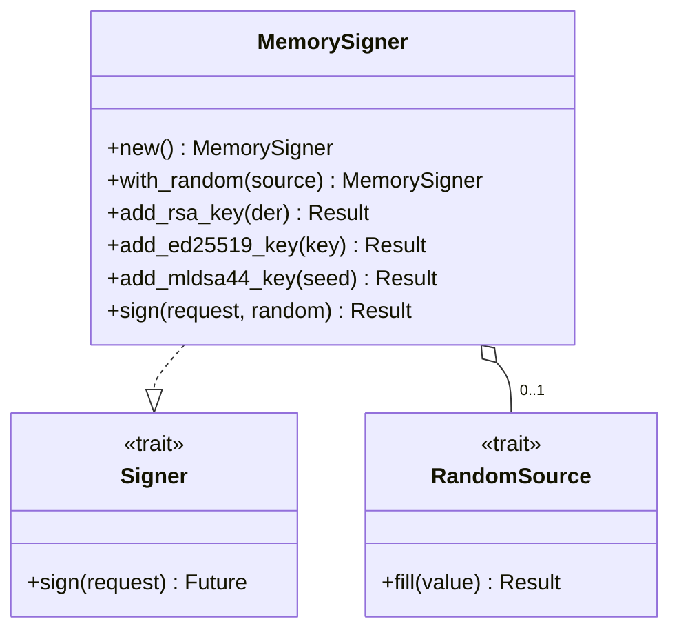

# Signing

The values that signing passes between a check and the caller's signer, and `MemorySigner`, the library's signer for keys in memory ([ADR 0042](../../adr/0042-signing-goes-through-a-signer-the-caller-supplies-and-the-caller-can-have-each-signature-verified.md)). [Lifecycle](../design/lifecycle.md#signing) gives the states of one signature, and [Driver](driver.md#traits) gives the `Signer` trait.

## Contents

- [Flow](#flow)
- [Signatures](#signatures)
- [Parameters](#parameters)
- [Types](#types)
- [MemorySigner](#memorysigner)
- [Validation](#validation)
  - [Values a check takes](#values-a-check-takes)
  - [`MemorySigner::with_random`](#memorysignerwith_random)
  - [`MemorySigner::add_rsa_key`](#memorysigneradd_rsa_key)
  - [`MemorySigner::add_ed25519_key`](#memorysigneradd_ed25519_key)
  - [`MemorySigner::add_mldsa44_key`](#memorysigneradd_mldsa44_key)
  - [`MemorySigner::sign`](#memorysignersign)

## Flow

## Signatures

| API | Signature | Returns | Requirements |
|---|---|---|---|
| `SignerStatement::new` | `fn new(algorithm: Algorithm, public_key: Vec<u8>) -> SignerStatement` | The statement of a signer the caller supplies | SGN-003 |
| `Signature::new` | `fn new(bytes: Vec<u8>) -> Signature` | A signature to hand to `Check::answer_signing` | SGN-004 |
| `SignerFailure::new` | `fn new(description: String) -> SignerFailure` | A failure to hand to `Check::answer_signing` | SGN-004 |
| `RandomFailure::new` | `fn new(description: String) -> RandomFailure` | A failure of a `RandomSource` | SGN-005 |
| `MemorySigner::new` | `fn new() -> MemorySigner` | A signer with no keys | SGN-005 |
| `MemorySigner::with_random` | `fn with_random(source: Box<dyn RandomSource>) -> MemorySigner` | A signer with no keys that can sign ML-DSA-44 through the `Signer` trait | SGN-005, IO-001 |
| `MemorySigner::add_rsa_key` | `fn add_rsa_key(&mut self, der: &[u8]) -> Result<SignerStatement, KeyError>` | The key's statement | SGN-005, SEC-001 |
| `MemorySigner::add_ed25519_key` | `fn add_ed25519_key(&mut self, key: &[u8; 32]) -> Result<SignerStatement, KeyError>` | The key's statement | SGN-005, SEC-001 |
| `MemorySigner::add_mldsa44_key` | `fn add_mldsa44_key(&mut self, seed: &[u8; 32]) -> Result<SignerStatement, KeyError>`, with `unstable-dkim2` | The key's statement | SGN-005, DK2-009 |
| `MemorySigner::sign` | `fn sign(&self, request: &SigningRequest, random: Option<&[u8; 32]>) -> Result<Signature, SignerFailure>` | The signature, at once | SGN-005 |
| `Signer` for `MemorySigner` | `fn sign(&self, request: SigningRequest) -> impl Future<Output = Result<Signature, SignerFailure>> + Send` | A future that is ready at once | [ADR 0048](../../adr/0048-the-resolver-the-suffix-source-and-the-signer-return-futures-that-are-send.md) |
| `RandomSource::fill` | `fn fill(&self, value: &mut [u8; 32]) -> Result<(), RandomFailure>`, which the caller implements | Nothing. `value` holds 32 random octets | SGN-005, IO-001 |

## Parameters

| API | Parameter | Meaning and form |
|---|---|---|
| `SignerStatement::new` | `algorithm` | The algorithm the signer signs with |
| `SignerStatement::new` | `public_key` | The public key: for RSA, an RSAPublicKey or a SubjectPublicKeyInfo that holds one, in DER. For Ed25519, 32 octets. For ML-DSA-44, 1,312 octets |
| `Signature::new` | `bytes` | The signature value, before base64 |
| `SignerFailure::new`, `RandomFailure::new` | `description` | Text for the caller's logs. The check keeps it out of the trace (SGN-004) |
| `MemorySigner::with_random` | `source` | The caller's source of random values for ML-DSA-44 |
| `MemorySigner::add_rsa_key` | `der` | An RSAPrivateKey in DER (RFC 8017 Appendix A.1.2). The signer copies it, and the caller zeroes its own copy |
| `MemorySigner::add_ed25519_key` | `key` | A private key (RFC 8032 §5.1.5) |
| `MemorySigner::add_mldsa44_key` | `seed` | A seed for the ML-DSA-44 key pair |
| `MemorySigner::sign` | `request` | A signing request from a check |
| `MemorySigner::sign` | `random` | For `Mldsa44`, the random value of the hedged variant (draft-09 §3.4). `None` for the other algorithms |
| `Signer` for `MemorySigner` | `request` | A signing request from a check |
| `RandomSource::fill` | `value` | Where the source writes 32 random octets |

## Types

| Type | Field or variant | Type or carries | Meaning | Requirements |
|---|---|---|---|---|
| `Algorithm` | `RsaSha256` | Nothing | `rsa-sha256` | DKS-001 |
| `Algorithm` | `Ed25519Sha256` | Nothing | `ed25519-sha256` | DKS-001, RFC 8463 |
| `Algorithm` | `Mldsa44` | Nothing | `mldsa44`, with `unstable-dkim2` | DK2-009 |
| `SignerStatement` | `algorithm` | `Algorithm` | The signer's algorithm | SGN-003 |
| `SignerStatement` | `public_key` | `Vec<u8>` | The signer's public key, in the form of `SignerStatement::new` | SGN-003 |
| `SigningRequest` | `id` | `RequestId` ([Check](check.md#questionid-and-requestid)) | Names the request in `answer_signing` | CHK-004 |
| `SigningRequest` | `kind` | `SigningKind`: `Dkim`, or `Dkim2` with `unstable-dkim2` | The kind of signature | SGN-002 |
| `SigningRequest` | `statement` | `SignerStatement` | The statement the request was made for | SGN-003 |
| `SigningRequest` | `domain` | `String` | `d=`, in lookup form | SGN-002 |
| `SigningRequest` | `selector` | `Vec<u8>` | `s=` | SGN-002 |
| `SigningRequest` | `data` | `Vec<u8>` | What the signer signs, by algorithm in the table below | SGN-002 |
| `Signature` | `bytes` | `Vec<u8>` | The signature value, before base64 | SGN-004 |
| `SignerFailure` | `description` | `String` | Why the signer couldn't sign | SGN-004 |
| `RandomFailure` | `description` | `String` | Why the source gave no value | SGN-005 |

`Algorithm` and `SigningKind` are `#[non_exhaustive]` enums, `Copy`. `SigningRequest` is built by the check. `SignerStatement`, `Signature`, `SignerFailure` and `RandomFailure` are `#[non_exhaustive]` with public fields, and the caller builds them with `new`.

| Algorithm | `data` | Signature size | Requirements |
|---|---|---|---|
| `RsaSha256` | The SHA-256 hash, for RSASSA-PKCS1-v1_5 | The modulus size in octets | SGN-002, RFC 8017 §8.2.1 |
| `Ed25519Sha256` | The SHA-256 hash, which Ed25519 takes as its message | 64 octets | SGN-002, RFC 8032 §5.1.6 |
| `Mldsa44` | The whole signing input, unhashed, signed with the context string `DKIM2` | 2,420 octets | SGN-002, draft-09 §3.4 |

## MemorySigner

`RandomSource` requires `Send` and `Sync`, so a `MemorySigner` that holds one stays `Send` and `Sync` ([Concurrency](../design/concurrency.md#send-and-sync)). `MemorySigner` implements neither `Debug` nor `Clone`.

| Rule | Requirements |
|---|---|
| `MemorySigner` finds the key by the public key in the request's statement | SGN-003 |
| It draws no random number. ML-DSA-44 uses the hedged variant with a random value from the caller: the `random` parameter of `sign`, or the `RandomSource` through the `Signer` trait | SGN-005, IO-001 |
| Its keys neither print nor format, and their memory is zeroed when the signer is dropped. No error holds a byte of a key | SEC-001, SEC-002 |
| It doesn't verify its own signatures at run time. Tests do | ADR 0042 |

## Validation

### Values a check takes

| Value | Checked by | Rules |
|---|---|---|
| `SignerStatement` in `DkimSigning` | `Check::new` | [VAL-222 to VAL-225](options.md#validation-at-checknew) |
| `SignerStatement` in `Dkim2Signer` | `Check::new` | [VAL-234 to VAL-236](options.md#validation-at-checknew) |
| `Signature`, `SignerFailure` | `Check::answer_signing` | [VAL-140 to VAL-143](check.md#checkanswer_signing) |

### `MemorySigner::with_random`

| ID | Input | Rule | Error code | Requirement | Scenario |
|---|---|---|---|---|---|
| | `source` | No rule: any `RandomSource` | | SGN-005 | SIGN-010 |

### `MemorySigner::add_rsa_key`

| ID | Input | Rule | Error code | Requirement | Scenario |
|---|---|---|---|---|---|
| VAL-401 | `der` | Decodes as an RSAPrivateKey whose parts agree | `key.invalid` | SGN-005, RFC 8017 Appendix A.1.2 | API-401 |
| VAL-402 | `der` | The modulus has from 1,024 to 16,384 bits | `key.rsa_size` | DKS-001, RFC 8301 §3.2 | API-402 |
| VAL-403 | `der` | The signer holds no key with the same public key | `key.duplicate` | SGN-005 | API-403 |

### `MemorySigner::add_ed25519_key`

| ID | Input | Rule | Error code | Requirement | Scenario |
|---|---|---|---|---|---|
| VAL-404 | `key` | The signer holds no key with the same public key | `key.duplicate` | SGN-005 | API-404 |

The type takes exactly 32 octets, so no other rule applies.

### `MemorySigner::add_mldsa44_key`

| ID | Input | Rule | Error code | Requirement | Scenario |
|---|---|---|---|---|---|
| VAL-405 | `seed` | The signer holds no key with the same public key | `key.duplicate` | SGN-005 | API-405 |

### `MemorySigner::sign`

| ID | Input | Rule | Error code | Requirement | Scenario |
|---|---|---|---|---|---|
| VAL-410 | `request` | The signer holds the key of the request's statement | `signer.key_unknown` | SGN-005 | API-410 |
| VAL-411 | `random` | `Some` when the algorithm is `Mldsa44`, and `None` otherwise | `signer.random_mismatch` | SGN-005 | API-411 |
| VAL-412 | The signer | Through the `Signer` trait, an `Mldsa44` request needs a `RandomSource` whose `fill` succeeds | `signer.random_unavailable` | SGN-005, IO-001 | API-412 |

`sign` and the trait report a broken rule as a `SignerFailure` whose description names the code, so the caller can hand it to the check as it is (SGN-004).
