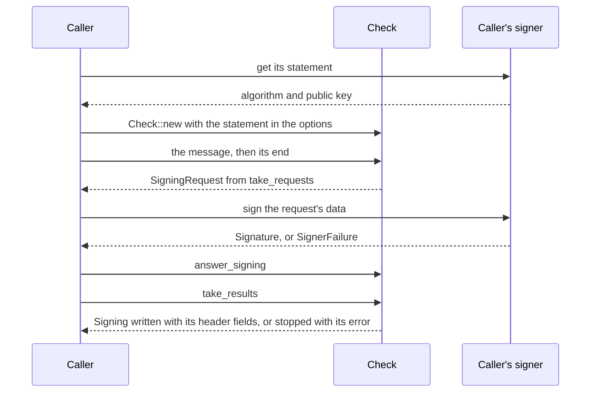
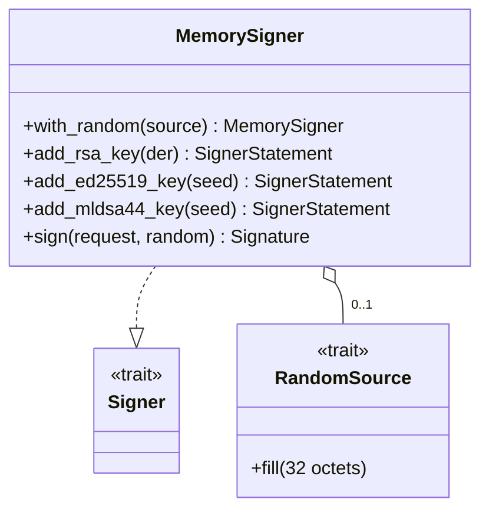

# Signing

The values that signing passes between a check and the caller's signer, and `MemorySigner`, the library's signer for keys in memory ([ADR 0042](../../adr/0042-signing-goes-through-a-signer-the-caller-supplies-and-the-caller-can-have-each-signature-verified.md)). [Lifecycle](../design/lifecycle.md#signing) gives the states of one signature.

## Contents

- [Flow](#flow)
- [Types](#types)
- [MemorySigner](#memorysigner)
- [Validation](#validation)
  - [Values a check takes](#values-a-check-takes)
  - [`MemorySigner::with_random`](#memorysignerwith_random)
  - [`MemorySigner::add_rsa_key`](#memorysigneradd_rsa_key)
  - [`MemorySigner::add_ed25519_key`](#memorysigneradd_ed25519_key)
  - [`MemorySigner::add_mldsa44_key`](#memorysigneradd_mldsa44_key)
  - [`MemorySigner::sign`](#memorysignersign)

## Flow

## Types

| Type | Members | Meaning | Requirements |
|---|---|---|---|
| `Algorithm` | `rsa-sha256`, `ed25519-sha256`, and with `unstable-dkim2` `mldsa44` | The signature algorithm | DKS-001, DK2-009 |
| `SignerStatement` | `algorithm`, `public_key` | The signer's statement before signing. An RSA key is an RSAPublicKey or a SubjectPublicKeyInfo that holds one | SGN-003 |
| `SigningRequest` | `id`, the kind (DKIM or DKIM2), the `SignerStatement` it was made for, the domain, the selector, and `data` | One signature to make | SGN-002 |
| `RequestId` | A number unique within the check | Names the request in `answer_signing` | CHK-004 |
| `Signature` | Bytes | The signature value, before base64 | SGN-004 |
| `SignerFailure` | A description, as text | The signer couldn't sign | SGN-004 |

| Algorithm | `data` | Signature size | Requirements |
|---|---|---|---|
| `rsa-sha256` | The SHA-256 hash, for RSASSA-PKCS1-v1_5 | The modulus size in octets | SGN-002, RFC 8017 §8.2.1 |
| `ed25519-sha256` | The SHA-256 hash, which Ed25519 takes as its message | 64 octets | SGN-002, RFC 8032 §5.1.6 |
| `mldsa44` | The whole signing input, unhashed, signed with the context string `DKIM2` | 2,420 octets | SGN-002, draft-09 §3.4 |

## MemorySigner

| API | Takes | Gives | Requirements |
|---|---|---|---|
| `MemorySigner::new` | Nothing | A signer with no keys | SGN-005 |
| `MemorySigner::with_random` | A `RandomSource` that the caller implements | A signer with no keys that can sign ML-DSA-44 through the `Signer` trait | SGN-005, IO-001 |
| `MemorySigner::add_rsa_key` | An RSAPrivateKey in DER (RFC 8017 Appendix A.1.2) | Its `SignerStatement`, or `KeyError` | SGN-005, SEC-001 |
| `MemorySigner::add_ed25519_key` | A 32-octet private key (RFC 8032 §5.1.5) | Its `SignerStatement`, or `KeyError` | SGN-005, SEC-001 |
| `MemorySigner::add_mldsa44_key` | A 32-octet seed, with `unstable-dkim2` | Its `SignerStatement`, or `KeyError` | SGN-005, DK2-009 |
| `MemorySigner::sign` | A `SigningRequest`, and for `mldsa44` a 32-octet random value | `Signature`, or `SignerFailure` | SGN-005 |
| `Signer` for `MemorySigner` | A `SigningRequest` | A future of `Signature` or `SignerFailure` that is ready at once | ADR 0048 |

| Rule | Requirements |
|---|---|
| `MemorySigner` finds the key by the public key in the request's statement | SGN-003 |
| It draws no random number. ML-DSA-44 uses the hedged variant with a random value from the caller: the argument of `sign`, or the `RandomSource` through the `Signer` trait | SGN-005, IO-001 |
| Its keys neither print nor format, and their memory is zeroed when the signer is dropped. No error holds a byte of a key | SEC-001, SEC-002 |
| It doesn't verify its own signatures at run time. Tests do | ADR 0042 |

## Validation

### Values a check takes

| Value | Checked by | Rules |
|---|---|---|
| `SignerStatement` in `DkimSigning` | `Check::new` | [VAL-222 to VAL-225](options.md#validation-at-checknew) |
| `SignerStatement` in `Dkim2Signing` | `Check::new` | [VAL-234 to VAL-236](options.md#validation-at-checknew) |
| `Signature`, `SignerFailure` | `Check::answer_signing` | [VAL-140 to VAL-143](check.md#checkanswer_signing) |

### `MemorySigner::with_random`

| ID | Input | Rule | Error code | Requirement | Scenario |
|---|---|---|---|---|---|
| | `source` | No rule: any `RandomSource` | | SGN-005 | SIGN-010 |

### `MemorySigner::add_rsa_key`

| ID | Input | Rule | Error code | Requirement | Scenario |
|---|---|---|---|---|---|
| VAL-401 | `der` | Decodes as an RSAPrivateKey whose parts agree | `key.invalid` | SGN-005, RFC 8017 Appendix A.1.2 | API-401 |
| VAL-402 | `der` | The modulus has from 1,024 to 16,384 bits | `key.rsa_size` | DKS-001, RFC 8301 §3.2 | API-402 |
| VAL-403 | `der` | The signer holds no key with the same public key | `key.duplicate` | SGN-005 | API-403 |

### `MemorySigner::add_ed25519_key`

| ID | Input | Rule | Error code | Requirement | Scenario |
|---|---|---|---|---|---|
| VAL-404 | `key` | The signer holds no key with the same public key | `key.duplicate` | SGN-005 | API-404 |

The type takes exactly 32 octets, so no other rule applies.

### `MemorySigner::add_mldsa44_key`

| ID | Input | Rule | Error code | Requirement | Scenario |
|---|---|---|---|---|---|
| VAL-405 | `seed` | The signer holds no key with the same public key | `key.duplicate` | SGN-005 | API-405 |

### `MemorySigner::sign`

| ID | Input | Rule | Error code | Requirement | Scenario |
|---|---|---|---|---|---|
| VAL-410 | `request` | The signer holds the key of the request's statement | `signer.key_unknown` | SGN-005 | API-410 |
| VAL-411 | `random` | Given when the algorithm is `mldsa44`, and absent otherwise | `signer.random_mismatch` | SGN-005 | API-411 |
| VAL-412 | The signer | Through the `Signer` trait, an `mldsa44` request needs a `RandomSource` that fills the value | `signer.random_unavailable` | SGN-005, IO-001 | API-412 |

`sign` and the trait report a broken rule as a `SignerFailure` whose description names the code, so the caller can hand it to the check as it is (SGN-004).
