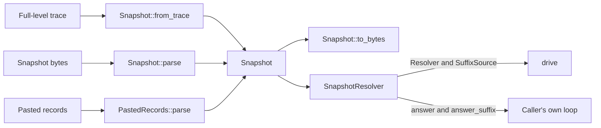

# Snapshots and pasted records

The APIs that keep the DNS answers of a check and answer from them later: snapshots, their resolver, and records pasted in the presentation format (DNS-004, DNS-010, [ADR 0035](../../adr/0035-dns-snapshots-and-demo-cases-are-documents-in-the-trace-formats-conventions.md)). [Trace format](../trace-format.md#snapshots) defines a snapshot's bytes. Demo cases get their API with the demo, which settles their options ([open item](../requirements.md#open-items)).

## Contents

- [Flow](#flow)
- [Signatures](#signatures)
- [Parameters](#parameters)
- [Types](#types)
- [Validation](#validation)
  - [`Snapshot::parse`](#snapshotparse)
  - [`Snapshot::from_trace`](#snapshotfrom_trace)
  - [`Snapshot::to_bytes`](#snapshotto_bytes)
  - [`SnapshotResolver::new`](#snapshotresolvernew)
  - [`SnapshotResolver::answer` and `answer_suffix`](#snapshotresolveranswer-and-answer_suffix)
  - [`PastedRecords::parse`](#pastedrecordsparse)

## Flow

## Signatures

| API | Signature | Returns | Requirements |
|---|---|---|---|
| `Snapshot::parse` | `fn parse(bytes: &[u8], limits: &DocumentLimits) -> Result<Snapshot, DocumentError>` | The snapshot | DNS-004 |
| `Snapshot::from_trace` | `fn from_trace(trace: &[u8], limits: &DocumentLimits) -> Result<Snapshot, DocumentError>` | The snapshot of the answers the trace records | TRC-008 |
| `Snapshot::to_bytes` | `fn to_bytes(&self) -> Vec<u8>` | The snapshot in the fixed form of bytes | DNS-004, TRC-007 |
| `SnapshotResolver::new` | `fn new(snapshot: Snapshot) -> SnapshotResolver` | A resolver that answers from the snapshot | DNS-004 |
| `SnapshotResolver::answer` | `fn answer(&self, question: &Question) -> Answer` | The answer the snapshot holds | DNS-004 |
| `SnapshotResolver::answer_suffix` | `fn answer_suffix(&self, question: &SuffixQuestion) -> SuffixAnswer` | The suffix answer the snapshot holds | DNS-004 |
| `Resolver` for `SnapshotResolver` | `fn resolve(&self, question: Question) -> impl Future<Output = Answer> + Send` | A future that is ready at once with the answer of `answer` | DNS-004, ADR 0048 |
| `SuffixSource` for `SnapshotResolver` | `fn suffix(&self, question: SuffixQuestion) -> impl Future<Output = SuffixAnswer> + Send` | A future that is ready at once with the answer of `answer_suffix` | DNS-004, ADR 0048 |
| `PastedRecords::parse` | `fn parse(text: &str, limits: &DocumentLimits) -> Result<Snapshot, DocumentError>` | A snapshot that answers as complete zone data | DNS-010 |

## Parameters

| API | Parameter | Meaning and form |
|---|---|---|
| `Snapshot::parse` | `bytes` | One snapshot document in the form of [Trace format](../trace-format.md#snapshots) |
| `Snapshot::from_trace` | `trace` | The bytes of one whole trace at the full level, its events sorted or not |
| `Snapshot::parse`, `from_trace`, `PastedRecords::parse` | `limits` | The size and depth limits of [Limits](../design/limits.md#limits-outside-a-check) |
| `SnapshotResolver::new` | `snapshot` | The snapshot to answer from |
| `SnapshotResolver::answer`, `resolve` | `question` | A DNS question from a check |
| `SnapshotResolver::answer_suffix`, `suffix` | `question` | A public suffix question from a check |
| `PastedRecords::parse` | `text` | Records, one per line, in the presentation format of RFC 1035 §5.1 |

## Types

| Type | Shape | Meaning | Requirements |
|---|---|---|---|
| `Snapshot` | Private fields. `Clone`, `PartialEq`, `Eq` | The questions of a check, each with its answer, and whether it answers as complete zone data | DNS-004, DNS-010 |
| `SnapshotResolver` | Private fields | A resolver over one snapshot, read only after creation | DNS-004 |
| `PastedRecords` | An enum with no variant | Holds `parse` and no value | DNS-010 |

| Rule | Requirements |
|---|---|
| The resolver matches a question by type and name, without regard to ASCII case | DNS-004, RFC 4343 §2 |
| A question the snapshot lacks gets a temporary failure that says so. A public suffix question it lacks gets `SuffixAnswer::Unavailable` | DNS-004, DNS-009 |
| A snapshot from `PastedRecords::parse` answers as complete zone data. A name with no pasted records and none below it doesn't exist. A name with records of other types, or with records below it, has no records of the asked type | DNS-010, RFC 8020 §2 |

## Validation

### `Snapshot::parse`

| ID | Input | Rule | Error code | Requirement | Scenario |
|---|---|---|---|---|---|
| VAL-901 | `bytes` | At most `document_size` octets | `document.too_large` | SAF-004 | API-901 |
| VAL-902 | `bytes` | One I-JSON text (RFC 7493) holding one object | `document.syntax`, with the offset | DNS-004, PAR-001 | API-902 |
| VAL-903 | `bytes` | Nested at most `document_depth` levels | `document.too_deep` | PAR-005 | API-903 |
| VAL-904 | `v` | Names major version 1 | `document.version_unknown` | TRC-007 | RES-027 |
| VAL-905 | `type` | `snapshot` | `document.type_mismatch` | DNS-004 | API-905 |
| VAL-906 | Each answer and suffix answer | Has the members and shapes of [Trace format](../trace-format.md#snapshots), each TXT string at most 255 octets, and a `labels` from 1 to the labels of its name | `document.member_invalid`, with the member | DNS-004, DNS-006, DMC-011 | API-906 |
| VAL-907 | `answers`, `suffixes` | In ascending order of the name in ASCII lowercase, then of the type, with no type and name twice | `document.order` | DNS-004 | API-907 |
| VAL-908 | Each name | A domain name in lookup form | `document.member_invalid`, with the member | DNS-008 | API-908 |

### `Snapshot::from_trace`

| ID | Input | Rule | Error code | Requirement | Scenario |
|---|---|---|---|---|---|
| VAL-910 | `trace` | The rules of [`sort_trace`](trace.md#sort_trace), VAL-501 to VAL-506 | `document.trace_invalid`, which carries the `TraceError` | TRC-007 | API-910 |
| VAL-911 | `trace` | The root event says the level is `full` and the trace wasn't cut short | `document.trace_incomplete` | TRC-008, TRC-005 | API-911 |
| VAL-912 | `trace` | Every step that read the same question records the same answer | `document.trace_inconsistent` | DNS-007, TRC-008 | RES-024 |

### `Snapshot::to_bytes`

| ID | Input | Rule | Error code | Requirement | Scenario |
|---|---|---|---|---|---|
| | None | No rule: the method takes no input | | DNS-004 | RES-021 |

### `SnapshotResolver::new`

| ID | Input | Rule | Error code | Requirement | Scenario |
|---|---|---|---|---|---|
| | `snapshot` | No rule: a `Snapshot` is valid once built | | DNS-004 | RES-021 |

### `SnapshotResolver::answer` and `answer_suffix`

| ID | Input | Rule | Error code | Requirement | Scenario |
|---|---|---|---|---|---|
| | `question` | No rule: every question gets an answer | | DNS-004 | RES-022, RES-041 |

### `PastedRecords::parse`

| ID | Input | Rule | Error code | Requirement | Scenario |
|---|---|---|---|---|---|
| VAL-920 | `text` | At most `pasted_records_size` octets | `document.too_large` | DNS-010 | API-920 |
| VAL-921 | Each line | One record in the presentation format of RFC 1035 §5.1: an absolute owner name, an optional TTL and class, the type and the data | `document.line_invalid`, with the line and the offset | DNS-010, PAR-001 | RES-034 |
| VAL-922 | Each line | The class, when given, is `IN`, and the type is `A`, `AAAA`, `MX`, `PTR` or `TXT` | `document.line_invalid`, with the line and the offset | DNS-001, DNS-010 | API-922 |
| VAL-923 | Each TXT line | Each character-string holds at most 255 octets after its escapes | `document.line_invalid`, with the line and the offset | DNS-010, RFC 1035 §5.1 | API-923 |
