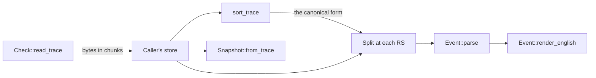

# Trace

The APIs that give and read a trace: reading the bytes of a check, sorting a trace into its canonical form, reading one event, and rendering it in English. [Trace format](../trace-format.md) defines the bytes, and [Trace codes](../trace-codes.md) the codes.

## Contents

- [APIs](#apis)
- [Validation](#validation)
  - [`Check::read_trace`](#checkread_trace)
  - [`sort_trace`](#sort_trace)
  - [`Event::parse`](#eventparse)
  - [`Event::render_english`](#eventrender_english)

## APIs

| API | Takes | Gives | Requirements |
|---|---|---|---|
| `Check::read_trace` | A buffer | The next trace bytes ([Check](check.md#checkread_trace)) | TRC-004, STR-002 |
| `sort_trace` | A whole trace, as bytes, and `DocumentLimits` | The same events sorted by position, in the same bytes each, or `TraceError` | TRC-012 |
| `Event::parse` | One record, with or without its RS and LF, and `DocumentLimits` | `Event`, or `TraceError` | TRC-007 |
| `Event::render_english` | An `Event` | The English text of [Trace codes](../trace-codes.md) | TRC-011 |
| `Snapshot::from_trace` | A whole trace | A snapshot ([Snapshot](snapshot.md#snapshotfrom_trace)) | TRC-008 |

| Rule | Requirements |
|---|---|
| A reader ignores members, codes, outcomes and parameters it doesn't know within major version 1, and keeps them when it sorts | TRC-007 |
| A trace holds addresses and header contents, and never a private key or body content | TRC-006, TRC-010 |
| Marked values come out unescaped. The reader escapes them for its output | TRC-013 |

## Validation

### `Check::read_trace`

[VAL-150](check.md#checkread_trace): the buffer holds at least 1 byte.

### `sort_trace`

| ID | Input | Rule | Error code | Requirement | Scenario |
|---|---|---|---|---|---|
| VAL-501 | `trace` | At most `document_size` octets | `trace.too_large` | SAF-004 | API-501 |
| VAL-502 | `trace` | A sequence of records, each RS, one JSON text and LF | `trace.record_malformed`, with the offset | TRC-007, RFC 7464 §2.2 | API-502 |
| VAL-503 | Each record | An I-JSON object (RFC 7493) nested at most `document_depth` levels | `trace.event_malformed` or `trace.too_deep` | TRC-007, PAR-005 | API-503 |
| VAL-504 | Each event | `v` names major version 1 | `trace.version_unknown` | TRC-007 | STEP-057 |
| VAL-505 | Each event | `pos` is a list of counts, each at least 1 | `trace.event_malformed` | TRC-012 | API-505 |
| VAL-506 | The events | No two hold the same position | `trace.position_repeated` | TRC-012 | API-506 |

`sort_trace` sorts the events of one trace. A store that mixes traces separates them by `msg` first (TRC-014).

### `Event::parse`

| ID | Input | Rule | Error code | Requirement | Scenario |
|---|---|---|---|---|---|
| VAL-510 | `record` | One JSON text, with an RS before it and an LF after it, or neither | `trace.record_malformed` | TRC-007 | API-510 |
| VAL-511 | `record` | The rules of VAL-503 to VAL-505 | As VAL-503 to VAL-505 | TRC-007 | API-511 |
| VAL-512 | `record` | `kind` is `fact`, `caution` or `hint`, and `code` is a keyword | `trace.event_malformed` | TRC-003, TRC-011 | API-512 |

### `Event::render_english`

| ID | Input | Rule | Error code | Requirement | Scenario |
|---|---|---|---|---|---|
| | `event` | No rule: an `Event` is valid once parsed. A code the renderer doesn't know renders as the code and its parameters | | TRC-011 | STEP-056 |
