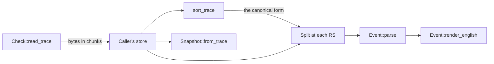

# Trace

The APIs that give and read a trace: reading the bytes of a check, sorting a trace into its canonical form, reading one event, and rendering it in English, with the types that hold an event. [Trace format](../trace-format.md) defines the bytes, and [Trace codes](../trace-codes.md) the codes.

## Contents

- [APIs](#apis)
- [Signatures](#signatures)
- [Parameters](#parameters)
- [Types](#types)
  - [`Event`](#event)
  - [`Position`](#position)
  - [`Value`](#value)
  - [`Data`](#data)
  - [`Place`](#place)
- [Validation](#validation)
  - [`Check::read_trace`](#checkread_trace)
  - [`sort_trace`](#sort_trace)
  - [`Event::parse`](#eventparse)
  - [`Event::render_english`](#eventrender_english)

## APIs

| Rule | Requirements |
|---|---|
| A reader ignores members, codes, outcomes and parameters it doesn't know within major version 1, and keeps them when it sorts | TRC-007 |
| A trace holds addresses and header contents, and never a private key or body content | TRC-006, TRC-010 |
| Marked values come out unescaped. The reader escapes them for its output | TRC-013 |

## Signatures

| API | Signature | Returns | Requirements |
|---|---|---|---|
| `Check::read_trace` | `fn read_trace(&mut self, buffer: &mut [u8]) -> Result<TraceRead, CheckError>` | The next trace bytes ([Check](check.md#checkread_trace)) | TRC-004, STR-002 |
| `sort_trace` | `fn sort_trace(trace: &[u8], limits: &DocumentLimits) -> Result<Vec<u8>, TraceError>` | The same events sorted by position, each in the same bytes | TRC-012 |
| `Event::parse` | `fn parse(record: &[u8], limits: &DocumentLimits) -> Result<Event, TraceError>` | The event | TRC-007 |
| `Event::render_english` | `fn render_english(&self) -> String` | The English text of [Trace codes](../trace-codes.md) | TRC-011 |
| `Snapshot::from_trace` | `fn from_trace(trace: &[u8], limits: &DocumentLimits) -> Result<Snapshot, DocumentError>` | A snapshot ([Snapshot](snapshot.md#snapshotfrom_trace)) | TRC-008 |

`sort_trace` is a function of the crate root.

## Parameters

| API | Parameter | Meaning and form |
|---|---|---|
| `sort_trace` | `trace` | The bytes of one whole trace, its events in any order |
| `sort_trace`, `Event::parse` | `limits` | The size and depth limits of [Limits](../design/limits.md#limits-outside-a-check) |
| `Event::parse` | `record` | One record: one JSON text, with or without the RS before it and the LF after it |

## Types

Every type on this page is built by hallmark, and is `#[non_exhaustive]` with public fields, apart from the enums.

### `Event`

| Field | Type | JSON member | Meaning | Requirements |
|---|---|---|---|---|
| `version` | `Version`: `major: u64`, `minor: u64` | `v` | The format version | TRC-007 |
| `message_id` | `Option<String>` | `msg` | The caller's ID for the message | TRC-014 |
| `position` | `Position` | `pos` | The step's place in the tree | TRC-002, TRC-012 |
| `kind` | `EventKind`: `Fact`, `Caution` or `Hint` | `kind` | The kind of step | TRC-003 |
| `code` | `String` | `code` | The step's code | TRC-011 |
| `outcome` | `Option<String>` | `outcome` | The step's outcome, for a code that has outcomes | TRC-002 |
| `params` | `Vec<Param>`: each `name: String` and `value: Value` | `params` | The parameters, in the order of the JSON object | TRC-011 |
| `cite` | `Vec<String>` | `cite` | The sections the step applies | TRC-002 |

`EventKind` is an exhaustive enum, `Copy`. The parser leaves out members it doesn't know (TRC-007).

### `Position`

| Field | Type | Meaning | Requirements |
|---|---|---|---|
| `path` | `Vec<u64>` | The child numbers on the path from the root, each at least 1. Empty for the root | TRC-012 |

`Position` implements `Ord` in the order of [Trace format](../trace-format.md#positions): element by element, with a prefix before the positions that extend it.

### `Value`

`Value` is an exhaustive enum with one variant for each value type of [Trace format](../trace-format.md#values).

| Variant | Carries | JSON form |
|---|---|---|
| `Count` | `u64` | Integer from 0 to 2^53−1 |
| `Number` | `String`: decimal digits | String of decimal digits |
| `Keyword` | `String` | String from a fixed list |
| `Boolean` | `bool` | `true` or `false` |
| `Position` | `Position` | List of counts |
| `Hash` | `Vec<u8>`: the hash, decoded | String in base64 |
| `Address` | `IpAddr` | String: a dotted quad, or an IPv6 address in the text form of RFC 5952 §4 |
| `Place` | `Place` | Object |
| `Data` | `Data` | Object |
| `List` | `Vec<Value>` | List of values of one type |
| `Unknown` | `Vec<u8>`: the JSON text of the value | A parameter of a code that this version of the library doesn't list, whose type it can't tell from the JSON |

### `Data`

| Field | Type | Meaning | Requirements |
|---|---|---|---|
| `bytes` | `Vec<u8>` | The bytes, decoded from `text` or `base64url` | TRC-013 |
| `from` | `Parties`: `dns: bool`, `sender: bool` | The parties that control the bytes. At least one is true | TRC-013 |

### `Place`

| Field | Type | JSON member | Meaning | Requirements |
|---|---|---|---|---|
| `offset` | `u64` | `offset` | The byte offset in the body that the caller passed, from 0 | TRC-010 |
| `line` | `u64` | `line` | The line number in that body, from 1 | TRC-010 |
| `canonical` | `Option<u64>` | `canonical` | The byte offset in the canonical body, from 0, when the hash depends on it | TRC-010 |

## Validation

### `Check::read_trace`

[VAL-150](check.md#checkread_trace): `buffer` holds at least 1 byte.

### `sort_trace`

| ID | Input | Rule | Error code | Requirement | Scenario |
|---|---|---|---|---|---|
| VAL-501 | `trace` | At most `document_size` octets | `trace.too_large` | SAF-004 | API-501 |
| VAL-502 | `trace` | A sequence of records, each RS, one JSON text and LF | `trace.record_malformed`, with the offset | TRC-007, RFC 7464 §2.2 | API-502 |
| VAL-503 | Each record | An I-JSON object (RFC 7493) nested at most `document_depth` levels | `trace.event_malformed` or `trace.too_deep` | TRC-007, PAR-005 | API-503 |
| VAL-504 | Each event | `v` names major version 1 | `trace.version_unknown` | TRC-007 | STEP-057 |
| VAL-505 | Each event | `pos` is a list of counts, each at least 1 | `trace.event_malformed` | TRC-012 | API-505 |
| VAL-506 | The events | No two hold the same position | `trace.position_repeated` | TRC-012 | API-506 |

`sort_trace` sorts the events of one trace. A store that mixes traces separates them by `msg` first (TRC-014).

### `Event::parse`

| ID | Input | Rule | Error code | Requirement | Scenario |
|---|---|---|---|---|---|
| VAL-510 | `record` | One JSON text, with an RS before it and an LF after it, or neither | `trace.record_malformed` | TRC-007 | API-510 |
| VAL-511 | `record` | The rules of VAL-503 to VAL-505 | As VAL-503 to VAL-505 | TRC-007 | API-511 |
| VAL-512 | `record` | `kind` is `fact`, `caution` or `hint`, and `code` is a keyword | `trace.event_malformed` | TRC-003, TRC-011 | API-512 |

### `Event::render_english`

| ID | Input | Rule | Error code | Requirement | Scenario |
|---|---|---|---|---|---|
| | `self` | No rule: an `Event` is valid once parsed. A code the renderer doesn't know renders as the code and its parameters | | TRC-011 | STEP-056 |
