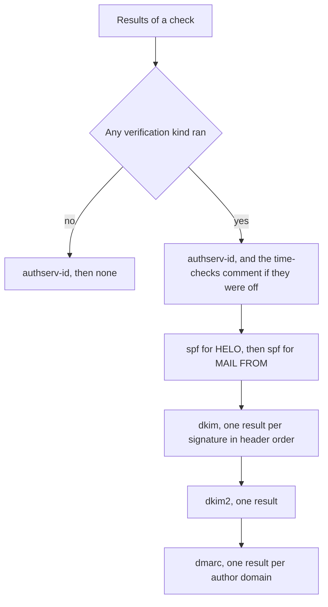

# Authentication-Results

How hallmark writes an Authentication-Results header field from the results of a check (RFC 8601): the order of the results, the result value and properties of each method, the `reason` and comment texts, and how values are quoted and folded. [ADR 0056](../../adr/0056-authentication-results-map-each-typed-reason-to-one-result-value.md) records the mappings. Parsing and the authserv-id check follow HDR-009 and AR-005, and [`AuthenticationResults`](https://photom.github.io/hallmark/api/hallmark/struct.AuthenticationResults.html) gives the API.

## Contents

- [The field](#the-field)
- [SPF](#spf)
- [DKIM](#dkim)
- [DMARC](#dmarc)
- [DKIM2](#dkim2)
- [Values](#values)
- [Comments](#comments)
- [Folding](#folding)

## The field

| Rule | Requirements |
|---|---|
| hallmark writes one field with every result of the check, in the order of the diagram. A kind that didn't run has no result | AR-001, RFC 8601 §4 |
| A check that ran no verification kind, such as one that only signs, gives `none` after the authserv-id | RFC 8601 §2.2, §4 |
| The field holds no version after the authserv-id, which means version 1 | RFC 8601 §2.2 |
| Each result has a `reason`, a fixed phrase that the typed reason selects, and never a value from the message, the envelope or DNS | AR-002 |
| hallmark never writes the `policy` result or the `policy` ptype, because it applies no local policy | GEN-006, RFC 8601 §2.4 |
| The explanation of an SPF `fail` (`exp=`) never enters the field. It is text from a third party, and the result carries it | REC-016, TRC-013 |

## SPF

One result for each identity that SPF checked: HELO first, then MAIL FROM.

| Outcome | Result |
|---|---|
| `none`, `neutral`, `pass`, `fail`, `softfail`, `temperror`, `permerror` | The same word (RFC 8601 §2.7.2) |

| Property | Value | Requirements |
|---|---|---|
| `smtp.helo` | The HELO name, for the HELO identity | RFC 8601 §2.7.2 |
| `smtp.mailfrom` | The domain of MAIL FROM, for the MAIL FROM identity. With a null MAIL FROM, SPF checks `postmaster@` the HELO name as that identity, and the value is the HELO name | RFC 8601 §2.7.2, RFC 7208 §2.4 |

The value never holds the local part, because hallmark can't tell whether a record provides for authenticating it (RFC 8601 §2.7.2). Reported erratum 6027 against RFC 8601 reads `smtp.mailfrom` as a mailbox, and a new ADR replaces ADR 0056 if the erratum is verified.

| `SpfReason` | `reason` |
|---|---|
| `Matched` | `mechanism matched` |
| `Default` | `no mechanism matched` |
| `NoValidDomain` | `no valid domain` |
| `NoRecord` | `no SPF record` |
| `SeveralRecords` | `several SPF records` |
| `TemporaryFailure` | `DNS temporary failure` |
| `Syntax` | `SPF record syntax error` |
| `LookupLimit` | `too many DNS lookups` |
| `VoidLookupLimit` | `too many void lookups` |
| `MxLimit` | `too many MX records` |
| `CheckLimit` | `limit reached` |
| `Nested` | `error in included or redirected record` |

## DKIM

One result for each DKIM-Signature field, in header order (RFC 8601 §2.7.1). A message with no DKIM-Signature field gives `dkim=none`. A header limit that stops DKIM before any signature gives one `dkim=permerror` with the reason `header limit reached` and no properties.

| `DkimReason` | Result | `reason` |
|---|---|---|
| `Verified` | `pass` | `signature verified` |
| `BodyHash` | `fail` | `body hash did not verify` |
| `Signature` | `fail` | `signature did not verify` |
| `Field` with `Expired` | `fail` | `signature expired` |
| `Field` with `FutureTimestamp` | `fail` | `timestamp in the future` |
| `Field` with `Syntax` | `neutral` | `signature syntax error` |
| `Field` with `MissingTag` | `neutral` | `signature missing required tag` |
| `Field` with `Version` | `neutral` | `incompatible version` |
| `Field` with `Algorithm` | `neutral` | `unsupported algorithm` |
| `Field` with `DomainMismatch` | `neutral` | `domain mismatch` |
| `Field` with `FromNotSigned` | `neutral` | `From field not signed` |
| `Field` with `TimeOrder` | `neutral` | `expiration not after timestamp` |
| `Field` with `Name` | `neutral` | `invalid domain or selector` |
| `Key` with `NoKey` | `permerror` | `no key for signature` |
| `Key` with `Syntax` | `permerror` | `key syntax error` |
| `Key` with `Revoked` | `permerror` | `key revoked` |
| `Key` with `KeyAlgorithm` | `permerror` | `inappropriate key algorithm` |
| `Key` with `HashAlgorithm` | `permerror` | `inappropriate hash algorithm` |
| `Key` with `DomainMismatch` | `permerror` | `domain mismatch` |
| `Key` with `KeySize` | `permerror` | `key size out of range` |
| `Key` with `ExponentSize` | `permerror` | `key exponent too large` |
| `Limit` | `permerror` | `limit reached` |
| `KeyTemporaryFailure` | `temperror` | `key unavailable` |

Where RFC 6376 §6.1 names the failure, the phrase is its text. RFC 8601 §2.7.1 gives `fail` to a signature that failed verification, `neutral` to one that couldn't be processed, and `permerror` to an error that a later attempt won't fix. When a selector has several key records and none verifies the signature, the result comes from the reason of the first record that passed its key checks, so a usable key gives `fail` and only unusable keys give `permerror` ([dkim.md](dkim.md#key-checks)).

| Property | Value | Written when | Requirements |
|---|---|---|---|
| `header.d` | `d=` as written | The field has a valid `d=` | RFC 8601 §2.7.1 |
| `header.i` | `i=` after dkim-quoted-printable decoding | The field has `i=` | RFC 8601 §2.7.1, ADS-013 |
| `header.a` | `a=` as written | The field has `a=` | RFC 8601 §6.3.1 |
| `header.s` | `s=` as written | The field has `s=` | RFC 8601 §6.3.2 |

The properties appear with every result, as in RFC 8601 Appendix B.6, so a reader can tell the signatures apart.

## DMARC

One result for each author domain, in the order of the From fields (DMC-002).

| `DmarcReason` | Result | `reason` |
|---|---|---|
| `AlignedPass` | `pass` | `aligned identifier passed` |
| `NoAlignedPass` | `fail` | `no aligned identifier passed` |
| `NoRecord` | `none` | `no DMARC policy record` |
| `TemporaryFailure` | `temperror` | `DNS temporary failure` |
| `SuffixUnavailable` | `temperror` | `public suffix unavailable` |
| `Limit` | `permerror` | `limit reached` |
| `NotApplied` with `NoFrom` | `permerror` | `no From field` |
| `NotApplied` with `FromUnparsable` | `permerror` | `From field does not parse` |
| `NotApplied` with `NoMailbox` | `permerror` | `no mailbox in From field` |
| `NotApplied` with `DomainLiteral` | `permerror` | `From domain is a literal` |
| `NotApplied` with `NoLookupForm` | `permerror` | `author domain has no lookup form` |
| `NotApplied` with `SeveralAuthorDomains` | `permerror` | `several author domains` |
| `NotApplied` with `AuthorDomainLimit` | `permerror` | `too many author domains` |
| `NotApplied` with `NoValidPolicy` | `permerror` | `no valid policy` |

RFC 9989 §9.2 and RFC 7489 §11.2 register no result for a message that DMARC can't evaluate. Of the registered results, `permerror` is the one for an error that a later attempt won't fix.

| Property | Value | Written when | Requirements |
|---|---|---|---|
| `header.from` | The author domain as written in the From field | The result has an author domain | RFC 9989 §9.1, RFC 7489 §11.1 |

hallmark never writes `policy.dmarc`: RFC 9989 §9.1 defines it as the policy applied after policy options, and the caller decides that (GEN-006).

## DKIM2

The `dkim2` result follows AR-004: one result, the values of authres-02 §3.1, and `header.d` and `header.i` as authres-02 §3.2 says. Its comment, which authres-02 §3.3 describes, is decided with the DKIM2 verifier.

## Values

| Item | Form | Requirements |
|---|---|---|
| `reason` | A quoted-string, because every phrase holds spaces | RFC 8601 §2.2, RFC 2045 §5.1 |
| A domain, or `local-part@domain` | Bare when it matches `domain-name` of RFC 6376 §3.5, or `[local-part] "@" domain-name` with the local part of RFC 5322 §3.4.1 | RFC 8601 §2.2 |
| `header.a`, `header.s` | Bare when it is a token of RFC 2045 §5.1 | RFC 8601 §2.2 |
| Any other value, a U-label included | A quoted-string, with `"` and `\` as quoted-pairs, and UTF-8 as RFC 6532 §3.2 allows | RFC 8601 §2.2, §2.5, RFC 6532 §3.2 |
| Between two properties | One space. That is valid both under `1*propspec` of RFC 8601 §2.2, whose `pvalue` ends in CFWS, and under Reported erratum 6026 | RFC 8601 §2.2 |

No value holds CR or LF, and a value that a sender controls can't end the field or a comment (THR-023).

## Comments

Each comment is a fixed text. The only values in it are a count and a policy keyword from a fixed set, so no other value from the message, the envelope or DNS enters it. A reader can't rely on comments (RFC 8601 §2.2), so each one repeats a fact that the result's type carries.

| Comment | Place | When | Requirements |
|---|---|---|---|
| `(time checks off)` | After the authserv-id | The check ran with time checks off | TIM-005 |
| `(key in test mode)` | After the result value of a `dkim` result | The signature counts as testing | DKV-009 |
| `(N body octets unsigned)` | After the result value of a `dkim` result | `l=` left N octets unsigned | DKV-006 |
| `(test mode)` | After the result value of a `dmarc` result | The record asks for test mode | DMC-007 |
| `(pass rests on testing keys)` | After the result value of a `dmarc` result | DMC-008 applies | DMC-008 |
| `(policy p=reject)`, with the tag and keyword that applied | After the result value of a `dmarc` result | The policy tag that applied holds `none`, `quarantine` or `reject`, written in lowercase | DMC-006 |

## Folding

| Rule | Requirements |
|---|---|
| Each result starts on a new line: the `;` before it ends the line above, and a fold begins its line | RFC 5322 §2.2.3 |
| A result whose line would pass 78 characters folds before a property, a `reason` or a comment. A value is never folded | RFC 5322 §2.1.1 |
| The value starts with a space or without one, as `FieldForm` asks. A fold is the line break that `FieldForm` asks for, followed by one tab | STR-009 |
