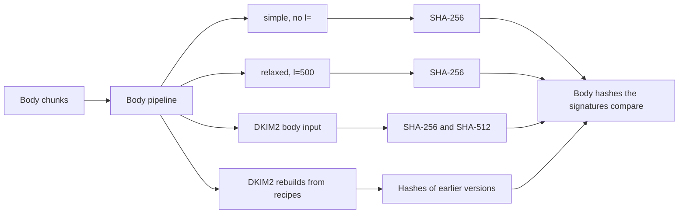
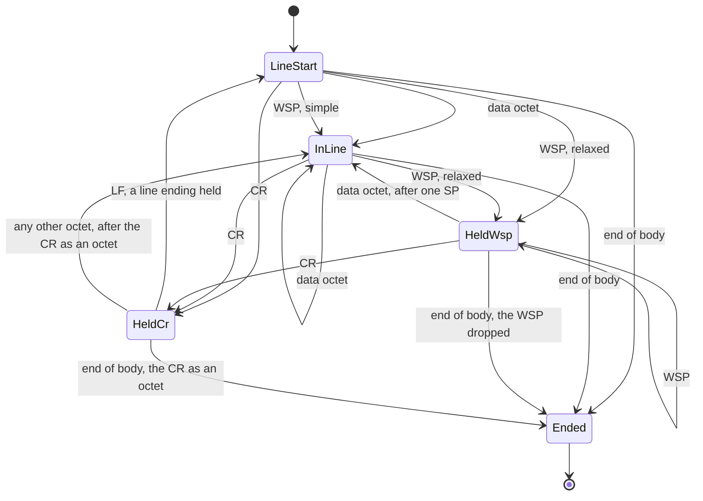
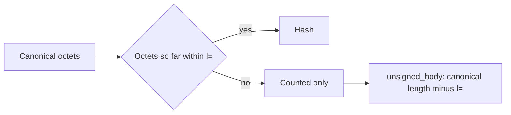
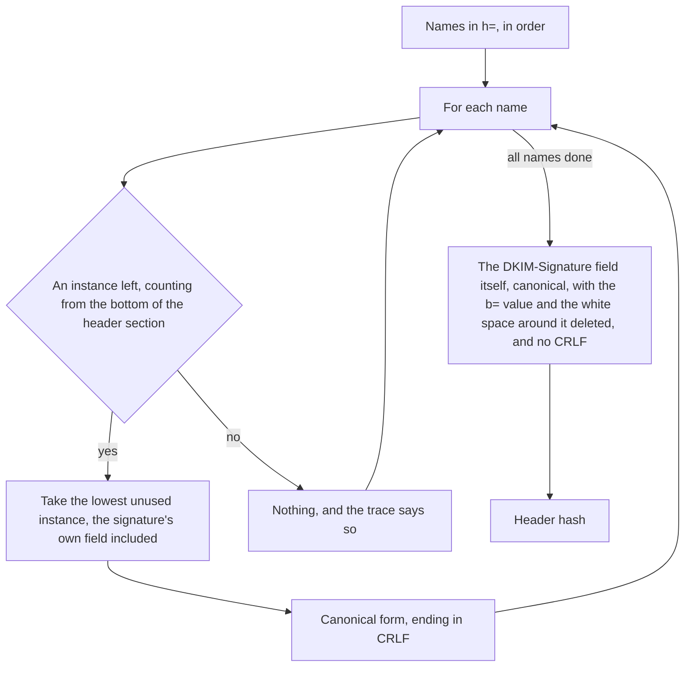
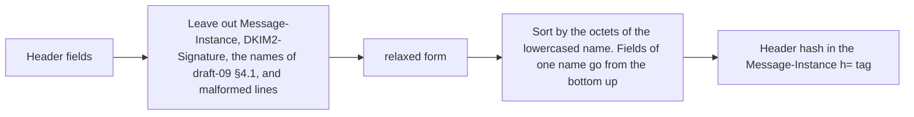

# Canonicalization

The steps that turn the body and the header fields into the bytes hallmark hashes: the body pipeline, one streaming state machine for the body, the `l=` cut, the places the trace records, and the three header forms of DKIM and DKIM2. The public `Canonicalizer` runs the same body code (STR-012, [Canonicalizer](https://photom.github.io/hallmark/api/hallmark/struct.Canonicalizer.html)).

## Contents

- [The body pipeline](#the-body-pipeline)
- [Body rules](#body-rules)
- [The body state machine](#the-body-state-machine)
- [The `l=` cut](#the-l-cut)
- [Places in the body](#places-in-the-body)
- [Header fields](#header-fields)
- [DKIM header hash input](#dkim-header-hash-input)
- [DKIM2 header hash](#dkim2-header-hash)
- [DKIM2 signing input](#dkim2-signing-input)
- [Trace](#trace)

## The body pipeline

| Rule | Requirements |
|---|---|
| The pipeline has one canonicalizer for each distinct mode and `l=` that the signatures need, and one hash state for each hash algorithm on its output | STR-001, INV-005 |
| Every chunk passes through every canonicalizer once, so no check reads the body twice | STR-010 |
| DKIM2 rebuilds each earlier version that a recipe describes in the same pass | DK2-006 |
| Signing and verification share the pipeline | STR-001 |

## Body rules

| Step | `simple` | `relaxed` | DKIM2 body input | Requirements |
|---|---|---|---|---|
| WSP at the end of a line | Kept | Removed | Kept | RFC 6376 §3.4.3, §3.4.4, draft-09 §6.1 |
| A run of WSP inside a line | Kept | One SP | Kept | RFC 6376 §3.4.4 |
| Empty lines at the end | Removed | Removed, counting lines that held only WSP | Removed | RFC 6376 §3.4.3, §3.4.4 |
| A body with no CRLF at its end | Gets one | Gets one, if it isn't empty | Gets one | RFC 6376 §3.4.3, §3.4.4 |
| An empty body | `\r\n` | Empty | `\r\n` | CAN-001, CAN-020, CAN-041 |
| A bare CR or LF | An octet | An octet, which isn't WSP and ends no line | An octet | STR-011 |

The DKIM2 body input is DKIM's `simple` (draft-09 §6.1).

## The body state machine

| Held between chunks | Size | Meaning | Scenario |
|---|---|---|---|
| Line endings held | A count | CRLFs not yet written, because they may end the body | CAN-083, CAN-084, CAN-100 |
| WSP held | A flag | A run of WSP in `relaxed`, written as one SP if a data octet follows and dropped at a line ending | CAN-080, CAN-081, CAN-101 |
| CR held | A flag | A CR at the end of a chunk, which an LF in the next chunk makes a line ending | CAN-082, CAN-089 |
| Content written | A flag | Whether the body has content, which decides the CRLF at the end in `relaxed` | CAN-020, CAN-025 |
| Octets written | A count | The canonical length, for `l=` and the places | CAN-120 |

| Event | Writes | Requirements |
|---|---|---|
| A data octet | The held line endings, then the held SP in `relaxed`, then the octet | STR-005 |
| A line ending | Nothing: the count goes up, and `relaxed` drops the held WSP | RFC 6376 §3.4.4 |
| The end of the body | One CRLF, unless `relaxed` wrote no content. The held line endings and WSP are dropped | RFC 6376 §3.4.3, §3.4.4 |

The canonicalizer holds no input octet between calls, so its memory doesn't grow with the body (STR-001, STR-007, CAN-306), and the output doesn't depend on where the chunks are cut (STR-005, CAN-086).

## The `l=` cut

| Rule | Requirements | Scenario |
|---|---|---|
| The hash takes the first `l=` canonical octets | RFC 6376 §3.5, DKV-006 | CAN-120 |
| An `l=` larger than the canonical body gets no special rule: the hash covers the whole body and differs from the signer's if the signer hashed more | ADR 0009, DKV-008 | CAN-121, CAN-122 |
| The result and the trace report the canonical octets after the cut | DKV-006 | CAN-120 |
| DKIM2 has no `l=` | draft-09 §6.1 | API-601 |

## Places in the body

The trace gives each place as an offset and a line in the body the caller passed, and an offset in the canonical body where the hash depends on it (TRC-010).

| Place | Recorded | Requirements |
|---|---|---|
| The `l=` cut | Its offset | TRC-010 |
| The empty lines at the end | The offset of the first one | TRC-010 |
| The CRLF added at the end | Whether it was added | TRC-010 |
| A run of WSP made one SP | The count and the first places, up to `trace_places` | TRC-010, STEP-062 |
| WSP removed at the end of a line | The count and the first places, up to `trace_places` | TRC-010 |
| A bare CR or LF | A caution with the count and the first places, up to `trace_places` | STR-011, STEP-065 |

## Header fields

All header forms start from the raw bytes of [Header section](header-section.md), with each line ending as CRLF. WSP is SP and HTAB, so every other octet passes unchanged, UTF-8 and bare CR and LF included ([ADR 0051](../../adr/0051-a-bare-cr-or-lf-in-the-header-section-is-an-octet-of-the-line-that-holds-it.md)).

| Step | DKIM `simple` | DKIM `relaxed` and the DKIM2 header hash | DKIM2 signing input | Requirements |
|---|---|---|---|---|
| Field name | As written | Lowercased in ASCII | Lowercased in ASCII | HCN-001, HCN-002, HCN-007 |
| Folds | Kept | CRLF before WSP removed | Removed | HCN-002, HCN-007 |
| A run of WSP | Kept | One SP | Deleted | HCN-002, HCN-007 |
| WSP at the end of the value | Kept | Deleted, as erratum 5839 reads RFC 6376 §3.4.2 | Deleted | HCN-002, HCN-005 |
| WSP around the colon | Kept | Deleted | Deleted | HCN-002, HCN-007 |
| Final CRLF | Kept | Kept | Kept | HCN-001, HCN-002, HCN-007 |
| A last line with no CRLF | Gets one | Gets one | Gets one | HCN-008 |

## DKIM header hash input

| Rule | Requirements | Scenario |
|---|---|---|
| Names match without regard to case, and each instance is used once, from the bottom up | HDR-002, DKV-011 | CAN-184, CAN-185 |
| The signature's own field counts as an instance when `h=` names `dkim-signature` more times than there are DKIM-Signature fields below it. The trace records that as a fact with a caution | HCN-004 | CAN-201 |
| A malformed line is never selected, because it has no name | HCN-006 | CAN-262 |
| The `b=` tag is found with the tag list parser, so `b=` inside another value stays | HCN-003 | CAN-182 |
| Nothing follows the signature field. The body enters only through `bh=` | HCN-003 | CAN-180 |

## DKIM2 header hash

| Rule | Requirements | Scenario |
|---|---|---|
| The names of §4.1 match without regard to case, and `Received-*` and `X-*` stand for every name with that start | HCN-005 | CAN-221 |
| `content` sorts before `content-type` | HCN-005 | CAN-223 |
| A malformed line stays out, with a caution | HCN-006 | CAN-260 |
| An earlier header set that a recipe rebuilds is hashed by the same rules | HCN-005 | CAN-226 |

## DKIM2 signing input

| Rule | Requirements | Scenario |
|---|---|---|
| The selectors, algorithm names and the `:`, `,` and `\|` between them stay in the own field | HCN-007 | CAN-242 |
| The signature values are found with the tag list parser | HCN-007 | CAN-242 |
| The signer gets this input unhashed for `mldsa44`, and its SHA-256 hash otherwise | SGN-002 | SIGN-003 |

## Trace

| Step | Code | Records | Requirements |
|---|---|---|---|
| Each body hash | `dkim.body_hash`, with the `body.*` steps | The mode, the `l=` cut, the computed and stated hashes, and the places above | TRC-010 |
| Each header hash input | `dkim.header_hash`, with `dkim.signature_field` | The fields taken, in order and in canonical form, and for DKIM2 each field left out with the rule that left it out | HCN-009 |
| A name in `h=` | `dkim.h_name` | The instance it selected, or that none was left | DKV-011 |

[Trace codes](../trace-codes.md#body) gives the parameters of the `body.*` steps. DKIM2 adds its codes with its verifier.

Body content never enters the trace (TRC-010). Field contents are values the sender controls (TRC-013).
