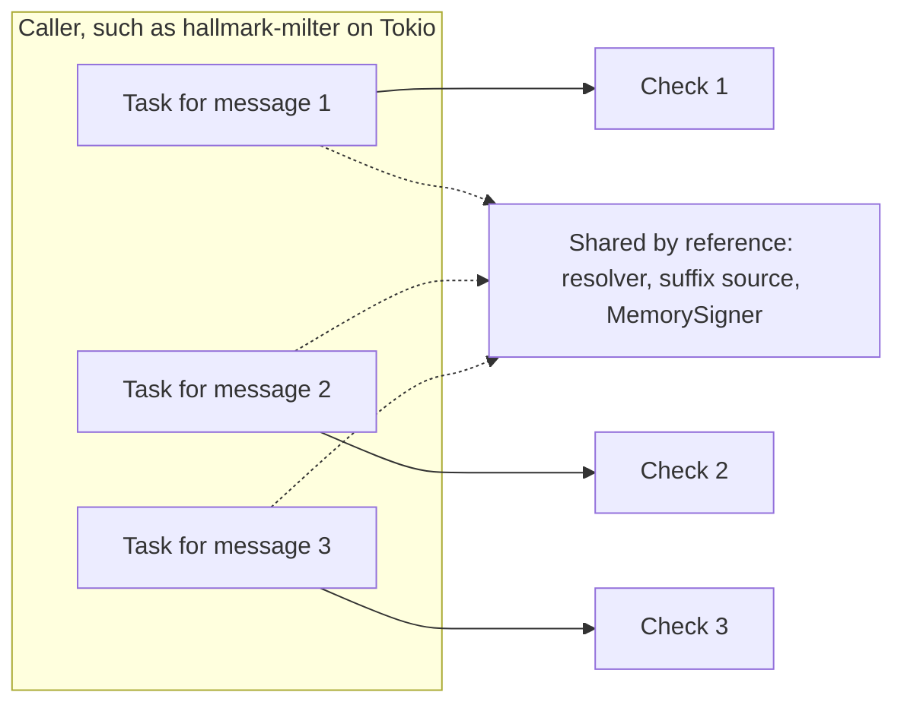
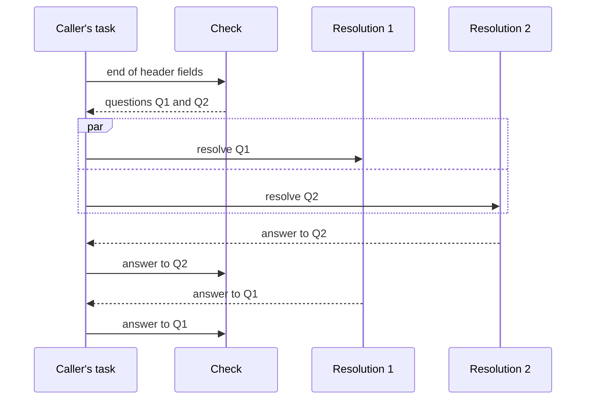

# Concurrency

hallmark starts no threads. A check is a state machine that the caller drives one call at a time ([ADR 0017](../../adr/0017-the-core-does-no-io-and-the-caller-drives-it.md)), and the driver only polls futures ([ADR 0048](../../adr/0048-the-resolver-the-suffix-source-and-the-signer-return-futures-that-are-send.md)). This page covers what the library does and doesn't do with threads, which types move between threads, how a caller runs checks in parallel, and how cancellation and memory work. [Lifecycle](lifecycle.md) gives the states.

## Contents

- [What hallmark never does](#what-hallmark-never-does)
- [Send and Sync](#send-and-sync)
- [Checks in parallel](#checks-in-parallel)
- [Inside one check](#inside-one-check)
- [The driver](#the-driver)
- [WebAssembly and blocking callers](#webassembly-and-blocking-callers)
- [Cancellation](#cancellation)
- [Memory](#memory)

## What hallmark never does

| hallmark never | So | Requirements |
|---|---|---|
| Starts a thread or a task | The caller decides where each check runs | DNS-003 |
| Takes a lock, or uses atomics or interior mutability | A check has no shared state to protect | |
| Keeps mutable global state | Two checks never affect each other. The IDNA tables and the English texts are immutable statics | CHK-003 |
| Blocks, sleeps or reads a clock | A call returns as soon as its work is done. Time limits belong to the caller | IO-001, DNS-009 |
| Calls the caller back from inside a check | Only the driver calls the caller's traits, and only between calls to the check | ADR 0017 |
| Uses `unsafe` | The workspace forbids it | |

## Send and Sync

| Type | `Send` | `Sync` | Why |
|---|---|---|---|
| `Check`, `Signing` | Yes | Yes | Each owns all its data. Methods that change it take it by unique reference |
| `CheckOptions`, `SigningOptions`, `Limits`, `Envelope`, `VerificationTime` | Yes | Yes | Plain values |
| `Question`, `Answer`, `SuffixQuestion`, `SuffixAnswer`, `SigningRequest`, `Signature` | Yes | Yes | Plain values |
| `CheckResults`, `SigningResults` and every result type | Yes | Yes | Plain values |
| `Event`, `Position` | Yes | Yes | Plain values |
| `Canonicalizer` | Yes | Yes | It owns its state |
| `Snapshot`, `SnapshotResolver` | Yes | Yes | Read only after creation |
| `MemorySigner` | Yes | Yes | Its keys are read only after creation and zeroed on drop (SEC-001) |
| The future of `drive` or `drive_signing` | Yes | | The traits require `Send` futures and `Send + Sync` implementers (ADR 0048) |

A test asserts each row at compile time, so a change that breaks one fails the build.

## Checks in parallel

| Rule | Why |
|---|---|
| One check serves one message. The caller runs as many checks at once as it likes | Checks share nothing |
| The caller may share a resolver, a suffix source and a `SnapshotResolver` among checks, and a `MemorySigner` among signings | They are `Sync`, and checks and signings only read them |
| `CheckOptions`, `SigningOptions` and `Limits` are copied into each check or signing | INV-015: options never change after creation |
| A long-running caller can change options between messages | Each check and each signing takes its own options, so the next one sees new ones, the `verify` of the signing options included (SGN-006) |

## Inside one check

A check takes one call at a time, because each input method takes it by unique reference. The caller can resolve many questions at once and hand back the answers one by one, in any order.

The order of the answers changes neither the result nor the sorted trace (CHK-003, INV-013).

## The driver

The driver polls several futures from one task and starts none of its own.

| Rule | Requirements |
|---|---|
| The driver keeps up to `driver_in_flight` futures pending at once, and starts the next when one completes | CHK-005, [Limits](limits.md) |
| It polls its futures in turn from its own `poll`, so it needs no executor beyond the caller's | DNS-003 |
| It hands each answer to the check or the signing as soon as its future completes, between polls | CHK-003 |
| `drive` holds shared references to the resolver and the suffix source and a unique reference to the check, and `drive_signing` a shared reference to the signer and a unique reference to the signing | ADR 0048 |

## WebAssembly and blocking callers

| Caller | How it drives a check or a signing | Requirements |
|---|---|---|
| `hallmark-wasm` | Its own loop on the browser's one thread: take the requests, resolve them through `fetch`, hand back the answers. The library's `MemorySigner` signs synchronously in the same loop | WSM-002, ADR 0048 |
| Blocking code | Its own loop: take a request, resolve it, hand back the answer. The adapters of STR-004 read the message from a standard reader and write the trace to a standard writer | STR-004 |
| Async code with `Send` futures | `drive` or `drive_signing`, on any runtime | CHK-005 |

## Cancellation

A caller cancels by dropping the check or the signing, or by dropping the driver's future at any await.

| Dropped | What happens | What the caller handles |
|---|---|---|
| A check or a signing | Its requests, answers and unread trace bytes are freed. Nothing else holds them | Its own resolutions or signings still running, which it can drop too |
| The driver's future | The resolver, suffix source or signer futures it held are dropped. The check or the signing stays as the last delivered answer left it, and the caller can drive it again or drop it | What a dropped resolver or signer future leaves behind, such as a socket |
| A `MemorySigner` | Its keys are zeroed | |

A check never waits, so it needs no timeout of its own. A caller that stops waiting for an answer reports a temporary failure for that question (CHK-002, DNS-009).

## Memory

| Rule | Requirements |
|---|---|
| A check or a signing copies no body chunk, and keeps nothing that points into one after the call returns | STR-007, INV-004 |
| The body pipeline keeps a fixed amount of state for each body hash, whatever the size of the body | STR-001, INV-005 |
| Everything else a check or a signing keeps is bounded by its limits: the header section, the questions and answers, the trace bytes and the signing data | SAF-004, [Limits](limits.md) |
| At the off level, the trace allocates nothing | TRC-004 |
