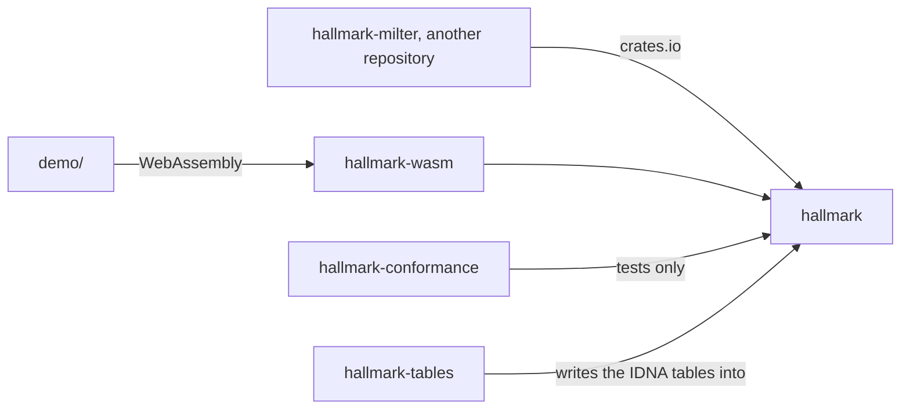

# Crates

The external side of the module design: the crates of the workspace, the public interface of the `hallmark` crate, the traits that a caller implements, the features, and the outside crates. Within a major version, the public interface and the traits change only by adding (STB-001), except the DKIM2 items (DK2-005). [Modules](modules.md) gives the inside of the `hallmark` crate.

## Contents

- [Crates of the workspace](#crates-of-the-workspace)
- [Public interface](#public-interface)
- [Traits the caller implements](#traits-the-caller-implements)
- [Features](#features)
- [Outside crates](#outside-crates)

## Crates of the workspace

| Crate | Role | Depends on | Published | Requirements |
|---|---|---|---|---|
| `hallmark` | The core, the drivers, the snapshot resolver, the signer for keys in memory and the blocking adapters | The crates of [Outside crates](#outside-crates) | crates.io | REP-001, STB-001 |
| `hallmark-wasm` | `wasm-bindgen` bindings, a DNS-over-HTTPS resolver, the Public Suffix List parser of the demo, and its own loop over the requests of a check or a signing ([ADR 0048](../../adr/0048-the-resolver-the-suffix-source-and-the-signer-return-futures-that-are-send.md)) | `hallmark` | Not at first | WSM-002, DEM-009 |
| `hallmark-conformance` | Tests that run published conformance data, with the data and its license files | `hallmark` | Never | TST-002 |
| `hallmark-tables` | The generator of the IDNA tables and the Unicode data files it reads | Nothing | Never | ADS-002, STB-002 |

Fuzz targets (SAF-003) live in `fuzz/`, outside the workspace members, as `cargo fuzz` expects.

## Public interface

| Part | Where a caller finds it | Rule | Requirement or ADR |
|---|---|---|---|
| Entry types | `Check` with `CheckOptions` and `CheckResults` for a verifying caller, and `Signing` with `SigningOptions` and `SigningResults` for a signing caller | Each type takes only its own settings and input, hands out only its own requests, and has its own errors | CHK-006, [ADR 0062](../../adr/0062-verification-and-signing-have-separate-entry-types.md) |
| Public types and functions | At the crate root, except the blocking adapters in `io`, the only public module. No other module shows in a path | The conventions of ADR 0065: how a caller builds and reads values, which enums are `#[non_exhaustive]`, and what a doc comment holds | [ADR 0065](../../adr/0065-the-public-api-follows-one-set-of-conventions-and-each-api-checks-the-limits-it-takes.md), [ADR 0059](../../adr/0059-the-modules-of-the-hallmark-crate-are-bounded-contexts-in-five-layers.md) |
| The API reference | The rustdoc on GitHub Pages, with the validation rules and error codes of each method | Every link from the documents to it is checked against the rustdoc that CI builds | REP-004, [ADR 0052](../../adr/0052-the-api-reference-is-rustdoc-published-on-github-pages.md) |
| Error codes | The error table of the crate's front page, with one prefix for each error type | A code keeps its meaning within a major version, and a minor version can add codes | STB-001 |
| The trace format | [Trace format](../trace-format.md) and [Trace codes](../trace-codes.md) | It has a major and a minor version of its own, separate from the crate's | TRC-007, STB-001 |
| Snapshots and demo cases | [Trace format](../trace-format.md#snapshots) | Documents in the rules of the trace format | DNS-004, DEM-004, [ADR 0035](../../adr/0035-dns-snapshots-and-demo-cases-are-documents-in-the-trace-formats-conventions.md) |
| DKIM2 items | Items marked as available with `unstable-dkim2` | They can change in any release while the feature lasts | DK2-005 |

## Traits the caller implements

The caller extends the core through these traits without changing it. The core checks what each implementation gives back instead of trusting it, so any implementation can stand in for another.

| Trait | Used by | Requires | What the core checks |
|---|---|---|---|
| `Resolver` | `drive` | `Send` and `Sync`, and a future that is `Send` ([ADR 0048](../../adr/0048-the-resolver-the-suffix-source-and-the-signer-return-futures-that-are-send.md)) | The shape of each answer, by the rules of `Check::answer` (VAL-804, VAL-120 to VAL-125) |
| `SuffixSource` | `drive`, in RFC 7489 mode | The same as `Resolver` | The range of each public suffix answer (VAL-130 to VAL-134) |
| `Signer` | `drive_signing` | The same as `Resolver` | The size of each signature and, when `verify` is on in the signing options, its verification (VAL-142, VAL-143) |
| `RandomSource` | `MemorySigner`, for ML-DSA-44 | `Send` and `Sync` | A failure stops that signature (VAL-412) |

`NoSuffixSource` stands for a verifying caller that needs no suffix source. A verifying caller never names a signer, and a signing caller never names a resolver ([ADR 0062](../../adr/0062-verification-and-signing-have-separate-entry-types.md)). `SnapshotResolver` implements `Resolver` and `SuffixSource`, and `MemorySigner` implements `Signer`.

## Features

| Feature | Default | Turns on | Requirements |
|---|---|---|---|
| `unstable-dkim2` | Off | DKIM2 verification and signing, ML-DSA-44 and SHA-512, the DKIM2 kinds of check, the DKIM2 mode of the canonicalizer, and the `dkim2` method of Authentication-Results | DK2-001, DK2-005 |
| `fuzzing` | Off | The hidden entry points that the fuzz targets in `fuzz/` call. No caller uses it, and it stays out of the documentation and the semantic versioning promise ([ADR 0069](../../adr/0069-fuzz-targets-run-with-cargo-fuzz-and-reach-the-internal-parsers-through-a-hidden-fuzzing-feature.md)) | SAF-003, TST-005 |

hallmark has no other feature. It needs `std`, which `wasm32-unknown-unknown` provides.

## Outside crates

[ADR 0049](../../adr/0049-hallmark-depends-on-cryptography-crates-zeroize-and-thiserror-and-writes-everything-else-itself.md) lists the crates that `hallmark` depends on and why. Their licenses must be compatible with hallmark's, and CI checks them (STB-002).

| Crate | Needed for |
|---|---|
| `sha2` | SHA-256, and SHA-512 with `unstable-dkim2` |
| `rsa`, 0.10.0 or later | RSA verification and signing |
| `ed25519-dalek` | Ed25519 verification and signing |
| `ml-dsa` | ML-DSA-44 verification and signing, with `unstable-dkim2` only |
| `zeroize` | Zeroing the memory of private keys (SEC-001) |
| `thiserror` | The public error types |

[Modules](modules.md#outside-crates-in-the-modules) gives the modules that use each crate.
