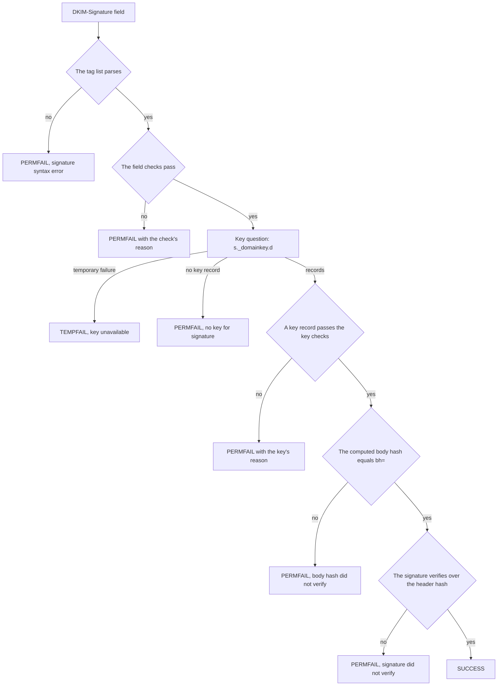
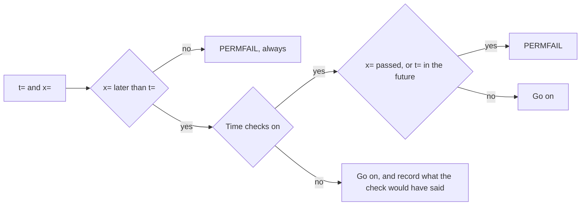
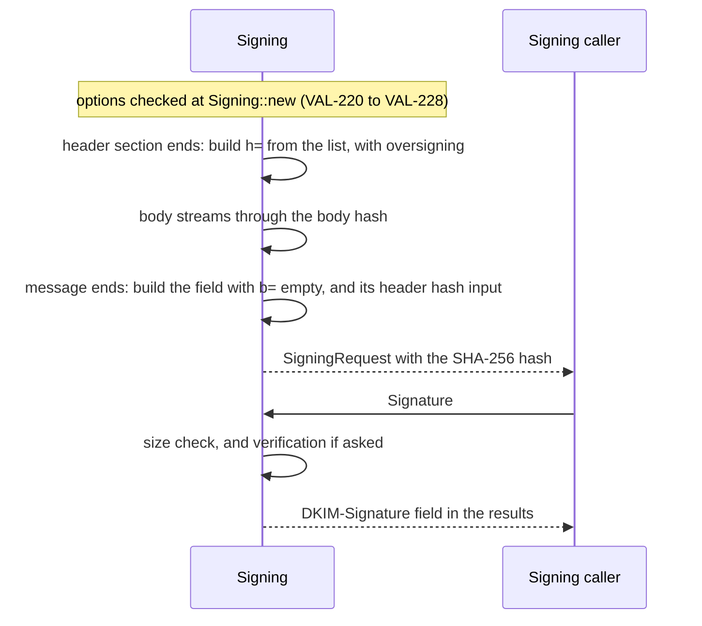

# DKIM

The steps of DKIM verification and signing (RFC 6376): each signature from its field to its result, the key lookup, the hashes, time checks, the cautions and hints, and the signing path. [Header section](header-section.md), [Tag lists](tag-lists.md) and [Canonicalization](canonicalization.md) cover the steps that DKIM shares with DKIM2.

## Contents

- [Signatures of a message](#signatures-of-a-message)
- [One signature](#one-signature)
- [Field checks](#field-checks)
- [Key checks](#key-checks)
- [Time checks](#time-checks)
- [Results](#results)
- [Cautions and hints](#cautions-and-hints)
- [Signing](#signing)
- [Trace](#trace)

## Signatures of a message

| Rule | Requirements |
|---|---|
| Each DKIM-Signature field is verified on its own, in header order, and gets its own result | DKV-004 |
| Fields after the first `dkim_signatures` get PERMFAIL with a reason that names the limit | DKV-004, SAF-002 |
| A header limit that stops the splitter gives the whole DKIM check `permerror` | SAF-002 |
| The key questions of all signatures go out when the header section ends, and the body hashes run while the body arrives | DNS-005, STR-001 |
| Two signatures with the same `s=` and `d=` share one key question | DNS-007 |

## One signature

The body hash and the header hash come from [Canonicalization](canonicalization.md). The body hash runs for every signature that passed its field checks, so a key that arrives late costs no second pass (STR-010).

## Field checks

| Check | Fails with | Requirements |
|---|---|---|
| The tag list parses, with no tag twice | PERMFAIL, signature syntax error | HDR-006, RFC 6376 §6.1.1 |
| `v`, `a`, `b`, `bh`, `d`, `h` and `s` are present | PERMFAIL, signature missing required tag | RFC 6376 §6.1.1 |
| `v=1` | PERMFAIL, incompatible version | RFC 6376 §6.1.1 |
| `a=` is `rsa-sha256` or `ed25519-sha256`. `rsa-sha1` never verifies | PERMFAIL, the algorithm | DKV-002, RFC 8301 §3.1 |
| The domain of `i=` is `d=` or a subdomain of it | PERMFAIL, domain mismatch | ADS-013, RFC 6376 §6.1.1 |
| `h=` names From | PERMFAIL, From field not signed | RFC 6376 §6.1.1 |
| `x=` is later than `t=` | PERMFAIL, the times | TIM-003, RFC 6376 §3.5 |
| `x=` hasn't passed, and `t=` isn't in the future | PERMFAIL, signature expired, or a future timestamp, unless time checks are off | TIM-002 |
| `d=`, `s=` and the key name fit ADS-004 | PERMFAIL, the name rule | ADS-008, DNS-008 |

## Key checks

| Check | Fails with | Requirements |
|---|---|---|
| A record whose first tag is `v=` with another value than `DKIM1` is dropped | The next record, or no key | REC-050 |
| More than `key_records` records | PERMFAIL before any is tried | REC-052, SAF-002 |
| The tag list parses | PERMFAIL, key syntax error | REC-050 |
| `p=` isn't empty | PERMFAIL, key revoked | REC-051 |
| `k=` fits `a=`, and `h=` lists the hash | PERMFAIL, inappropriate key or hash algorithm | REC-051 |
| `s=` lists `*` or `email` | The record is ignored | REC-050 |
| With `t=s` in the key, the domain of `i=` equals `d=` | PERMFAIL, domain mismatch | REC-050, [ADR 0044](../../adr/0044-a-dkim-signature-that-breaks-the-s-flag-of-its-key-gets-permfail-domain-mismatch.md) |
| The key data decodes: an RSAPublicKey, a SubjectPublicKeyInfo that holds one, or 32 octets of Ed25519 | PERMFAIL, key syntax error | REC-051, [ADR 0026](../../adr/0026-rsa-keys-in-key-records-may-be-rsapublickey-or-subjectpublickeyinfo.md) |
| An RSA modulus has from 1,024 bits to `rsa_key_bits`, and an exponent of at most `rsa_exponent_bits` | PERMFAIL with the size | DKV-003, REC-051, [ADR 0043](../../adr/0043-rsa-public-exponents-have-a-size-limit-in-dkim-and-must-be-65537-in-dkim2.md) |

With several records left, the signature passes if any of them verifies it, and the result lists each record with its own reason (REC-052, [ADR 0025](../../adr/0025-a-dkim-selector-with-several-key-records-passes-if-any-of-them-verifies-the-signature.md)). hallmark tries the records in ascending order of their octets, so neither the result nor the trace depends on the order of the records in the answer. When none verifies it, the signature takes the reason of the first record tried that passed its key checks, or of the first record if none did ([ADR 0056](../../adr/0056-authentication-results-map-each-typed-reason-to-one-result-value.md)).

## Time checks

| Rule | Requirements |
|---|---|
| The verification time is the time the message was received, never a clock | TIM-001 |
| Time checks are on by default, and the verifying caller can turn them off | TIM-002 |
| Checks that don't use the verification time still run | TIM-003 |
| With time checks off, the trace records the skipped check and its outcome | TIM-004 |
| A `t=` or `x=` of more than 12 digits is infinite | HDR-013 |

## Results

| Outcome | Reasons | Requirements |
|---|---|---|
| `success` | The signature verified, with the testing flag of the key and the octets after any `l=` cut | DKV-006, DKV-009 |
| `permfail` | The field check (`DkimFieldCheck`), key check (`DkimKeyCheck`), body hash or signature that failed, or the limit | GEN-004, RFC 6376 §3.9 |
| `tempfail` | The key question failed, with the resolver's description | GEN-005, DNS-009 |
| `permerror` for the check | A header limit stopped the splitter | SAF-002 |

DMARC takes each `d=` of a `success` as a DKIM identifier, by its position (DMC-005). [Authentication-Results](authentication-results.md#dkim) maps each reason to a result value.

## Cautions and hints

| Kind | When | Requirements |
|---|---|---|
| Caution | A pass with an RSA key under 2,048 bits, with an `l=` tag, or with an `h=` that names From only as often as the message has From fields | DKV-010 |
| Caution | `h=` selects the signature's own field | HCN-004 |
| Fact | The body hash matched and the signature failed | DKV-012 |
| Hint | That fact, with Subject, Reply-To or Sender in `h=` | DKV-012 |
| Hint | The body hash didn't match | DKV-013 |
| Hint | A `simple` header signature failed while its body hash matched | DKV-014 |

None of them changes a result (TRC-003).

## Signing

| Rule | Requirements |
|---|---|
| `h=` names each listed field the message has, as often as it has it, plus one more with oversigning. From is always listed | DKS-003 |
| `h=` names `dkim-signature` once for each such field at signing time, and never for the new one | DKS-006 |
| `t=` comes from the signing time of the signing options, `x=` from the expiration, and no `l=` is written | DKS-004 |
| Each `DkimSigning` gives one field, so RSA and Ed25519 can sign together | DKS-002 |
| Only the header fields to add come back | DKS-005 |

## Trace

| Step | Code | Records | Requirements |
|---|---|---|---|
| Each signature | `dkim.signature`, with `dkim.tags`, `dkim.tag`, `dkim.fields`, `dkim.expiration` and `dkim.timestamp` | Its tags with their byte ranges, each check and its outcome, and each time check, skipped or not | TRC-002, TIM-004 |
| The key | `dkim.key`, with `dns.txt` and `dkim.key_record` | The question, the answer, each record with its flags and its own outcome | TRC-008, REC-052 |
| `h=` | `dkim.h_name`, under `dkim.header_hash` | The instance each name selected, or none | DKV-011 |
| The hashes | `dkim.header_hash`, `dkim.signature_field`, `dkim.body_hash` and the `body.*` steps | The header hash input, the body steps, the computed and stated hashes | HCN-009, TRC-010 |
| The signature | `dkim.verification`, with `dkim.header_changed` | The key record that decided, and what a body hash match with a failed signature shows | DKV-012 |
| Cautions | `dkim.caution.*` | The cautions of DKV-010, HCN-004 and REC-052 | TRC-003 |
| Signing | `dkim.sign`, `dkim.sign.signature` and its children | The `h=` list, the hashes, the request to the signer, the size check and the field written, with no byte of a key | DKS-005, SGN-004, SEC-002 |

[Trace codes](../trace-codes.md#the-dkim-tree) gives the position of each step and the parameters of each code, and [the signing tree](../trace-codes.md#the-signing-tree) those of signing.
