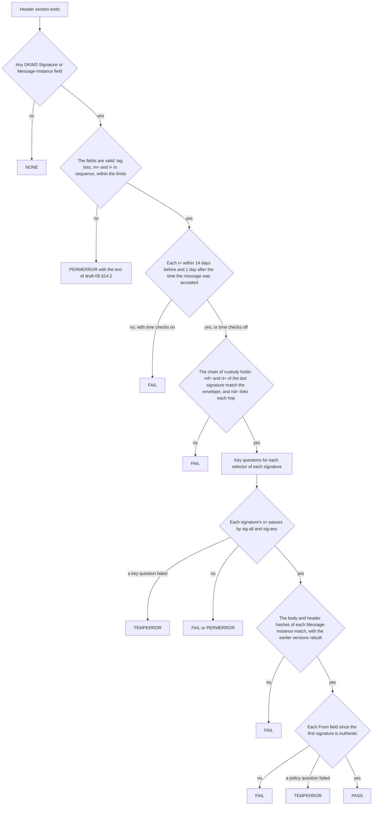
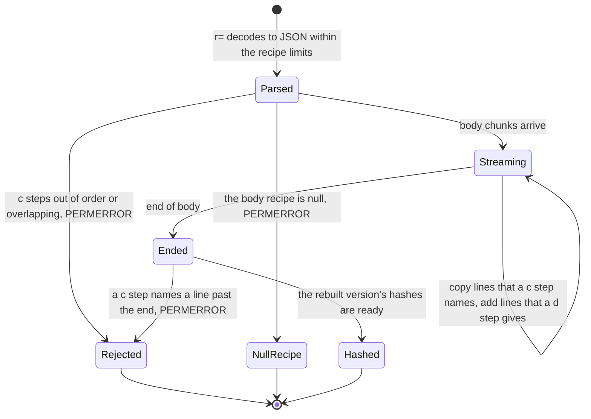
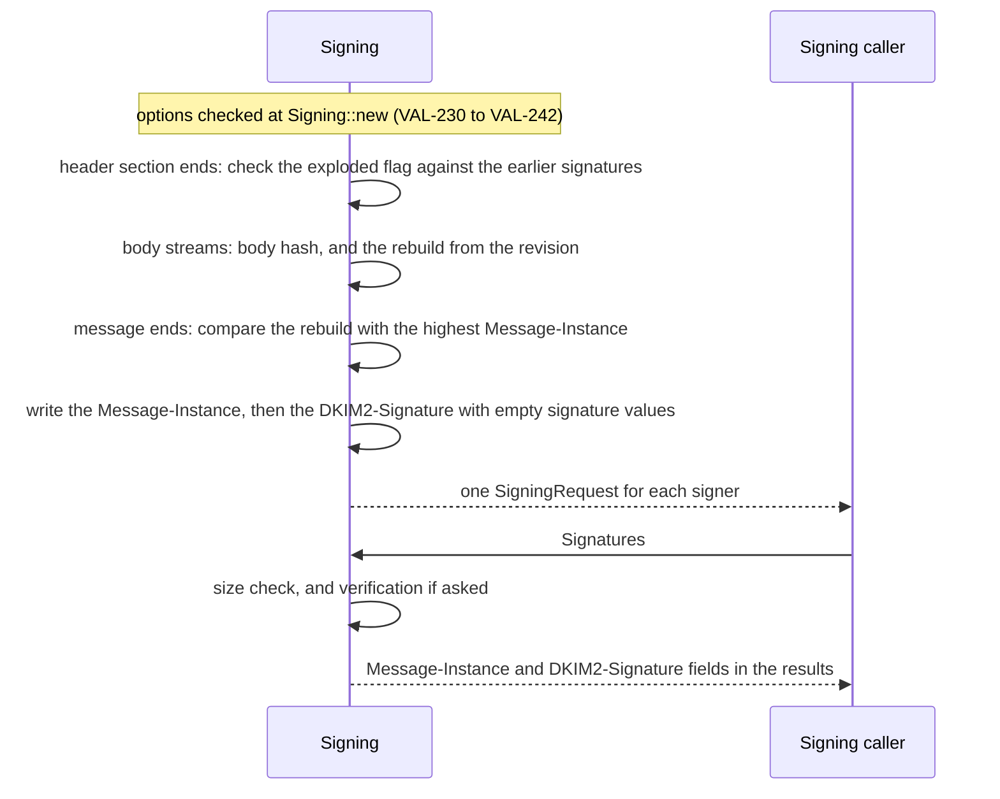

# DKIM2

The steps of DKIM2 verification and signing (draft-09, behind `unstable-dkim2`): the verifier actions of draft-09 §14 in order, the recipe rebuilds, the output state, and the signer actions of §12. The API and these flows can change in any release while the feature is experimental (DK2-005).

## Contents

- [Verification](#verification)
- [Steps](#steps)
- [Recipe rebuilds](#recipe-rebuilds)
- [Output states](#output-states)
- [Signing](#signing)
- [Trace](#trace)

## Verification

The key questions go out when the header section ends, and the body hashes and rebuilds run while the body arrives (DNS-005, DK2-006). The check reports the first state that decides the outcome, as draft-09 §14.1 lets a verifier stop once the outcome is known, and the trace keeps every step it ran.

## Steps

| Step | Rule | Outcome when it fails | Requirements |
|---|---|---|---|
| Fields valid | Each Message-Instance and DKIM2-Signature field parses as a tag list with ASCII values and holds its required tags. No `m=` or `i=` is missing or repeated, no Message-Instance has an `m=` above every signature's, and no hash algorithm or selector repeats. Recipes are valid JSON within the recipe limits and in order, and none is null. `i=1` has no `exploded` flag. The counts stay within `message_instances` and `dkim2_signatures` | PERMERROR, with the string of draft-09 §14.2 | DK2-003, DK2-007, HDR-006, draft-09 §14.2 |
| Timestamps | Each `t=` lies from 14 days before to 1 day after the verification time | FAIL, unless time checks are off | TIM-002, draft-09 §14.3 |
| Chain of custody | The decoded `mf=` and `rt=` of the highest signature match MAIL FROM and RCPT TO. Domains compare in lookup form without regard to case, and local parts as written | FAIL | ADS-024, draft-09 §14.4 |
| Keys | Each selector's key record follows dns-03 §4 | The text of REC-053: TEMPERROR or PERMERROR | DK2-011, REC-053 |
| Signatures | Each signature verifies over the signing input. Groups combine by `sig-all` and `sig-any`. An algorithm hallmark doesn't implement, or a key it treats as too short, gives a PERMERROR intermediate result | FAIL or PERMERROR | DK2-009, DK2-010, HCN-007, draft-09 §14.6 |
| Hashes | The body and header hashes of each Message-Instance match the message, or the earlier version its recipes rebuild. Hash sets combine by `hash-all` and `hash-any` | FAIL | DK2-006, DK2-010, HCN-005, draft-09 §14.7 |
| Authentic From | Each From field present since the first signature matches a signing domain by the relaxed domain match, in both directions. A subdomain match fetches the Domain Policy Record, and its `strict` flag cancels the match | FAIL, or PERMERROR for a malformed policy record | DK2-012, REC-054, draft-09 §14.8 |

## Recipe rebuilds

| Rule | Requirements |
|---|---|
| Each rebuild keeps only its position in its recipe, never the body | DK2-006, STR-001 |
| Line numbers count the raw body, before draft-09 §6.1 drops empty lines at the end. A recipe that copies one of those lines gets a trace note | DK2-008, [ADR 0008](../../adr/0008-dkim2-recipe-line-numbers-count-the-raw-body.md) |
| A recipe that breaks the order is hostile input, and gives PERMERROR with the string of draft-09 §14.2 that names it | DK2-007 |
| A null body recipe gives PERMERROR, and the result and the trace say so, because the earlier body can't be rebuilt | DK2-007, draft-09 §14.2 |
| Whether a `c` step that copies a last line without CRLF adds one is the [open item](../requirements.md#open-items) of hallmark#1 | DK2-008 |

## Output states

| State | Meaning | Requirements |
|---|---|---|
| `NONE` | No DKIM2 field | DK2-013, AR-004 |
| `PASS` | A Fully Verified DKIM2 Message | DK2-013 |
| `FAIL` | Verification finished, and the message isn't a Fully Verified DKIM2 Message | DK2-013 |
| `PERMERROR` | A field is absent or malformed, or another error that can't recover | DK2-013 |
| `TEMPERROR` | A DNS record couldn't be fetched | DK2-013, GEN-005 |

A state other than `PASS` carries the human-readable string of draft-09 §14 with its placeholders filled in, or none where the draft has none (DK2-013).

## Signing

| Rule | Requirements |
|---|---|
| A Reviser describes its changes, and hallmark writes the recipes from that description without comparing two bodies | DK2-014 |
| hallmark rebuilds the earlier version from the recipes it wrote, and signing stops if the hashes differ from the highest Message-Instance | DK2-014, SIGN-022 |
| `mf=` and `rt=` record the outgoing envelope, or `nd=` replaces them | draft-09 §10.5 to §10.7, VAL-237 |
| `exploded` on a message with no DKIM2-Signature yet stops signing | draft-09 §12.5, SIGN-026 |
| `i=` is one more than the highest DKIM2-Signature, and `m=` names the highest Message-Instance | draft-09 §10.1, §10.2 |
| Each signer of each group gets its own signing request, unhashed for `mldsa44` | SGN-002, DK2-009 |

## Trace

| Step | Records | Requirements |
|---|---|---|
| Each field | Its tags and their byte ranges | TRC-002 |
| Each step of the verification | Its inputs and outcome, with the section it applies | DK2-004 |
| The chain of custody | The paths compared, and the hint of ADS-024 | ADS-024 |
| Each recipe step | The lines it copied or added | DK2-004 |
| The header hashes | The fields taken and the fields left out, with their rules | HCN-009 |
| The result | The output state and the draft's string | DK2-013 |
