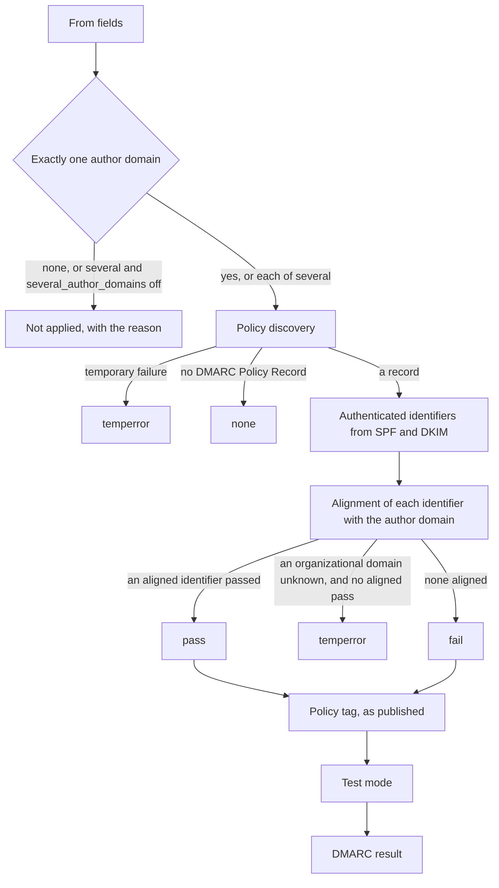
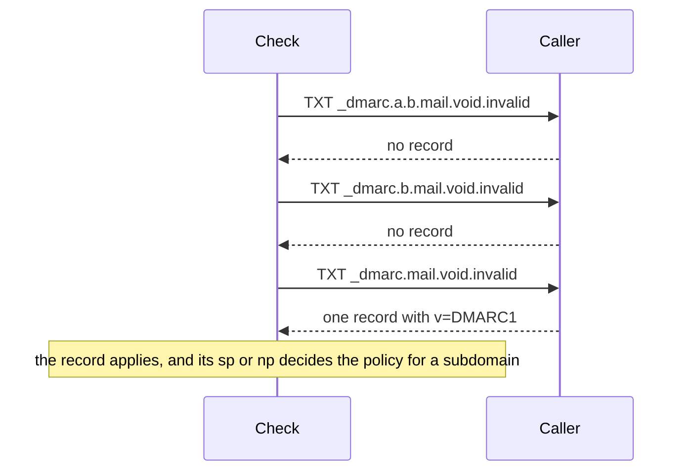
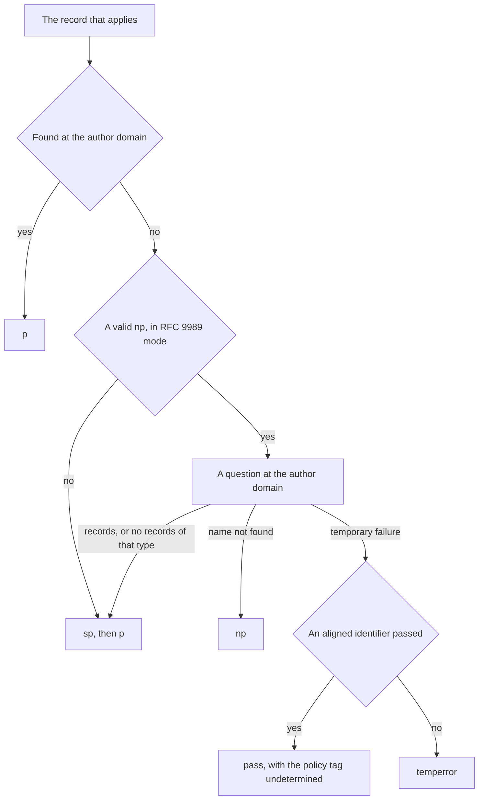

# DMARC

The steps of a DMARC check in its two modes, RFC 9989 and RFC 7489 ([ADR 0040](../../adr/0040-dmarc-supports-rfc-7489-and-dmarcbis-with-dmarcbis-the-default.md)): the author domain, policy discovery, the authenticated identifiers, alignment, the policy tag, test mode and the result. DMARC reports facts and applies no policy (GEN-006).

## Contents

- [Flow](#flow)
- [Modes](#modes)
- [Author domain](#author-domain)
- [Policy discovery](#policy-discovery)
- [Authenticated identifiers](#authenticated-identifiers)
- [Alignment](#alignment)
- [Policy tag and test mode](#policy-tag-and-test-mode)
- [Results](#results)
- [Trace](#trace)

## Flow

The policy questions go out when the header section ends, so they resolve while the body arrives (DNS-005). DMARC finishes once SPF and DKIM have their results.

## Modes

| Step | RFC 9989, the default | RFC 7489 | Requirements |
|---|---|---|---|
| Policy discovery | `_dmarc.` the author domain, then the DNS tree walk of §4.10 | `_dmarc.` the author domain, then `_dmarc.` its organizational domain if different | DMC-003, REC-030 |
| Organizational domain | The tree walk of §4.10.2 | The public suffix that the caller answers, plus one label | DMC-003, DMC-010, DMC-011 |
| Several records at one name | All discarded, and the walk goes on | No DMARC | REC-030 |
| Tags read | Adds `np`, `psd` and `t`. Drops `pct`, `rf` and `ri` | `pct`, `rf` and `ri` | DMC-004, REC-031 |
| Test mode | `t=y` | `pct=0`. Other `pct` values read as 100 | DMC-007 |
| Nonexistent subdomain | `np`, then `sp`, then `p`, with the A question of ADR 0050 | No `np` | REC-032 |

## Author domain

| Case | Result | Requirements |
|---|---|---|
| One From field with one mailbox whose domain has a lookup form | That domain, as an A-label | DMC-002, ADS-002 |
| No From field, a group with no mailbox, or a domain literal | Not applied, with the reason | DMC-002, [ADR 0013](../../adr/0013-a-from-domain-literal-gives-dmarc-no-author-domain.md) |
| More than one domain, from one field or several | Not applied, unless `several_author_domains` is on | DMC-002, ADS-012 |
| Several domains with `several_author_domains` on | One result for each, up to `author_domains`. More gives not applied for the limit | DMC-002, SAF-002 |
| A From field that doesn't parse | Not applied, for lack of an author domain | DMC-002, FLD-055 |

## Policy discovery

| Rule | Requirements |
|---|---|
| A record counts only if its first tag is `v=DMARC1` | REC-030 |
| In RFC 9989 mode, the walk asks at most eight names: an author domain of more than eight labels jumps to its last seven after the first question | RFC 9989 §4.10 |
| A record with `psd=y` or `psd=n` stops the walk | RFC 9989 §4.10 |
| In RFC 7489 mode, the check asks a public suffix question for the author domain, and asks no second name when the domain is its own organizational domain | DMC-010, DMC-011 |
| A temporary failure, or an unavailable public suffix that the result depends on, gives `temperror` | GEN-005, DMC-011 |
| The record parses by REC-031, and an invalid tag takes its default or the rule of §4.10.1 | REC-031, REC-032, [ADR 0023](../../adr/0023-dmarc-follows-rfc-9989-section-4-10-1-for-invalid-policy-tags-and-section-4-7-for-nonexistent-subdomains.md) |

## Authenticated identifiers

| Identifier | Comes from | Source | Requirements |
|---|---|---|---|
| SPF | The domain of the SPF MAIL FROM check when it gives `pass`. With MAIL FROM `<>`, that is the HELO name | Same check, an earlier result, or none (`dmarc_spf`) | DMC-005, RFC 9989 §4.4.2 |
| DKIM | The `d=` of each signature that gives `success` | Same check, earlier results, or none (`dmarc_dkim`) | DMC-005, RFC 9989 §4.4.1 |

A signature from a key with `t=y` counts like any other, and the result says when a pass rests only on such keys (DMC-008).

## Alignment

| Mode | An identifier aligns when | Requirements |
|---|---|---|
| Strict, `aspf=s` or `adkim=s` | Its domain equals the author domain, in lookup form without regard to case | DMC-005, ADS-003 |
| Relaxed, the default | Its organizational domain equals the author domain's | DMC-005, RFC 9989 §4.10.2, RFC 7489 §3.1 |

In RFC 7489 mode, the check asks a public suffix question for each domain it compares. Each alignment step names the identifier's result by its position, so a caller that ran the checks one at a time can match them (DMC-005). An SPF failure next to an aligned DKIM pass adds the hint of DMC-009.

## Policy tag and test mode

| Rule | Requirements |
|---|---|
| The result names the policy tag that applied with its published value, and lists every policy tag as published | DMC-006, REC-032 |
| A missing or invalid policy tag follows RFC 9989 §4.10.1: `none` if `rua` holds a valid URI, otherwise not applied | REC-032, REC-033, ADR 0023 |
| The A question goes out only when `np` can change the policy, as soon as the record is found | REC-032, [ADR 0050](../../adr/0050-dmarc-asks-whether-the-author-domain-exists-when-np-can-change-the-policy-and-needs-the-answer-only-for-a-message-that-fails.md) |
| Test mode comes from `t=y`, or from `pct=0` in RFC 7489 mode. hallmark samples nothing | DMC-007, [ADR 0020](../../adr/0020-test-modes-are-reported-and-the-caller-decides-what-they-mean.md) |
| hallmark computes no other policy. The caller decides what to do with the message | DMC-006, GEN-006 |

## Results

| Outcome | When | Requirements |
|---|---|---|
| `pass` | An aligned SPF or DKIM identifier passed | RFC 9989 §5.3.5, DMC-006 |
| `fail` | A record applies and no identifier aligned with a pass | RFC 9989 §5.3.5 |
| `none` | No DMARC Policy Record | DMC-006 |
| `temperror` | A question needed for the result failed, or a public suffix needed for it is unavailable | GEN-005, DMC-011, REC-032 |
| `permerror` | A limit stopped the check, such as `dns_questions` | SAF-002 |
| Not applied | No single author domain, too many author domains, or an invalid policy tag with no valid `rua` | DMC-002, REC-032 |

## Trace

| Step | Records | Requirements |
|---|---|---|
| Author domain | The From fields, the domains found and the case that applied | DMC-002 |
| Policy discovery | Each question and answer, each public suffix question and answer, the records kept and dropped | TRC-008, DMC-011 |
| Alignment | Each identifier, its mode, its organizational domain and the result it came from | DMC-005 |
| Policy | The tag that applied, the existence question, test mode, an ignored `pct` | DMC-006, DMC-007 |
| Hints | The forwarding hint of DMC-009 | DMC-009 |
