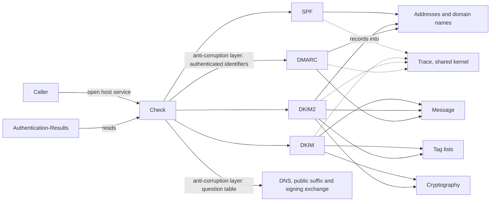
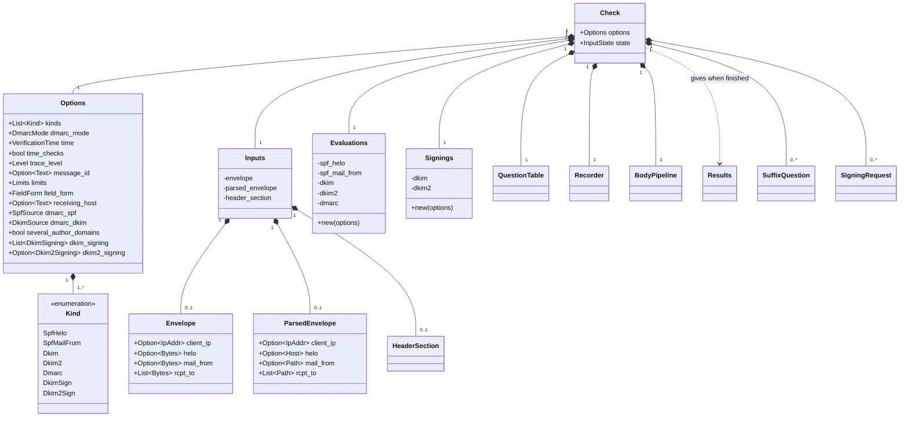
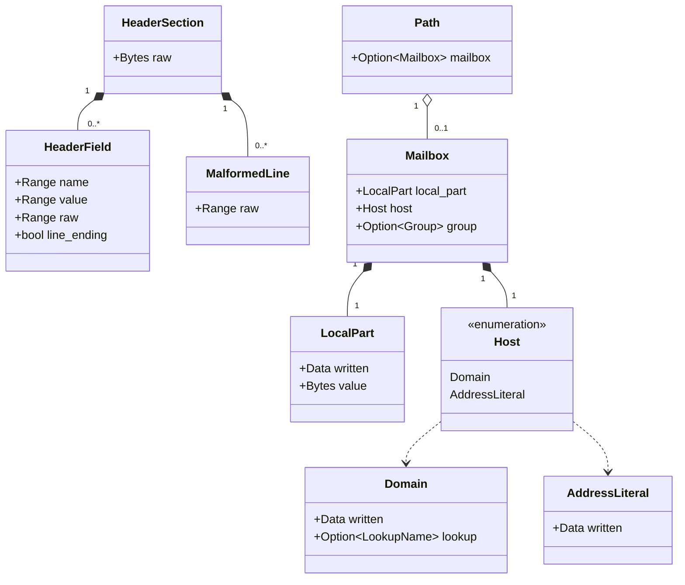
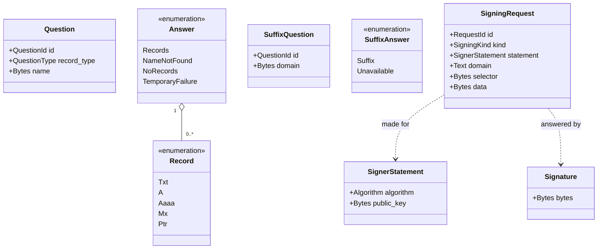
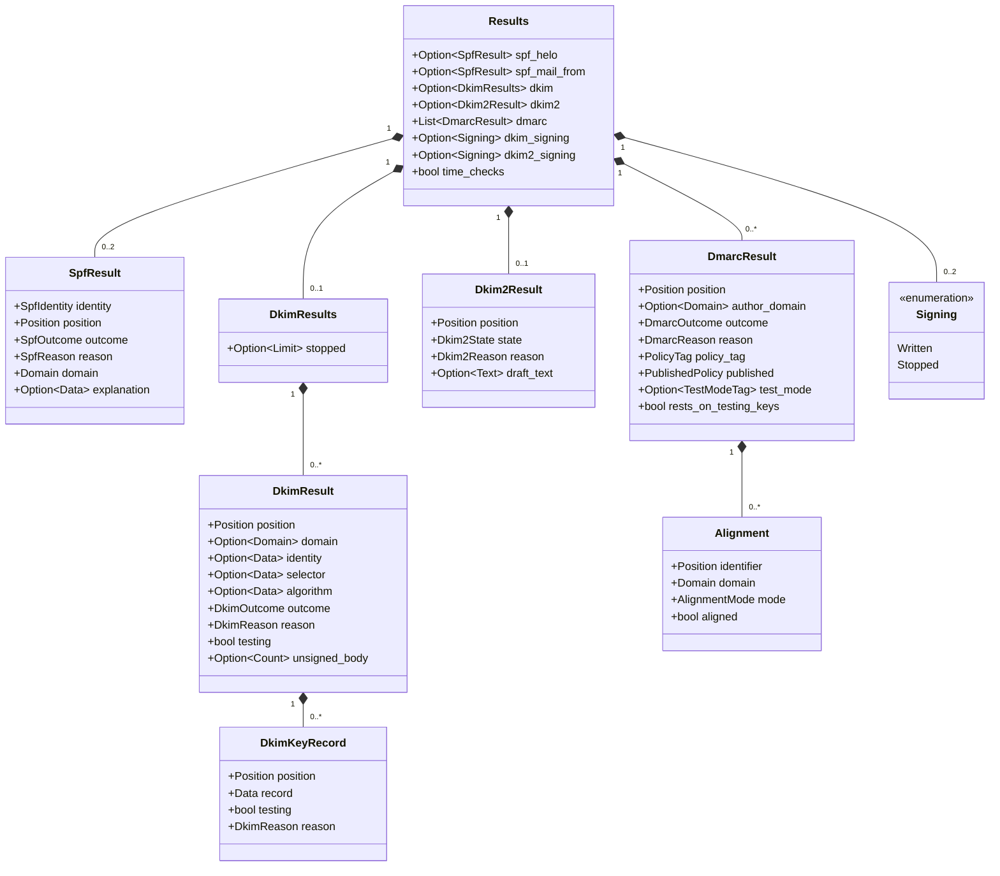
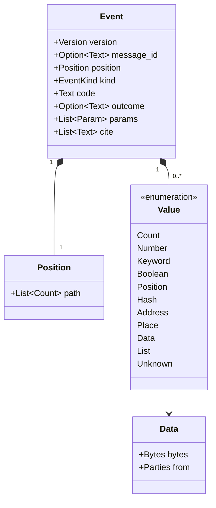

# Domain model

The bounded contexts of hallmark, the entities and value objects of each, and the invariants that hold between them. The type names are the Ubiquitous Language. The [API reference](https://photom.github.io/hallmark/api/hallmark/) gives each public type's exact fields and variants.

## Contents

- [Context map](#context-map)
- [The check](#the-check)
- [Message and addresses](#message-and-addresses)
- [What the core and the caller exchange](#what-the-core-and-the-caller-exchange)
- [Results](#results)
- [Trace](#trace)
- [Glossary](#glossary)
- [Invariants](#invariants)

## Context map

| Context | Language it owns | Modules | Relationship |
|---|---|---|---|
| Check | Check, kind of check, envelope, input, request, results | `check` | Open host service for callers ([ADR 0047](../../adr/0047-one-check-type-runs-any-set-of-checks-and-shares-their-dns-answers.md)) |
| Message | Header section, header field, malformed line, field form, body chunk, canonical form | `header`, `canonical`, `canonicalizer` | Supplier to DKIM, DKIM2 and DMARC |
| Tag lists | Tag, tag value, tag list | `tags` | Supplier to DKIM and DKIM2 |
| Addresses and domain names | Mailbox, path, local part, domain, lookup form, address literal | `address`, `idna`, `ip` | Supplier to SPF, DKIM, DKIM2 and DMARC |
| Exchange | Question, answer, record, suffix question, suffix answer, signer statement, signing request, signature | `dns`, `suffix`, `signing` | Shared by the core and the caller. The question table of Check translates between it and the protocols ([ADR 0060](../../adr/0060-a-check-fixes-its-evaluations-when-created-and-each-input-once-it-arrives.md)) |
| Cryptography | Hash, signature verification, key data | `crypto` | Supplier to DKIM, DKIM2 and the memory signer |
| SPF | Identity, record, term, mechanism, modifier, macro | `spf` | Customer of Addresses |
| DKIM | Signature, selector, key record, body hash, header hash | `dkim` | Customer of Message |
| DKIM2 | Message-Instance, DKIM2-Signature, recipe, revision, chain of custody, Domain Policy Record | `dkim2` | Customer of Message and Addresses |
| DMARC | Author domain, DMARC Policy Record, organizational domain, authenticated identifier, alignment, policy tag | `dmarc` | Gets authenticated identifiers only through Check (DMC-005) |
| Authentication-Results | authserv-id, method, result, reason, property | `authres` | Reads results |
| Trace | Step, event, position, slot, fact, caution, hint, code, data value | `trace`, `render` | Shared kernel that every context records into, each with its own codes ([ADR 0061](../../adr/0061-each-context-owns-its-trace-codes-and-the-english-renderer-sits-in-the-application-layer.md)) |

[Modules](modules.md#layers) places each context in its layer ([ADR 0059](../../adr/0059-the-modules-of-the-hallmark-crate-are-bounded-contexts-in-five-layers.md)).

## The check

`Check` is the aggregate root that a caller creates and feeds. Everything else in the core lives inside it or passes through it.

| Part | Holds | Requirements |
|---|---|---|
| `Options` | Everything the caller fixes when it creates the check. Nothing changes them later | GEN-001, TIM-002, TRC-004, TRC-014 |
| `Inputs` | A write-once slot for each input that the check keeps: the envelope, the parsed envelope and the header section. The check sets each slot when its input is complete, the header section at the end of the header fields, and nothing changes it after that | CHK-004, INV-017 |
| `Envelope` | The SMTP envelope as the caller passed it, before parsing | GEN-002 |
| `ParsedEnvelope` | The client IP address, the HELO name as a host, MAIL FROM as a path and each RCPT TO as a path | ADS-020 to ADS-022 |
| `HeaderSection` | The raw header section and the lines found in it | HDR-001, STR-008 |
| `Evaluations` | One field for each kind of check that verifies. `new` decides which fields hold an evaluation, and an empty field means the caller didn't ask for that kind | GEN-001, INV-016 |
| `Signings` | One field for DKIM signing and one for DKIM2 signing, under the rules of `Evaluations` | DKS-001, DK2-014, INV-016 |
| `BodyPipeline` | One canonicalizer and hash state for each distinct body hash that the signatures need, and one rebuild for each DKIM2 recipe | STR-001, DK2-006 |
| `QuestionTable` | Each question with its state, and its answer in a write-once slot | DNS-007, CHK-004, INV-003 |
| `Recorder` | The trace events not yet read, within the trace limit | TRC-004, TRC-005 |

DMARC's identifiers come from one of three sources, which `SpfSource` names for SPF and `DkimSource` for DKIM:

| Source | Meaning | Requirement |
|---|---|---|
| Same check | The SPF or DKIM kind runs in this check | GEN-001 |
| Earlier results | The caller passes results from another check, each with its position in that check's trace | DMC-005 |
| None | The caller has no such result, so DMARC has no identifier of that type | RFC 9989 §5.3.3 |

## Message and addresses

| Value | Rule | Requirements |
|---|---|---|
| `HeaderField` | Positions in the raw bytes, never a copy. `line_ending` is false only for a last line with no line ending | HDR-001, HCN-008 |
| `MalformedLine` | A line in the header section that isn't a header field, kept with its raw bytes | HDR-004, HCN-006 |
| `Path` | A null path `<>` has no mailbox | ADS-020 |
| `LocalPart` | The form written in the input, and the value without quoting | ADS-006 |
| `Domain` | The form written in the input, and a lookup form when the conversion to A-labels succeeds and the labels fit | ADS-002 to ADS-004 |
| `AddressLiteral` | Never looked up in DNS | ADS-005 |

## What the core and the caller exchange

| Value | Shapes | Requirements |
|---|---|---|
| `QuestionType` | `TXT`, `A`, `AAAA`, `MX`, `PTR` | DNS-001 |
| `Answer` | Records, name not found (NXDOMAIN), no records of that type (NODATA), temporary failure with an optional description | DNS-002, DNS-009 |
| `Record` | TXT as its strings, not joined. A and AAAA as addresses. MX as a preference and an exchange name. PTR as a name | DNS-006 |
| `SuffixAnswer` | A number of labels from 1 to the labels of the domain, with an optional list name, or unavailable, with an optional description | DMC-010, DMC-011 |
| `Algorithm` | `rsa-sha256`, `ed25519-sha256`, and with `unstable-dkim2` `mldsa44` | DKS-001, DK2-009 |
| `SigningRequest` data | The SHA-256 hash for `rsa-sha256` and `ed25519-sha256`, and the whole signing input for `mldsa44` | SGN-002 |

## Results

| Result | Values | Requirements |
|---|---|---|
| `SpfOutcome` | `none`, `neutral`, `pass`, `fail`, `softfail`, `temperror`, `permerror` | SPF-003 |
| `DkimOutcome` | `success`, `permfail`, `tempfail` for each signature, and `permerror` for the whole check when a header limit stops it | RFC 6376 §3.9, DKV-004, SAF-002 |
| `Dkim2State` | `NONE`, `PASS`, `FAIL`, `PERMERROR`, `TEMPERROR`, with the text of draft-09 §14 | DK2-013 |
| `DmarcOutcome` | `pass`, `fail`, `none`, `temperror`, `permerror`, or not applied with the reason | DMC-002, DMC-006 |
| `PolicyTag` | `p`, `sp` or `np` with its published value, undetermined, or no policy | DMC-006, REC-032 |
| `Signing` | The header fields written, or stopped with the error that stopped it | DKS-005, SGN-004 |

Each result carries a typed reason (GEN-004) and its position in the trace, so another check can point at it (DMC-005).

## Trace

[Trace format](../trace-format.md) defines each member and its bytes, and [Trace codes](../trace-codes.md) lists the codes.

## Glossary

| Term | Type | Role | Context | Requirements |
|---|---|---|---|---|
| Check | `Check` | Aggregate root | Check | CHK-001 |
| Kind of check | `Kind` | Value | Check | GEN-001 |
| Options | `Options` | Value | Check | PAR-004, TRC-004 |
| Envelope | `Envelope` | Value | Check | GEN-002 |
| Request | `Request` | Value: a question, a suffix question or a signing request | Check | CHK-001 |
| Results | `Results` | Value | Check | GEN-004 |
| Inputs | `Inputs` | Write-once slots inside a check | Check | CHK-004 |
| Parsed envelope | `ParsedEnvelope` | Value | Check | ADS-020 to ADS-022 |
| Evaluations | `Evaluations` | The evaluations a check runs, fixed when it is created | Check | GEN-001 |
| Signings | `Signings` | The signings a check runs, fixed when it is created | Check | DKS-001, DK2-014 |
| Write-once slot | `WriteOnce` | Holds one value or none, and keeps the first value it gets | Kernel | CHK-004 |
| Verification time | `VerificationTime` | Value: seconds since 1970-01-01T00:00:00Z | Kernel | TIM-001 |
| Limits | `Limits` | Value | Kernel | SAF-002 |
| Header section | `HeaderSection` | Entity inside a check | Message | HDR-001 |
| Header field | `HeaderField` | Value | Message | HDR-001 |
| Malformed line | `MalformedLine` | Value | Message | HDR-004 |
| Field form | `FieldForm` | Value: LF or CRLF between folded lines, and whether a leading space was removed | Message | STR-008, STR-009 |
| Canonicalizer | `Canonicalizer` | Aggregate root of its own | Message | STR-012 |
| Mailbox | `Mailbox` | Value | Addresses | ADS-001 |
| Path | `Path` | Value | Addresses | ADS-020, ADS-021 |
| Local part | `LocalPart` | Value | Addresses | ADS-006 |
| Domain | `Domain` | Value | Addresses | ADS-002 |
| Address literal | `AddressLiteral` | Value | Addresses | ADS-005 |
| Question | `Question` | Entity inside the question table | Exchange | DNS-001, DNS-007 |
| Answer | `Answer` | Value | Exchange | DNS-002 |
| Suffix question and answer | `SuffixQuestion`, `SuffixAnswer` | Entity and value | Exchange | DMC-010 |
| Signer statement | `SignerStatement` | Value | Exchange | SGN-003 |
| Signing request | `SigningRequest` | Entity inside a check | Exchange | SGN-002 |
| Signature | `Signature` | Value | Exchange | SGN-004 |
| Memory signer | `MemorySigner` | Entity that holds keys | Exchange | SGN-005 |
| Authenticated identifier | `AuthenticatedIdentifier` | Value: a domain and the position of the SPF or DKIM result it came from | DMARC | DMC-005 |
| Policy tag | `PolicyTag` | Value | DMARC | DMC-006 |
| Event | `Event` | Value | Trace | TRC-002 |
| Position | `Position` | Value | Trace | TRC-012 |
| Data value | `Data` | Value: bytes and the parties that control them | Trace | TRC-013 |
| Snapshot | `Snapshot` | Value | Exchange | DNS-004 |

## Invariants

| ID | Invariant | Held by | Requirements |
|---|---|---|---|
| INV-001 | A check holds each question type and lookup name once, and every step that needs the answer reads the same one | The question table, keyed by type and name | DNS-007 |
| INV-002 | A question ID is unique within its check | The question table, which numbers questions in order | DNS-007 |
| INV-003 | Each question takes one answer. A second answer, or an answer to an ID the check never handed out, gives an error and leaves the check as it was | The question table's states ([lifecycle.md](lifecycle.md#requests)), and the write-once slot of each entry | CHK-004 |
| INV-004 | The check keeps no reference to a body chunk after the call that passed it returns | Input methods borrow the chunk and keep only state | STR-007 |
| INV-005 | Memory doesn't grow with the body | Canonicalizer states of fixed size, and hash states | STR-001, SAF-004 |
| INV-006 | A domain name has a lookup form only if the conversion to A-labels succeeded and its labels fit RFC 1035 | The constructor of `Domain` | ADS-002, ADS-004 |
| INV-007 | No question names an address literal | `Host` keeps literals apart from domains | ADS-005 |
| INV-008 | A step's position depends only on the inputs | Positions come from the order the specifications fix and the order of the input | TRC-012 |
| INV-009 | Results don't depend on the trace level or the trace limits | The recorder never feeds back into a decision | TRC-004, TRC-005 |
| INV-010 | A caller error, a signer error or a stream error never becomes a protocol result | Errors and results are separate types | CHK-004, SGN-004, STR-006 |
| INV-011 | A check holds no private key | Signing goes through signing requests | SGN-001 |
| INV-012 | Bytes that a sender or a DNS publisher controls enter the trace only as data values that name those parties | `Data` is the only trace value that holds such bytes | TRC-013 |
| INV-013 | The result and the sorted trace don't depend on when answers arrive, how the caller groups them, or where body chunks are cut | INV-001, INV-008 and the canonicalizer | CHK-003 |
| INV-014 | Signing writes a header field only after the signature has the size its algorithm gives and, if the caller asked, verifies | The signing states ([lifecycle.md](lifecycle.md#signing)) | SGN-004, SGN-006 |
| INV-015 | Options don't change after the check is created | `Check` takes them by value and exposes no setter | SGN-006 |
| INV-016 | The kinds of check that a check runs don't change after it is created | `Evaluations::new` and `Signings::new` alone fill their fields, and no method gives `&mut Option<T>` ([ADR 0060](../../adr/0060-a-check-fixes-its-evaluations-when-created-and-each-input-once-it-arrives.md)) | GEN-001 |
| INV-017 | An input doesn't change once the check holds it | The write-once slots of `Inputs`, input values that hallmark builds with only `&self` methods, and evaluations that read inputs by shared reference ([ADR 0060](../../adr/0060-a-check-fixes-its-evaluations-when-created-and-each-input-once-it-arrives.md)) | CHK-003, CHK-004 |
