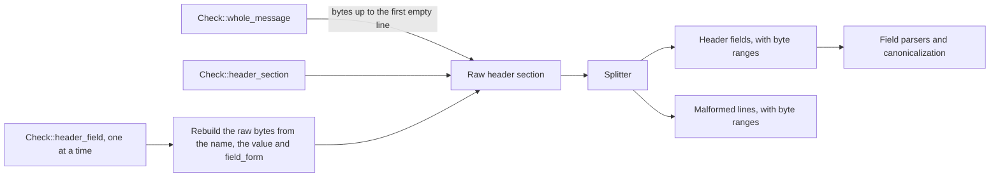
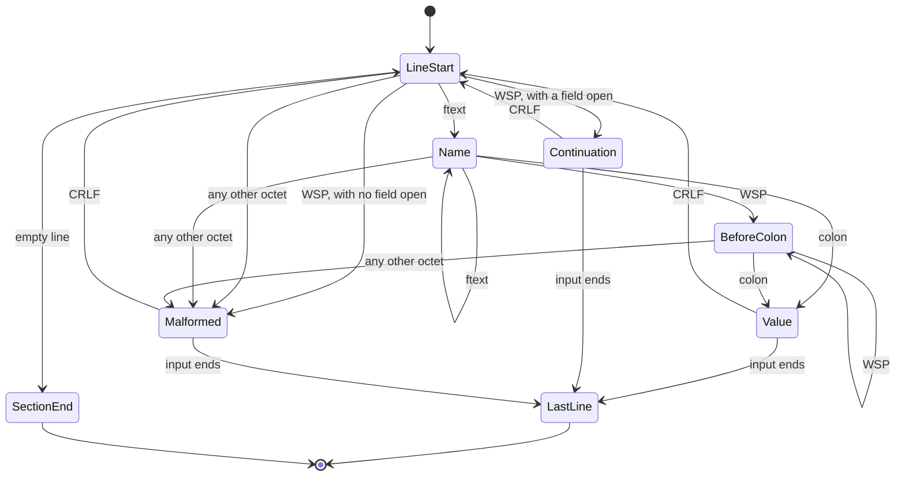
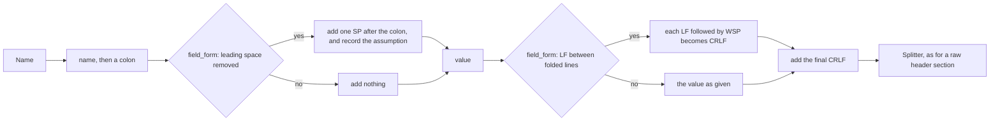

# Header section

The steps from a check's header input to header fields and malformed lines: the two input forms, the splitter, the limits, bare CR and LF, the fields that hallmark parses further, and what the trace records. [Canonicalization](canonicalization.md) takes the fields from here.

## Contents

- [Inputs](#inputs)
- [Splitting lines](#splitting-lines)
- [What a line becomes](#what-a-line-becomes)
- [Fields from a milter](#fields-from-a-milter)
- [Bare CR and LF](#bare-cr-and-lf)
- [Limits](#limits)
- [Fields that hallmark parses](#fields-that-hallmark-parses)
- [Trace](#trace)

## Inputs

| Input | The header section ends at | Requirements |
|---|---|---|
| `whole_message` | The first empty line, or the end of the input when there is no body | HDR-001, GEN-003 |
| `header_section` | The end of the input. An empty last line is allowed and ends it, and an empty line before that is an error to the caller (VAL-110) | HDR-001 |
| `header_field` | `end_of_header_fields` | STR-008, HDR-005 |

The splitter keeps the raw bytes and never changes them (HDR-001). Every value it gives is a byte range into them (PAR-002).

## Splitting lines

A line ends at CRLF and nowhere else (RFC 5321 §2.3.8, HDR-012).

| State | Rule | Requirements |
|---|---|---|
| Name | `ftext` is printable US-ASCII except the colon, `%d33-57 / %d59-126` | HDR-004, RFC 5322 §3.6.8 |
| BeforeColon | WSP between the name and the colon is the obsolete form of RFC 5322 §4.5 | HDR-003 |
| Value | Every octet up to CRLF belongs to the value: UTF-8, bare CR and LF included | HDR-004, HDR-012 |
| Continuation | A line that starts with WSP folds the open field, including a line of WSP only (RFC 5322 §4.2) | HDR-003 |
| Malformed | The line, up to and including its CRLF, is a malformed line | HDR-004 |
| LastLine | The input ended with no CRLF. The line keeps its class, and canonicalization adds a CRLF | HCN-008 |
| SectionEnd | The empty line belongs to neither the fields nor the body (FLD-002) | HDR-001 |

## What a line becomes

| Line | Becomes | Scenario |
|---|---|---|
| A field name, optional WSP, a colon and a value | A header field: its name, its value and its raw bytes, up to the next line that doesn't start with WSP | FLD-001 |
| A line that starts with WSP after a field | Part of that field. Unfolding removes the CRLF before it (RFC 5322 §2.2.3) | FLD-001 |
| A line that starts with WSP before any field, or after a malformed line | A malformed line of its own | FLD-043 |
| A line with no colon, or with an octet outside `ftext` before it | A malformed line | FLD-042 |
| A line that starts with a bare CR or LF | A malformed line, because neither byte is WSP | FLD-053 |
| The last line, with no CRLF | Its class as above, marked as having no line ending | CAN-263 |

| Value | Rule | Requirements |
|---|---|---|
| Name | Compared without regard to ASCII case | HDR-002 |
| Unfolded value | The value with each CRLF that WSP follows removed | HDR-003 |
| Raw bytes | The bytes from the first octet of the name to the CRLF that ends the field, folds included | HDR-001, HCN-001 |
| `line_ending` | False only for a last line with no CRLF | HCN-008 |

## Fields from a milter

| Rule | Requirements |
|---|---|
| The rebuilt bytes go through the same splitter as a raw header section, so a name that isn't a field name gives a malformed line | HDR-005, HDR-004 |
| A CR or LF in the value that isn't part of a line break of the stated form stays an octet | HDR-012 |
| In the LF form, an LF followed by WSP counts as a fold. The trace records each assumption the rebuild made | STR-008, FLD-060 |
| A field that negotiated an unmodified value gets no assumption | FLD-061 |

## Bare CR and LF

A bare CR or LF is an octet of the line that holds it ([ADR 0051](../../adr/0051-a-bare-cr-or-lf-in-the-header-section-is-an-octet-of-the-line-that-holds-it.md)).

| Position | Effect | Scenario |
|---|---|---|
| In a field value | Stays in the value. The parser of a structured field reads it by that field's grammar | FLD-052, FLD-055 |
| In a field name | The line is a malformed line | FLD-054 |
| At the start of a line | The line is a malformed line | FLD-053 |
| At the end of the last line, with no CRLF | Stays, and canonicalization adds a CRLF after it | CAN-268 |
| In a field from a milter | Stays, as in a raw header section | FLD-062 |

## Limits

| Limit | Counts | Effect of reaching it | Requirements |
|---|---|---|---|
| `header_fields` | Header fields and malformed lines | The splitter stops. DKIM gives `permerror` for the check, DKIM2 PERMERROR and DMARC `permerror`, and signing stops with `signing.header_limit`. SPF goes on, because it needs no header field | SAF-002 |
| `header_field_size` | Octets of one field or malformed line, folds included | As `header_fields` | SAF-002 |
| `header_section_size` | Octets of the whole header section | As `header_fields` | SAF-002 |

[Limits](limits.md#limits-of-a-check) gives the defaults and ranges.

## Fields that hallmark parses

| Field | Parser | Read by | Requirements |
|---|---|---|---|
| From | Header address parser | DMARC, DKIM2 | DMC-002, DK2-012, ADS-012 |
| DKIM-Signature | Tag list parser ([Tag lists](tag-lists.md)) | DKIM | HDR-006 |
| Message-Instance, DKIM2-Signature | Tag list parser | DKIM2 | HDR-006 |
| Every field | None: only its name and raw bytes | DKIM `h=` selection, the DKIM2 header hash | HCN-003, HCN-005 |

Authentication-Results fields are parsed only when the caller asks (AR-003). A check doesn't read them.

## Trace

| Step | Code | Records | Requirements |
|---|---|---|---|
| The header section | `header.section`, in the slot `[8]` | The input, and the number of fields and malformed lines | TRC-002 |
| A malformed line | `header.malformed` | Its raw bytes as a data value. DKIM2 adds a caution when it leaves the line out of its header hash | HDR-004, HCN-006 |
| A last line with no CRLF | `header.no_line_ending` | That the line ending is missing, citing RFC 5322 §2.2 | HCN-008 |
| Bare CR and LF | `header.bare_cr_lf` | A caution with the count and the first places, citing RFC 5322 §2.2 and RFC 5321 §2.3.8, and in signing also RFC 6376 §5.3 and draft-09 §17 | HDR-012 |
| Fields from a milter | `header.rebuilt` | The field form and the leading spaces the rebuild assumed | STR-008 |
| A limit | `header.section` with the outcome `permerror` | The limit | SAF-002 |

[Trace codes](../trace-codes.md#header-section) gives the parameters of each code. The checks of a call share one header section, so it has one slot of its own.

Field contents are values the sender controls (TRC-013).
