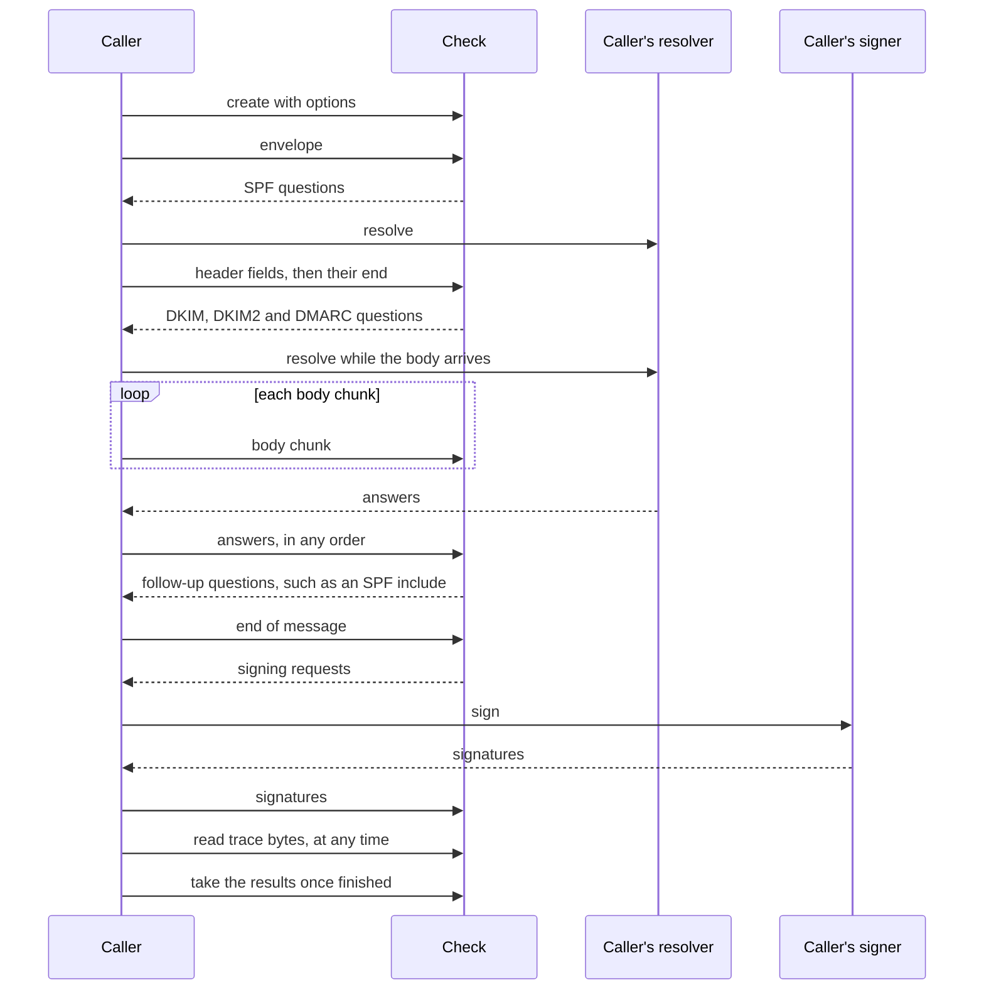
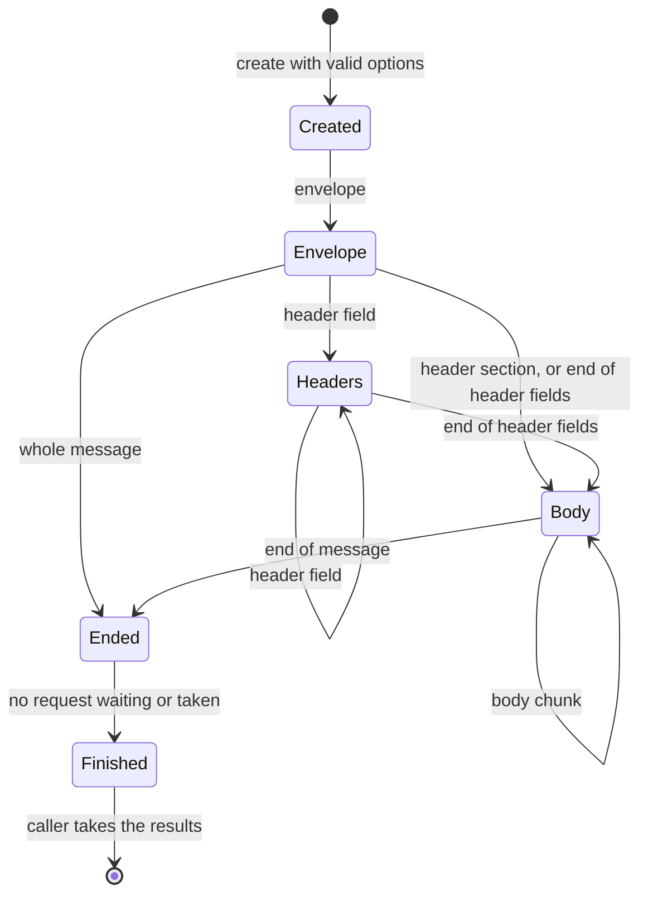
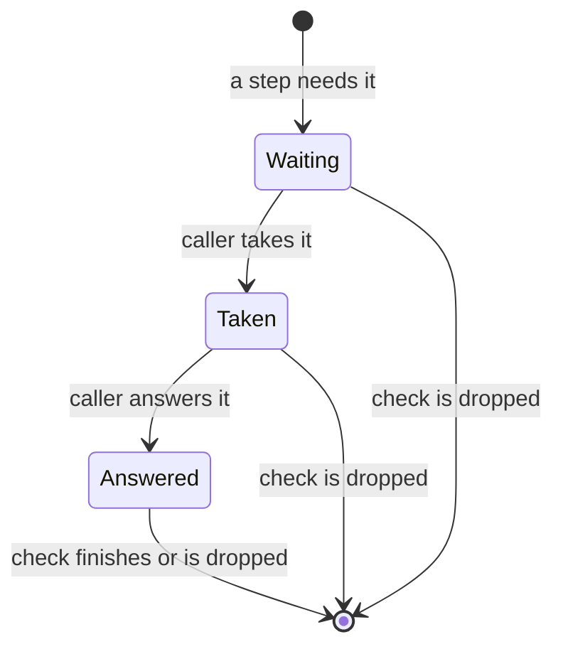
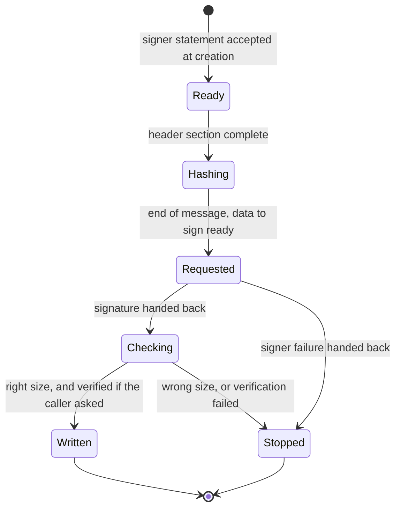
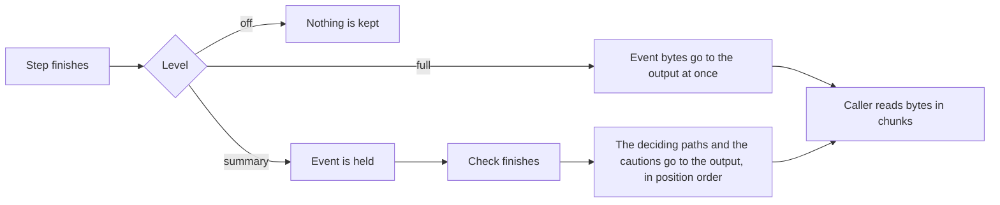
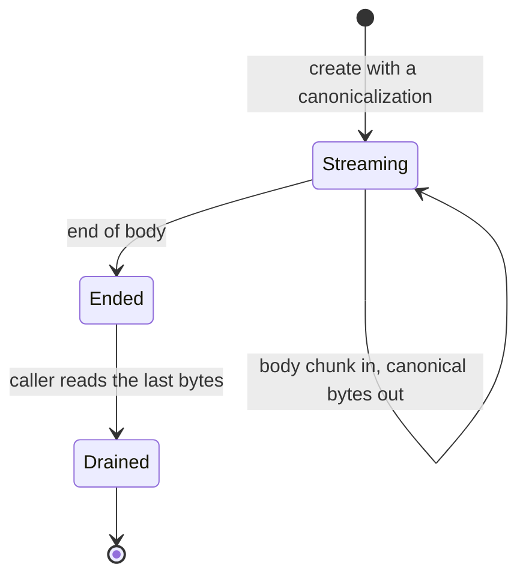
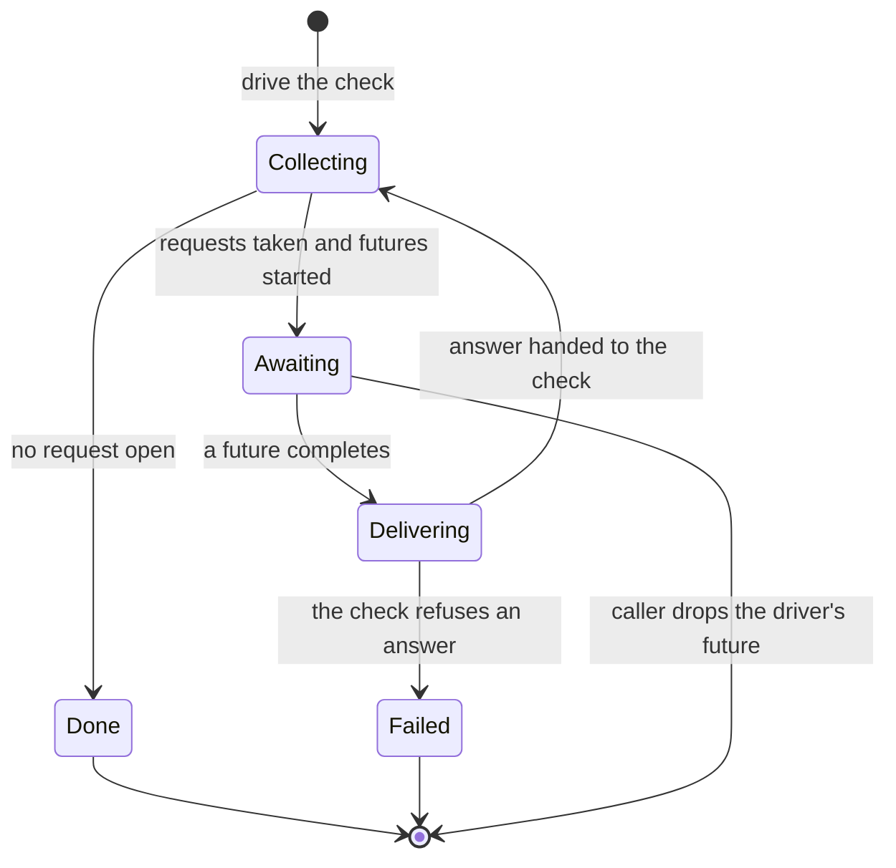

# Lifecycle

The states of each object that lives longer than one call: a check, its requests, its signing, the canonicalizer, the trace output and the driver, and how long each object stays in memory. [Concurrency](concurrency.md) covers threads and cancellation.

## Contents

- [A check from start to end](#a-check-from-start-to-end)
- [Check](#check)
- [Requests](#requests)
- [Signing](#signing)
- [Trace output](#trace-output)
- [Canonicalizer](#canonicalizer)
- [Driver](#driver)
- [How long objects live](#how-long-objects-live)

## A check from start to end

After each call, the caller takes the requests the check now has. It can answer them at once, later, or together (CHK-001).

## Check

A check whose kinds are all SPF needs only the envelope, so it moves from Created to Ended when the envelope arrives (CHK-001, DNS-005).

| State | Input it accepts | Next state | Requests that can appear |
|---|---|---|---|
| Created | Envelope | Envelope, or Ended for SPF alone | SPF questions. In RFC 7489 mode, the public suffix question for the MAIL FROM domain, or the HELO name when MAIL FROM is null (DMC-010) |
| Envelope | One header field (STR-008), the raw header section, the end of header fields, or the whole message | Headers, Body or Ended | As for Body, once the header section is complete |
| Headers | One header field, or the end of header fields | Headers or Body | None |
| Body | A body chunk, or the end of the message | Body or Ended | DKIM and DKIM2 key questions, DKIM2 Domain Policy Record questions, DMARC policy questions, and in RFC 7489 mode public suffix questions for the author domain and each DKIM `d=` domain (DNS-005) |
| Ended | None of the message input | Finished | Signing requests, and questions that follow from answers, such as SPF follow-ups, the DMARC tree walk and the author domain question of REC-032 |
| Finished | None | | None |

In every state from Envelope on, the check also accepts an answer to a question it handed out, a public suffix answer and a signature, and these can make new requests appear. Reading trace bytes is allowed in every state.

| Input that breaks the order | What happens | Requirement |
|---|---|---|
| Message input in the wrong state, such as a body chunk before the header section ends, or a second envelope | An error to the caller. The check stays in its state and loses nothing | CHK-004 |
| An answer to a question the check never handed out, or a second answer | An error to the caller. The check keeps the first answer | CHK-004 |
| Taking the results before Finished | The check names what it still waits for, and gives no result | CHK-002 |

The states above cover only the order of the input. The rest of a check has lifecycles of its own, each kept in one place ([ADR 0060](../../adr/0060-a-check-fixes-its-evaluations-when-created-and-each-input-once-it-arrives.md)):

| Part | Lifecycle | Kept in |
|---|---|---|
| Which evaluations and signings the check runs | None. `Check::new` fixes them from the options (INV-016) | `Evaluations`, `Signings` |
| Each input that the check keeps: the envelope, the parsed envelope and the header section | Empty until the input is complete, then set once and never changed (INV-017). The header section is complete at the end of the header fields | `Inputs` |
| Each evaluation and signing | Its own states, from its first state on, even before its input arrives | Its protocol context: [SPF](spf.md#evaluation-without-recursion), [DKIM](dkim.md#one-signature), [DKIM2](dkim2.md#verification), [DMARC](dmarc.md#flow) and [Signing](#signing) |

## Requests

Questions, public suffix questions and signing requests share one lifecycle.

| Event | Rule | Requirement |
|---|---|---|
| A second step needs the same question type and name | It reads the existing question and its answer. No new request appears | DNS-007 |
| The caller answers a Waiting request | Error: the caller can know an ID only after taking the request | CHK-004 |
| The caller answers an Answered request | Error, and the first answer stays | CHK-004 |
| The caller gives up waiting | It answers with a temporary failure, which becomes the protocol's temporary error | CHK-002, DNS-009 |
| A step no longer needs an answer, such as the author domain question of a message with an aligned identifier | The request stays, and its answer is still accepted | REC-032 |

## Signing

Each signature that the options ask for follows these states. DKIM2 signing with several algorithms has one signing request for each.

| State | Meaning | Requirements |
|---|---|---|
| Ready | The options gave the signer statement, and the check accepted its algorithm and key | SGN-003 |
| Hashing | The body streams through the body hashes the signature needs | STR-001 |
| Requested | The signing request is waiting or taken | SGN-002 |
| Checking | The size check, then verification if the caller turned it on for this call | SGN-004, SGN-006 |
| Written | The header field is ready, and the results carry it | DKS-005, STR-009 |
| Stopped | Signing for that kind of check stops with an error that names the signer. No header field of that kind comes out, and the other kinds still finish | SGN-004, SGN-006 |

## Trace output

| Rule | Requirements |
|---|---|
| At the full level, the root event goes out last, when the check finishes. At the summary level, it goes out first | [Trace format](../trace-format.md#levels-and-order) |
| Every byte the recorder writes counts toward `trace_size`, whether the caller has read it or not | TRC-005 |
| When the limit is reached, the recorder writes nothing more, and the root event says the trace was cut short. Results don't change | TRC-005, INV-009 |
| At the off level, the recorder allocates nothing | TRC-004 |

## Canonicalizer

The public canonicalizer of STR-012 is separate from any check.

A body chunk after the end of the body gives an error. The output doesn't depend on where the chunks are cut (STR-005).

## Driver

The driver runs a check until no request is open (CHK-005).

| Rule | Requirements |
|---|---|
| The driver hands each answer to the check in the order its future completes. The result and the sorted trace stay the same | CHK-003, CHK-005 |
| A signer failure is an answer like any other: the check stops that signing and the driver goes on | SGN-004 |
| The driver reads no clock. The caller's resolver applies its own time limits | DNS-009 |

## How long objects live

| Object | Created by | Owned by | Freed | Bound on its size |
|---|---|---|---|---|
| `Check` | The caller | The caller | When the caller drops it | [Limits](limits.md) |
| Body chunk | The caller | The caller | When the call that passed it returns | None. The check copies no chunk (STR-007) |
| Header section | The check, from the input | The check | With the check | `header_section_size` |
| Question and its answer | A step that needs it, and the caller's answer | The check. The caller gets a copy of the question | With the check | `dns_questions`, `answer_size` |
| Signing request data | The check, at the end of the message | The check. The caller gets a copy | With the check | `header_section_size` (SGN-002) |
| Trace bytes not yet read | The recorder | The check | When the caller reads them | `trace_size` |
| `Results` | The check, when it finishes | The caller | When the caller drops them | The limits of the check that made them |
| Private key | The caller, inside a `MemorySigner` or its own signer | The signer | When the signer is dropped, zeroed (SEC-001) | |
