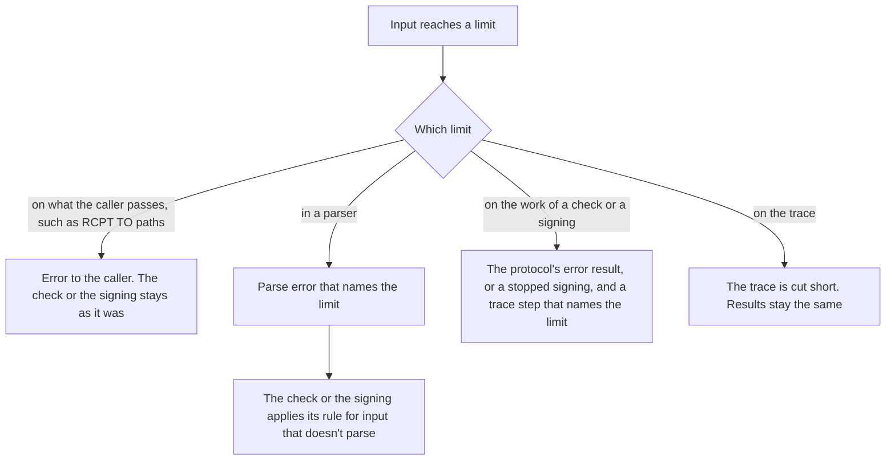

# Limits

Every limit in hallmark: the limits a caller can set for each call (SAF-002, PAR-004), the limits of the other APIs, and the limits that the specifications fix. Each row gives the default, the range a caller may choose from, where hallmark checks it, and what happens when input reaches it.

## Contents

- [What reaching a limit does](#what-reaching-a-limit-does)
- [Limits of a check or a signing](#limits-of-a-check-or-a-signing)
- [Limits outside a check or a signing](#limits-outside-a-check-or-a-signing)
- [Rules between limits](#rules-between-limits)
- [Limits the specifications fix](#limits-the-specifications-fix)

## What reaching a limit does

A limit never makes hallmark panic (SAF-001), and every trace step for a limit names the limit.

## Limits of a check or a signing

The caller sets these in `Limits`, part of the options of each check and each signing (PAR-004).

| Limit | Default | Range | Counts | Checked by | When input reaches it | Why this default | Requirements |
|---|---|---|---|---|---|---|---|
| `header_fields` | 1,000 | 1 to 100,000 | Header fields and malformed lines | Header section splitter | DKIM gives `permerror`, DKIM2 PERMERROR and DMARC `permerror`. Signing stops with an error | Room for long chains of trace fields and signatures | SAF-002, PRS-004 |
| `header_field_size` | 65,536 | 1 to 16,777,216 | Octets of one field, name and folding included | Header section splitter | As `header_fields` | Holds an ML-DSA-44 DKIM2-Signature, whose signature alone is 3,228 base64 characters, and is above the 60,000 octets that a Postfix with milters keeps of an incoming field | SAF-002, STR-002 |
| `header_section_size` | 1,048,576 | 1 to 16,777,216 | Octets of the raw header section | Header section splitter | As `header_fields` | Sixteen fields of the largest size | SAF-002 |
| `comment_depth` | 16 | 1 to 256 | Levels of nested comments | Header address parser, Authentication-Results parser | Parse error. A From field that doesn't parse gives DMARC no author domain (DMC-002) | RFC 5322 sets no depth | HDR-011 |
| `mailboxes` | 64 | 1 to 10,000 | Mailboxes in one address list | Header address parser | Parse error | A From field usually holds one | SAF-002 |
| `address_size` | 1,024 | 1 to 65,536 | Octets of one address or path | Both address parsers | Parse error. The check applies its rule for a malformed address | Four times the path size that RFC 5321 §4.5.3.1.3 sets as a minimum | ADS-007 |
| `rcpt_to` | 1,000 | 1 to 100,000 | RCPT TO paths in the envelope | Envelope input | Error to the verifying caller | RFC 5321 §4.5.3.1.8 requires a server to buffer at least 100 | SAF-004 |
| `rt_entries` | 1,000 | 1 to 100,000 | Entries in one DKIM2 `rt=` tag | DKIM2 | PERMERROR | As `rcpt_to` | SAF-002 |
| `dkim_signatures` | 16 | 1 to 1,000 | DKIM-Signature fields verified, in header order | DKIM | Each signature after the limit gets PERMFAIL with a reason that names the limit | RFC 6376 §6.1 lets a verifier limit them | DKV-004 |
| `key_records` | 8 | 1 to 100 | Key records at one DKIM selector | DKIM | PERMFAIL before hallmark tries any record | RFC 6376 §3.6.2.2 leaves several records at one selector undefined | REC-052 |
| `rsa_key_bits` | 4,096 | 1,024 to 16,384 | Bits of an RSA modulus | Key decoding, signer statements | DKIM PERMFAIL, DKIM2 PERMERROR. A signer statement over the limit gives an error when the signing is created | RFC 8301 §3.2 requires verifiers to handle keys up to 4,096 bits | DKV-003 |
| `rsa_exponent_bits` | 32 | 2 to 16,384 | Bits of an RSA public exponent in a DKIM key | Key decoding | PERMFAIL with a step that cites RFC 6376 §8.13 | Holds 65537 and any common exponent | REC-051, [ADR 0043](../../adr/0043-rsa-public-exponents-have-a-size-limit-in-dkim-and-must-be-65537-in-dkim2.md) |
| `author_domains` | 4 | 1 to 100 | Author domains evaluated when the verifying caller asks for several | DMARC | DMARC isn't applied, and the result names the limit | Each domain costs up to nine questions | DMC-002 |
| `dns_questions` | 512 | 1 to 100,000 | Distinct questions in one check | Question table | The kind that needed the question gives its permanent error: SPF `permerror`, PERMFAIL for the DKIM signature, DKIM2 PERMERROR, DMARC `permerror` | Above the most that mail within every other limit needs: two SPF evaluations of about 120 questions each, 16 DKIM keys, the keys and policies of DKIM2, and four DMARC walks | SAF-002 |
| `answer_size` | 65,535 | 512 to 16,777,216 | Octets of record data and description in one DNS answer, and of the description in one public suffix answer | Answer input | The check takes a DNS answer as a temporary failure that names the limit (GEN-005), and a public suffix answer as unavailable without its description, with a trace step that names the limit | The largest DNS message, whose length field has 16 bits (RFC 1035 §4.2.2) | SAF-004 |
| `dkim2_signatures` | 32 | 1 to 1,000 | DKIM2-Signature fields | DKIM2 | PERMERROR | Each hop adds one | SAF-002 |
| `message_instances` | 32 | 1 to 1,000 | Message-Instance fields | DKIM2 | PERMERROR | Each hop that changes the message adds one | SAF-002 |
| `recipe_steps` | 10,000 | 1 to 1,000,000 | Steps in one recipe | Recipe parser | PERMERROR for the signatures that depend on the recipe | Draft-09 §14.2 lets a verifier refuse recipes that are too complex | SAF-002, DK2-007 |
| `recipe_size` | 65,536 | 1 to 16,777,216 | Octets of one recipe's decoded JSON | JSON reader | As `recipe_steps` | A recipe in a field within `header_field_size` stays under it | SAF-002 |
| `recipe_depth` | 8 | 1 to 64 | Levels of nesting in recipe JSON | JSON reader | As `recipe_steps` | The recipe schema of draft-09 §5 nests five levels | PAR-005, PRS-005 |
| `spf_void_lookups` | 2 | 0 to 10 | Void lookups in one SPF evaluation | SPF | `permerror` | RFC 7208 §4.6.4 | SPF-006 |
| `trace_size` | 1,048,576 | 1,024 to 268,435,456 | Octets of trace events written, read or not | Recorder | The trace is cut short, and the root event says so. Results stay the same | Holds the header hash inputs of every signature within the other limits (HCN-009) | TRC-005 |
| `trace_places` | 16 | 0 to 10,000 | Places listed for each kind of body change, and for bare CR and LF in the body and the header section | Body and header section steps | The count stays exact, the list stops and says it was cut short | Enough to find the first changes | TRC-010 |

## Limits outside a check or a signing

| Limit | Default | Range | Counts | Checked by | When input reaches it | Requirements |
|---|---|---|---|---|---|---|
| `pasted_records_size` | 1,048,576 | 1 to 16,777,216 | Octets of pasted records | Pasted records parser | Error that names the limit | DNS-010 |
| `document_size` | 33,554,432 | 1 to 268,435,456 | Octets of a trace, a snapshot or a demo case | `sort_trace`, and the snapshot and case readers | Error that names the limit | DNS-004, DEM-004, SAF-004 |
| `document_depth` | 16 | 1 to 64 | Levels of nesting in a trace event, a snapshot or a demo case | `sort_trace`, `Event::parse`, and the snapshot and case readers | Error that names the limit | PAR-005 |
| `driver_in_flight` | 16 | 1 to 1,024 | Futures the driver keeps pending at once | Driver | The driver waits for one to complete before it starts another | CHK-005 |

A snapshot of a check within every default limit fits in `document_size`: 512 answers of 65,535 octets each. So does a trace of `trace_size` octets, when both limits are at their defaults or both at their largest. A caller that raises `trace_size` above `document_size` raises `document_size` with it, or `sort_trace` refuses the larger traces with `trace.too_large`.

## Rules between limits

A caller sets the limits in any order. Nothing checks them until an API takes them, and then that API checks every rule below at once, before it reads any input. `Limits::validate` and `DocumentLimits::validate` run the same checks for a caller that wants them earlier ([ADR 0065](../../adr/0065-the-public-api-follows-one-set-of-conventions-and-each-api-checks-the-limits-it-takes.md)).

| Rule | When broken |
|---|---|
| Every value lies in its range | Error from the API that takes the limits, VAL-202 and VAL-204. The driver checks `driver_in_flight` when it starts, VAL-801 |
| `header_field_size` is at most `header_section_size` | Error from the API that takes the limits, VAL-203 |

## Limits the specifications fix

No caller can change these.

| Limit | Value | Source | When input reaches it |
|---|---|---|---|
| SPF terms that cause DNS lookups | 10 | RFC 7208 §4.6.4 | `permerror` (SPF-006) |
| MX records for one `mx` term | 10 | RFC 7208 §4.6.4 | `permerror` (REC-017) |
| PTR names validated | The first 10 | RFC 7208 §4.6.4 | The rest are ignored (REC-017) |
| Depth of SPF `include` and `redirect` | Bounded by the 10 terms | RFC 7208 §4.6.4 | No separate limit |
| SPF target name after macro expansion | 253 characters | RFC 7208 §7.3 | Cut from the left (DNS-008, REC-015) |
| DNS label and name | 63 and 255 octets, in lookup form | RFC 1035 §2.3.4 | The check's own rule (ADS-004) |
| DMARC tree walk | 8 queries | RFC 9989 §4.10 | The walk takes the shortcut of §4.10 |
| DKIM `t=` and `x=` | 12 digits | RFC 6376 §3.5 | A longer value counts as infinite (HDR-013) |
| DKIM `l=` | 76 digits | RFC 6376 §3.5 | A value too large to hold is larger than the body (HDR-013) |
| DKIM2 signature time | From 14 days before the message was accepted to 1 day after | Draft-09 §14.3 | FAIL, unless the verifying caller turned time checks off (TIM-002) |
| RSA key size | At least 1,024 bits | RFC 8301 §3.2, draft-09 §3.2 | DKIM PERMFAIL, DKIM2 PERMERROR, and a signer statement refused (SGN-003) |
| DKIM2 RSA public exponent | Exactly 65537 | Draft-09 §3.2 | PERMERROR "algorithm mismatch" (REC-053) |
| Ed25519 and ML-DSA-44 public keys | 32 and 1,312 octets | RFC 8463 §4.2, dns-03 §4 | Malformed key (REC-051, DK2-011) |
