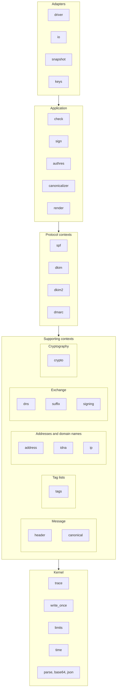
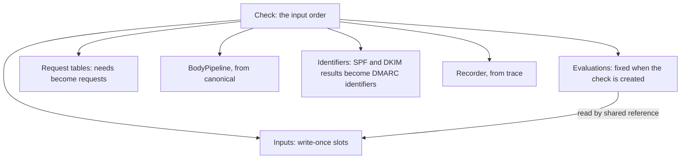
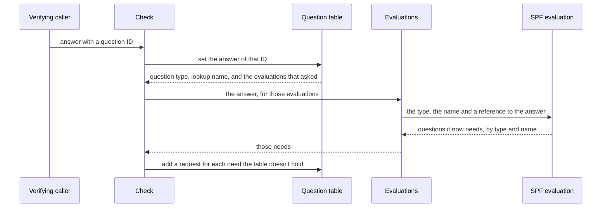
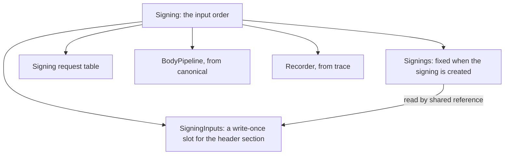

# Modules

The internal side of the module design: the layers and bounded contexts of the `hallmark` crate, the inside of the check, of the signing and of each protocol context, the owners of the trace codes, and the rules for dependencies. Nothing here is a promise to callers, and any of it can change in a release as long as [Crates](crates.md) and the [external architecture](../../explanation/external-architecture.md) still hold. The names are a first draft.

## Contents

- [Layers](#layers)
- [Modules of the hallmark crate](#modules-of-the-hallmark-crate)
- [Inside the check](#inside-the-check)
- [Inside the signing](#inside-the-signing)
- [Inside a protocol context](#inside-a-protocol-context)
- [Trace codes](#trace-codes)
- [Dependency rules](#dependency-rules)
- [SOLID](#solid)
- [Features in the modules](#features-in-the-modules)
- [Outside crates in the modules](#outside-crates-in-the-modules)

## Layers

The modules of the `hallmark` crate are grouped by bounded context into five layers ([ADR 0059](../../adr/0059-the-modules-of-the-hallmark-crate-are-bounded-contexts-in-five-layers.md)). A module uses only the layers below it, and the table gives what it may use within its own layer.

| Layer | Holds | May use |
|---|---|---|
| Kernel | Shared helpers, limits, the verification time, the write-once slot, and the trace recorder and event model | The kernel |
| Supporting contexts | The message, tag lists, addresses and domain names, what the core and the caller exchange, and cryptography | The kernel, and the modules of its own context |
| Protocol contexts | SPF, DKIM, DKIM2 and DMARC | The kernel and the supporting contexts. Never another protocol context |
| Application | The `Check` and `Signing` aggregate roots, Authentication-Results, the public canonicalizer and the English renderer | Every layer below |
| Adapters | The driver and its traits, blocking adapters, snapshots and the signer for keys in memory | Every layer below |

## Modules of the hallmark crate

| Module | Layer | Context | Public | Contents | Requirements |
|---|---|---|---|---|---|
| `parse` | Kernel | | Partly | Cursor, `ParseError` with its rule and byte offset, byte ranges, numbers with overflow checks, depth counter | PAR-001 to PAR-005 |
| `base64` | Kernel | | No | base64 decoder and encoder with the folding white space rules of DKIM and DKIM2 | HDR-007 |
| `json` | Kernel | | No | JSON reader with a depth limit, and the writer of the fixed form | HDR-008, TRC-007 |
| `limits` | Kernel | | Yes | `Limits`, `DocumentLimits`, `Limit`, `LimitsError` | SAF-002, PAR-004 |
| `time` | Kernel | | Yes | `VerificationTime`, `TimeError` | TIM-001 |
| `write_once` | Kernel | | No | `WriteOnce<T>`, a slot that takes one value and keeps it ([ADR 0063](../../adr/0063-checks-and-signings-fix-their-evaluations-when-created-and-each-input-once-it-arrives.md)) | CHK-004, INV-003, INV-017 |
| `trace` | Kernel | Trace | Yes | The recorder and the `Code` trait (crate-private), the `trace` codes, `Level`, `Event`, `EventKind`, `Version`, `Param`, `Value`, `Position`, `Data`, `Parties`, `Place`, `sort_trace`, `TraceError` | TRC-001 to TRC-014 |
| `header` | Supporting | Message | Partly | Header section splitter, fields from a milter, `FieldForm`, `LineBreak`, `LeadingSpace`, `HeaderFieldOut`, `HeaderFieldError`, the `header` codes | HDR-001 to HDR-005, HDR-012, STR-002, STR-008, STR-009 |
| `canonical` | Supporting | Message | No | The body state machine, the `l=` cut, places in the body, the `simple` and `relaxed` forms of a header field and its form in the DKIM2 signing input, a rebuild that applies copy and insert steps to the body as it streams, the `BodyPipeline` that passes each chunk once through every canonicalizer and rebuild that a check or a signing needs, and the `body` codes | HCN-001, HCN-002, HCN-005 to HCN-008, STR-001, STR-010, STR-011, TRC-010, DK2-006 |
| `tags` | Supporting | Tag lists | No | Tag=value list parser and its value decoders | HDR-006, HDR-007, HDR-013 |
| `address` | Supporting | Addresses and domain names | Partly | Header and envelope address parsers, `LocalPart`, `Mailbox` and `Path`, which stay crate-private, and the public `Domain` | ADS-001 to ADS-030 |
| `idna` | Supporting | Addresses and domain names | No | Lookup form of domain names, Punycode, the generated tables, the rule keywords of domain names | ADS-002 |
| `ip` | Supporting | Addresses and domain names | No | The IPv4 and IPv6 text forms of address literals, SPF and pasted records | ADS-005, REC-012, DNS-010 |
| `dns` | Supporting | Exchange | Yes | `Question`, `QuestionId`, `QuestionType`, `Answer`, `Record`, the crate-private `QuestionKey`, the `dns` codes | DNS-001 to DNS-009 |
| `suffix` | Supporting | Exchange | Yes | `SuffixQuestion`, `SuffixAnswer` | DMC-010, DMC-011 |
| `signing` | Supporting | Exchange | Yes | `SignerStatement`, `Algorithm`, `SigningKind`, `SigningRequest`, `RequestId`, `Signature`, `SignerFailure` | SGN-001 to SGN-006 |
| `crypto` | Supporting | Cryptography | No | Hashes, signature verification, key data decoding | DKV-002, DK2-009, REC-051 |
| `spf` | Protocol | SPF | Results | See [Inside a protocol context](#inside-a-protocol-context) | SPF-001 to SPF-007, REC-010 to REC-017 |
| `dkim` | Protocol | DKIM | Results | See [Inside a protocol context](#inside-a-protocol-context) | DKV-001 to DKV-014, DKS-001 to DKS-006, HCN-003, HCN-004, REC-050 to REC-052 |
| `dkim2` | Protocol | DKIM2 | Results | See [Inside a protocol context](#inside-a-protocol-context) | DK2-001 to DK2-014, HCN-005 to HCN-007, REC-053, REC-054 |
| `dmarc` | Protocol | DMARC | Results | See [Inside a protocol context](#inside-a-protocol-context) | DMC-001 to DMC-011, REC-030 to REC-033 |
| `check` | Application | Check | Yes | `Check`, `CheckOptions`, `Kind`, `DmarcMode`, `Envelope`, `Request`, `Waiting`, `ExpectedInput`, `TraceRead`, `SpfSource`, `DkimSource`, `CheckResults`, `CheckError`, `EnvelopeField`, `CheckOptionsError`, and the crate-private parts of [Inside the check](#inside-the-check) | GEN-001 to GEN-006, CHK-001 to CHK-005 |
| `sign` | Application | Signing | Yes | `Signing`, `SigningOptions`, `DkimSigning`, `DkimCanonicalization`, `CanonAlgorithm`, `Dkim2Signing`, `Dkim2Signer`, `Dkim2Flags`, `Revision`, `BodyRevision`, `EarlierLines`, `FieldRevision`, `SigningWaiting`, `SigningResults`, `SigningOutcome`, `SigningError`, `SigningOptionsError`, `SignatureError`, and the crate-private parts of [Inside the signing](#inside-the-signing) | CHK-006, DKS-001 to DKS-006, DK2-014, SGN-002 to SGN-006 |
| `authres` | Application | Authentication-Results | Yes | `AuthservId`, the generator, the parser, `AuthenticationResults` and `AuthResError` | AR-001 to AR-006, HDR-009 |
| `canonicalizer` | Application | Message | Yes | `Canonicalizer`, `CanonicalizerMode`, `Rebuild`, `Progress`, `Finish` and `CanonicalizerError`, which join `canonical` with the recipe reading of `dkim2` | STR-012 |
| `render` | Application | Trace | Yes | `Event::render_english`, which reads the English templates of every code owner ([ADR 0061](../../adr/0061-each-context-owns-its-trace-codes-and-the-english-renderer-sits-in-the-application-layer.md)) | TRC-011 |
| `driver` | Adapters | Exchange | Yes | `Resolver`, `SuffixSource`, `Signer`, `NoSuffixSource`, `drive`, `drive_signing` and `DriveError` | CHK-005, DNS-003 |
| `io` | Adapters | Check, Signing | Yes | `read_message`, `read_message_to_sign`, `write_trace` and `write_signing_trace` for a standard blocking reader and writer, and `StreamError` | STR-004 |
| `snapshot` | Adapters | Exchange | Yes | `Snapshot`, `SnapshotResolver`, `PastedRecords`, `DocumentError`, extraction from a trace, demo cases | DNS-004, DNS-010, DEM-004 |
| `keys` | Adapters | Exchange | Yes | `MemorySigner`, `RandomSource`, `RandomFailure` and `KeyError`. The private key types inside the signer are crate-private | SGN-005, SEC-001 to SEC-003 |

"Results" means that only the module's result and reason types are public. "Partly" means that the listed types are public and the parsers are crate-private. `lib.rs` re-exports every public type at the crate root, except those of the public module `io`, so no other module shows in a public path. The one exception is the hidden `fuzz` module of the `fuzzing` feature, which only the fuzz targets use.

## Inside the check

`Check` is the aggregate root of the Check context. It keeps the input order, and it holds the values below, each in a crate-private submodule ([ADR 0063](../../adr/0063-checks-and-signings-fix-their-evaluations-when-created-and-each-input-once-it-arrives.md)).

| Submodule | Holds | Rules | Requirements |
|---|---|---|---|
| `check` | `Check`, its states, and the public types of the context | The only module that takes the verifying caller's input and gives requests and results | CHK-001 to CHK-005 |
| `check::options` | `CheckOptions` | Public. The verifying caller fills them, and the check takes them by value (INV-015) | GEN-001 |
| `check::results` | `CheckResults` | Public | GEN-004 |
| `check::inputs` | `Inputs`: a write-once slot for the envelope as the verifying caller passed it, one for the `ParsedEnvelope`, and one for the header section | Header fields that arrive one at a time collect in the check until the end of the header fields, and only the finished header section goes into its slot. A second envelope or a second end of the header fields is the slot's error, which the check gives as `check.out_of_order` | CHK-004, STR-008, INV-017 |
| `check::evaluations` | `Evaluations`, with a field for SPF HELO, SPF MAIL FROM, DKIM, DKIM2 and DMARC | Private fields. `new` alone decides which fields hold an evaluation, and `None` means the verifying caller didn't ask for that kind. Accessors give `Option<&T>`, and no method gives `&mut Option<T>`. Input methods pass each input to the evaluations that exist | GEN-001, INV-016 |
| `check::requests` | The question table and the table of public suffix questions | Each entry keeps its answer in a write-once slot, so a second answer is `check.already_answered` and the first stays. The tables number requests and turn each answer back into the needs of the evaluations that asked | DNS-007, CHK-004, INV-001 to INV-003 |
| `check::identifiers` | The translation of SPF and DKIM results, from this check or from earlier results, into DMARC's authenticated identifiers | The only place where DMARC meets SPF and DKIM results | DMC-005 |

The states of [Lifecycle](lifecycle.md#check) cover only the order of the input. The rest of a check has lifecycles of its own, each kept in one place:

| Part | Lifecycle | Kept in |
|---|---|---|
| Which evaluations the check runs | None. `Check::new` fixes them from the options (INV-016) | `Evaluations` |
| Each input that the check keeps: the envelope, the parsed envelope and the header section | Empty until the input is complete, then set once and never changed (INV-017). The header section is complete at the end of the header fields | `Inputs` |
| Each evaluation | Its own states, from its first state on, even before its input arrives | Its protocol context: [SPF](spf.md#evaluation-without-recursion), [DKIM](dkim.md#one-signature), [DKIM2](dkim2.md#verification) and [DMARC](dmarc.md#flow) |

An answer from the verifying caller reaches the evaluations through the question table, which is the anti-corruption layer between the language of the exchange and the language of the protocols:

## Inside the signing

`Signing` is the aggregate root of the Signing context. It keeps the input order, and it holds the values below, each in a crate-private submodule, under the same rules as the check ([ADR 0062](../../adr/0062-verification-and-signing-have-separate-entry-types.md), [ADR 0063](../../adr/0063-checks-and-signings-fix-their-evaluations-when-created-and-each-input-once-it-arrives.md)).

| Submodule | Holds | Rules | Requirements |
|---|---|---|---|
| `sign` | `Signing`, its states, `SigningWaiting` and `SigningError` | The only module that takes the signing caller's input and gives signing requests and results | CHK-006 |
| `sign::options`, `sign::dkim_signing`, `sign::dkim2_signing` | `SigningOptions` with its own copy of the shared settings, and the options of DKIM and DKIM2 signing | Public. The signing caller fills them, and the signing takes them by value (INV-015) | CHK-006, DKS-003, DK2-014 |
| `sign::results` | `SigningResults`, `SigningOutcome`, `SignatureError` | Public | DKS-005, SGN-004 |
| `sign::inputs` | `SigningInputs`: a write-once slot for the header section | A second end of the header fields is the slot's error, which the signing gives as `signing.out_of_order` | CHK-004, INV-017 |
| `sign::signings` | `Signings`, with a field for DKIM signing and one for DKIM2 signing | The rules of `Evaluations` | INV-016 |
| `sign::requests` | The table of signing requests | Each entry keeps its signature in a write-once slot, so a second signature is `signing.already_answered` and the first stays | CHK-004, INV-003 |

The states of [Lifecycle](lifecycle.md#signing) cover only the order of the input. Which signings the signing runs is fixed by `Signing::new` (INV-016), its header section is set once at the end of the header fields (INV-017), and each signature's states live in `dkim` and `dkim2`.

## Inside a protocol context

Each protocol context has a crate-private aggregate root for verification, and DKIM and DKIM2 have one for signing too. The check holds the first in `Evaluations`, and the signing holds the second in `Signings`. Other modules talk only to the aggregate root and read only the context's public results. The aggregate is a state machine that does no I/O: it takes input by shared reference and gives back what it needs next.

| Call from the check or the signing | Taken by | Gives back |
|---|---|---|
| The parsed envelope | SPF, DKIM2, DMARC | Questions, by type and lookup name. In RFC 7489 mode, the domains whose public suffix DMARC needs |
| The header section | DKIM, DKIM2, DMARC, DKIM and DKIM2 signing | Questions, and the body hashes it needs |
| The canonical body from the pipeline | DKIM and DKIM2 verification, and DKIM and DKIM2 signing, which hash it with `crypto` | Nothing, or for signing the data to sign |
| An answer, with its type and lookup name | The evaluations that asked for it | Questions that follow from it, such as an SPF `include` |
| A public suffix answer | DMARC | Questions, such as the query at the organizational domain of RFC 7489 §6.6.3 step 3 |
| The authenticated identifiers | DMARC | Nothing new. With an aligned identifier, the result no longer depends on the answer to the author domain question of REC-032 ([ADR 0050](../../adr/0050-dmarc-asks-whether-the-author-domain-exists-when-np-can-change-the-policy-and-needs-the-answer-only-for-a-message-that-fails.md)) |
| A signature, from the signing | DKIM and DKIM2 signing | The header fields to add, or the error that stopped the signing |

Every call also takes the recorder and the position of the evaluation's slot ([Trace codes](../trace-codes.md#slots-under-the-root)), and records with the context's own codes.

| Context | Aggregate root | Submodules |
|---|---|---|
| SPF | `spf::Evaluation`, one for each identity | `record`: the terms, mechanisms and modifiers. `macros`: macro expansion. `evaluation`: the frames of `check_host()` and the counters. `result`: the public results. `codes` |
| DKIM | `dkim::Verification`, for all signatures of the message, and `dkim::Signing` | `field`: DKIM-Signature tags. `key`: key records. `header_hash`: the selection of `h=` and the hash input (HCN-003, HCN-004). `verification`: the states of each signature, time checks, cautions and hints. `signing`. `result`. `codes` |
| DKIM2 | `dkim2::Verification` and `dkim2::Signing` | `fields`: Message-Instance and DKIM2-Signature. `recipe`: recipe JSON into the copy and insert steps of `canonical`. `key`. `policy`: Domain Policy Records. `header_hash` (HCN-005, HCN-006). `signing_input` (HCN-007). `custody`: the chain of custody. `verification`. `signing`, with revisions (DK2-014). `result`. `codes` |
| DMARC | `dmarc::Evaluation`, with one evaluation for each author domain inside it | `record` and `uri`: the record and its reporting URIs. `discovery`: the DNS tree walk and the public suffix questions. `alignment`. `evaluation`. `result`. `codes` |

| Rule | Why |
|---|---|
| A crate-private type inside a context is named without the context's name, such as `spf::Evaluation`, and other modules write it with the module path | The module path already names the context. `dkim::Signing`, the aggregate of DKIM signing, differs from the public `Signing`, the entry type of a signing caller |
| Public result types keep the context's name, such as `SpfResult` | They are re-exported at the crate root, where the module path doesn't show |
| The submodules of a context are private to its module tree | Code outside the context can't reach past the aggregate root |

## Trace codes

Each code belongs to the module that owns its area, which declares it in a crate-private enum in its `codes` submodule, with its English template ([ADR 0061](../../adr/0061-each-context-owns-its-trace-codes-and-the-english-renderer-sits-in-the-application-layer.md)).

| Area | Owner |
|---|---|
| `trace` | `trace` |
| `spf` | `spf` |
| `dkim` | `dkim` |
| `dkim2` | `dkim2` |
| `dmarc` | `dmarc` |
| `dns` | `dns` |
| `header` | `header` |
| `body` | `canonical` |

| Rule | Why |
|---|---|
| The recorder takes any value that implements the kernel's crate-private `Code` trait | The kernel depends on no context |
| A context's code enum is visible only inside its module tree | A context records only its own codes |
| Each owner gives the crate a function that returns the English template of one of its codes, and `render` picks the owner from the first part of the code | `render_english` renders any event, including one read back from trace bytes |

## Dependency rules

| Rule | Why | Requirement or ADR |
|---|---|---|
| A module uses only what its layer may use, as [Layers](#layers) gives it | The dependency rule of Clean Architecture: dependencies point inward | [ADR 0059](../../adr/0059-the-modules-of-the-hallmark-crate-are-bounded-contexts-in-five-layers.md) |
| A supporting context uses only the kernel and its own modules | Each supporting context keeps its own model | ADR 0059 |
| A protocol context uses no other protocol context | Each protocol is a bounded context, and a change to one specification touches one context | ADR 0059 |
| Only `check` turns SPF and DKIM results into DMARC's authenticated identifiers | DMARC knows its own model, not SPF's or DKIM's | DMC-005 |
| Only `check` sees question IDs, and only `sign` sees signing request IDs. Protocols ask by question type and lookup name | The request tables are the anti-corruption layer between the exchange and the protocols | INV-001, INV-002, [ADR 0063](../../adr/0063-checks-and-signings-fix-their-evaluations-when-created-and-each-input-once-it-arrives.md) |
| No method of `Evaluations` or `Signings` gives `&mut Option<T>`, and an input value that hallmark builds has only `&self` methods | Which evaluations and signings exist, and each input once set, never change | INV-016, INV-017, [ADR 0063](../../adr/0063-checks-and-signings-fix-their-evaluations-when-created-and-each-input-once-it-arrives.md) |
| A context records only its own codes | The codes of a specification change with it | [ADR 0061](../../adr/0061-each-context-owns-its-trace-codes-and-the-english-renderer-sits-in-the-application-layer.md) |
| Only `trace` writes trace bytes. Other modules record steps through the recorder | The deciding code records, and one writer keeps the fixed form | TRC-001, TRC-007 |
| No module outside `keys` holds a private key | The core never holds a key that an outside signer keeps | SGN-001, SEC-002 |
| No module opens a socket or a file, reads a clock or draws a random number | The caller supplies everything from outside | IO-001 |
| No module depends on an async runtime. `driver` uses only `core::future` and `core::task` | Any runtime can drive a check or a signing | DNS-003 |
| No module depends on a browser crate | Browser code lives in `hallmark-wasm` | WSM-002 |

Review checks each `use crate::` path against these rules, and once the modules hold code, a CI job checks them too.

## SOLID

| Principle | Where hallmark applies it |
|---|---|
| Single responsibility | Each protocol context follows one specification, and each of its submodules one part of it, such as the record grammar or the results. `canonical` makes the canonical forms, and the protocol whose specification picks the header fields builds the hash input |
| Open/closed | The specifications fix the kinds of check and of signing, so the check and the signing name each one in a field instead of loading them as plug-ins ([ADR 0063](../../adr/0063-checks-and-signings-fix-their-evaluations-when-created-and-each-input-once-it-arrives.md)). The caller extends the core through traits that it implements, `Resolver`, `SuffixSource`, `Signer` and `RandomSource`, without changing the core ([Crates](crates.md#traits-the-caller-implements)) |
| Liskov substitution | Any implementation of the caller's traits can stand in for another, because the core checks what it gets back instead of trusting it: the shape of an answer (VAL-120 to VAL-125), a public suffix answer (VAL-130 to VAL-134), and the size of a signature and, when `verify` is on, its verification (VAL-142, VAL-143) |
| Interface segregation | Each trait covers one capability, and `NoSuffixSource` serves a verifying caller that needs no suffix source. A verifying caller and a signing caller each see only their own entry type, options and driver ([ADR 0062](../../adr/0062-verification-and-signing-have-separate-entry-types.md)). Inside the crate, each protocol takes only the input it reads, so SPF never gets the body, and a context sees the recorder only through the `Code` trait |
| Dependency inversion | The core defines the exchange values and the caller's traits, and the verifying caller's resolver and the signing caller's signer depend on them ([ADR 0017](../../adr/0017-the-core-does-no-io-and-the-caller-drives-it.md), [ADR 0042](../../adr/0042-signing-goes-through-a-signer-the-caller-supplies-and-the-caller-can-have-each-signature-verified.md)). In the kernel, the recorder depends on the `Code` trait, which each code owner implements. `crypto` calls the cryptography crates directly, because they do no I/O and hallmark has no second implementation ([ADR 0059](../../adr/0059-the-modules-of-the-hallmark-crate-are-bounded-contexts-in-five-layers.md)) |

## Features in the modules

`unstable-dkim2` turns on the `dkim2` module and the DKIM2 fields of `Evaluations` and `Signings`. [Crates](crates.md#features) gives what the feature offers a caller. `fuzzing` builds `fuzz`, a hidden module outside the layers, whose entry points run the parsers of one area each for the fuzz targets. It may use any module, and no module uses it ([ADR 0069](../../adr/0069-fuzz-targets-run-with-cargo-fuzz-and-reach-the-internal-parsers-through-a-hidden-fuzzing-feature.md)).

## Outside crates in the modules

[Crates](crates.md#outside-crates) lists the outside crates and what each is needed for. This table shows the modules that use each one.

| Crate | Used in |
|---|---|
| `sha2` | `crypto` |
| `rsa`, 0.10.0 or later | `crypto`, `keys` |
| `ed25519-dalek` | `crypto`, `keys` |
| `ml-dsa` | `crypto`, `keys`, with `unstable-dkim2` only |
| `zeroize` | `keys` |
| `thiserror` | Every public error type |
