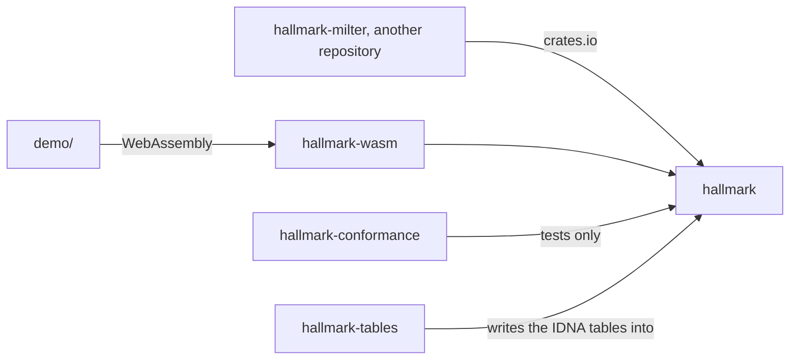
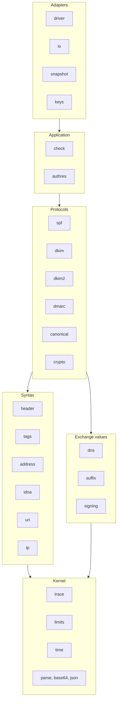

# Modules

The crates of the workspace, the modules of the `hallmark` crate, the rules for their dependencies, and the outside crates they use. The names are a first draft of the public API.

## Contents

- [Crates](#crates)
- [Layers](#layers)
- [Modules of the hallmark crate](#modules-of-the-hallmark-crate)
- [Dependency rules](#dependency-rules)
- [Features](#features)
- [Outside crates](#outside-crates)

## Crates

| Crate | Role | Depends on | Published | Requirements |
|---|---|---|---|---|
| `hallmark` | The core, the driver, the snapshot resolver, the signer for keys in memory and the blocking adapters | The crates of [Outside crates](#outside-crates) | crates.io | REP-001, STB-001 |
| `hallmark-wasm` | `wasm-bindgen` bindings, a DNS-over-HTTPS resolver, the Public Suffix List parser of the demo, and its own loop over a check's requests ([ADR 0048](../../adr/0048-the-resolver-the-suffix-source-and-the-signer-return-futures-that-are-send.md)) | `hallmark` | Not at first | WSM-002, DEM-009 |
| `hallmark-conformance` | Tests that run published conformance data, with the data and its license files | `hallmark` | Never | TST-002 |
| `hallmark-tables` | The generator of the IDNA tables and the Unicode data files it reads | Nothing | Never | ADS-002, STB-002 |

Fuzz targets (SAF-003) live in `fuzz/`, outside the workspace members, as `cargo fuzz` expects.

## Layers

Each layer may use the layers below it and never the layers above it.

| Layer | Holds | Knows about |
|---|---|---|
| Kernel | Shared helpers, limits, the verification time, and the trace recorder and event model | Nothing above it |
| Exchange values | What the core and the caller hand each other: DNS questions and answers, public suffix questions and answers, signing requests and signatures | The kernel |
| Syntax | Parsers of header fields, tag lists, addresses, domain names, URIs and IP addresses | The kernel |
| Protocols | SPF, DKIM, DKIM2 and DMARC, canonicalization and cryptography | Syntax, exchange values, kernel |
| Application | The `Check` aggregate and Authentication-Results | Everything below |
| Adapters | The driver and its traits, blocking adapters, snapshots and the signer for keys in memory | Everything below |

## Modules of the hallmark crate

| Module | Layer | Public | Contents | Requirements |
|---|---|---|---|---|
| `parse` | Kernel | Partly | Cursor, `ParseError` with its rule and byte offset, byte ranges, numbers with overflow checks, depth counter | PAR-001 to PAR-005 |
| `base64` | Kernel | No | base64 decoder and encoder with the folding white space rules of DKIM and DKIM2 | HDR-007 |
| `json` | Kernel | No | JSON reader with size and depth limits, and the writer of the fixed form | HDR-008, TRC-007 |
| `limits` | Kernel | Yes | `Limits`, `DocumentLimits`, `Limit`, `LimitsError` | SAF-002, PAR-004 |
| `time` | Kernel | Yes | `VerificationTime` | TIM-001 |
| `trace` | Kernel | Yes | The recorder (crate-private), `Level`, `Event`, `EventKind`, `Version`, `Param`, `Value`, `Position`, `Data`, `Parties`, `Place`, `sort_trace`, `TraceError`, and the English renderer | TRC-001 to TRC-014 |
| `dns` | Exchange values | Yes | `Question`, `QuestionId`, `QuestionType`, `Answer`, `Record` | DNS-001 to DNS-009 |
| `suffix` | Exchange values | Yes | `SuffixQuestion`, `SuffixAnswer` | DMC-010, DMC-011 |
| `signing` | Exchange values | Yes | `SignerStatement`, `Algorithm`, `SigningKind`, `SigningRequest`, `RequestId`, `Signature`, `SignerFailure` | SGN-001 to SGN-006 |
| `header` | Syntax | Partly | Header section splitter, fields from a milter, `FieldForm`, `LineBreak`, `LeadingSpace` | HDR-001 to HDR-005, STR-008, STR-009 |
| `tags` | Syntax | No | Tag=value list parser and its value decoders | HDR-006, HDR-007, HDR-013 |
| `address` | Syntax | Partly | Header and envelope address parsers, `Domain`, `LocalPart`, `Mailbox`, `Path` | ADS-001 to ADS-030 |
| `idna` | Syntax | No | Lookup form of domain names, Punycode, the generated tables | ADS-002 |
| `uri` | Syntax | No | RFC 3986 checker for `rua` and `ruf` | REC-033 |
| `ip` | Syntax | No | IPv4 and IPv6 text forms of SPF | REC-012 |
| `canonical` | Protocols | Partly | Body and header canonicalization, and the public `Canonicalizer`, `CanonicalizerMode`, `Rebuild`, `Progress`, `Finish` and `CanonicalizerError` | HCN-001 to HCN-009, STR-011, STR-012 |
| `crypto` | Protocols | No | Hashes, signature verification, key data decoding | DKV-002, DK2-009, REC-051 |
| `spf` | Protocols | Results | Record parser, macro expansion, `check_host()` | SPF-001 to SPF-007, REC-010 to REC-017 |
| `dkim` | Protocols | Results | DKIM-Signature fields, key records, verification and signing | DKV-001 to DKV-014, DKS-001 to DKS-006 |
| `dkim2` | Protocols | Results | Message-Instance and DKIM2-Signature fields, recipes, key and policy records, verification, signing and revisions | DK2-001 to DK2-014 |
| `dmarc` | Protocols | Results | Record parser, policy discovery, alignment and evaluation | DMC-001 to DMC-011, REC-030 to REC-033 |
| `check` | Application | Yes | `Check`, `Options`, `Kind`, `DmarcMode`, `Envelope`, `Request`, `Waiting`, `ExpectedInput`, `TraceRead`, `SpfSource`, `DkimSource`, `DkimSigning`, `DkimCanonicalization`, `CanonAlgorithm`, `Dkim2Signing`, `Dkim2Signer`, `Dkim2Flags`, `Revision`, `BodyRevision`, `EarlierLines`, `FieldRevision`, `Results`, `Signing`, `HeaderFieldOut`, `CheckError`, `EnvelopeField`, `OptionsError`, `ResultsError`, `SigningError` | GEN-001 to GEN-006, CHK-001 to CHK-005 |
| `authres` | Application | Yes | `AuthservId`, the generator, the parser, `AuthenticationResults` and `AuthResError` | AR-001 to AR-005, HDR-009 |
| `driver` | Adapters | Yes | `Resolver`, `SuffixSource`, `Signer`, `NoSuffixSource`, `NoSigner`, `drive` and `DriveError` | CHK-005, DNS-003 |
| `io` | Adapters | Yes | `read_message` and `write_trace` for a standard blocking reader and writer, and `StreamError` | STR-004 |
| `snapshot` | Adapters | Yes | `Snapshot`, `SnapshotResolver`, `PastedRecords`, `DocumentError`, extraction from a trace, demo cases | DNS-004, DNS-010, DEM-004 |
| `keys` | Adapters | Yes | `MemorySigner`, `RandomSource`, `RandomFailure` and `KeyError`. The private key types inside the signer are crate-private | SGN-005, SEC-001 to SEC-003 |

"Results" means that only the module's result and reason types are public. "Partly" means that the listed types are public and the parsers are crate-private.

## Dependency rules

| Rule | Why | Requirement or ADR |
|---|---|---|
| A module uses only its own layer and the layers below | The dependency rule of Clean Architecture | |
| A protocol module uses no other protocol module, except that `dkim` and `dkim2` use `canonical` and `crypto` | Each protocol is a bounded context | |
| Only `check` turns SPF and DKIM results into DMARC's authenticated identifiers | DMARC knows its own model, not SPF's or DKIM's | DMC-005 |
| Only `trace` writes trace bytes. Other modules record steps through the recorder | The deciding code records, and one writer keeps the fixed form | TRC-001, TRC-007 |
| No module outside `keys` holds a private key | The core never holds a key that an outside signer keeps | SGN-001, SEC-002 |
| No module opens a socket or a file, reads a clock or draws a random number | The caller supplies everything from outside | IO-001 |
| No module depends on an async runtime. `driver` uses only `core::future` and `core::task` | Any runtime can drive a check | DNS-003 |
| No module depends on a browser crate | Browser code lives in `hallmark-wasm` | WSM-002 |

## Features

| Feature | Default | Turns on | Requirements |
|---|---|---|---|
| `unstable-dkim2` | Off | The `dkim2` module, the `ml-dsa` crate, SHA-512, the DKIM2 kinds of check, the DKIM2 modes of the canonicalizer, and the `dkim2` method of Authentication-Results | DK2-001, DK2-005 |

hallmark has no other feature. It needs `std`, which `wasm32-unknown-unknown` provides.

## Outside crates

[ADR 0049](../../adr/0049-hallmark-depends-on-cryptography-crates-zeroize-and-thiserror-and-writes-everything-else-itself.md) lists them and why. This table shows where each one is used.

| Crate | Used in |
|---|---|
| `sha2` | `crypto` |
| `rsa`, 0.10.0 or later | `crypto`, `keys` |
| `ed25519-dalek` | `crypto`, `keys` |
| `ml-dsa` | `crypto`, `keys`, with `unstable-dkim2` only |
| `zeroize` | `keys` |
| `thiserror` | Every public error type |
