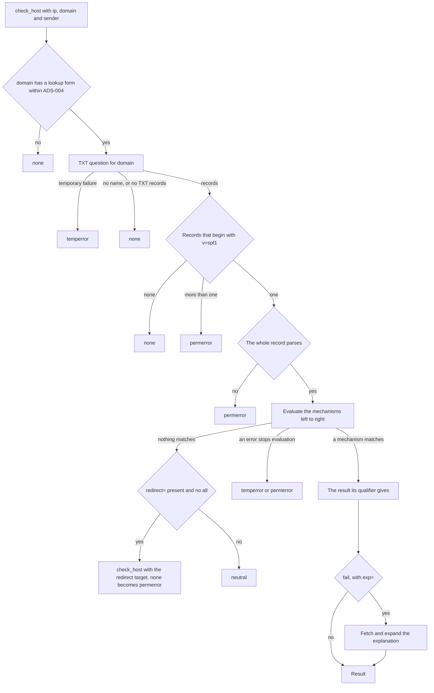
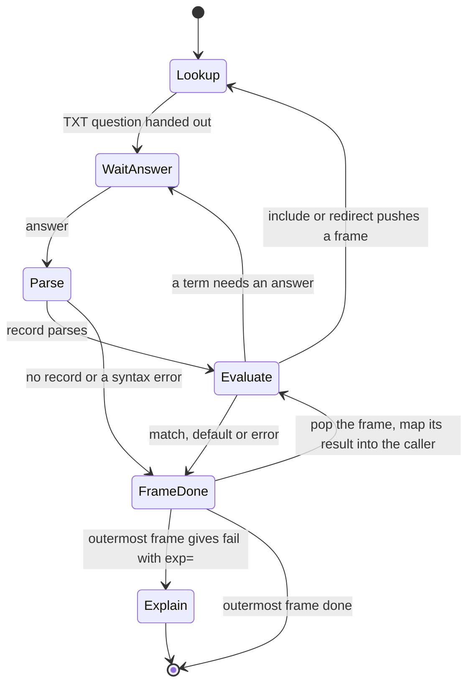

# SPF

The steps of an SPF check (RFC 7208): `check_host()` from the identity to the result, the evaluation of each term, the counters and limits, macro expansion, and what the trace records. [Requirements](../requirements.md#spf-rfc-7208) give the rules, and [DNS records](../requirements.md#dns-records) the record grammar.

## Contents

- [Identities](#identities)
- [check_host()](#check_host)
- [Terms](#terms)
- [Evaluation without recursion](#evaluation-without-recursion)
- [Counters and limits](#counters-and-limits)
- [Macros](#macros)
- [Results](#results)
- [Trace](#trace)

## Identities

| Kind | `<sender>` | `<domain>` | Runs when | Requirements |
|---|---|---|---|---|
| SPF MAIL FROM | The MAIL FROM mailbox, or `postmaster@` the HELO name when MAIL FROM is `<>` | Its domain | Always, once the envelope arrives | SPF-001, ADS-023, RFC 7208 §2.4 |
| SPF HELO | `postmaster@` the HELO name | The HELO name | Only for a valid multi-label domain name. Otherwise the result is `none` | SPF-002, ADS-023, RFC 7208 §2.3 |

`<ip>` is the client address of the envelope (VAL-102). Both identities share the check's question table, so a name asked by one is answered for both (DNS-007).

## check_host()

| Step | Rule | Requirements |
|---|---|---|
| Initial processing | A domain that isn't a valid name gives `none` | RFC 7208 §4.3, ADS-004 |
| Record lookup | A temporary failure gives `temperror`. No name or no TXT records gives `none` | RFC 7208 §4.4, GEN-005 |
| Record selection | `v=spf1` without regard to ASCII case, then a space or the end. More than one record gives `permerror` | SPF-007 |
| Parse | The whole record, before the first term runs. A syntax error anywhere gives `permerror` | REC-010 to REC-013 |
| Evaluation | Mechanisms left to right. Modifiers act only after them | RFC 7208 §4.6.2, REC-011 |
| Default | No match and no `redirect=` gives `neutral` | RFC 7208 §4.7 |
| Explanation | Only for `fail`. Any problem leaves the result without one | REC-016 |

## Terms

| Mechanism | Questions | Matches when | Counts toward the 10 | Requirements |
|---|---|---|---|---|
| `all` | None | Always | No | RFC 7208 §5.1 |
| `include` | The questions of the inner `check_host()` | The inner result is `pass` | Yes | RFC 7208 §5.2 |
| `a` | A or AAAA, by the client's family | An address is in the CIDR range | Yes | REC-017 |
| `mx` | MX, then A or AAAA for each exchange, at most 10 | An address of an exchange is in the CIDR range | Yes | REC-017 |
| `ptr` | PTR for the client, then A or AAAA for at most 10 names | A validated name is the target or below it | Yes | REC-017, SPF-004 |
| `ip4`, `ip6` | None | The client is in the range | No | REC-012 |
| `exists` | A, for either family | The answer has records | Yes | REC-017 |

| Inner result of `include` | Effect | Requirements |
|---|---|---|
| `pass` | Match | RFC 7208 §5.2 |
| `fail`, `softfail`, `neutral` | No match | RFC 7208 §5.2 |
| `temperror` | The outer result is `temperror` | RFC 7208 §5.2 |
| `permerror`, `none` | The outer result is `permerror` | RFC 7208 §5.2 |

A target name that macro expansion makes invalid matches nothing, and still counts toward the 10 terms ([ADR 0022](../../adr/0022-an-spf-target-name-that-macro-expansion-makes-invalid-matches-nothing.md), REC-015).

## Evaluation without recursion

`include` and `redirect` start an inner `check_host()`. The check keeps the frames on an explicit stack, so a deep chain uses no call stack (PAR-005), and the limit of 10 terms bounds its depth (RFC 7208 §4.6.4).

Each frame holds its domain, its parsed record, the index of the next term, and the counters are shared by all frames. A frame that waits for an answer holds no other state, so answers can arrive in any order (CHK-003).

## Counters and limits

| Counter | Limit | Effect of reaching it | Requirements |
|---|---|---|---|
| Terms that cause DNS lookups: `include`, `a`, `mx`, `ptr`, `exists`, `redirect` | 10 | `permerror`, and the trace names the term | SPF-006, RFC 7208 §4.6.4 |
| Void lookups: answers with no name or no records | `spf_void_lookups`, 2 by default | `permerror` | SPF-006 |
| MX records for one `mx` | 10 | `permerror` | REC-017 |
| PTR names validated | The first 10 | The rest are ignored | REC-017 |
| Distinct questions in the check | `dns_questions` | `permerror` | SAF-002 |

A question asked twice is answered once and counts once for each term that asks it (DNS-007).

## Macros

| Letter | Expands to | Requirements |
|---|---|---|
| `s`, `l`, `o` | The sender, its local part as written, its domain | ADS-023, [ADR 0015](../../adr/0015-spf-macros-expand-the-local-part-as-written.md) |
| `d` | The current `<domain>` | RFC 7208 §7.3 |
| `i` | The client address, IPv6 as dotted nibbles | RFC 7208 §7.3 |
| `p` | A validated name for the client, or `unknown` | REC-014 |
| `v` | `in-addr` or `ip6` | RFC 7208 §7.3 |
| `h` | The HELO name | RFC 7208 §7.3 |
| `c`, `r`, `t` | In explanations only: the client address in text form, the receiving host, the verification time | REC-013, REC-014, [ADR 0021](../../adr/0021-spf-reads-v-spf1-without-regard-to-case-and-allows-c-r-and-t-only-in-explanations.md) |

Digits and `r` reverse and cut the parts, and an uppercase letter percent-encodes the expansion (REC-014). A target name is cut from the left to 253 characters (DNS-008).

## Results

| Result | Reason the result carries | Requirements |
|---|---|---|
| `pass`, `fail`, `softfail`, `neutral` | The mechanism that matched and its position, or the default | GEN-004, SPF-003 |
| `none` | No valid domain, or no SPF record | RFC 7208 §4.3, §4.4, §4.5 |
| `temperror` | The question that failed and the resolver's description | GEN-005, DNS-009 |
| `permerror` | The syntax error and its offset, the limit and the term that reached it, or the include or redirect that gave it | REC-010, SPF-006 |

DMARC takes the MAIL FROM result as its SPF identifier, by its position (DMC-005).

## Trace

| Step | Records | Requirements |
|---|---|---|
| Each `check_host()` | The domain, the sender, each question and answer, the record as published and as read | TRC-008 |
| Each term | Its text, its expansion, its questions, the running counts, and whether it matched | TRC-002 |
| A limit | The limit, the count and the term that reached it | SPF-006 |
| The explanation | The text as fetched and as expanded, marked as from a third party | REC-016, TRC-013 |
