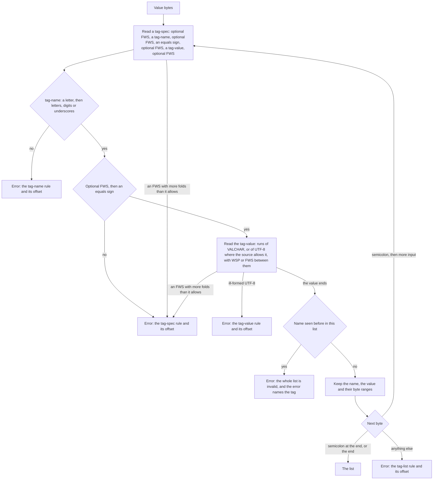

# Tag lists

The parse of a tag=value list and the decoding of its values: where tag lists appear, the parse, the decoders, and the outcome of each error. One parser serves DKIM and DKIM2, because RFC 6376 §3.2 and draft-09 §8 define the same grammar (HDR-006).

## Contents

- [Where tag lists appear](#where-tag-lists-appear)
- [Parsing a list](#parsing-a-list)
- [Rules](#rules)
- [Value decoders](#value-decoders)
- [Errors and their outcomes](#errors-and-their-outcomes)
- [Trace](#trace)

## Where tag lists appear

| Source | Specification | UTF-8 in values | Requirements |
|---|---|---|---|
| DKIM-Signature field | RFC 6376 §3.5 | In a message with internationalized header fields | HDR-006, RFC 8616 §5 |
| DKIM key record | RFC 6376 §3.6.1 | No | REC-050 |
| Message-Instance field | draft-09 §9 | No | HDR-006 |
| DKIM2-Signature field | draft-09 §10 | No | HDR-006 |
| DKIM2 key record | dns-03 §4 | No | DK2-011 |
| Domain Policy Record | dns-03 §5 | No | REC-054 |

A field's list is its value after the colon, folds included. A record's list is its TXT strings joined with nothing between them (DNS-006).

## Parsing a list

The parser reads left to right without recursion (PAR-005). A semicolon can't occur in a value, so each semicolon ends a tag-spec (RFC 6376 §3.2, draft-09 §8).

The source decides the grammar. DKIM lists follow RFC 6376 §3.2 as erratum 5070 corrects it, and DKIM2 lists follow draft-09 §8. The two differ only in the white space around an empty value. Values hold well-formed UTF-8 only in a DKIM-Signature field of a message with internationalized header fields.

## Rules

| Rule | Example | Requirements | Scenario |
|---|---|---|---|
| A tag-name is a letter followed by letters, digits and underscores | `1a=x` is an error at offset 0 | HDR-006 | TAG-007 |
| Tag names are case-sensitive | `V=1` is a tag named `V`, not `v` | HDR-006 | TAG-006, TAG-019 |
| White space around a tag and before the semicolon isn't part of the value, and white space inside it is | ` a = x y ;` gives `x y` | HDR-006 | TAG-002 |
| The last semicolon is optional | `b=z;` is valid | HDR-006 | TAG-002 |
| A tag-spec follows every semicolon but a last one at the end, and a list holds at least one tag-spec. White space after the last semicolon is an error, because ADR 0010 holds the parser to the ABNF | `a=1; ` is an error at offset 5 | HDR-006 | TAG-015 |
| An equals sign follows the tag name | `a:1` is an error at offset 1 | HDR-006 | TAG-010 |
| An FWS holds at most one CRLF, and a CRLF folds only before WSP (RFC 6376 §2.8) | `a=1\r\nb=2` is an error at offset 3 | HDR-006 | TAG-014 |
| One FWS may surround an empty value in DKIM (erratum 5070), and two in DKIM2 (draft-09 §8) | `a=\r\n \r\n ;` | HDR-006 | TAG-011, TAG-012 |
| Any run of WSP and FWS may separate two tvals, and it stays in the value | `a=x\r\n \r\n y` gives `x\r\n \r\n y` | HDR-006 | TAG-013 |
| A tag named twice makes the whole list invalid. Reading left to right, the first repeat in a complete tag-spec wins over a later fault | `a=1; a=2` | HDR-006, PAR-005 | TAG-003, TAG-018 |
| A tag the check doesn't know is ignored | `zz=9` in a DKIM-Signature | HDR-006 | TAG-004 |
| An empty value differs from an omitted tag | `a=;` | HDR-006 | TAG-005 |
| A VALCHAR is `%x21-3A / %x3C-7E`. In a DKIM-Signature of an internationalized message, well-formed UTF-8 is allowed too | `d=例え.test` | HDR-006, RFC 3629 §4 | TAG-008, TAG-017 |
| DKIM2 values stay ASCII | `d=例え.test` in a DKIM2-Signature is a syntax error | HDR-006 | TAG-009, TAG-016 |

## Value decoders

The name of a tag decides how its value decodes (RFC 6376 §3.2).

| Value kind | Tags | Rule | Requirements | Scenario |
|---|---|---|---|---|
| base64 | DKIM `b=`, `bh=`, key `p=`, DKIM2 hashes and signatures | One FWS between two symbols and one before each `=` are ignored. The value is canonical: `=` completes the last group of four symbols, and the pad bits are zero | HDR-007, ADR 0066, RFC 6376 §2.10, draft-09 §2.14, RFC 4648 §3.5 | TAG-020, TAG-031 to TAG-034 |
| dkim-quoted-printable | DKIM `z=`, `i=` | `=` and two uppercase hex digits. In an internationalized message, well-formed UTF-8 may stay unencoded | HDR-007, RFC 6376 §2.11, RFC 8616 §5 | TAG-021, TAG-022, TAG-024, TAG-025 |
| Colon-separated names | DKIM `h=` | Header field names, with FWS allowed around each colon | HDR-007, RFC 6376 §3.5 | TAG-023 |
| Canonicalization pair | DKIM `c=` | One name sets the header algorithm and leaves the body `simple`. A missing `c=` means `simple/simple` | HDR-007 | TAG-026, TAG-027 |
| Number | DKIM `t=`, `x=`, `l=`, DKIM2 `t=`, `m=`, `i=` | Read with overflow checks. A DKIM `t=` or `x=` of more than 12 digits is infinite, and any other value too large to hold is larger than what it is compared with | HDR-013 | TAG-028, TAG-029, TAG-030 |
| Groups | DKIM2 `s=`, Message-Instance `h=` | `,` binds more tightly than `\|` | HDR-007, draft-09 §9.3, §10.9 | TAG-040, TAG-042 |
| Paths | DKIM2 `mf=`, `rt=` | base64 of an RFC 5321 path, angle brackets included | HDR-008 | TAG-044, TAG-045 |
| Recipes | Message-Instance `r=` | base64 of a JSON object, read within `recipe_size` and `recipe_depth` | HDR-008, SAF-002 | TAG-046, TAG-047 |

## Errors and their outcomes

A parse error never becomes a returned error. It gives the outcome of the protocol that read the list (PAR-001, INV-010).

| Source | Outcome | Requirements |
|---|---|---|
| DKIM-Signature field | PERMFAIL for that signature (RFC 6376 §6.1.1) | DKV-004 |
| DKIM key record | PERMFAIL for the signature that asked for the key | REC-050 |
| Message-Instance or DKIM2-Signature field | PERMERROR, with the string of draft-09 §14 | DK2-013 |
| DKIM2 key record | The outcome REC-053 gives | REC-053 |
| Domain Policy Record | PERMERROR | REC-054 |

A base64 value that doesn't decode (ADR 0066) gives the same outcome as a list that doesn't parse, from the same source. An empty `p=` isn't decoded: it means that the key has been revoked (RFC 6376 §3.6.1, dns-03 §4.3).

## Trace

| Step | Records | Requirements |
|---|---|---|
| A list that parses | Each tag the check reads, with its byte range in the field or record | PAR-002, TRC-002 |
| A list that doesn't parse | The rule that failed, the offset and the input, as a data value | PAR-001, TRC-013 |
| A base64 value that doesn't decode | The rule that failed (the base64string rule, the padding or the pad bits), the offset in the field or record, and the value, as a data value. The offset is the value's start plus the decoder's offset, which for a missing `=` is the end of the value | PAR-001, TRC-013, ADR 0066 |
| An ignored tag | Its name | HDR-006 |
