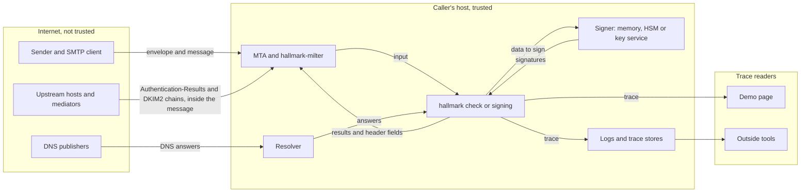

# Threat model

The assets that hallmark protects, the actors who can reach them, the threats, and the requirement or design rule behind each mitigation. [SECURITY.md](../../../SECURITY.md) tells reporters what counts as a vulnerability.

## Contents

- [Data flow and trust boundaries](#data-flow-and-trust-boundaries)
- [Assets](#assets)
- [Actors](#actors)
- [Threats](#threats)
- [Risks left to the caller](#risks-left-to-the-caller)

## Data flow and trust boundaries

| Boundary | What crosses it | What hallmark assumes |
|---|---|---|
| Internet to the caller | The message, the envelope and DNS answers | All of it is hostile (SAF-001) |
| Caller to the core | Options, input, answers, public suffix answers and signatures | The caller is trusted. A mistake of the caller gives an error, never a result (CHK-004) |
| Core to the signer | Data to sign, and signatures back | The signer is the signing caller's. The core checks each signature's size, and verifies it if asked (SGN-004, SGN-006) |
| Core to trace readers | Events that hold values from senders and publishers | A reader displays values in places where they could run as markup (TRC-013) |

## Assets

| Asset | Why it matters | Requirements |
|---|---|---|
| Private signing keys | A stolen key lets anyone sign as the domain | SGN-001, SEC-001 to SEC-003 |
| Correct results | A false `pass` lets forged mail through, and a false `fail` loses mail | TST-001, GEN-005 |
| The host's CPU and memory | hallmark runs on every message that an MTA accepts | SAF-001 to SAF-004 |
| Personal data in traces | Traces hold addresses and header fields | TRC-006, TRC-010 |
| Trace readers | A reader that renders a hostile value can run script | TRC-013, DEM-010 |
| Other parties' DNS servers | SPF records can make a receiver send lookups to them | SPF-006 |

## Actors

| Actor | Controls | Trust |
|---|---|---|
| Sender | The message, the envelope through its SMTP client, the signatures it makes and the recipes it writes | None |
| DNS publisher | The records of its zone: SPF, DKIM and DKIM2 keys, Domain Policy Records and DMARC records | None |
| Mediator | Changes to messages in transit, and the header fields it adds | None |
| Attacker on the DNS path | Forged answers | Outside hallmark: the verifying caller's resolver handles it |
| Caller | Options, input, the resolver and the signer | Trusted |
| Demo user | Pasted messages, records and keys, and cases shared by others | Trusted for their own input. A shared case comes from a stranger |

## Threats

| ID | Type | Threat | Mitigation | Requirements |
|---|---|---|---|---|
| THR-001 | Spoofing | A message claims a From domain it doesn't come from | DMARC aligns the author domain with the domains that SPF and DKIM authenticated | DMC-005 |
| THR-002 | Spoofing | An upstream host adds Authentication-Results with the receiver's authserv-id | hallmark reports the fields that carry the verifying caller's authserv-id, and the verifying caller deletes them | AR-005 |
| THR-003 | Spoofing | A domain that looks like another through U-labels | The conversion to A-labels maps nothing and enforces RFC 5891, and comparisons use the lookup form | ADS-002, ADS-003 |
| THR-004 | Tampering | Content appended after signing, under a DKIM `l=` | The result reports how much of the body went unsigned, with a caution | DKV-006, DKV-010 |
| THR-005 | Tampering | A From field added after signing | A caution when `h=` names From only as often as the message has From fields. hallmark's own signatures oversign | DKV-010, DKS-003 |
| THR-006 | Tampering | A signed message replayed to other recipients | DKIM `x=`, the DKIM2 time window and the DKIM2 chain of custody | TIM-002, ADS-024 |
| THR-007 | Tampering | Weak algorithms or keys | `rsa-sha1` is never valid, an RSA key under 1,024 bits is invalid, and one under 2,048 bits gets a caution | DKV-002, DKV-003, DKV-010 |
| THR-008 | Tampering | A DKIM2 recipe that breaks its own ordering rules | Verification fails with the step that broke the rule, and limits bound the recipe | DK2-007, SAF-002 |
| THR-009 | Tampering | A header section that a verifier and a mail reader parse differently | Parsers follow the ABNF and repair nothing. Lines that aren't header fields stay out of the DKIM2 hash, with a caution | HDR-010, HCN-006 |
| THR-010 | Tampering | A milter loses the leading space of a header value | The trace records the assumption that rebuilt it | STR-008 |
| THR-011 | Repudiation | An operator can't show why a message passed or failed | The trace carries the caller's message ID, and a snapshot replays the check with the same result | TRC-014, DNS-004, CHK-003 |
| THR-012 | Information disclosure | A private key in a trace, an error, a log, `Debug` output, a snapshot or a case | Keys stay inside signers, and key types neither print nor format their contents | SEC-001, SEC-002, INV-011 |
| THR-013 | Information disclosure | Signing time reveals the private key | `rsa` 0.10.0 or later, the first release patched for RUSTSEC-2023-0071 | SEC-003, [ADR 0049](../../adr/0049-hallmark-depends-on-cryptography-crates-zeroize-and-thiserror-and-writes-everything-else-itself.md) |
| THR-014 | Information disclosure | Traces stored where others can read them | The body never enters a trace, and the documentation says what a trace holds | TRC-006, TRC-010 |
| THR-015 | Information disclosure | The demo sends a message out of the browser | Only the DNS-over-HTTPS queries that the page names leave the browser | DEM-003 |
| THR-016 | Denial of service | Input that is too large or nested too deep | Limits with defaults, parsers without recursion, and memory bounded by the limits | SAF-002, PAR-005, SAF-004 |
| THR-017 | Denial of service | Input that makes hallmark panic | No panic in library code, enforced by lints | SAF-001 |
| THR-018 | Denial of service | SPF records that fan out lookups, against the receiver or a third party | The lookup and void lookup limits, and each name asked once | SPF-006, DNS-007 |
| THR-019 | Denial of service | Costly keys or many signatures | `rsa_key_bits`, `dkim_signatures` and `dkim2_signatures` | DKV-003, SAF-002 |
| THR-020 | Denial of service | A trace that grows without end | `trace_size` and `trace_places` | TRC-005, TRC-010 |
| THR-021 | Denial of service | An author domain with many labels | The DMARC tree walk asks at most 8 questions | DMC-003 |
| THR-022 | Injection | A sender's or publisher's value runs as script or markup in a trace reader | Each such value carries a mark, readers escape it, and the demo shows it as text | TRC-013, DEM-010 |
| THR-023 | Injection | A value from the input breaks out of a header field that hallmark generates | Design rule: a generated field holds no CR or LF except its folds, and no input value that its grammar doesn't allow | AR-001, STR-009 |
| THR-024 | Injection | An SPF explanation that poses as the receiver's own text | The trace marks it as text from a third party | REC-016, TRC-013 |
| THR-025 | Supply chain | A dependency with a vulnerability or a hostile release | Few dependencies, cargo-deny for advisories, licenses and sources, CodeQL, and pinned CI actions | STB-002, ADR 0049 |

## Risks left to the caller

| Risk | Why hallmark leaves it | Who handles it |
|---|---|---|
| Forged DNS answers | hallmark has no network code | The verifying caller's resolver, with DNSSEC validation if it chooses |
| Keys of the memory signer stay in process memory while it lives | That signer serves tests and the demo | Production signing callers keep keys in an HSM or a key service (SGN-001) |
| A signature made with the wrong key leaves when verification is off | Verification costs one more operation per signature | The signing caller turns on verification (SGN-006) |
| Replay inside the windows that the specifications allow | RFC 6376 and draft-09 set those windows | The verifying caller's own defenses |
| Personal data in stored traces | The trace is the main feature | The caller picks the level and where traces go (TRC-006) |
| Acting on test modes | hallmark acts on nothing (GEN-006) | The verifying caller ([ADR 0020](../../adr/0020-test-modes-are-reported-and-the-caller-decides-what-they-mean.md)) |
| Demo page policies, such as its Content-Security-Policy | Decided with the demo | The demo ([open item](../requirements.md#open-items)) |
