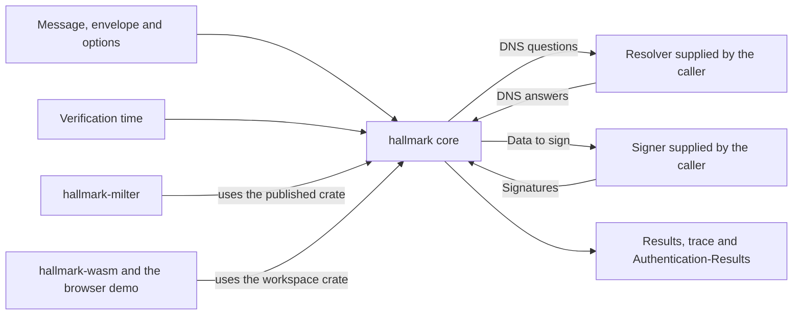
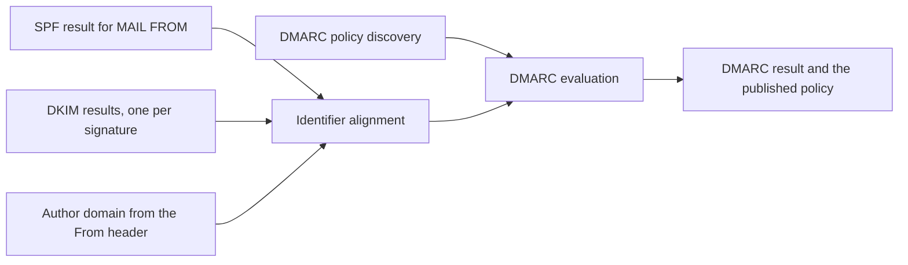
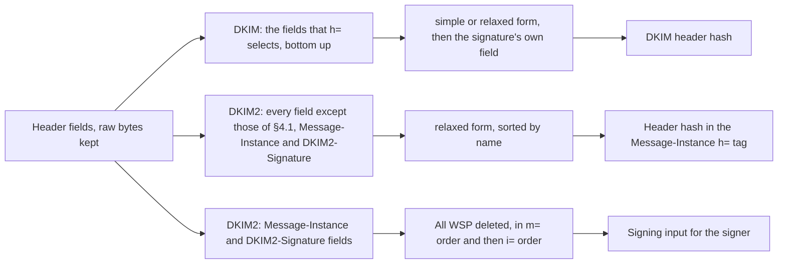
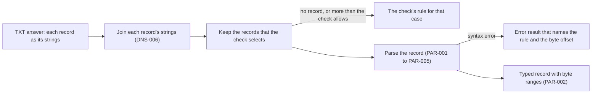
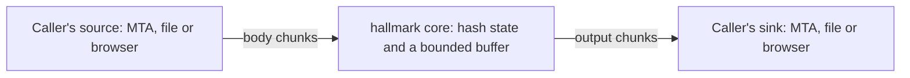

# Requirements

The requirements for hallmark, with an ID for each one. Test scenarios in [docs/testing](../testing/README.md) link to these IDs, and the [architecture decision records](../adr/README.md) record the choices behind them. [Architecture](../explanation/architecture.md) explains how the parts fit together, and the [detailed design](design/README.md) describes the modules, objects and limits that meet these requirements.

hallmark is a Rust library for email sender authentication. It verifies SPF, DKIM, DKIM2 and DMARC, signs messages with DKIM and DKIM2, and runs both natively and in WebAssembly. Its main feature is a detailed trace that explains every step of every check, so an operator can see why a message passed or failed instead of getting a one-word result.

hallmark is a library. It reports results and leaves every action to its caller: whether to reject or quarantine a message, which header fields to delete, and how to treat a domain that says it is testing (GEN-006).

Two programs use the library:

- hallmark-milter, a separate repository, signs and verifies mail inside a Sendmail or Postfix MTA.
- The browser demo, in this repository, shows what hallmark does and doubles as a test bench.

## Contents

- [Context](#context)
- [Scope](#scope)
- [Functional requirements](#functional-requirements)
  - [General](#general)
  - [Running a check](#running-a-check)
  - [SPF (RFC 7208)](#spf-rfc-7208)
  - [DKIM verification](#dkim-verification)
  - [DKIM signing](#dkim-signing)
  - [Signers](#signers)
  - [DKIM2](#dkim2)
  - [DMARC](#dmarc)
  - [Authentication-Results (RFC 8601)](#authentication-results-rfc-8601)
  - [Trace and reasoning](#trace-and-reasoning)
  - [Verification time](#verification-time)
  - [DNS](#dns)
  - [Parsers](#parsers)
  - [Header parsing](#header-parsing)
  - [Header canonicalization](#header-canonicalization)
  - [Addresses and domain names](#addresses-and-domain-names)
  - [DNS records](#dns-records)
- [Non-functional requirements](#non-functional-requirements)
  - [I/O only through the caller](#io-only-through-the-caller)
  - [Streaming](#streaming)
  - [WebAssembly](#webassembly)
  - [Hostile input](#hostile-input)
  - [Private keys](#private-keys)
  - [Stability and licensing](#stability-and-licensing)
- [Repository and deliverables](#repository-and-deliverables)
- [Browser demo](#browser-demo)
- [Quality and process](#quality-and-process)
- [Relationship to hallmark-milter](#relationship-to-hallmark-milter)
- [Open items](#open-items)

## Context

The caller supplies everything that comes from outside: the message, the DNS answers, the time, and the signatures, which a signer of its choosing computes (SGN-001). The core takes no random values. With the same inputs, the core always produces the same results and the same trace.

## Scope

In scope:

- SPF verification, RFC 7208
- DKIM verification and signing, RFC 6376 with RFC 8301, RFC 8463 and RFC 8616
- DKIM2 verification and signing, from `draft-ietf-dkim-dkim2-spec-09` and its key record draft `draft-ietf-dkim-dkim2-dns-03`, as an experimental feature
- DMARC evaluation under RFC 9989 (DMARCbis, May 2026) and under RFC 7489, which RFC 9989 obsoletes
- Generating and parsing Authentication-Results header fields, RFC 8601, with the `dkim2` method of `draft-gondwana-dkim2-authres-02`
- The trace and reasoning for every check
- WebAssembly bindings and a browser demo published on GitHub Pages

Out of scope:

- ARC, which DKIM2 aims to replace
- Sender ID, ADSP and BIMI
- Sending DMARC aggregate or failure reports. The library parses `rua` and `ruf` but sends nothing.
- Network code in the core: no DNS resolver implementation and no SMTP handling
- MIME parsing. For now, this leaves out checking DKIM2 delivery status notifications (draft-09 §16.4) ([ADR 0011](../adr/0011-hallmark-reads-no-mime-structure.md)).
- Received-SPF header fields (RFC 7208 §9.1), for now. SPF results go in Authentication-Results (RFC 7208 §9.2, AR-001).
- Messages with LF line endings, for now. The core takes CRLF line endings, and a caller with LF line endings converts them before the check, as the demo does (STR-011, DEM-008).

## Functional requirements

### General

| ID | Requirement |
|---|---|
| GEN-001 | A caller can run each check (SPF, DKIM, DKIM2, DMARC) on its own, or run all of them in one call that feeds the SPF and DKIM results into DMARC. |
| GEN-002 | Checks take the message as bytes in RFC 5322 form, plus envelope data: the client IP address, the HELO name, the MAIL FROM address and the RCPT TO addresses. DKIM2's chain-of-custody check uses MAIL FROM and RCPT TO (draft-09 §14.4). SPF can also take the name of the receiving host for its `%{r}` macro (REC-014). |
| GEN-003 | DKIM and DKIM2 accept a message as a stream (STR-001). A caller with the whole message can pass it in one piece. |
| GEN-004 | Every result is a typed value that carries a machine-readable reason: which mechanism matched, why a signature failed, which domain aligned. |
| GEN-005 | A temporary DNS failure produces the protocol's temporary-error result (`temperror`). It never turns into a pass or a fail. |
| GEN-006 | hallmark returns results, a trace and header fields to add, and acts on nothing. Rejecting or quarantining a message (RFC 9989 §5.4) and deleting header fields (AR-005) stay with the caller, as does every choice that the specifications leave to the receiver, such as how to treat test modes (DKV-009, DMC-007, [ADR 0020](../adr/0020-test-modes-are-reported-and-the-caller-decides-what-they-mean.md)). |

### Running a check

A check is a value the caller drives, so the same core runs under any async runtime, in blocking code and in the browser ([ADR 0017](../adr/0017-the-core-does-no-io-and-the-caller-drives-it.md)).

| ID | Requirement |
|---|---|
| CHK-001 | The caller passes a check the envelope, then the header fields, then the body in chunks, then the end of the message. The body may come in no chunks at all, as for a message with an empty or missing body, which still has a body hash (RFC 6376 §3.4.3 and §3.4.4, draft-09 §6.1). Only the end of the message tells the check that the body is complete. After each input, the check lists the DNS questions, public suffix questions (DMC-010) and signing requests (SGN-001) it now has, and the caller answers them whenever it has the answers. SPF needs only the envelope (DNS-005). |
| CHK-002 | A check finishes when its input is complete and every answer it needs has arrived, and it then returns its result and its trace. A caller that stops waiting for an answer reports a temporary failure for that question (DNS-009). |
| CHK-003 | A check's result and its sorted trace depend only on its inputs: not on when answers arrive, how the caller groups them, or where body chunks are cut (TRC-012, STR-005). |
| CHK-004 | Input that the check can't accept, such as a body chunk before the header fields end, an answer to a question it never asked, or a second answer to the same question, gives an error to the caller. It never turns into a protocol result. |
| CHK-005 | The driver of DNS-003 runs a check to the end with a resolver, in RFC 7489 mode a source of public suffixes (DMC-010), and for signing a signer, each of which the caller implements. It may resolve several questions at once, and the result and trace stay the same (CHK-003). |

### SPF (RFC 7208)

| ID | Requirement |
|---|---|
| SPF-001 | The library implements `check_host()` for the MAIL FROM identity. When MAIL FROM is empty, it checks `postmaster@` the HELO name, as RFC 7208 §2.4 says. |
| SPF-002 | A caller can also check the HELO identity on its own (RFC 7208 §2.3). |
| SPF-003 | Results use all seven values: `none`, `neutral`, `pass`, `fail`, `softfail`, `temperror`, `permerror`. |
| SPF-004 | Every mechanism and modifier works, including `ptr`, which RFC 7208 §5.5 tells publishers not to use, plus `exp=` and `redirect=`. |
| SPF-005 | Macro expansion follows RFC 7208 §7. |
| SPF-006 | The library enforces the processing limits of RFC 7208 §4.6.4: at most 10 terms that cause DNS lookups, the void-lookup limit (default 2), and the MX and PTR address-lookup limits, each with the result the RFC gives for it. |
| SPF-007 | Record selection follows RFC 7208 §4.5. A TXT record is an SPF record only if it begins with `v=spf1`, compared without regard to ASCII case ([ADR 0021](../adr/0021-spf-reads-v-spf1-without-regard-to-case-and-allows-c-r-and-t-only-in-explanations.md)), followed by a space or the end of the record, so a record that begins `v=spf10` is discarded. No SPF record gives `none`, and more than one gives `permerror`. |

### DKIM verification

| ID | Requirement |
|---|---|
| DKV-001 | The library verifies DKIM-Signature header fields under RFC 6376, with the `simple` and `relaxed` canonicalizations for headers (HCN-001 to HCN-004) and body. |
| DKV-002 | It supports `rsa-sha256` and `ed25519-sha256` (RFC 8463). An `rsa-sha1` signature is never valid (RFC 8301). |
| DKV-003 | It verifies RSA keys from 1024 to 4096 bits. A key under 1024 bits makes the signature invalid (RFC 8301). The caller can choose whether to accept larger keys. |
| DKV-004 | It verifies each signature on a message and reports a result for each one. The number of signatures it checks has a limit with a default (RFC 6376 §6.1). |
| DKV-005 | It parses key records under RFC 6376 §3.6.1, including an empty `p=` (revoked key), `h=`, `s=`, and the `t=y` and `t=s` flags (REC-050 to REC-052). An RSA key may be an RSAPublicKey or a SubjectPublicKeyInfo that contains one ([ADR 0026](../adr/0026-rsa-keys-in-key-records-may-be-rsapublickey-or-subjectpublickeyinfo.md)). A selector with several key records passes if any of them verifies the signature ([ADR 0025](../adr/0025-a-dkim-selector-with-several-key-records-passes-if-any-of-them-verifies-the-signature.md)). |
| DKV-006 | A signature with `l=` can verify, and both the result and the trace report how much of the body was left unsigned (RFC 6376 §8.2). |
| DKV-007 | Internationalized addresses and domains follow RFC 8616. |
| DKV-008 | An `l=` larger than the canonicalized body gets no special rule ([ADR 0009](../adr/0009-a-dkim-l-tag-larger-than-the-body-gets-no-special-rule.md)). Verification follows RFC 6376 §3.7 as written: truncating the body to `l=` octets leaves it whole, and the body hash comparison decides the result. The trace records, as a fact, that `l=` exceeds the body, which RFC 6376 §3.5 forbids signers to do. |
| DKV-009 | A key record with `t=y` marks the signature as testing. Verification runs as for any other key, because the steps of RFC 6376 §6 never read the flag, and the result carries the flag. RFC 6376 §3.6.1 tells verifiers to treat mail from a testing-mode key like unsigned mail, and the caller applies that ([ADR 0020](../adr/0020-test-modes-are-reported-and-the-caller-decides-what-they-mean.md)). |
| DKV-010 | The trace records a caution (TRC-003) on a signature that passes with an RSA key under 2048 bits (RFC 8301 §3.2), with an `l=` tag (RFC 6376 §8.2), or with an `h=` that names From only as many times as the message has From fields, so that a From field added later leaves the signature valid (RFC 6376 §5.4 and §8.15). A caution never changes the result. |
| DKV-011 | For each name in `h=`, the trace records the header field instance it selected, from the bottom up, or that no instance was left for it. The DKIM-Signature field being verified counts as an instance like any other (HCN-004). A name with no instance contributes nothing to the hash (RFC 6376 §3.5 and §5.4). |
| DKV-012 | If the body hash matches `bh=` but the signature doesn't verify, the trace records as a fact that the body was unchanged and the signature over the header hash failed: a signed header field, the DKIM-Signature field or the key changed after signing. It also records that DKIM keeps nothing that tells which header field changed. If `h=` names Subject, Reply-To or Sender, the trace adds a hint (TRC-003) that names them as fields that mailing lists commonly change (RFC 6377 §3.3, RFC 7960 §3.2.3). |
| DKV-013 | If a DKIM body hash doesn't match `bh=`, the trace adds a hint (TRC-003) under the body hash step: a mediator may have changed the body after signing, such as a mailing list that added or removed lines or MIME parts, or an MTA that re-encoded 8-bit content as 7-bit (RFC 6377 §3.3, RFC 7960 §3.1.2.1 and §3.2.3). |
| DKV-014 | If a signature with `simple` header canonicalization fails while its body hash matches `bh=`, the trace adds a hint (TRC-003): a relay may have refolded, re-spaced or rewritten a signed header field, which `simple` doesn't tolerate (RFC 6376 §3.4, RFC 7960 §2.3 and §3.1.2.2). |

### DKIM signing

| ID | Requirement |
|---|---|
| DKS-001 | The library signs with `rsa-sha256` and `ed25519-sha256`, through a signer (SGN-001). It refuses RSA keys under 1024 bits. |
| DKS-002 | A caller can add more than one signature to a message, for example RSA and Ed25519 together, as RFC 8463 suggests. |
| DKS-003 | The caller chooses the canonicalizations and the header fields to sign. The library has a default header list, always signs From (RFC 6376 §5.4), and can oversign: sign one more instance of a field than the message has, so that a later added instance breaks the signature. DKIM-Signature is the exception (DKS-006). |
| DKS-004 | The library sets `t=` from the verification time parameter. `x=` is optional. It never sets `l=`. |
| DKS-005 | Signing returns only the header fields to add, and the caller puts them in the message. The library never returns the whole signed message, because it can compute a signature only after the body has streamed past (STR-001). |
| DKS-006 | A signature that hallmark makes never includes its own DKIM-Signature field in `h=` (RFC 6376 §3.5 and §3.7). If the caller asks to sign DKIM-Signature fields, `h=` names `dkim-signature` once for each DKIM-Signature field in the message at signing time, and oversigning (DKS-003) adds no extra name for it, because §5.4 allows the name only to sign preexisting signatures. An extra name would select the new field at verification and break the signature (HCN-004, [ADR 0028](../adr/0028-dkim-h-selection-counts-the-signatures-own-dkim-signature-field.md)). |

### Signers

Signing hands the data to sign to a signer and takes the signature back, as DNS questions go to the resolver ([ADR 0042](../adr/0042-signing-goes-through-a-signer-the-caller-supplies-and-the-caller-can-have-each-signature-verified.md)).

| ID | Requirement |
|---|---|
| SGN-001 | The caller supplies the signer. A signer can keep its key in memory, in a hardware security module or in a remote key service, and it can answer at once or later. The core never holds a key that an outside signer keeps. |
| SGN-002 | The signer gets the data its algorithm signs: the SHA-256 hash for `rsa-sha256`, signed with RSASSA-PKCS1-v1_5 (RFC 6376 §3.3.2, draft-09 §3.2, RFC 8017 §8.2); the SHA-256 hash for `ed25519-sha256`, which Ed25519 takes as its message (RFC 8463 §3, draft-09 §3.3); and the whole signing input, unhashed, with the context string `DKIM2`, for `mldsa44` (draft-09 §3.4). The header field limits of SAF-002 bound the size of that input. |
| SGN-003 | Before signing, a signer states its algorithm and public key. The core refuses an RSA key under 1024 bits (RFC 8301 §3.2, draft-09 §3.2), and for DKIM2 an RSA key whose public exponent isn't 65537 (draft-09 §3.2). |
| SGN-004 | The core checks that each signature it gets back has the size that its algorithm and key give. A signer error or a signature of the wrong size stops signing with an error that names the signer, never a protocol result. |
| SGN-005 | The library ships a signer for keys held in memory, which tests and the demo use (DEM-006). Its key types follow SEC-001 to SEC-003. It signs ML-DSA-44 with the hedged variant that draft-09 §3.4 recommends, taking a random value from the caller for each signature. |
| SGN-006 | The caller can turn on, for each call, verification of the signatures that the signer returns. The core then verifies each signature with the public key that the signer stated (SGN-003) before it writes the header field, and a signature that doesn't verify stops signing with an error that names the signer, as in SGN-004. Verification is off by default. hallmark keeps no state from one call to the next, so a caller that runs for a long time can turn verification on or off for the next message without a restart ([ADR 0042](../adr/0042-signing-goes-through-a-signer-the-caller-supplies-and-the-caller-can-have-each-signature-verified.md)). |

### DKIM2

| ID | Requirement |
|---|---|
| DK2-001 | DKIM2 support sits behind the Cargo feature `unstable-dkim2` until the specification becomes an RFC ([ADR 0006](../adr/0006-dkim2-targets-draft-09-behind-an-unstable-feature.md)). |
| DK2-002 | The library targets three drafts together, the latest revisions on 13 November 2026 ([ADR 0006](../adr/0006-dkim2-targets-draft-09-behind-an-unstable-feature.md)): `draft-ietf-dkim-dkim2-spec-09` (1 November 2026) for DKIM2 itself, `draft-ietf-dkim-dkim2-dns-03` (2 November 2026) for key records and the Domain Policy Record, and `draft-gondwana-dkim2-authres-02` (2 November 2026) for Authentication-Results. Moving any of them to a new revision is a deliberate change with its own tests. |
| DK2-003 | The library verifies and signs DKIM2, with the header hashes of HCN-005 to HCN-007. |
| DK2-004 | The trace covers every DKIM2 signature on the message and every change to the message that the draft records. |
| DK2-005 | While the feature is experimental, the DKIM2 API and behavior may change in any release ([ADR 0006](../adr/0006-dkim2-targets-draft-09-behind-an-unstable-feature.md)). |
| DK2-006 | Verification rebuilds every earlier version of the body that the recipes describe, for all signatures in the chain, in the same single pass over the body. Draft-09 §5.1 and §5.2 require the `c` (copy) steps of a recipe to be in ascending order and not to overlap, so each earlier version can take its lines as they stream past, and the core keeps only a position in each recipe. It needs no storage and no random access. |
| DK2-007 | A recipe that matches the JSON schema but breaks the ordering rules (draft-09 §5.1 and §5.2 warn this can happen) is hostile input. Verification of the signatures that depend on it fails with a reason, and the trace names the step that broke the rule. A null body recipe, which declares that the earlier body can't be rebuilt, also appears in the result and the trace. |
| DK2-008 | Body recipe line numbers count the raw body, before §6.1 drops empty lines at the end. Recipes that hallmark writes never copy those empty lines with `c` steps, and the trace records the assumption whenever a recipe copies one ([ADR 0008](../adr/0008-dkim2-recipe-line-numbers-count-the-raw-body.md)). |
| DK2-009 | Verification implements the five algorithms that draft-09 §3 requires of every verifier: the `sha256` and `sha512` hashes, and the `rsa-sha256`, `ed25519-sha256` and `mldsa44` signatures. ML-DSA-44 is the pure variant, with the context string `DKIM2` (§3.4). Signing offers the same algorithms through a signer (SGN-001), and a caller can sign with several at once. |
| DK2-010 | Several signatures in one `s=` tag combine by the `sig-all` and `sig-any` rules of draft-09 §14.6, and several hash sets in one `h=` tag combine by the `hash-all` and `hash-any` rules of §14.7. An algorithm that hallmark doesn't implement or treats as insecure, and a key it treats as too short, give a PERMERROR intermediate result. |
| DK2-011 | DKIM2 key records follow dns-03 §4: the `rsa`, `ed25519` and `mldsa44` key types, an empty `p=` for a revoked key, and exact sizes of 32 octets for an Ed25519 key and 1,312 octets for an ML-DSA-44 key. An `rsa` key may be an RSAPublicKey or a SubjectPublicKeyInfo that contains one (dns-03 §4.2, [ADR 0026](../adr/0026-rsa-keys-in-key-records-may-be-rsapublickey-or-subjectpublickeyinfo.md)). DKIM2 ignores the deprecated `h=`, `n=`, `s=` and `t=` tags (draft-09 §14.5). REC-053 gives the outcome of each problem with a key record. DKIM keys keep following RFC 6376 (DKV-005). |
| DK2-012 | Verification checks that each From header field present since the first signature is Authentic (draft-09 §11 and §14.8). It uses the relaxed domain match of §7 in both directions. If the match succeeds only because the signing domain is a subdomain of the From domain, it fetches the From domain's Domain Policy Record (dns-03 §5), and a `strict` flag there cancels the match. A malformed Domain Policy Record gives PERMERROR (REC-054, [ADR 0027](../adr/0027-a-malformed-dkim2-domain-policy-record-gives-permerror.md)). A From header field with more than one address, or with a domain literal, is never Authentic. |
| DK2-013 | Results use the five output states of draft-09 §14.1: NONE, PASS, FAIL, PERMERROR and TEMPERROR. A result other than PASS carries the human-readable string that draft-09 §14 gives for its case, with the placeholders filled in, and the trace records the same string. For a case to which §14 gives no string, such as a malformed Domain Policy Record ([ADR 0027](../adr/0027-a-malformed-dkim2-domain-policy-record-gives-permerror.md)), the result carries none, and the trace says that the draft has none. |
| DK2-014 | A Reviser (draft-09 §2.3) describes each change it made: for the body, which lines of the new body came unchanged from the earlier version, and which earlier lines it removed or replaced, with their content; for header fields, the earlier value of each field it changed or removed. hallmark writes the Message-Instance and its recipes from that description (§5, §12.1), or a null body recipe when the caller asks for one. It never compares two versions of the body, which would need both in memory (STR-001). In the same pass, it rebuilds the earlier version from the recipes it wrote, as verification does (DK2-006), and signing stops with an error if that version's hashes differ from the ones in the highest Message-Instance. |

### DMARC

| ID | Requirement |
|---|---|
| DMC-001 | The library evaluates DMARC under RFC 9989 (DMARCbis) and under RFC 7489. The caller picks one per call, and RFC 9989 is the default ([ADR 0040](../adr/0040-dmarc-supports-rfc-7489-and-dmarcbis-with-dmarcbis-the-default.md)). |
| DMC-002 | The author domain is the domain in the RFC5322.From header field (ADS-012 covers a message with several), converted from a U-label to an A-label (RFC 5890 §2.3), as RFC 9989 §5.3.1 and RFC 7489 §6.6.1 require. DMARC applies only when exactly one domain is found. When none is found, as with a missing From field, a group with no addresses (RFC 6854) or an address with a domain literal (ADS-005), or when more than one is found, the result says that DMARC was not applied and why. A caller can choose to evaluate a message with several domains anyway, taking each one as an author domain up to a limit (SAF-002). hallmark then returns a DMARC result for each author domain, and the caller applies the most strict policy among those that fail, as RFC 9989 §11.5 and RFC 7489 §6.6.1 recommend (GEN-006). The trace records which case applied. |
| DMC-003 | In RFC 7489 mode, the library finds the organizational domain from a public suffix that the caller gives (DMC-010, DMC-011). In DMARCbis mode, it uses the DNS tree walk and the query limit DMARCbis sets. |
| DMC-004 | The record parser reads the tags of the mode in use (REC-031): DMARCbis adds `np`, `psd` and `t` and drops `pct`, `rf` and `ri`. Unknown tags are ignored. A missing or invalid policy tag follows RFC 9989 §4.10.1 (REC-032, [ADR 0023](../adr/0023-dmarc-follows-rfc-9989-section-4-10-1-for-invalid-policy-tags-and-section-4-7-for-nonexistent-subdomains.md)). |
| DMC-005 | Identifier alignment checks the SPF-authenticated MAIL FROM domain and each DKIM `d=` domain against the author domain, in relaxed or strict mode from `aspf` and `adkim`. When MAIL FROM is null, the SPF-authenticated domain is the HELO name, because SPF then checks `postmaster@` the HELO name as the MAIL FROM identity (SPF-001, RFC 7208 §2.4, RFC 7489 §3.1.2 and §4.1, RFC 9989 §4.4.2). Each alignment step names the SPF or DKIM result it used, so a caller that ran the checks one at a time (GEN-001) can match them. |
| DMC-006 | The result is `pass`, `fail`, `none`, `temperror` or `permerror`, together with the alignment details, the policy tag that applied (`p`, `sp`, or in RFC 9989 mode `np`) with its published value, or that it couldn't be determined (REC-032), and whether the record asks for test mode (DMC-007). hallmark computes no other policy from them. The caller decides what to do with the message ([ADR 0020](../adr/0020-test-modes-are-reported-and-the-caller-decides-what-they-mean.md)), and the how-to guide [Handle DMARC test modes](../how-to/handle-dmarc-test-modes.md) shows the steps that RFC 9989 §4.7 and RFC 7489 §6.6.4 describe. |
| DMC-007 | Test mode comes from `t=y` in RFC 9989 mode (§4.7) and from `pct=0` in RFC 7489 mode, as RFC 9989 Appendix A.6 pairs them. In RFC 7489 mode, hallmark ignores any other `pct` value and reads the record as if `pct` were absent, which means 100, because Appendix A.6 reports that other values were seldom applied accurately. The trace records the `pct` value as published, and says that hallmark supports only 0 and 100. hallmark samples nothing and takes no random value ([ADR 0020](../adr/0020-test-modes-are-reported-and-the-caller-decides-what-they-mean.md)). |
| DMC-008 | If a DMARC pass rests only on signatures from keys with `t=y` (DKV-009), that is, SPF gives no aligned pass and every aligned DKIM pass comes from such a key, the result says so. hallmark still counts those signatures, as RFC 9989 §4.4.1 counts any signature that validates, and leaves to the caller how RFC 6376 §3.6.1 applies ([ADR 0020](../adr/0020-test-modes-are-reported-and-the-caller-decides-what-they-mean.md)). |
| DMC-009 | If SPF fails or soft-fails for MAIL FROM while a DKIM signature aligned with the author domain passes, the trace adds a hint (TRC-003) under the alignment step: the message may have been forwarded by a mediator that kept the original MAIL FROM (RFC 7960 §2.2 and §3.2.1). The hint names the SPF result and the DKIM signature by their positions. |
| DMC-010 | In RFC 7489 mode, the check asks the caller for the public suffix of each distinct domain whose organizational domain it may need: the author domain, for policy discovery and alignment (RFC 7489 §6.6.3 and §3.1), the MAIL FROM domain, which is the HELO name when MAIL FROM is null (DMC-005), and each DKIM `d=` domain (§3.1.1 and §3.1.2). RFC 7489 names no list (§3.2, Appendix A.6.1), so the caller answers from the list of its choice, as it answers DNS questions (CHK-001), and a question is available as soon as its domain is known (DNS-005). The answer gives the public suffix by its number of labels, the x of §3.2 step 3, from 1 to the number of labels in the domain, and can carry a name for the list, such as its date or a hash. The caller can instead answer that no suffix is available, with a description of its own, which the trace records as given, as DNS-009 says for a temporary failure. RFC 9989 mode asks no such question ([ADR 0038](../adr/0038-in-rfc-7489-mode-the-caller-answers-public-suffix-questions.md)). |
| DMC-011 | The organizational domain is the last x + 1 labels of the domain (RFC 7489 §3.2 step 4). If x equals the number of labels, the domain is its own organizational domain, and policy discovery makes no second query (§6.6.3 step 3). An answer outside the range of DMC-010 gives an error to the caller (CHK-004), and an answer that no suffix is available gives `temperror` if the result depends on that organizational domain, as a temporary DNS failure does (GEN-005). The trace records each question, its answer, the list's name and the organizational domain, and a snapshot keeps the answers (DNS-004). |

### Authentication-Results (RFC 8601)

| ID | Requirement |
|---|---|
| AR-001 | The library generates an Authentication-Results header field from its results, with the authserv-id supplied by the caller. |
| AR-002 | Each method result carries a short explanation in its `reason` (the reasonspec of RFC 8601 §2.2) and in comments. hallmark builds it from the result's typed reason (GEN-004), not from the trace, so it is there at every trace level, off included (TRC-004). |
| AR-003 | The library parses Authentication-Results header fields, so that a caller can read results from an upstream host it trusts. |
| AR-004 | DKIM2 results use the `dkim2` method of `draft-gondwana-dkim2-authres-02` §3: one result for the whole message, the result values of §3.1, and the `header.d` and `header.i` properties of §3.2, each left out in the cases §3.2 lists. A message with no DKIM2 header fields is reported as `dkim2=none`, not left out (§3.1). |
| AR-005 | The library reports which Authentication-Results fields carry an authserv-id the caller names, so that an MTA can delete the ones that claim to come from inside its trust boundary without coming from a trusted MTA (RFC 8601 §5). In internationalized messages, it compares authserv-ids after converting A-labels to U-labels, as §5 says. hallmark deletes nothing itself. |
| AR-006 | The generated field holds a result for each SPF identity checked, each DKIM signature in header order, DKIM2, and each DMARC author domain, with the properties of RFC 8601 §2.7.1 and §2.7.2 and the `header.from` property of RFC 9989 §9.1. Each typed reason maps to one result value: a DKIM PERMFAIL gives `fail`, `neutral` or `permerror` by its reason, a message that DMARC can't evaluate gives `dmarc=permerror`, and hallmark never writes `policy`. `smtp.mailfrom` holds the domain only, as RFC 8601 §2.7.2 advises ([ADR 0056](../adr/0056-authentication-results-map-each-typed-reason-to-one-result-value.md)). |

### Trace and reasoning

The trace is the main feature. It records every step a check takes, with the rule that required the step, as events that readers sort into a tree ([ADR 0031](../adr/0031-the-code-that-decides-writes-the-trace-as-events-with-tree-positions.md)). [Trace format](trace-format.md) describes the events, and [Trace codes](trace-codes.md) lists their codes.

| ID | Requirement |
|---|---|
| TRC-001 | The code that makes a decision also records it in the trace, while the check runs. The library never rebuilds a trace after the fact, so the trace can't disagree with the result. |
| TRC-002 | The trace is structured data: a tree of steps, each of which goes out as one event. Each step records what it checked, its inputs (including each DNS question and answer), its outcome, and the RFC or draft section that requires it, as codes and parameters (TRC-011). Each event carries the step's position in the tree: the path of child numbers from the root, which also names the step's parent. |
| TRC-003 | Facts and hints stay apart. A fact states what the check found ("the body hash didn't match `bh=`"). A fact that a specification warns about carries a caution, which cites the section with the warning ("the signature passed with a 1024-bit RSA key", RFC 8301 §3.2). A hint is a labeled guess about the cause ("a mailing list footer may have changed the body"). Cautions and hints never change a result. Facts, cautions and results cite the specifications they apply, and hints may also cite RFC 6377 and RFC 7960, which describe how mailing lists and other mediators change messages. The first release has the hints of DKV-012 to DKV-014, DMC-009 and ADS-024, which [Trace codes](trace-codes.md#hints) lists, and new hints arrive with test cases that justify them. |
| TRC-004 | The caller picks a trace level per call: off, summary or full. At the full level, each event goes out when its step finishes, and the trace holds every step. At the summary level, hallmark holds the events back until the check finishes, then sends, for each check, the events on the path from its top step down to the steps that decided its result, and every caution, in position order. At the off level, the library allocates nothing for the trace. |
| TRC-005 | The trace has size limits. Hostile DNS answers or messages can't make it grow without bound, and when it reaches a limit, the trace records that it was cut short. A trace limit never changes a result: the check goes on and returns what it would have returned with no trace. |
| TRC-006 | The trace never contains private key material or the message body (TRC-010). It can contain addresses and header contents, and the reference docs say so, so that callers can decide where to store it. |
| TRC-007 | The trace is a JSON text sequence (RFC 7464) of events, each an I-JSON text (RFC 7493) written in one fixed form of bytes, with a major and a minor version of its own, as [Trace format](trace-format.md) describes ([ADR 0033](../adr/0033-trace-events-are-i-json-texts-in-a-json-text-sequence.md)). The demo, hallmark-milter and outside tools all read that format. Within a major version, a reader ignores the members and codes it doesn't know (RFC 7493 §4.2). |
| TRC-008 | At the full level, the trace records every DNS question and answer as the resolver gave it, each TXT record as its separate strings (DNS-006), and every public suffix question and answer (DMC-010), under each step that read the answer, so a caller can extract a snapshot and replay the check offline (DNS-004). The trace names a question by its type and name, never by its identifier (DNS-007), which can depend on when the question was asked. |
| TRC-009 | Tests can assert on the path a check took through the trace as well as on its result. They match step codes and positions in the sorted trace (TRC-011, TRC-012), so a change of wording breaks no test. |
| TRC-010 | The trace records the body only as hashes, byte counts, line counts and places: the point where `l=` cut it, where the empty lines at its end start, whether a CRLF was added at its end, where it holds a bare CR or LF (STR-011), and where canonicalization changed it. For each kind of change, the trace gives the count and the first places, up to a limit (TRC-005), and says when the list is cut short. A place gives the offset and the line in the body that the caller passed, and the offset in the canonical body where the hash depends on it. Body content never enters the trace, at any level. A caller that wants to see the canonical body gets it from STR-012 ([ADR 0041](../adr/0041-the-trace-records-places-in-the-body-and-a-separate-api-streams-the-canonical-body.md)). |
| TRC-011 | Each step carries a kind, a code and, when the code has them, an outcome and parameters, such as a domain name, a tag value or a count. [Trace codes](trace-codes.md) lists every code ([ADR 0034](../adr/0034-trace-step-codes-are-strings-listed-in-a-reference-page.md)). The text a person reads is rendered from the codes and parameters. The library renders English, and a caller can render another language, as the demo may. The human-readable strings of draft-09 §14 (DK2-013) keep a parameter of their own, in the words the draft gives them. |
| TRC-012 | A step's position depends only on the inputs: the order that the specifications fix and the order of items in the input, never the order in which DNS answers arrive or where the body chunks are cut. An answer sits under the step whose question it answers, SPF terms follow their record, DKIM signatures follow the header section, and a step that finishes when the body ends, such as the assumption of DK2-008, stays under the step it belongs to. At the full level, events go out as their steps finish, so their order can differ between runs. Sorted by position, with each parent before its children, the same inputs give the same events in the same bytes, and the sorted events are the trace. The library offers the sort. |
| TRC-013 | The trace marks each value that a sender or a DNS publisher controls: header field values, addresses, DNS record contents, the SPF explanation string (RFC 7208 §6.2), macro expansions and recipe content. The mark sits in the value itself, so a reader finds it even under a code it doesn't know. The library escapes nothing, because the right escaping depends on where a value is shown. [Trace format](trace-format.md#values) tells readers, the demo included, to escape marked values for their output, and to show an SPF explanation as coming from a third party, as RFC 7208 §6.2 asks. |
| TRC-014 | The caller can give a check an ID for the message, such as the MTA's queue ID, and every event of its trace carries it, so an operator can join hallmark's events with the MTA's and the milter's logs. The ID isn't the Message-ID header field, and hallmark never makes one up (IO-001). |

What the trace shows for each protocol:

| Protocol | Steps the trace records |
|---|---|
| SPF | The evaluation tree through `include` and `redirect`, each DNS question and answer, each macro expansion and its result, the running lookup and void-lookup counts, the mechanism that matched, or the limit that was hit and the term that hit it, and for a `fail` the `exp=` lookup and the expanded explanation |
| DKIM | Tag parsing, the key lookup and key record with its flags, the header field instance chosen for each name in `h=` or the lack of one (DKV-011), the header hash input (HCN-009), the body as described in TRC-010, the computed and stated body hashes, the signature check, what a body hash match with a failed signature shows (DKV-012), the cautions of DKV-010 and HCN-004, and the hints of DKV-012 to DKV-014 |
| DKIM2 | The same steps as DKIM for each signature, plus the header fields that each header hash left out and why (HCN-009), the chain of custody with the hint of ADS-024, the timestamp checks, each recipe step, the relaxed domain matches and Domain Policy Record lookups of the From check, how signatures and hash sets combined, and the human-readable string that draft-09 §14 gives for the result |
| DMARC | The author domain, each step of policy discovery (the public suffix questions and their answers, or the tree walk), alignment for each identifier with its mode and the SPF or DKIM result it came from, which of `p`, `sp` or `np` applied, test mode and the tag that set it, an ignored `pct` value, whether a pass rests only on testing-mode keys, the hint of DMC-009, and the final result |

### Verification time

| ID | Requirement |
|---|---|
| TIM-001 | The verification time is a parameter, and the core never reads a clock. It is the time the message was received. RFC 6376 §3.5 asks for the time the message was first received at the verifier's administrative domain, when that is reliably known, and draft-09 §14.3 measures DKIM2 timestamps against the time the message was accepted over SMTP. A caller that checks a stored message later passes the time it was received, not the current time. |
| TIM-002 | The caller can turn off checks that compare a signature time with the verification time: an expired DKIM `x=`, a DKIM `t=` in the future, and the DKIM2 checks of draft-09 §14.3, which fail a signature created more than 14 days before the message was accepted or more than one day after it. The checks are on by default. RFC 6376 §3.5 makes both DKIM checks optional for verifiers. |
| TIM-003 | Checks that don't use the verification time still run when time checks are off. For example, `x=` must still be later than `t=`. |
| TIM-004 | When a time check is off, the library still works out what it would have said and records that in the trace as a skipped step ("this signature expired on 2024-03-02; the expiration check was off"). |
| TIM-005 | An Authentication-Results header field generated with time checks off carries a comment that says so. |
| TIM-006 | The option exists on every target, native and WebAssembly, so native tests cover it. |

### DNS

| ID | Requirement |
|---|---|
| DNS-001 | The core asks for DNS records by handing questions to the caller and taking the answers back ([ADR 0017](../adr/0017-the-core-does-no-io-and-the-caller-drives-it.md)). It needs TXT, A, AAAA, MX and PTR records. |
| DNS-002 | The resolver's answer tells apart: records found, name does not exist, no records of that type, and temporary failure. SPF void lookups and temporary errors depend on that difference. |
| DNS-003 | The core never waits for an answer, so a caller can resolve with any async runtime, with blocking code, or in the browser. The library also offers a driver that runs a check to the end with a resolver the caller implements, and the driver depends on no async runtime. |
| DNS-004 | The library ships a resolver that answers from a snapshot: the questions of a check, each with the answer its resolver gave. A snapshot is a document of its own in the rules of the trace format, with one answer for each question type and name in a fixed order and, for RFC 7489 mode, the public suffix answers (DMC-010), and the library extracts one from a trace (TRC-008, [Trace format](trace-format.md#snapshots), [ADR 0035](../adr/0035-dns-snapshots-and-demo-cases-are-documents-in-the-trace-formats-conventions.md)). Tests, bug reports and the demo's replay of a shared case (DEM-004) use it. It matches a question by its type and its name, without regard to ASCII case (RFC 4343 §2). A question the snapshot doesn't hold gets a temporary failure that says so (DNS-009), and a public suffix question it doesn't hold gets the answer that no suffix is available, with a description that says so. |
| DNS-005 | The DNS questions for DKIM and DKIM2 keys, for DKIM2 Domain Policy Records and for DMARC policy are available once the header fields are complete, so the caller can resolve them while the body streams. SPF needs only the envelope, so its questions are available before the message. |
| DNS-006 | Answers come in fixed shapes: each TXT record as its list of character-strings, in order and not joined (RFC 1035 §3.3 and §3.3.14), A and AAAA records as addresses, MX records as a preference and an exchange name, and PTR records as a name. The core joins TXT strings with nothing between them, as RFC 7208 §3.3, RFC 6376 §3.6.2.2, RFC 9989 §4.5 and dns-03 §3 require, so a resolver needs to know none of those rules. |
| DNS-007 | Each question has an identifier, unique within the check, and each answer names the question it answers. Within one check, and within one call that runs several checks (GEN-001), the core asks each name and type once, and every step that needs the answer reads the same one. Reusing an answer changes none of the counts that RFC 7208 §4.6.4 keeps. |
| DNS-008 | The core builds every question name itself: `<selector>._domainkey.<domain>` for DKIM and DKIM2 keys (RFC 6376 §3.6.2.1, dns-03 §3), `_domainkey.<domain>` for a DKIM2 Domain Policy Record (dns-03 §5), `_dmarc.<domain>` for a DMARC policy record (RFC 9989 §4.5) and the names of the DNS tree walk (§4.10), an A question at the author domain to find out whether it exists (REC-032), reverse names under `in-addr.arpa` and `ip6.arpa` for SPF `ptr` and `%{p}` (RFC 1035 §3.5, RFC 3596 §2.5), and SPF target names after macro expansion, cut from the left to 253 characters (RFC 7208 §7.3). Every name goes out in lookup form (ADS-002) and within the limits of ADS-004. |
| DNS-009 | A temporary failure can carry the resolver's own description, such as a timeout or SERVFAIL, and the trace records it as the resolver gave it. The core reads no clock, so the caller's resolver applies time limits, such as the one RFC 7208 §4.6.4 asks for, and reports a timeout as a temporary failure. |
| DNS-010 | The snapshot resolver also answers from records that a user pastes into the demo (DEM-002), one per line in the presentation format of RFC 1035 §5.1: an absolute owner name, an optional TTL and class, the type, and the data. Pasted records act as the complete zone data. A name with no pasted records and none below it doesn't exist (RFC 8020 §2, RFC 9989 §3.2.13), and a name with records of other types, or with records below it, has no records of the asked type. A line that doesn't match the format gives an error with its line and offset (PAR-001), never a repaired record. |

### Parsers

Every parser in hallmark, for header fields, addresses, tag lists, DNS records, recipe JSON and pasted records, shares the rules below ([ADR 0010](../adr/0010-header-parsers-follow-the-abnf-and-never-repair-input.md)).

| ID | Requirement |
|---|---|
| PAR-001 | Input that doesn't match its grammar gives an error, never a repaired value. The error names the rule that failed, the byte offset, and the input that the parser read, such as a header field or a DNS record. HDR-010 applies this rule to header fields. |
| PAR-002 | Each parsed value keeps the byte range it came from, so the trace can point at the text in a header field or a record that a step read. |
| PAR-003 | Parsers read numbers with overflow checks, as HDR-013 describes for tag values. A number outside the range that its grammar or its protocol allows gets that protocol's rule, such as `permerror` for an SPF CIDR length over 32 (RFC 7208 §5.6, §4.6). |
| PAR-004 | The limits of SAF-002 form one set with documented defaults, and a caller can change them per call. Each parser checks its limits as it reads. |
| PAR-005 | Parsers read input left to right without recursion, as HDR-011 says for header fields. Nesting, such as JSON depth in a recipe, counts against a depth limit (SAF-002). |

### Header parsing

hallmark parses every header field it uses with its own parsers, written from the ABNF ([ADR 0010](../adr/0010-header-parsers-follow-the-abnf-and-never-repair-input.md)), and reads no MIME structure ([ADR 0011](../adr/0011-hallmark-reads-no-mime-structure.md)). Addresses, in header fields and in the envelope, have a design of their own, which [Addresses and domain names](#addresses-and-domain-names) describes.

| ID | Requirement |
|---|---|
| HDR-001 | The header section parser splits a message's header section into header fields, each with its name, its unfolded value and its exact raw bytes. The header section ends at the first empty line, or at the end of the input when the message has no body (RFC 5322 §2.1 and §3.5). If the input ends inside the last line, with no line ending, that line can still be a header field (HCN-008). The parser never changes the raw bytes, because `simple` header canonicalization hashes them as they arrived (RFC 6376 §3.4.1). |
| HDR-002 | Field names match without regard to case, as ABNF strings do (RFC 5234 §2.3) and as RFC 6376 §6.1.3 requires when it matches `h=` against the message. |
| HDR-003 | Unfolding removes each CRLF that is followed by WSP (RFC 5322 §2.2.3). The parser also accepts the obsolete forms: folded lines made only of white space (§4.2), and white space between a field name and its colon (§4.5). |
| HDR-004 | Field values may contain UTF-8 (RFC 6532 §3.2). Field names stay printable US-ASCII without the colon (RFC 5322 §2.2). A line that isn't a header field stays a separate malformed line with its raw bytes ([ADR 0010](../adr/0010-header-parsers-follow-the-abnf-and-never-repair-input.md)), and the DKIM2 header hash leaves it out (HCN-006). |
| HDR-005 | The same parsers serve both input forms of STR-008: a raw header section, and fields that arrive one at a time from a milter. |
| HDR-006 | One parser reads the tag=value lists of DKIM-Signature, Message-Instance and DKIM2-Signature header fields, and of DKIM keys, DKIM2 keys and Domain Policy Records, because RFC 6376 §3.2 and draft-09 §8 define the same grammar. Tag names are case-sensitive, a duplicate tag makes the whole list invalid, checks ignore an unrecognized tag, and an empty value differs from an omitted tag. In a DKIM-Signature field of a message with internationalized header fields, tag values may also hold well-formed UTF-8 (RFC 3629 §4): RFC 8616 §5 says `d=`, `i=` and `s=` should carry U-labels there, and RFC 6376 §3.2 advises against ruling out UTF-8 in tag values. DKIM2 tag values stay ASCII, as draft-09 §8 defines them. |
| HDR-007 | The decoders follow the rules of each tag. The base64 decoder ignores folding white space (RFC 6376 §2.10 and §3.5, draft-09 §2.14). The dkim-quoted-printable decoder accepts uppercase hex digits only (RFC 6376 §2.11). In internationalized messages, it also accepts well-formed UTF-8 left unencoded, as RFC 8616 §5 allows (RFC 3629 §4). DKIM `h=` holds header field names separated by colons (§3.5). In DKIM `c=`, a single name sets the header algorithm and leaves the body `simple`, and a missing `c=` means `simple/simple` (§3.5). In the DKIM2 `s=` and `h=` groups, "," binds more tightly than "\|" (draft-09 §9.3 and §10.9). |
| HDR-008 | DKIM2 `mf=` and `rt=` values decode from base64 to the RFC 5321 paths they record, angle brackets included (draft-09 §10.5 and §10.6). An `r=` value decodes from base64 to a JSON object (draft-09 §9.2, RFC 8259), parsed within the limits of SAF-002. |
| HDR-009 | The Authentication-Results parser follows RFC 8601 §2.2: the authserv-id, the optional version, `none`, and each result with its method, method version, reason and properties, with comments wherever the grammar allows CFWS. Values follow the token and quoted-string rules of RFC 2045 §5.1, with the UTF-8 that RFC 6532 adds to quoted strings, as RFC 8601 §2.2 says. AR-003 uses this parser. |
| HDR-010 | Input that doesn't match its grammar yields an error, never a repaired value. The error names the rule that failed and the byte offset, and the trace records it ([ADR 0010](../adr/0010-header-parsers-follow-the-abnf-and-never-repair-input.md)). |
| HDR-011 | Parsers read input left to right without recursion. Nested comments (RFC 5322 §3.2.2) count against a depth limit (SAF-002). |
| HDR-012 | A raw header section uses CRLF line endings, as the body does (STR-011), and canonicalization gets each line ending as that CRLF. A bare CR or LF is an octet of the line that holds it: it ends no line and starts no field, so `A: 1\nB: 2\r\n` is one field (RFC 5321 §2.3.8). In a field name it makes the line a malformed line (HDR-004). In a field value it stays, as `obs-unstruct` allows (RFC 5322 §4.1), and the parser of a structured field reads it by that field's grammar. Canonicalization passes it through unchanged, because it is neither CRLF nor WSP. The trace records a caution (TRC-003) with the count and the first places, citing RFC 5322 §2.2 and RFC 5321 §2.3.8, and in signing also RFC 6376 §5.3 and draft-09 §17 ([ADR 0051](../adr/0051-a-bare-cr-or-lf-in-the-header-section-is-an-octet-of-the-line-that-holds-it.md)). |
| HDR-013 | Parsers read numeric tag values with overflow checks, so a long value can't make them panic or wrap around (SAF-001). A DKIM `t=` or `x=` longer than 12 digits counts as infinite, as RFC 6376 §3.5 allows. Any other value too large to hold counts as larger than whatever the check compares it with: a DKIM `l=` of up to 76 digits (RFC 6376 §3.5) is then larger than the body ([ADR 0009](../adr/0009-a-dkim-l-tag-larger-than-the-body-gets-no-special-rule.md)), a DKIM2 `t=` (draft-09 §10.4) lies more than a day in the future (§14.3), and a DKIM2 `m=` or `i=` exceeds the limits of SAF-002. |

### Header canonicalization

DKIM and DKIM2 hash header fields in three ways. DKIM hashes the fields that `h=` selects, in the `simple` or `relaxed` form (RFC 6376 §3.4 and §3.7). DKIM2 hashes the header fields of the message, and of each earlier version that its recipes rebuild, into the Message-Instance fields (draft-09 §6.2). It signs its own header fields in a stricter form (§12.8). All three start from the raw bytes that the header section parser keeps or rebuilds (HDR-001, STR-008), with each line ending as CRLF (HDR-012). WSP means SP and HTAB (RFC 5234 Appendix B.1), so every other byte, UTF-8 included, passes through unchanged.

| ID | Requirement |
|---|---|
| HCN-001 | DKIM `simple` header canonicalization hands over each field as its raw bytes, with the case of its name and all its white space kept (RFC 6376 §3.4.1). A field from a milter uses the bytes that STR-008 rebuilds. |
| HCN-002 | DKIM `relaxed` header canonicalization applies the steps of RFC 6376 §3.4.2 in order. It lowercases the field name in ASCII, removes each CRLF that WSP follows, turns each run of WSP into one SP, deletes the SP left before the final CRLF, and deletes the WSP before and after the colon between the name and the value. The fourth step follows erratum 5839, which corrects §3.4.2. The value keeps its case, and the final CRLF stays. |
| HCN-003 | The DKIM header hash input follows RFC 6376 §3.7, as erratum 5252 corrects it. It starts with the fields that DKV-011 selects for the names in `h=`, in `h=` order, each in canonical form and ending in a single CRLF. A name with no field left adds nothing (§5.4). It ends with the DKIM-Signature field being verified or created, in the same canonical form, with the value of its `b=` tag and the white space around that value deleted, and with no CRLF at the end. Nothing follows that field: the body hash enters only through `bh=`. hallmark finds the `b=` tag with the tag-list parser (HDR-006), so `b=` inside another tag's value, such as `z=`, stays. |
| HCN-004 | If `h=` names `dkim-signature`, the bottom-up selection of DKV-011 counts the DKIM-Signature field being verified as an instance like any other ([ADR 0028](../adr/0028-dkim-h-selection-counts-the-signatures-own-dkim-signature-field.md)). A name selects that field when `h=` names `dkim-signature` more times than there are DKIM-Signature fields below it. The field is then hashed in its canonical form, the header hash differs from the signer's, and the signature fails (RFC 6376 §6.1.3). The trace records as a fact that the name selected the signature's own field. It adds a caution (TRC-003) that cites RFC 6376 §3.5, §3.7 and §5.4: the signer broke the MUST NOT of those sections, unless a DKIM-Signature field below this one was removed after signing or moved, as §5.4 warns some MTAs do. |
| HCN-005 | The DKIM2 header hash follows draft-09 §6.2. It takes every header field except Message-Instance, DKIM2-Signature and the fields listed in §4.1. Names match those lists without regard to case, and `Received-*` and `X-*` stand for every name that begins with `Received-` or `X-`. Each field gets the `relaxed` form of HCN-002: §6.2 words the step for trailing white space as RFC 6376 §3.4.2 did before erratum 5839, and hallmark reads it as the erratum does. The fields go in ascending order of the octets of their lowercased names, so `content` comes before `content-type`, and fields with the same name go from the bottom of the header section up (§5.1). The same rules hash each earlier header set that a header recipe rebuilds, in which a `d` or `u` step gives a field as its name, a colon, the value and a CRLF (§5.1). |
| HCN-006 | A line in the header section that isn't a header field (HDR-004) stays out of the DKIM2 header hash, in verification and in signing. The trace records a caution for each such line that cites draft-09 §2.7 and §6.2 ([ADR 0029](../adr/0029-the-dkim2-header-hash-leaves-out-lines-that-are-not-header-fields.md)): §6.2 hashes header fields, and §2.7 defines a header field as a field name, a colon and a field body. DKIM never selects such a line, because `h=` selects fields by name. |
| HCN-007 | The DKIM2 signing input follows draft-09 §12.8 and §14.6. For the DKIM2-Signature field with `i=x` and `m=y`, it takes the Message-Instance fields with `m=` up to and including `y`, in ascending `m=` order, then the DKIM2-Signature fields with `i=` below `x`, in ascending `i=` order, and last the signature's own field with each signature value in its `s=` tag emptied. The selectors, the algorithm names and the `:`, `,` and `\|` between them stay. Each field gets its name lowercased in ASCII, its folds removed and all its WSP deleted, and keeps its colon and its final CRLF, the signature's own field included. hallmark finds the signature values with the tag-list parser (HDR-006). The signer gets this input as SGN-002 says. |
| HCN-008 | If the input ends inside the last line of the header section, with no line ending, that line is a header field as long as it otherwise matches the field grammar. Its raw bytes stay as they arrived, and each canonical form (HCN-001, HCN-002, HCN-005 and HCN-007) ends it with CRLF, as RFC 6376 §3.7 and draft-09 §6.2 and §12.8 require of each field. The DKIM-Signature field being verified or created still gets no CRLF (HCN-003). The trace records the missing line ending, citing RFC 5322 §2.2, and the CRLF that canonicalization added ([ADR 0030](../adr/0030-a-last-header-line-without-a-line-ending-is-a-header-field-that-canonicalization-ends-with-crlf.md)). |
| HCN-009 | The trace records each header hash input: the fields it took, in order and in canonical form, and for DKIM2 each field it left out, with the rule that left it out (draft-09 §4.1 or §6.2, or HCN-006). Field contents are values the sender controls (TRC-013). |

### Addresses and domain names

Checks read addresses from two places with different grammars: header fields, under RFC 5322, and the SMTP envelope, under RFC 5321. They compare what they find across both, so the two parsers return the same parts. The parsers follow [ADR 0010](../adr/0010-header-parsers-follow-the-abnf-and-never-repair-input.md): input that matches no grammar gives an error that names the rule and the byte offset (HDR-010).

| ID | Requirement |
|---|---|
| ADS-001 | hallmark has two address parsers, one for each grammar. The header address parser reads RFC 5322 addresses (§3.4), and the envelope address parser reads RFC 5321 paths and HELO names (§4.1.1.1, §4.1.2). Both return the same parts: a local part, and either a domain name or an address literal. The envelope address parser also reads DKIM `i=` values, whose local part follows RFC 5321, and the header address parser reads the addresses in Authentication-Results property values, whose local part follows RFC 5322 (ADS-013). Checks can then compare an envelope domain with a header domain, as DMARC alignment does (RFC 9989 §4.4), and as the DKIM2 relaxed domain match does (draft-09 §7). |
| ADS-002 | A domain name keeps the form it had in the input and also gets a lookup form, in which each U-label becomes an A-label through the lookup protocol of RFC 5891 §5: the checks of §5.4, with the code points of RFC 5892 and RFC 8753, the contextual rules of RFC 5892 Appendix A for both CONTEXTJ and CONTEXTO code points ([ADR 0057](../adr/0057-the-conversion-to-a-labels-runs-the-contexto-rules.md)), and the bidirectional rule of RFC 5893, then Punycode (RFC 3492). Every DNS question and every comparison uses the lookup form, as RFC 8616 §3, RFC 7208 §4.3, RFC 9989 §5.3.1 and draft-09 §18 require. A domain name that fails the conversion has no lookup form, and the trace names the rule it broke ([Trace codes](trace-codes.md#domain-name-rules)). hallmark carries out the conversion itself, with tables computed for Unicode 12.0.0 ([ADR 0012](../adr/0012-hallmark-converts-domain-names-to-a-labels-with-its-own-rfc-5891-code.md), [ADR 0055](../adr/0055-the-idna-tables-use-unicode-12-0-0.md)). |
| ADS-003 | Domain names compare in their lookup form without regard to ASCII case (RFC 5321 §2.4, RFC 4343), as RFC 9989 §4.4 also says for alignment. |
| ADS-004 | A domain name used in a DNS question has labels of 1 to 63 octets and at most 255 octets in all, in its lookup form (RFC 1035 §2.3.4). A check that meets a domain name outside these limits applies its own rule, such as `none` for SPF (RFC 7208 §4.3). A header domain may hold ASCII characters other than letters, digits and hyphens, as RFC 5322 §3.4.1 allows, and checks look it up as written, because DNS labels may hold any octets (RFC 2181 §11, [ADR 0014](../adr/0014-hallmark-looks-up-header-domains-as-written-whatever-ascii-they-hold.md)). Envelope domains keep the letters, digits and hyphens of RFC 5321 §4.1.2. |
| ADS-005 | Address literals stay apart from domain names, and no check looks them up in the DNS. The header parser returns RFC 5322 domain literals (§3.4.1), and the envelope parser returns RFC 5321 address literals: IPv4, IPv6 and general literals (§4.1.3). DKIM2 never matches a literal (draft-09 §7.2), and a From address with a domain literal gives DMARC no author domain ([ADR 0013](../adr/0013-a-from-domain-literal-gives-dmarc-no-author-domain.md)). |
| ADS-006 | A local part keeps the form it had in the input and also gets a value without its quoting: the quote characters and the backslash of each quoted pair (RFC 5322 §3.2.4, RFC 5321 §4.1.2). The value also leaves out the comments and folding white space that the obsolete local parts of RFC 5322 §4.4 allow between words. Local parts compare with their case kept (RFC 5321 §2.4). hallmark never converts a UTF-8 local part (RFC 6532 §3.2, RFC 6531 §3.3, draft-09 §18). |
| ADS-007 | The parsers accept addresses longer than the minimum sizes of RFC 5321 §4.5.3.1 (local parts of 64 octets, domains of 255 octets, paths of 256 octets), up to the limits of SAF-002, because that section asks implementations to avoid limits on these lengths where they can. |
| ADS-008 | Domain names outside addresses follow ADS-002 to ADS-004 too: DKIM `d=` and `s=`, the domain of DKIM `i=`, DKIM2 `d=` and `nd=`, the domains that SPF reaches through its mechanisms, modifiers and macros, and the DMARC policy domains. DKIM `d=` and `s=` use the labels of RFC 5321 §4.1.2 (RFC 6376 §3.5), and DKIM2 `d=` and `nd=` use its Domain rule (draft-09 §2.13), so these labels hold only letters, digits and hyphens. In a DKIM-Signature of an internationalized message, `d=`, `i=` and `s=` may hold U-labels (RFC 8616 §5, HDR-006). DNS questions use the lookup form, and the DKIM hash uses the domain as it appears in the header field (RFC 8616 §5). |
| ADS-010 | The header address parser reads each From header field as an address list (RFC 5322 §3.4 and §3.6.2), groups included (RFC 6854), with comments and folding white space (§3.2.2), quoted strings (§3.2.4), domain literals (§3.4.1), the obsolete forms of §4.4, and UTF-8 (RFC 6532 §3.2). It returns each mailbox in order, with the group it belongs to, and ignores an obsolete route, as §4.4 says. |
| ADS-011 | Display names and comments keep their raw form, encoded words included. An encoded word can't appear in an addr-spec (RFC 2047 §5), so no check needs one decoded ([ADR 0011](../adr/0011-hallmark-reads-no-mime-structure.md)). |
| ADS-012 | The From field is the only header field whose addresses a check reads. DMARC takes the author domain from it (RFC 9989 §5.3.1, DMC-002), and DKIM2 checks that it is Authentic (draft-09 §11, DK2-012). A message can carry more than one From field, although RFC 5322 §3.6 allows exactly one. The parser then reads all of them, the domains of all of them count toward DMC-002, and the trace records that the message had several From fields (RFC 9989 §11.5, RFC 7489 §6.6.1). |
| ADS-013 | Two tag values hold addresses. A DKIM `i=` value, after dkim-quoted-printable decoding, is an address whose local part may be empty and follows the RFC 5321 grammar (RFC 6376 §2.9 and §3.5), so the envelope address parser reads it. Its domain must equal the `d=` domain or be a subdomain of it (RFC 6376 §6.1.1). An Authentication-Results property value can take the form `local-part@domain`, with the local part of RFC 5322 §3.4.1 as RFC 6531 extends it (RFC 8601 §2.2), so the header address parser reads it. |
| ADS-020 | The envelope address parser reads MAIL FROM as a Reverse-path: the null path `<>`, or a Path (RFC 5321 §4.1.1.2 and §4.1.2). The caller passes the path without its Mail-parameters, which DKIM2 `mf=` also leaves out (draft-09 §10.5). The parser accepts and ignores a source route, as §4.1.2 says. |
| ADS-021 | It reads each RCPT TO value as a Forward-path, and also accepts `<Postmaster>` without a domain, matching "Postmaster" without regard to case (RFC 5321 §4.1.1.3). |
| ADS-022 | It reads the HELO or EHLO name as a domain name or an address literal (RFC 5321 §4.1.1.1). An internationalized HELO name must already be in A-labels (RFC 8616 §4), so a HELO name with U-labels is malformed. |
| ADS-023 | SPF takes its `<sender>` and `<domain>` (RFC 7208 §4.1) from these parts: the MAIL FROM mailbox, or `postmaster@` the HELO name when MAIL FROM is null (§2.4), with "postmaster" as the local part of a sender that has none (§4.3). SPF checks the HELO identity only when it is a valid multi-label domain name (§2.3). The macros `%{s}`, `%{l}` and `%{o}` expand from the same parts (§7.2 and §7.3), and a term in which `%{s}` or `%{l}` expands a non-ASCII local part matches nothing (RFC 8616 §4). `%{l}` expands the local part as written in MAIL FROM, quoting included, and `%{s}` joins that local part, `@` and the domain in its lookup form ([ADR 0015](../adr/0015-spf-macros-expand-the-local-part-as-written.md)). |
| ADS-024 | The envelope address parser reads the decoded DKIM2 `mf=` and `rt=` values (HDR-008) as a Reverse-path and Forward-paths. The chain-of-custody check compares them with MAIL FROM and RCPT TO, angle brackets included: domains in lookup form without regard to case, and local parts as written, quoting included (draft-09 §12.2, §14.4 and §18). It ignores a source route on either side (RFC 5321 §4.1.2). If two local parts differ only in quoting, the trace adds a hint that RFC 5321 §4.1.2 treats them as one mailbox ([ADR 0016](../adr/0016-dkim2-compares-local-parts-as-written-and-ignores-source-routes.md)). The relaxed domain match uses only the domain part (§7.2). |
| ADS-030 | The trace records each address a check reads: where it came from, its local part, its domain name in both forms or its literal, and the result of each conversion to an A-label. |

### DNS records

Each check reads the records it fetches with a parser of its own, written from its specification's grammar under the rules of [Parsers](#parsers). Every TXT record takes the same path from the answer to the check:

The resolver passes each TXT record as its strings, and the core joins them, so the trace can show the record both as published and as read. The rule for no record, or for more records than a check allows, differs between checks, and the rows below give each one.

| ID | Requirement |
|---|---|
| REC-001 | A check keeps only the records that its specification selects, and the trace records each record it dropped and why. A byte that a record's grammar doesn't allow, such as a non-ASCII byte in an SPF record (RFC 7208 §3.1), is a syntax error for the check that selected the record (PAR-001). It is never a reason to drop the record. |
| REC-010 | The SPF parser reads the whole record before the first term runs, and a syntax error anywhere gives `permerror`, even in a term after `all` or after a term that would match (RFC 7208 §4.6, §5.1). Terms are separated by one or more spaces, and the record may end with spaces (§4.5, §4.6.1). Any other byte between terms, such as a tab, is a syntax error. |
| REC-011 | Mechanism and modifier names ignore case (§4.6.1). A term whose name is followed directly by `=` is a modifier. hallmark ignores a modifier other than `redirect` and `exp` wherever and however often it appears (§6), so `ip4=192.0.2.1` matches nothing and is no error, and the trace lists each modifier it ignored. Any other term must be one of the eight mechanisms of §5, with an optional qualifier (§4.6.2), so a qualifier before a modifier is a syntax error. A second `redirect` or a second `exp` gives `permerror` (§6). `redirect` has no effect if the record holds `all` anywhere (§5.1, §6.1). |
| REC-012 | `ip4` takes a dotted quad whose numbers have no leading zeros (§5.6). `ip6` takes an address in a text form of RFC 4291 §2.2, with `::` at most once, an optional dotted quad at the end, and no zone. A CIDR length has no leading zeros, and a length over 32 for IPv4 or over 128 for IPv6 gives `permerror` (§5.6, PAR-003). The ABNF gives those ranges only in comments, on purpose, as the notes on erratum 4453 explain. `a` and `mx` take both lengths, as in `a/24//64` (§5.6). An address with parts left out, such as `192.0.2`, is a syntax error (§5.6). |
| REC-013 | A `domain-spec` ends in a macro, or in a dot and a top label (§7.1). A top label holds letters, digits and hyphens, neither starts nor ends with a hyphen, and isn't all digits, so `a:localhost` and `a:192.0.2.1` are syntax errors. A dot at the end of the name is accepted (§7.3). Macros follow the ABNF of §7.1. A `%` followed by anything other than `{`, `%`, `_` or `-` is a syntax error (§7.3), and so is a digit transformer of 0. A digit transformer too large to hold counts as more parts than the value has (§7.3, PAR-003). The letters `c`, `r` and `t` are syntax errors in any term and appear only in explanation text (REC-016, [ADR 0021](../adr/0021-spf-reads-v-spf1-without-regard-to-case-and-allows-c-r-and-t-only-in-explanations.md)). |
| REC-014 | Macros expand as RFC 7208 §7.3 describes, and ADS-023 covers `%{s}`, `%{l}` and `%{o}`. `%{t}` expands the verification time (TIM-001) in seconds since 1970. `%{r}` expands the name of the receiving host that the caller passes, or `unknown` if the caller passes none (§7.3). `%{c}` writes an IPv6 client in the form of RFC 5952 §4, one of the forms §7.3 allows. `%{p}` takes `<domain>` if it validated, otherwise the first validated subdomain of `<domain>`, otherwise the first validated name, in the order of the PTR answer, and `unknown` if no name validated or a DNS error occurred (§5.5, §7.3). An uppercase macro letter expands like the lowercase one, and hallmark then percent-encodes each character outside the unreserved set of RFC 3986 §2.3, with uppercase hex digits (RFC 3986 §2.1, RFC 7208 §7.3). |
| REC-015 | After expansion, the core cuts a target name to 253 characters (DNS-008) and checks it against the limits of ADS-004: no empty label other than the root after a final dot, and no label over 63 octets. A name outside them makes `a`, `mx`, `ptr` and `exists` match nothing, makes `include` and `redirect` give `permerror` (§4.3, §5.2, §6.1), and makes `exp` act as if the record had no `exp=` (§6.2). A term that matches nothing this way still counts toward the limit of 10 terms that cause DNS lookups. It is no void lookup, because no question goes out for it (§4.6.4, [ADR 0022](../adr/0022-an-spf-target-name-that-macro-expansion-makes-invalid-matches-nothing.md)). The trace records the name and the rule it broke. |
| REC-016 | `exp=` fetches one TXT record (§6.2). A DNS error, no record, more than one record, a non-ASCII byte, or text that doesn't match `explain-string` (§7.1) leaves the result with no explanation (§6.2). The explanation's macros expand as REC-014 says, `c`, `r` and `t` included. The trace marks the explanation as text from a third party (TRC-013). |
| REC-017 | SPF reads address answers in the shapes of DNS-006. `a` asks for A records for an IPv4 client and AAAA records for an IPv6 client, and `exists` asks for A records for either (§5, §5.7). `mx` asks for MX records, then for the addresses of each exchange. An MX answer with more than 10 records gives `permerror` (§4.6.4, §5.4), and a name with no MX records gets no implicit MX (§5.4). `ptr` and `%{p}` validate at most the first 10 names of a PTR answer, in the answer's order, and ignore the rest (§4.6.4, §5.5). |
| REC-030 | DMARC keeps a TXT record only if its first tag is `v` with the value `DMARC1`, matched exactly (RFC 9989 §4.7, RFC 7489 §6.3). If more than one record remains at a name, RFC 9989 mode discards them all, and the DNS tree walk goes on (§4.10). RFC 7489 mode doesn't apply DMARC, and the result says why (§6.6.3, DMC-002). |
| REC-031 | The DMARC parser reads tags separated by `;`, each a name, `=` and a value, with optional white space around `;` and `=` (RFC 9989 §4.8, RFC 7489 §6.4). Tag names are case-sensitive, keyword values ignore case, white space at either end of a value isn't part of it, an empty value is invalid, and every copy of a repeated tag is invalid ([ADR 0024](../adr/0024-dmarc-tag-names-keep-their-case-white-space-around-a-value-is-not-part-of-it-and-a-repeated-tag-is-invalid.md)). Unknown tags are ignored (§4.7). RFC 9989 mode reads `adkim`, `aspf`, `fo`, `np`, `p`, `psd`, `rua`, `ruf`, `sp`, `t` and `v` with the value rules of §4.8. RFC 7489 mode reads `adkim`, `aspf`, `fo`, `p`, `pct`, `rf`, `ri`, `rua`, `ruf`, `sp` and `v` with the value rules of RFC 7489 §6.4, and accepts `p` anywhere after `v`. |
| REC-032 | An invalid tag takes its default if it has one (§4.8): `r` for `adkim` and `aspf`, `n` for `t`, `u` for `psd`, and `0` for `fo`, and in RFC 7489 mode the defaults of RFC 7489 §6.3. A missing or invalid `p`, or an invalid `sp` or `np`, follows §4.10.1. If `rua` holds at least one valid URI (REC-033), the policy that applies is `none`, and the record's other valid tags keep their values. Otherwise DMARC isn't applied ([ADR 0023](../adr/0023-dmarc-follows-rfc-9989-section-4-10-1-for-invalid-policy-tags-and-section-4-7-for-nonexistent-subdomains.md)). RFC 7489 mode applies the same rule to `p` and `sp` (§6.6.3). For a nonexistent subdomain, the policy comes from `np`, then `sp`, then `p` (§4.7). To find out whether the author domain exists, the check asks for A records at it, only when the record came from a name above the author domain and has a valid `np`. An answer that the name doesn't exist means the author domain doesn't exist (§3.2.13). Records found, or no records of that type, mean it exists. A temporary failure gives `temperror` when no authenticated identifier aligns with the author domain. When one aligns, the result is `pass`, because a policy applies only to a message that fails (§5.3.5, §5.3.6), and it says that the policy tag couldn't be determined ([ADR 0050](../adr/0050-dmarc-asks-whether-the-author-domain-exists-when-np-can-change-the-policy-and-needs-the-answer-only-for-a-message-that-fails.md)). The result lists each policy tag as published and names the rule that set the policy (DMC-006). |
| REC-033 | `rua` and `ruf` hold URIs separated by commas, with optional white space around each comma. hallmark checks each entry on its own against the URI grammar of RFC 3986 §3, in which DMARC requires commas and exclamation marks to be percent-encoded, followed by an optional obsolete size, which it ignores (RFC 9989 §4.8, RFC 7489 §6.4). hallmark sends no reports. The result lists the URIs as published and marks each invalid entry, and only REC-032 uses `rua`. |
| REC-050 | A DKIM key record is a tag=value list (HDR-006) with the tags of RFC 6376 §3.6.1, as erratum 5137 corrects them. No record at the selector, as with a name that doesn't exist or has no TXT records, gives PERMFAIL (no key for signature), and a temporary failure gives TEMPFAIL (key unavailable) (§6.1.2). hallmark drops a record that begins with a `v=` tag whose value isn't exactly `DKIM1`. A `v=` tag in any other place, or a tag list that breaks HDR-006, makes the record malformed: PERMFAIL (key syntax error) (§6.1.2). In `h=`, `s=` and `t=`, which are lists separated by colons, unknown entries are ignored. If `t=` lists `s` and the domain of the signature's `i=` isn't the same as `d=`, the signature gets PERMFAIL (domain mismatch) (RFC 6376 §3.6.1 and §3.10, [ADR 0044](../adr/0044-a-dkim-signature-that-breaks-the-s-flag-of-its-key-gets-permfail-domain-mismatch.md)). A record whose `s=` lists neither `*` nor `email` doesn't apply to email, and hallmark ignores it (§3.6.1). hallmark doesn't interpret `n=`. |
| REC-051 | The key data in `p=` decodes from base64 (HDR-007). For `k=rsa`, the default, it holds an RSAPublicKey or a SubjectPublicKeyInfo that contains one ([ADR 0026](../adr/0026-rsa-keys-in-key-records-may-be-rsapublickey-or-subjectpublickeyinfo.md)). A key whose public exponent has more bits than the limit of SAF-002, 32 by default, can't verify a signature: PERMFAIL, with a trace step that cites RFC 6376 §8.13 ([ADR 0043](../adr/0043-rsa-public-exponents-have-a-size-limit-in-dkim-and-must-be-65537-in-dkim2.md)). For `k=ed25519`, it holds the 32-octet public key (RFC 8463 §4.2, dns-03 §4.3). An empty `p=` means the key is revoked: PERMFAIL (key revoked). Key data that doesn't decode to its form is malformed: PERMFAIL (key syntax error). A signature whose hash algorithm `h=` doesn't list gets PERMFAIL (inappropriate hash algorithm), and a key type that doesn't fit the signature's `a=` gets PERMFAIL (inappropriate key algorithm) (RFC 6376 §6.1.2). |
| REC-052 | If more than one record remains at a DKIM selector, hallmark tries each one, and the signature passes if any record verifies it. More records than the limit (SAF-002) give PERMFAIL before hallmark tries any. If none verifies the signature, the result lists each record with its own reason. If several do, the result lists them all, and the signature counts as testing (DKV-009) if any of them has `t=y`. The trace records every record and adds a caution that cites RFC 6376 §3.6.2.2 and dns-03 §3 ([ADR 0025](../adr/0025-a-dkim-selector-with-several-key-records-passes-if-any-of-them-verifies-the-signature.md)). The order of the records in the answer changes nothing. |
| REC-053 | DKIM2 key records follow dns-03 §4, with the tag=value rules of draft-09 §8 (dns-03 §2.4). Each problem gives its text from draft-09 §14.5. A temporary failure gives TEMPERROR "could not be fetched". A name that doesn't exist, no TXT records, or no record left after hallmark drops those whose `v=` isn't `DKIM1` gives PERMERROR "does not exist". The other cases give PERMERROR too: "has multiple records" for more than one record left, "has a syntax error" for a broken tag list or a `v=` that isn't the first tag, "has been revoked" for an empty `p=`, "is malformed" for key data of the wrong form or size (DK2-011, [ADR 0026](../adr/0026-rsa-keys-in-key-records-may-be-rsapublickey-or-subjectpublickeyinfo.md)), and "algorithm mismatch" for a `k=` that doesn't fit the signature's algorithm, or for an `rsa` key whose public exponent isn't 65537 (draft-09 §3.2, [ADR 0043](../adr/0043-rsa-public-exponents-have-a-size-limit-in-dkim-and-must-be-65537-in-dkim2.md)). |
| REC-054 | A Domain Policy Record follows dns-03 §5. hallmark drops each TXT record at `_domainkey.<domain>` that doesn't begin with `v=DKIM1`. If none remains, or the name doesn't exist or has no TXT records, the domain has no policy, and its subdomains are authorized. More than one record gives PERMERROR `multiple records for <value> policy`, and a temporary failure gives TEMPERROR `policy for <value> unavailable` (draft-09 §14.8). `f=` is a list separated by colons, and it may be empty. `strict` is its only flag, and unknown flags are ignored (dns-03 §5.2). A record that breaks the tag=value rules or the `f=` ABNF gives PERMERROR with no draft text ([ADR 0027](../adr/0027-a-malformed-dkim2-domain-policy-record-gives-permerror.md)). The record applies only to the domain that holds it (§5). |

## Non-functional requirements

### I/O only through the caller

The core does no I/O of its own. Where data is too large to hold in memory, it streams input and output through interfaces the caller supplies ([ADR 0017](../adr/0017-the-core-does-no-io-and-the-caller-drives-it.md)).

| ID | Requirement |
|---|---|
| IO-001 | The core opens no sockets and files, reads no clock or environment variables, and draws no random numbers. DNS answers, the time and signatures come from the caller, and the core takes no random values. |
| IO-002 | Large input and output pass through streaming interfaces that the caller supplies as parameters (STR-001 to STR-012). The DNS resolver (DNS-001) and the signer (SGN-001) are the other caller-supplied interfaces. |

### Streaming

| ID | Requirement |
|---|---|
| STR-001 | Signing and verification accept the message body as a stream of chunks of any size. Memory use doesn't grow with the body: the core keeps hash state and a bounded buffer, not the body. |
| STR-002 | Output that can grow large streams to the caller in chunks of bounded size. This covers the serialized trace (TRC-007) and two kinds of DKIM2 header field: Message-Instance fields, which record changes to the message, and DKIM2-Signature fields, where one ML-DSA-44 signature takes 3,228 base64 characters (draft-09 §3.4). |
| STR-003 | The caller drives the stream: it pushes input chunks and pulls output chunks. The same interface works with any async runtime, with blocking code, and in the browser, and the library never waits on I/O itself. |
| STR-004 | The library provides adapters that take a standard blocking reader or writer as a parameter, for callers that don't need async. |
| STR-005 | Streamed output is byte-for-byte the same as buffered output, whatever the chunk sizes, and tests check this with chunks from 1 byte up to the whole message. |
| STR-006 | An error from the caller's source or sink stops the operation with an error that names the stream. The library never treats a stream error as a protocol result such as `fail`. |
| STR-007 | The core keeps no reference to an input chunk after the call that received it returns. A caller that accounts for memory per command, such as a milter engine, can then release a chunk's memory as soon as the call ends. |
| STR-008 | Header fields can arrive one at a time as a name and a value, in the order of the message, as a milter receives them. The caller states the form of the value: LF or CRLF between folded lines, and whether the receiving side removed one leading space. The core rebuilds the bytes that canonicalization needs, and the trace records any assumption it made, for example "one leading space was assumed after the colon". |
| STR-009 | A generated header field comes out as a whole value in the form the caller asks for: LF or CRLF between folded lines, with or without a leading space. |
| STR-010 | The single pass covers DKIM2 chains too (DK2-006). No check needs to read the body twice. |
| STR-011 | The core takes the message with CRLF line endings, as a milter receives it, and recognizes a CRLF even when two chunks split it. It recognizes no other line ending (RFC 5321 §2.3.8). A bare CR or LF in the body is an octet of the body. Canonicalization hashes it as it is (RFC 6376 §3.4.3 and §3.4.4, draft-09 §6.1), so `relaxed` keeps the WSP before a bare LF, and a body that ends with a bare CR or LF gets a CRLF after it. The trace records a caution (TRC-003) with the count and the first places of bare CR and LF (TRC-010), citing RFC 5322 §2.3 and RFC 5321 §2.3.8, in verification and in signing. A caller with LF line endings, as in many `.eml` files, converts them to CRLF before the check, and the demo does so as DEM-008 says ([ADR 0037](../adr/0037-the-core-takes-crlf-line-endings-only-and-a-bare-cr-or-lf-in-the-body-is-an-octet.md)). HDR-012 covers the header section. |
| STR-012 | The library offers a body canonicalizer of its own, for callers that want to see what a check hashed, such as the demo. It takes body chunks with CRLF line endings (STR-011) and streams out the canonical body: `simple` or `relaxed` (RFC 6376 §3.4.3 and §3.4.4), or the DKIM2 body hash input (draft-09 §6.1). It can cut the body at an `l=` length, and it can stream an earlier DKIM2 version that the recipes of given Message-Instance header fields rebuild (draft-09 §5.2). It runs the same code as the checks, so its output is the bytes they hash. Its memory doesn't grow with the body (STR-001), and its output doesn't depend on where the chunks are cut (STR-005) ([ADR 0041](../adr/0041-the-trace-records-places-in-the-body-and-a-separate-api-streams-the-canonical-body.md)). |

### WebAssembly

| ID | Requirement |
|---|---|
| WSM-001 | The core builds for `wasm32-unknown-unknown`, and CI checks the build on every change. |
| WSM-002 | The core depends on no browser crates such as `wasm-bindgen`. Browser code lives in `hallmark-wasm`. |
| WSM-003 | Cryptography uses pure Rust crates that build for WebAssembly, ML-DSA-44 included (DK2-009). |

### Hostile input

| ID | Requirement |
|---|---|
| SAF-001 | No input makes the library panic: not a message, a DNS answer, or a record ([ADR 0004](../adr/0004-no-input-makes-hallmark-panic.md)). |
| SAF-002 | Limits with defaults cover the header field count and size, the nesting depth of comments, the mailboxes in one address list, the length of an address, the entries in one `rt=` tag, the signatures checked per message, the key records tried per DKIM selector (REC-052), the author domains evaluated per message (DMC-002), the DNS questions per check, the key size, the size of an RSA public exponent in DKIM (REC-051), recursion depth, and for DKIM2 the number of Message-Instances, the recipe steps, and the size and nesting depth of recipe JSON. Draft-09 §20 sets no limits on recipes, and §14.2 lets a verifier refuse recipes that are too complex. Hitting a limit gives the protocol's error result and a trace step. |
| SAF-003 | Every parser has a fuzz target: the header section, the tag=value list and its value decoders for DKIM and DKIM2 fields and key records, header addresses, envelope paths and HELO names, conversion to A-labels, DKIM2 recipe JSON, the SPF record and its IPv6 addresses, the DMARC record and its reporting URIs, RSA key data, pasted records, Authentication-Results, and canonicalization. |
| SAF-004 | Memory use stays bounded by the input size and the configured limits. |

### Private keys

| ID | Requirement |
|---|---|
| SEC-001 | Private key types neither print nor format their contents, and memory holding a key is zeroed when the key is dropped. |
| SEC-002 | Private keys never appear in traces, errors, logs, snapshots or saved demo cases (DEM-004). |
| SEC-003 | Signing must not leak the private key through timing. If a chosen crate has a known timing advisory, an ADR records the decision and its limits. |

### Stability and licensing

| ID | Requirement |
|---|---|
| STB-001 | The crate follows semantic versioning. The trace format's version (TRC-007) changes separately from the crate version. |
| STB-002 | hallmark is MIT-licensed. Once the IDNA tables generated from Unicode data enter the `hallmark` package, its license is `MIT AND Unicode-3.0`, it carries the Unicode notice, and the Unicode data and the generator stay outside it ([ADR 0045](../adr/0045-the-hallmark-package-is-licensed-mit-and-unicode-3-0-and-its-source-data-stays-outside-it.md)). Dependencies must have compatible licenses, and CI checks them. |
| STB-003 | The `hallmark` crate states its minimum supported Rust version in `rust-version`: Rust 1.88. A CI job checks the library with that version, with all features and with none. The version rises when a security or bug-fix release of a dependency needs a newer Rust, and hallmark doesn't hold a dependency back to keep an older one ([ADR 0036](../adr/0036-the-minimum-supported-rust-version-starts-at-1-88-and-rises-when-a-dependency-needs-it.md)). Tests and `hallmark-wasm` may need a newer Rust. |

## Repository and deliverables

The hallmark repository is a Cargo workspace ([ADR 0005](../adr/0005-the-demo-lives-in-the-library-workspace.md)):

| Path | Contents | Published |
|---|---|---|
| `crates/hallmark` | The core library | crates.io |
| `crates/hallmark-wasm` | `wasm-bindgen` bindings and a DNS-over-HTTPS resolver for the browser | not at first |
| `crates/hallmark-conformance` | Tests that run published conformance data, with the data and its license files (TST-002) | never |
| `crates/hallmark-tables` | The generator of the IDNA tables and the Unicode data files it reads ([ADR 0045](../adr/0045-the-hallmark-package-is-licensed-mit-and-unicode-3-0-and-its-source-data-stays-outside-it.md)) | never |
| `demo/` | The static demo site | GitHub Pages |
| `target/doc`, built by CI | The API reference: the rustdoc of the workspace crates ([ADR 0052](../adr/0052-the-api-reference-is-rustdoc-published-on-github-pages.md)) | GitHub Pages, under `/api/` |

| ID | Requirement |
|---|---|
| REP-001 | The core crate's package leaves out `demo/`. |
| REP-002 | A GitHub Actions workflow builds the demo and publishes it to GitHub Pages, without a `gh-pages` branch. |
| REP-003 | The demo stays small: plain TypeScript or JavaScript with few npm dependencies. If it grows into a large front-end app with its own contributors, it moves to its own repository. |
| REP-004 | A GitHub Actions workflow builds the rustdoc of the workspace from `main` and publishes it to GitHub Pages under `/api/`, in the same site as the demo of REP-002. CI checks every link from the documents to the API reference against the rustdoc that it builds ([ADR 0052](../adr/0052-the-api-reference-is-rustdoc-published-on-github-pages.md)). |

## Browser demo

| ID | Requirement |
|---|---|
| DEM-001 | A user pastes a message, enters the client IP address, HELO name, MAIL FROM and RCPT TO, and gets the SPF, DKIM, DKIM2 and DMARC results with the trace drawn as a tree. |
| DEM-002 | The user picks the DNS source: DNS over HTTPS, or records pasted into the page (DNS-010). |
| DEM-003 | The page names the DNS-over-HTTPS provider before any query goes out. Only those queries leave the browser, and the message itself never does. |
| DEM-004 | A user can save a case (message, DNS snapshot, time and options) as one document in the rules of the trace format ([Trace format](trace-format.md#demo-cases), [ADR 0035](../adr/0035-dns-snapshots-and-demo-cases-are-documents-in-the-trace-formats-conventions.md)) and share it. Anyone can replay a shared case offline. A case holds no private key, even after the user signed with a key in the page (DEM-006, SEC-002). |
| DEM-005 | The user can turn off time checks (TIM-002), so that old messages can still be explained. |
| DEM-006 | The user can sign a message with a key generated in the page or pasted into it, through the library's signer for keys in memory (SGN-005). The key never leaves the browser, and the page tells users not to paste production keys. |
| DEM-007 | CI runs browser tests against the demo on every change, so a library change that breaks the demo fails the same pull request. |
| DEM-008 | The demo hands the core messages with CRLF line endings (STR-011). A browser gives the contents of a text area to scripts with every line break as LF, so the demo converts each LF of a pasted message to CRLF. Before the analysis, it tells the user that pasting doesn't keep the original line endings, so a bare CR or LF in the original can't be checked. The demo passes the bytes of a loaded file unchanged. If the file holds an LF without a CR before it, the demo warns before the analysis and lets the user convert each such LF to CRLF or analyze the bytes as they are ([ADR 0037](../adr/0037-the-core-takes-crlf-line-endings-only-and-a-bare-cr-or-lf-in-the-body-is-an-octet.md)). |
| DEM-009 | In RFC 7489 mode, the demo answers public suffix questions (DMC-010) from a copy of the Public Suffix List that its build bundles, parsed by its own code in `hallmark-wasm`, with no third-party crate. The page shows the list's MPL-2.0 notice and the date of the copy, which also names the list in each answer. A replayed case answers from its snapshot ([ADR 0038](../adr/0038-in-rfc-7489-mode-the-caller-answers-public-suffix-questions.md)). |
| DEM-010 | The demo shows every value of a trace, a snapshot or a case as text, never as markup, because senders and DNS publishers control those values (TRC-013). It shows an SPF explanation as text from a third party (RFC 7208 §6.2). |

## Quality and process

| ID | Requirement |
|---|---|
| TST-001 | Every requirement and every test comes from the RFC or draft text and cites the section it checks. |
| TST-002 | Published conformance test data may be used after a license check. [docs/testing/README.md](../testing/README.md#third-party-test-data) records each source, its version and its license. The data is copied unchanged, next to its license file, into `crates/hallmark-conformance`, which is never published. The tests of the SPF check run the openspf test suite this way, and RFC 7208 and its errata win over any case that disagrees with them ([ADR 0039](../adr/0039-the-openspf-test-suite-is-copied-unchanged-into-a-test-crate-that-is-never-published.md)). The test of the IDNA tables uses the IANA registry the same way ([ADR 0045](../adr/0045-the-hallmark-package-is-licensed-mit-and-unicode-3-0-and-its-source-data-stays-outside-it.md)). |
| TST-003 | Test vectors from the RFCs themselves (RFC 6376, RFC 8463) are part of the test suite. |
| TST-004 | Tests make no network calls. hallmark's own tests use domain names under `.test` ([ADR 0058](../adr/0058-test-names-are-under-test.md)) and answer DNS from snapshots. Tests that run conformance data (TST-002) keep its names and answer DNS from its own records. |
| TST-005 | Fuzz targets (SAF-003) run in CI for a bounded time on every change, and for longer on a schedule. |
| TST-006 | Code in this repository uses only short, well-established regular expressions, such as one that matches a run of digits, because people find long or complex ones hard to read. hallmark parses structured input, such as header fields, addresses, tag lists and DNS records, by hand from the ABNF ([ADR 0010](../adr/0010-header-parsers-follow-the-abnf-and-never-repair-input.md)). |
| TST-007 | CI runs the tests on Rocky Linux 9 and Debian 13, in containers on GitHub-hosted runners. The other CI jobs check tools and the code, and run on the hosted runner itself ([ADR 0053](../adr/0053-the-tests-run-on-rocky-linux-9-and-debian-13.md)). |

Process:

- Documentation follows Diátaxis, with one type per document.
- Each document with two or more sections opens with a contents list. ADRs keep the form they were accepted in.
- Architecture decisions are ADRs in [docs/adr](../adr/README.md).
- Test scenarios are Given/When/Then tables in [docs/testing](../testing/README.md), written before their tests, with IDs that link to the requirement IDs here.
- Code follows Canon TDD, the procedural Rust style ([ADR 0003](../adr/0003-rust-code-is-written-in-a-procedural-style.md)), and the panic rule ([ADR 0004](../adr/0004-no-input-makes-hallmark-panic.md)).
- Diagrams are Mermaid.

## Relationship to hallmark-milter

hallmark-milter depends on the published hallmark crate, never on its internals. It supplies a native resolver, the time each message was received (TIM-001), a signer for its keys (SGN-001), and in RFC 7489 mode the answers to public suffix questions (DMC-010). For those, it parses the Public Suffix List with its own code and no third-party crate, to keep its supply chain small, and reloads the list while it runs, downloading it no more than once a day, as [publicsuffix.org](https://publicsuffix.org/list/) asks. The milter signs with DKIM and DKIM2 and verifies SPF, DKIM, DKIM2 and DMARC. It deletes the Authentication-Results fields that carry its own authserv-id but didn't come from a trusted MTA, as RFC 8601 §5 requires (AR-005).

hallmark-milter does not offer the switch that turns off time checks (TIM-002), because skipping expiration on live mail weakens protection against replayed signatures. Full traces are off by default because they hold header data (TRC-006), and an operator can turn them on. The milter gives each check the MTA's queue ID as the ID for the message (TRC-014), so the MTA's log, the milter's log and hallmark's events join on one ID. The `reason` of each Authentication-Results result comes from the typed result (AR-002), so it is there with traces off.

The milter feeds hallmark from rust-milter's callbacks, which match STR-001, STR-003 and STR-007: one body chunk of at most 65,535 bytes per `SMFIC_BODY` call, with CRLF line endings, and memory counted until each command ends. `SMFIC_BODYEOB` becomes the end of the message, whether or not any `SMFIC_BODY` call came before it (CHK-001). Two limits on the milter side shape its design:

- Header fields arrive with LF between folded lines and with one leading space removed, unless the milter negotiates `SMFIP_HDR_LEADSPC`. Without that flag, the milter can't tell `From: x` from `From:x`, so a `simple` header canonicalization can't always be rebuilt (STR-008). rust-milter doesn't let a handler request that flag yet ([rust-milter#61](https://github.com/photom/rust-milter/issues/61)).
- An added header field goes out whole in one reply packet. Neither Sendmail nor Postfix limits the size of a milter's reply, and Postfix stores an added header field without cutting it. The limits apply where the mail is received: a Postfix with milters cuts each incoming header field to 60,000 bytes, and Sendmail limits all incoming header fields of a message together to `MaxHeadersLength`, 32,768 bytes by default. So a very large DKIM2 header field leaves this host whole, and the next hop cuts it (Postfix) or rejects the message (Sendmail). A cut field fails verification. Those limits belong to the receiving MTA's configuration. hallmark-milter can only check the length of each field before it adds it and decide what to do with one the next hop is likely to cut or reject.

## Open items

| Item | To decide |
|---|---|
| Last recipe line without CRLF | Under DK2-008, a last body line with no CRLF counts as a line. Whether a `c` step that copies it adds a CRLF ([hallmark#1](https://github.com/photom/hallmark/issues/1)) |
| Testing-mode DKIM keys in DMARC | RFC 6376 §3.6.1 tells verifiers to treat mail from a testing-mode key like unsigned mail, and RFC 9989 §4.4.1 counts any signature that validates. Neither says how the two combine. [ADR 0020](../adr/0020-test-modes-are-reported-and-the-caller-decides-what-they-mean.md) counts the signature and reports it (DMC-008) until a specification says otherwise |
| DK2-008 and the working group | Whether to ask the ietf-dkim working group about the reading of [ADR 0008](../adr/0008-dkim2-recipe-line-numbers-count-the-raw-body.md), as [hallmark#1](https://github.com/photom/hallmark/issues/1) asks about the last line |
| DKIM2 local-part comparison | Draft-09 §14.4 says local parts must match exactly, and RFC 5321 §4.1.2 says all quoted forms of a local part are equivalent when compared. [ADR 0016](../adr/0016-dkim2-compares-local-parts-as-written-and-ignores-source-routes.md) compares them as written until a revision of the draft says whether `<"a"@void.test>` matches `<a@void.test>` (ADS-024, [hallmark#2](https://github.com/photom/hallmark/issues/2)) |
| Demo "as of signing time" | Whether the demo should offer to verify as of the signature's `t=`. The library needs no change for it, because the time is already a parameter. |
| DMARC policy tag errata | RFC 9989 errata 9235, 9236 and 9237 are Reported. [ADR 0023](../adr/0023-dmarc-follows-rfc-9989-section-4-10-1-for-invalid-policy-tags-and-section-4-7-for-nonexistent-subdomains.md) follows §4.10.1 for invalid policy tags and §4.7 for nonexistent subdomains (REC-032). If the errata are verified or rejected, a new ADR replaces it |
| Malformed Domain Policy Record | Draft-09 §14.8 gives no outcome for a Domain Policy Record that begins with `v=DKIM1` and then breaks the tag=value rules. [ADR 0027](../adr/0027-a-malformed-dkim2-domain-policy-record-gives-permerror.md) gives PERMERROR (REC-054). Whether to ask the ietf-dkim working group which outcome the draft intends |
| `s=` default in dns-03 | dns-03 §4.6 gives `_` as the default service type, where its own ABNF and RFC 6376 §3.6.1 use `*`. DKIM keeps `*` (REC-050), and DKIM2 ignores `s=` (DK2-011). Whether to report the difference to the working group |
| RFC 9989 erratum 8995 | The erratum, Reported, proposes that a DNSSEC compact denial (RFC 9824) also proves that a domain doesn't exist. hallmark counts only NXDOMAIN, as RFC 9989 §3.2.13 says ([ADR 0050](../adr/0050-dmarc-asks-whether-the-author-domain-exists-when-np-can-change-the-policy-and-needs-the-answer-only-for-a-message-that-fails.md)). If the erratum is verified, DNS-002 and the resolver rules change ([hallmark#3](https://github.com/photom/hallmark/issues/3)) |
| Options of a demo case | Which options a saved demo case holds, and under which names ([Trace format](trace-format.md#demo-cases)). Decided with the demo |
| Demo page security | The demo's Content-Security-Policy, and how a user shares a case. Decided with the demo |
| `dkim2` comment in Authentication-Results | Whether the `dkim2` result carries the comment of authres-02 §3.3, with one item per signature and the text of draft-09 §14 (AR-004). Decided with the DKIM2 verifier |
