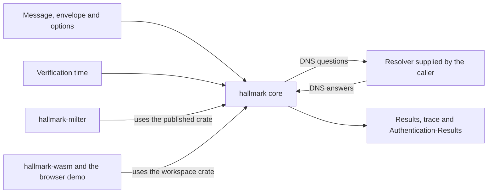
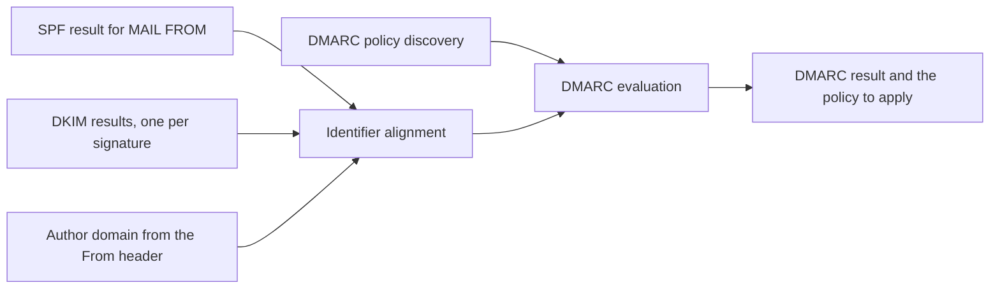
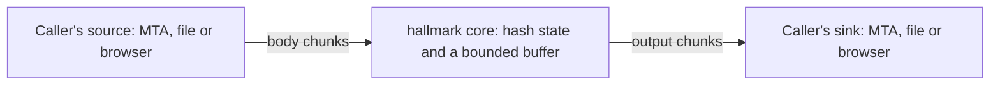

# Requirements

The requirements for hallmark, with an ID for each one. Test scenarios in [docs/testing](../testing/README.md) link to these IDs, and the [architecture decision records](../adr/README.md) record the choices behind them. [Architecture](../explanation/architecture.md) explains how the parts fit together.

hallmark is a Rust library for email sender authentication. It verifies SPF, DKIM, DKIM2 and DMARC, signs messages with DKIM and DKIM2, and runs both natively and in WebAssembly. Its main feature is a detailed trace that explains every step of every check, so an operator can see why a message passed or failed instead of getting a one-word result.

Two programs use the library:

- hallmark-milter, a separate repository, signs and verifies mail inside a Sendmail or Postfix MTA.
- The browser demo, in this repository, works as a showcase and as a test bench.

## Context

The caller supplies everything that comes from outside: the message, the DNS answers, the time, and the random values that RFC 7489 `pct` sampling and ML-DSA-44 signing need. With the same inputs, the core always produces the same results and the same trace.

## Scope

In scope:

- SPF verification, RFC 7208
- DKIM verification and signing, RFC 6376 with RFC 8301, RFC 8463 and RFC 8616
- DKIM2 verification and signing, from `draft-ietf-dkim-dkim2-spec-09` and its key record draft `draft-ietf-dkim-dkim2-dns-03`, as an experimental feature
- DMARC evaluation under RFC 9989 (DMARCbis, May 2026) and under RFC 7489, which RFC 9989 obsoletes
- Generating and parsing Authentication-Results header fields, RFC 8601, with the `dkim2` method of `draft-gondwana-dkim2-authres-02`
- The trace and reasoning for every check
- WebAssembly bindings and a browser demo published on GitHub Pages

Out of scope:

- ARC, which DKIM2 aims to replace
- Sender ID, ADSP and BIMI
- Sending DMARC aggregate or failure reports. The library parses `rua` and `ruf` but sends nothing.
- Network code in the core: no DNS resolver implementation and no SMTP handling
- MIME parsing. For now, this leaves out checking DKIM2 delivery status notifications (draft-09 §16.4) ([ADR 0012](../adr/0012-hallmark-reads-no-mime-structure.md)).
- Received-SPF header fields (RFC 7208 §9.1), for now. SPF results go in Authentication-Results (RFC 7208 §9.2, AR-001).

## Functional requirements

### General

| ID | Requirement |
|---|---|
| GEN-001 | A caller can run each check (SPF, DKIM, DKIM2, DMARC) on its own, or run all of them in one call that feeds the SPF and DKIM results into DMARC. |
| GEN-002 | Checks take the message as bytes in RFC 5322 form, plus envelope data: the client IP address, the HELO name, the MAIL FROM address and the RCPT TO addresses. DKIM2's chain-of-custody check uses MAIL FROM and RCPT TO (draft-09 §14.4). |
| GEN-003 | DKIM and DKIM2 accept a message as a stream (STR-001). A caller with the whole message can pass it in one piece. |
| GEN-004 | Every result is a typed value that carries a machine-readable reason: which mechanism matched, why a signature failed, which domain aligned. |
| GEN-005 | A temporary DNS failure produces the protocol's temporary-error result (`temperror`). It never turns into a pass or a fail. |

### SPF (RFC 7208)

| ID | Requirement |
|---|---|
| SPF-001 | The library implements `check_host()` for the MAIL FROM identity. When MAIL FROM is empty, it checks `postmaster@` the HELO name, as RFC 7208 §2.4 says. |
| SPF-002 | A caller can also check the HELO identity on its own (RFC 7208 §2.3). |
| SPF-003 | Results use all seven values: `none`, `neutral`, `pass`, `fail`, `softfail`, `temperror`, `permerror`. |
| SPF-004 | Every mechanism and modifier works, including `ptr`, which RFC 7208 §5.5 tells publishers not to use, plus `exp=` and `redirect=`. |
| SPF-005 | Macro expansion follows RFC 7208 §7. |
| SPF-006 | The library enforces the processing limits of RFC 7208 §4.6.4: at most 10 terms that cause DNS lookups, the void-lookup limit (default 2), and the MX and PTR address-lookup limits, each with the result the RFC gives for it. |
| SPF-007 | Record selection follows RFC 7208 §4.5. A TXT record is an SPF record only if it begins with exactly `v=spf1` followed by a space or the end of the record, so a record that begins `v=spf10` is discarded. No SPF record gives `none`, and more than one gives `permerror`. |

### DKIM verification

| ID | Requirement |
|---|---|
| DKV-001 | The library verifies DKIM-Signature header fields under RFC 6376, with the `simple` and `relaxed` canonicalizations for headers and body. |
| DKV-002 | It supports `rsa-sha256` and `ed25519-sha256` (RFC 8463). An `rsa-sha1` signature is never valid (RFC 8301). |
| DKV-003 | It verifies RSA keys from 1024 to 4096 bits. A key under 1024 bits makes the signature invalid (RFC 8301). The caller can choose whether to accept larger keys. |
| DKV-004 | It verifies each signature on a message and reports a result for each one. The number of signatures it checks has a limit with a default (RFC 6376 §6.1). |
| DKV-005 | It parses key records under RFC 6376 §3.6.1, including an empty `p=` (revoked key), `h=`, `s=`, and the `t=y` and `t=s` flags. |
| DKV-006 | A signature with `l=` can verify, and both the result and the trace report how much of the body was left unsigned (RFC 6376 §8.2). |
| DKV-007 | Internationalized addresses and domains follow RFC 8616. |
| DKV-008 | An `l=` larger than the canonicalized body gets no special rule ([ADR 0010](../adr/0010-a-dkim-l-tag-larger-than-the-body-gets-no-special-rule.md)). Verification follows RFC 6376 §3.7 as written: truncating the body to `l=` octets leaves it whole, and the body hash comparison decides the result. The trace records, as a fact, that `l=` exceeds the body, which RFC 6376 §3.5 forbids signers to do. |

### DKIM signing

| ID | Requirement |
|---|---|
| DKS-001 | The library signs with `rsa-sha256` and `ed25519-sha256`. It refuses RSA keys under 1024 bits. |
| DKS-002 | A caller can add more than one signature to a message, for example RSA and Ed25519 together, as RFC 8463 suggests. |
| DKS-003 | The caller chooses the canonicalizations and the header fields to sign. The library has a default header list, always signs From (RFC 6376 §5.4), and can oversign: sign one more instance of a field than the message has, so that a later added instance breaks the signature. |
| DKS-004 | The library sets `t=` from the verification time parameter. `x=` is optional. It never sets `l=`. |
| DKS-005 | Signing returns only the header fields to add, and the caller puts them in the message. The library never returns the whole signed message, because it can compute a signature only after the body has streamed past (STR-001). |

### DKIM2

| ID | Requirement |
|---|---|
| DK2-001 | DKIM2 support sits behind the Cargo feature `unstable-dkim2` until the specification becomes an RFC ([ADR 0006](../adr/0006-dkim2-targets-draft-09-behind-an-unstable-feature.md)). |
| DK2-002 | The library targets three drafts together, the latest revisions on 13 November 2026 ([ADR 0006](../adr/0006-dkim2-targets-draft-09-behind-an-unstable-feature.md)): `draft-ietf-dkim-dkim2-spec-09` (1 November 2026) for DKIM2 itself, `draft-ietf-dkim-dkim2-dns-03` (2 November 2026) for key records and the Domain Policy Record, and `draft-gondwana-dkim2-authres-02` (2 November 2026) for Authentication-Results. Moving any of them to a new revision is a deliberate change with its own tests. |
| DK2-003 | The library verifies and signs DKIM2. |
| DK2-004 | The trace covers every DKIM2 signature on the message and every change to the message that the draft records. |
| DK2-005 | The DKIM2 public API may change between minor versions while the feature is experimental. |
| DK2-006 | Verification rebuilds every earlier version of the body that the recipes describe, for all signatures in the chain, in the same single pass over the body. Draft-09 §5.1 and §5.2 require the `c` (copy) steps of a recipe to be in ascending order and not to overlap, so each earlier version can take its lines as they stream past, and the core keeps only a position in each recipe. It needs no storage and no random access. |
| DK2-007 | A recipe that matches the JSON schema but breaks the ordering rules (draft-09 §5.1 and §5.2 warn this can happen) is hostile input. Verification of the signatures that depend on it fails with a reason, and the trace names the step that broke the rule. A null body recipe, which declares that the earlier body can't be rebuilt, also appears in the result and the trace. |
| DK2-008 | Body recipe line numbers count the raw body, before §6.1 drops empty lines at the end. Recipes that hallmark writes never copy those empty lines with `c` steps, and the trace records the assumption whenever a recipe copies one ([ADR 0008](../adr/0008-dkim2-recipe-line-numbers-count-the-raw-body.md)). |
| DK2-009 | Verification implements the five algorithms that draft-09 §3 requires of every verifier: the `sha256` and `sha512` hashes, and the `rsa-sha256`, `ed25519-sha256` and `mldsa44` signatures. ML-DSA-44 is the pure variant, with the context string `DKIM2` (§3.4). Signing offers the same algorithms, and a caller can sign with several at once. ML-DSA-44 signing uses the hedged variant that §3.4 recommends, with a random value from the caller (IO-001). |
| DK2-010 | Several signatures in one `s=` tag combine by the `sig-all` and `sig-any` rules of draft-09 §14.6, and several hash sets in one `h=` tag combine by the `hash-all` and `hash-any` rules of §14.7. An algorithm that hallmark doesn't implement or treats as insecure, and a key it treats as too short, give a PERMERROR intermediate result. |
| DK2-011 | DKIM2 key records follow dns-03 §4: the `rsa`, `ed25519` and `mldsa44` key types, an empty `p=` for a revoked key, and exact sizes of 32 octets for an Ed25519 key and 1,312 octets for an ML-DSA-44 key. DKIM2 ignores the deprecated `h=`, `n=`, `s=` and `t=` tags (draft-09 §14.5). DKIM keys keep following RFC 6376 (DKV-005). |
| DK2-012 | Verification checks that each From header field present since the first signature is Authentic (draft-09 §11 and §14.8). It uses the relaxed domain match of §7 in both directions. When the match succeeds only because the signing domain is a subdomain of the From domain, it fetches the From domain's Domain Policy Record (dns-03 §5), and a `strict` flag there cancels the match. A From header field with more than one address, or with a domain literal, is never Authentic. |
| DK2-013 | Results use the five output states of draft-09 §14.1: NONE, PASS, FAIL, PERMERROR and TEMPERROR. A result other than PASS carries the human-readable string that draft-09 §14 gives for its case, with the placeholders filled in, and the trace records the same string. |

### DMARC

| ID | Requirement |
|---|---|
| DMC-001 | The library evaluates DMARC under RFC 9989 (DMARCbis) and under RFC 7489. The caller picks one per call, and RFC 9989 is the default ([ADR 0007](../adr/0007-dmarc-supports-rfc-7489-and-dmarcbis-with-dmarcbis-the-default.md)). |
| DMC-002 | The author domain is the domain in the RFC5322.From header field, converted from a U-label to an A-label (RFC 5890 §2.3), as RFC 9989 §5.3.1 and RFC 7489 §6.6.1 require. DMARC applies only when exactly one domain is found. When none is found, as with a missing From field or a group with no addresses (RFC 6854), or when more than one is found, the result says that DMARC was not applied and why. A caller can choose to evaluate a message with several domains anyway, taking each one as an author domain up to a limit (SAF-002), and then the most strict policy among the checks that fail applies (RFC 9989 §11.5, RFC 7489 §6.6.1). The trace records which case applied. |
| DMC-003 | In RFC 7489 mode, the library finds the organizational domain with the Public Suffix List. In DMARCbis mode, it uses the DNS tree walk and the query limit DMARCbis sets. |
| DMC-004 | The record parser accepts the tags of both specifications: DMARCbis adds `np`, `psd` and `t` and drops `pct`, `rf` and `ri`. Unknown tags are ignored. |
| DMC-005 | Identifier alignment checks the SPF-authenticated MAIL FROM domain and each DKIM `d=` domain against the author domain, in relaxed or strict mode from `aspf` and `adkim`. |
| DMC-006 | The result is `pass`, `fail`, `none`, `temperror` or `permerror`, together with the policy to apply (`p`, `sp` or `np`) and the alignment details. Whether to reject or quarantine stays the caller's decision. |
| DMC-007 | `pct` sampling in RFC 7489 mode takes its random value from the caller, so the core stays deterministic. |

### Authentication-Results (RFC 8601)

| ID | Requirement |
|---|---|
| AR-001 | The library generates an Authentication-Results header field from its results, with the authserv-id supplied by the caller. |
| AR-002 | Each method result carries a short summary of the trace in its `reason` (the reasonspec of RFC 8601 §2.2) and in comments. |
| AR-003 | The library parses Authentication-Results header fields, so that a caller can read results from an upstream host it trusts. |
| AR-004 | DKIM2 results use the `dkim2` method of `draft-gondwana-dkim2-authres-02` §3: one result for the whole message, the result values of §3.1, and the `header.d` and `header.i` properties of §3.2, each left out in the cases §3.2 lists. A message with no DKIM2 header fields is reported as `dkim2=none`, not left out (§3.1). |

### Trace and reasoning

The trace is the main feature. It records every step a check takes, with the rule that required the step ([ADR 0002](../adr/0002-the-code-that-decides-writes-the-trace.md)).

| ID | Requirement |
|---|---|
| TRC-001 | The code that makes a decision also records it in the trace, while the check runs. The library never rebuilds a trace after the fact, so the trace can't disagree with the result. |
| TRC-002 | The trace is structured data: a tree of steps. Each step records what it checked, its inputs (including each DNS question and answer), its outcome, and the RFC or draft section that requires it. |
| TRC-003 | Facts and hints stay apart. A fact states what the check found ("the body hash didn't match `bh=`"). A hint is a labeled guess about the cause ("a mailing list footer may have changed the body"). The first release has a small set of hints, and new hints arrive with test cases that justify them. |
| TRC-004 | The caller picks a trace level per call: off, summary or full. At the off level, the library allocates nothing for the trace. |
| TRC-005 | The trace has size limits. Hostile DNS answers or messages can't make it grow without bound, and when it reaches a limit, the trace records that it was cut short. |
| TRC-006 | The trace never contains private key material. It can contain addresses and header contents, and the reference docs say so, so that callers can decide where to store it. |
| TRC-007 | The trace serializes to a documented format with its own schema version. The demo, hallmark-milter and outside tools all read that format. |
| TRC-008 | The trace records every DNS question and answer, so a caller can save them as a snapshot and replay the check offline. |
| TRC-009 | Tests can assert on the path a check took through the trace, not only on its result. |
| TRC-010 | By default, the trace records the body as hashes, byte counts and line counts, plus the point where `l=` cut it. Body content goes into the trace only when the caller asks for it, and then it streams out through STR-002 as the body passes, without being kept, so trace memory stays within the limits of STR-001 and TRC-005. |

What the trace shows for each protocol:

| Protocol | Steps the trace records |
|---|---|
| SPF | The evaluation tree through `include` and `redirect`, each DNS question and answer, the running lookup and void-lookup counts, the mechanism that matched, or the limit that was hit and the term that hit it |
| DKIM | Tag parsing, the key lookup and key record, the header field instances chosen for signing (bottom-up), the canonicalized header, the body as described in TRC-010, the computed and stated body hashes, and the signature check |
| DKIM2 | The same steps as DKIM for each signature, plus the chain of custody, the timestamp checks, each recipe step, the relaxed domain matches and Domain Policy Record lookups of the From check, how signatures and hash sets combined, and the human-readable string that draft-09 §14 gives for the result |
| DMARC | The author domain, each step of policy discovery (Public Suffix List lookup or tree walk), alignment for each identifier with its mode, which of `p`, `sp` or `np` applied, and the final result |

### Verification time

| ID | Requirement |
|---|---|
| TIM-001 | The verification time is a parameter, and the core never reads a clock. It is the time the message was received. RFC 6376 §3.5 asks for the time the message was first received at the verifier's administrative domain, when that is reliably known, and draft-09 §14.3 measures DKIM2 timestamps against the time the message was accepted over SMTP. A caller that checks a stored message later passes the time it was received, not the current time. |
| TIM-002 | The caller can turn off checks that compare a signature time with the verification time: an expired DKIM `x=`, a DKIM `t=` in the future, and the DKIM2 checks of draft-09 §14.3, which fail a signature created more than 14 days before the message was accepted or more than one day after it. The checks are on by default. RFC 6376 §3.5 makes both DKIM checks optional for verifiers. |
| TIM-003 | Checks that don't use the verification time still run when time checks are off. For example, `x=` must still be later than `t=`. |
| TIM-004 | When a time check is off, the library still works out what it would have said and records that in the trace as a skipped step ("this signature expired on 2024-03-02; the expiration check was off"). |
| TIM-005 | An Authentication-Results header field generated with time checks off carries a comment that says so. |
| TIM-006 | The option exists on every target, native and WebAssembly, so native tests cover it. |

### DNS

| ID | Requirement |
|---|---|
| DNS-001 | The core asks for DNS records by handing questions to the caller and taking the answers back ([ADR 0001](../adr/0001-the-core-does-no-io-and-the-caller-drives-it.md)). It needs TXT, A, AAAA, MX and PTR records. |
| DNS-002 | The resolver's answer tells apart: records found, name does not exist, no records of that type, and temporary failure. SPF void lookups and temporary errors depend on that difference. |
| DNS-003 | The core never waits for an answer, so a caller can resolve with any async runtime, with blocking code, or in the browser. The library also offers a driver that runs a check to the end with a resolver the caller implements, and the driver depends on no async runtime. |
| DNS-004 | The library ships a resolver that answers from a saved snapshot (TRC-008). Tests, the demo's pasted-records mode and bug reports all use it. |
| DNS-005 | The DNS questions for DKIM and DKIM2 keys, for DKIM2 Domain Policy Records and for DMARC policy are available once the header fields are complete, so the caller can resolve them while the body streams. SPF needs only the envelope, so its questions are available before the message. |

### Header parsing

hallmark parses every header field it uses with its own parsers, written from the ABNF ([ADR 0011](../adr/0011-header-parsers-follow-the-abnf-and-never-repair-input.md)), and reads no MIME structure ([ADR 0012](../adr/0012-hallmark-reads-no-mime-structure.md)). Addresses, in header fields and in the envelope, have a design of their own, which this section doesn't cover.

| ID | Requirement |
|---|---|
| HDR-001 | The header section parser splits a message's header section into header fields, each with its name, its unfolded value and its exact raw bytes. The header section ends at the first empty line (RFC 5322 §2.1). The parser never changes the raw bytes, because `simple` header canonicalization hashes them as they arrived (RFC 6376 §3.4.1). |
| HDR-002 | Field names match without regard to case, as ABNF strings do (RFC 5234 §2.3) and as RFC 6376 §6.1.3 requires when it matches `h=` against the message. |
| HDR-003 | Unfolding removes each CRLF that is followed by WSP (RFC 5322 §2.2.3). The parser also accepts the obsolete forms: folded lines made only of white space (§4.2), and white space between a field name and its colon (§4.5). |
| HDR-004 | Field values may contain UTF-8 (RFC 6532 §3.2). Field names stay printable US-ASCII without the colon (RFC 5322 §2.2). A line that isn't a header field stays a separate malformed line with its raw bytes ([ADR 0011](../adr/0011-header-parsers-follow-the-abnf-and-never-repair-input.md)). |
| HDR-005 | The same parsers serve both input forms of STR-008: a raw header section, and fields that arrive one at a time from a milter. |
| HDR-006 | One parser reads the tag=value lists of DKIM-Signature, Message-Instance and DKIM2-Signature header fields, and of DKIM keys, DKIM2 keys and Domain Policy Records, because RFC 6376 §3.2 and draft-09 §8 define the same grammar. Tag names are case-sensitive, a duplicate tag makes the whole list invalid, checks ignore an unrecognized tag, and an empty value differs from an omitted tag. |
| HDR-007 | The decoders follow the rules of each tag: base64 with folding white space ignored (RFC 6376 §2.10 and §3.5, draft-09 §2.14), dkim-quoted-printable with uppercase hex digits only (RFC 6376 §2.11), which may also carry well-formed UTF-8 unencoded, as RFC 8616 §5 allows in internationalized messages (RFC 3629 §4), the colon-separated header field names of DKIM `h=` (§3.5), and the DKIM2 `s=` and `h=` groups, where "," binds more tightly than "\|" (draft-09 §9.3 and §10.9). |
| HDR-008 | DKIM2 `mf=` and `rt=` values decode from base64 to the RFC 5321 paths they record, angle brackets included (draft-09 §10.5 and §10.6). An `r=` value decodes from base64 to a JSON object (draft-09 §9.2, RFC 8259), parsed within the limits of SAF-002. |
| HDR-009 | The Authentication-Results parser follows RFC 8601 §2.2: the authserv-id, the optional version, `none`, and each result with its method, method version, reason and properties, with comments wherever the grammar allows CFWS. Values follow the token and quoted-string rules of RFC 2045 §5.1. AR-003 uses this parser. |
| HDR-010 | Input that doesn't match its grammar yields an error, never a repaired value. The error names the rule that failed and the byte offset, and the trace records it ([ADR 0011](../adr/0011-header-parsers-follow-the-abnf-and-never-repair-input.md)). |
| HDR-011 | Parsers read input left to right without recursion. Nested comments (RFC 5322 §3.2.2) count against a depth limit (SAF-002). |

## Non-functional requirements

### I/O only through the caller

The core does no I/O of its own. Where data is too large to hold in memory, it streams input and output through interfaces the caller supplies ([ADR 0001](../adr/0001-the-core-does-no-io-and-the-caller-drives-it.md)).

| ID | Requirement |
|---|---|
| IO-001 | The core opens no sockets and files, reads no clock or environment variables, and draws no random numbers. DNS, time and randomness all come from the caller. |
| IO-002 | Large input and output pass through streaming interfaces that the caller supplies as parameters (STR-001 to STR-011). The DNS resolver (DNS-001) is the other caller-supplied interface. |

### Streaming

| ID | Requirement |
|---|---|
| STR-001 | Signing and verification accept the message body as a stream of chunks of any size. Memory use doesn't grow with the body: the core keeps hash state and a bounded buffer, not the body. |
| STR-002 | Output that can grow large streams to the caller in chunks of bounded size. This covers the serialized trace (TRC-007) and two kinds of DKIM2 header field: Message-Instance fields, which record changes to the message, and DKIM2-Signature fields, where one ML-DSA-44 signature takes 3,228 base64 characters (draft-09 §3.4). |
| STR-003 | The caller drives the stream: it pushes input chunks and pulls output chunks. The same interface works with any async runtime, with blocking code, and in the browser, and the library never waits on I/O itself. |
| STR-004 | The library provides adapters that take a standard blocking reader or writer as a parameter, for callers that don't need async. |
| STR-005 | Streamed output is byte-for-byte the same as buffered output, whatever the chunk sizes, and tests check this with chunks from 1 byte up to the whole message. |
| STR-006 | An error from the caller's source or sink stops the operation with an error that names the stream. The library never treats a stream error as a protocol result such as `fail`. |
| STR-007 | The core keeps no reference to an input chunk after the call that received it returns. A caller that accounts for memory per command, such as a milter engine, can then release a chunk's memory as soon as the call ends. |
| STR-008 | Header fields can arrive one at a time as a name and a value, in the order of the message, as a milter receives them. The caller states the form of the value: LF or CRLF between folded lines, and whether the receiving side removed one leading space. The core rebuilds the bytes that canonicalization needs, and the trace records any assumption it made, for example "one leading space was assumed after the colon". |
| STR-009 | A generated header field comes out as a whole value in the form the caller asks for: LF or CRLF between folded lines, with or without a leading space. |
| STR-010 | The single pass covers DKIM2 chains too (DK2-006). No check needs to read the body twice. |
| STR-011 | The caller states the line endings of the body: CRLF, as a milter receives it, or LF, as in many `.eml` files and in a browser text area. The core converts bare LF to CRLF as the body streams, including a line ending split across two chunks (draft-09 §17, RFC 6376 §5.3). |

### WebAssembly

| ID | Requirement |
|---|---|
| WSM-001 | The core builds for `wasm32-unknown-unknown`, and CI checks the build on every change. |
| WSM-002 | The core depends on no browser crates such as `wasm-bindgen`. Browser code lives in `hallmark-wasm`. |
| WSM-003 | Cryptography uses pure Rust crates that build for WebAssembly, ML-DSA-44 included (DK2-009). |

### Hostile input

| ID | Requirement |
|---|---|
| SAF-001 | No input makes the library panic: not a message, a DNS answer, or a record ([ADR 0004](../adr/0004-no-input-makes-hallmark-panic.md)). |
| SAF-002 | Limits with defaults cover the header field count and size, the nesting depth of comments, the entries in one `rt=` tag, the signatures checked per message, the author domains evaluated per message (DMC-002), the DNS questions per check, the key size, recursion depth, and for DKIM2 the number of Message-Instances, the recipe steps, and the size and nesting depth of recipe JSON. Draft-09 §20 sets no limits on recipes, and §14.2 lets a verifier refuse recipes that are too complex. Hitting a limit gives the protocol's error result and a trace step. |
| SAF-003 | Every parser has a fuzz target: the header section, the tag=value list and its value decoders for DKIM and DKIM2 fields and key records, DKIM2 recipe JSON, the SPF record, the DMARC record, Authentication-Results, and canonicalization. |
| SAF-004 | Memory use stays bounded by the input size and the configured limits. |

### Private keys

| ID | Requirement |
|---|---|
| SEC-001 | Private key types neither print nor format their contents, and memory holding a key is zeroed when the key is dropped. |
| SEC-002 | Private keys never appear in traces, errors or logs. |
| SEC-003 | Signing must not leak the private key through timing. If a chosen crate has a known timing advisory, an ADR records the decision and its limits. |

### Stability and licensing

| ID | Requirement |
|---|---|
| STB-001 | The crate follows semantic versioning. The trace schema version (TRC-007) changes separately from the crate version. |
| STB-002 | hallmark is MIT-licensed. Dependencies must have compatible licenses, and CI checks them. |
| STB-003 | The core has a stated minimum supported Rust version, and CI tests it. |

## Repository and deliverables

The hallmark repository is a Cargo workspace ([ADR 0005](../adr/0005-the-demo-lives-in-the-library-workspace.md)):

| Path | Contents | Published |
|---|---|---|
| `crates/hallmark` | The core library | crates.io |
| `crates/hallmark-wasm` | `wasm-bindgen` bindings and a DNS-over-HTTPS resolver for the browser | not at first |
| `demo/` | The static demo site | GitHub Pages |

| ID | Requirement |
|---|---|
| REP-001 | The core crate's package leaves out `demo/`. |
| REP-002 | A GitHub Actions workflow builds the demo and publishes it to GitHub Pages, without a `gh-pages` branch. |
| REP-003 | The demo stays small: plain TypeScript or JavaScript with few npm dependencies. If it grows into a large front-end app with its own contributors, it moves to its own repository. |

## Browser demo

| ID | Requirement |
|---|---|
| DEM-001 | A user pastes a message, enters the client IP address, HELO name, MAIL FROM and RCPT TO, and gets the SPF, DKIM, DKIM2 and DMARC results with the trace drawn as a tree. |
| DEM-002 | The user picks the DNS source: DNS over HTTPS, or records pasted into the page (DNS-004). |
| DEM-003 | The page names the DNS-over-HTTPS provider before any query goes out. Only those queries leave the browser, and the message itself never does. |
| DEM-004 | A user can save a case (message, DNS snapshot, time and options) and share it. Anyone can replay a shared case offline. |
| DEM-005 | The user can turn off time checks (TIM-002), so that old messages can still be explained. |
| DEM-006 | The user can sign a message with a key generated in the page or pasted into it. The key never leaves the browser, and the page tells users not to paste production keys. |
| DEM-007 | CI runs browser tests against the demo on every change, so a library change that breaks the demo fails the same pull request. |

## Quality and process

| ID | Requirement |
|---|---|
| TST-001 | Every requirement and every test comes from the RFC or draft text and cites the section it checks. |
| TST-002 | The project builds only from the specifications. It does not read, copy or compare its behavior against other sender-authentication implementations, and its documents do not cite them ([ADR 0009](../adr/0009-requirements-and-tests-come-only-from-the-specifications.md)). |
| TST-003 | Published conformance test data, such as the openspf SPF test suite, may be used after a license check. The docs record each source and its license. |
| TST-004 | Test vectors from the RFCs themselves (RFC 6376, RFC 8463) are part of the test suite. |
| TST-005 | Tests use domain names under `.invalid` and answer DNS from snapshots. Tests make no network calls. |
| TST-006 | Fuzz targets (SAF-003) run in CI for a bounded time on every change, and for longer on a schedule. |
| TST-007 | Code in this repository uses only short, well-established regular expressions, such as one that matches a run of digits, because people find long or complex ones hard to read. hallmark parses structured input, such as header fields, addresses, tag lists and DNS records, by hand from the ABNF ([ADR 0011](../adr/0011-header-parsers-follow-the-abnf-and-never-repair-input.md)). |

Process:

- Documentation follows Diátaxis, with one type per document.
- Architecture decisions are ADRs in [docs/adr](../adr/README.md).
- Test scenarios are Given/When/Then tables in [docs/testing](../testing/README.md), written before their tests, with IDs that link to the requirement IDs here.
- Code follows Canon TDD, the procedural Rust style ([ADR 0003](../adr/0003-rust-code-is-written-in-a-procedural-style.md)), and the panic rule ([ADR 0004](../adr/0004-no-input-makes-hallmark-panic.md)).
- Diagrams are Mermaid.

## Relationship to hallmark-milter

hallmark-milter depends on the published hallmark crate, never on its internals. It supplies a native resolver, the time each message was received (TIM-001) and random values, and it signs with DKIM and DKIM2. It verifies SPF, DKIM, DKIM2 and DMARC. It does not offer the switch that turns off time checks (TIM-002), because skipping expiration on live mail weakens protection against replayed signatures. Full traces are off by default because they hold message data (TRC-006), and an operator can turn them on. The summary in Authentication-Results (AR-002) is always on. It feeds hallmark from rust-milter's callbacks, which match STR-001, STR-003 and STR-007: one body chunk of at most 65,535 bytes per `SMFIC_BODY` call, with CRLF line endings, and memory counted until each command ends. Two limits on the milter side shape its design:

- Header fields arrive with LF between folded lines and with one leading space removed, unless the milter negotiates `SMFIP_HDR_LEADSPC`. Without that flag, the milter can't tell `From: x` from `From:x`, so a `simple` header canonicalization can't always be rebuilt (STR-008). rust-milter doesn't let a handler request that flag yet ([rust-milter#61](https://github.com/photom/rust-milter/issues/61)).
- An added header field goes out whole in one reply packet. Neither Sendmail nor Postfix limits the size of a milter's reply, and Postfix stores an added header field without cutting it. The limits apply where the mail is received: a Postfix with milters cuts each incoming header field to 60,000 bytes, and Sendmail limits all incoming header fields of a message together to `MaxHeadersLength`, 32,768 bytes by default. So a very large DKIM2 header field leaves this host whole, and the next hop cuts it (Postfix) or rejects the message (Sendmail). A cut field fails verification. Those limits belong to the receiving MTA's configuration. hallmark-milter can only check the length of each field before it adds it and decide what to do with one the next hop is likely to cut or reject.

## Open items

| Item | To decide |
|---|---|
| Public Suffix List | Whether the caller supplies the list in RFC 7489 mode or the crate bundles a copy |
| openspf suite | Its license (TST-003) |
| MSRV | Which Rust version (STB-003) |
| Trace format | The serialization format and its first schema (TRC-007) |
| Last recipe line without CRLF | Under DK2-008, a last body line with no CRLF counts as a line. Whether a `c` step that copies it adds a CRLF ([hallmark#1](https://github.com/photom/hallmark/issues/1)) |
| Bare LF in CRLF mode | Whether a verifier whose caller declared CRLF line endings leaves a bare LF in the body as it is or converts it (STR-011, scenario CAN-063) |
| First hints | The starting set of hints (TRC-003) |
| Demo "as of signing time" | Whether the demo should offer to verify as of the signature's `t=`. The library needs no change for it, because the time is already a parameter. |
