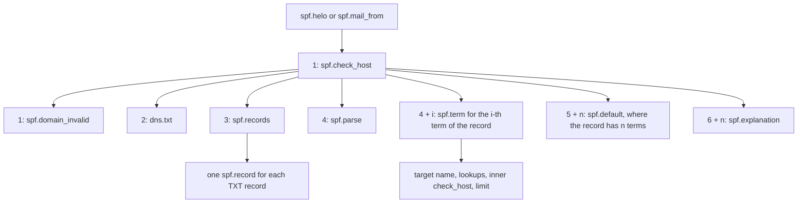

# Trace codes

The codes that trace events carry, and the slots under the root of the tree (TRC-011, [ADR 0034](../adr/0034-trace-step-codes-are-strings-listed-in-a-reference-page.md)). [Trace format](trace-format.md) describes the events themselves.

## Contents

- [How to read an entry](#how-to-read-an-entry)
- [Rules](#rules)
- [Slots under the root](#slots-under-the-root)
- [Codes](#codes)
  - [`trace`](#trace)
- [SPF](#spf)
  - [The SPF tree](#the-spf-tree)
  - [`spf.helo` and `spf.mail_from`](#spfhelo-and-spfmail_from)
  - [`spf.check_host`](#spfcheck_host)
  - [`spf.domain_invalid`](#spfdomain_invalid)
  - [`spf.records`](#spfrecords)
  - [`spf.record`](#spfrecord)
  - [`spf.parse`](#spfparse)
  - [`spf.term`](#spfterm)
  - [`spf.target`](#spftarget)
  - [`spf.limit.lookups`](#spflimitlookups)
  - [`spf.limit.void_lookups`](#spflimitvoid_lookups)
  - [`spf.limit.mx`](#spflimitmx)
  - [`spf.limit.check`](#spflimitcheck)
  - [`spf.default`](#spfdefault)
  - [`spf.explanation`](#spfexplanation)
- [DNS](#dns)
  - [`dns.txt`](#dnstxt)
  - [`dns.a` and `dns.aaaa`](#dnsa-and-dnsaaaa)
  - [`dns.mx`](#dnsmx)
  - [`dns.ptr`](#dnsptr)
- [Hints](#hints)
  - [`dkim.hint.body_changed`](#dkimhintbody_changed)
  - [`dkim.hint.list_header_change`](#dkimhintlist_header_change)
  - [`dkim.hint.simple_header_change`](#dkimhintsimple_header_change)
  - [`dkim2.hint.quoted_local_part`](#dkim2hintquoted_local_part)
  - [`dmarc.hint.forwarded`](#dmarchintforwarded)

## How to read an entry

Each code has an entry with these fields:

| Field | Meaning |
|---|---|
| Kind | `fact`, `caution` or `hint` (TRC-003) |
| Position | The step's place in the tree |
| Parameters | Each parameter's name and type ([Trace format](trace-format.md#values)), in the order they appear in `params`, and for a data value who controls it |
| Outcomes | The outcomes the step can have, or none |
| Cites | The sections the step cites, or none |
| English | The text that the library's English renderer makes, with parameter names in braces |
| Requirement | The requirement that calls for the step, when one names it |

## Rules

- A code is lowercase ASCII, with parts joined by `.` and words within a part joined by `_`. The first part names the area: `trace`, `spf`, `dkim`, `dkim2`, `dmarc`, `dns`, `header` or `body`.
- An outcome is lowercase. Results keep the names that their specification gives them, such as `permerror` (RFC 7208 §2.6) or `permfail` (RFC 6376 §3.9).
- The human-readable strings of draft-09 §14 go in a parameter named `draft_text`, in the words the draft gives them (DK2-013, TRC-011).
- A code is never reused or renamed. Adding a code, an outcome or a parameter is a minor version change, and removing or changing one is a major one ([Trace format](trace-format.md#versions)).
- A code enters this page with the scenarios that need it, before the code that records it is written.
- A test checks this page against the list of codes in the crate.

## Slots under the root

Each kind of check has a fixed slot under the root, which it keeps whether or not the other checks run in the same call. So a position names the same step in every call (GEN-001, DMC-005).

| Position | Code | Step |
|---|---|---|
| `[]` | `trace` | The root of every trace |
| `[1]` | `spf.helo` | The SPF check of the HELO identity (SPF-002, RFC 7208 §2.3) |
| `[2]` | `spf.mail_from` | The SPF check of the MAIL FROM identity (SPF-001, RFC 7208 §2.4) |
| `[3]` | `dkim.verify` | DKIM verification, with each signature as a child in the order of the header section |
| `[4]` | `dkim2.verify` | DKIM2 verification |
| `[5]` | `dmarc` | DMARC evaluation |
| `[6]` | `dkim.sign` | DKIM signing, with each signature it makes as a child |
| `[7]` | `dkim2.sign` | DKIM2 signing |

The entries for these checks and for the steps below them come with each check's scenarios. [SPF](#spf) has the first two.

## Codes

### `trace`

| Field | Value |
|---|---|
| Kind | `fact` |
| Position | `[]` |
| Parameters | `level`: keyword, `summary` or `full`; `events`: count; `cut_short`: boolean |
| Outcomes | none |
| Cites | none |
| English | "Trace at the {level} level, with {events} events." When `cut_short` is true, the renderer adds "A size limit cut the trace short." |

## SPF

The steps of an SPF check (RFC 7208), as [SPF](design/spf.md) describes them. Scenarios STEP-010, STEP-013, STEP-021, STEP-022 and STEP-080 to STEP-093 in [trace.md](../testing/trace.md), and the SPF record scenarios, check them.

### The SPF tree

Each identity has its slot under the root, and its first child is the outermost `check_host()`. An `include` or a `redirect` puts an inner `check_host()` under its term. Within a `check_host()` step, each child has a fixed number, so the number of a step depends only on the record (TRC-012). A step that didn't happen leaves its number unused.

| Parent | Child number | Step |
|---|---|---|
| `spf.helo`, `spf.mail_from` | 1 | `spf.check_host`, the outermost |
| `spf.check_host` | 1 | `spf.domain_invalid`, when the domain fails initial processing |
| `spf.check_host` | 2 | `dns.txt`, the record lookup |
| `spf.check_host` | 3 | `spf.records`, the record selection |
| `spf.check_host` | 4 | `spf.parse` |
| `spf.check_host` | 4 + i | `spf.term` for the i-th term of the record, mechanism or modifier, counted from 1. A term that didn't run, such as one after the term that matched, has no step |
| `spf.check_host` | 5 + n | `spf.default`, where the record has n terms |
| `spf.check_host` | 6 + n | `spf.explanation`, under the `check_host()` whose `exp=` applies (RFC 7208 §6.2) |
| `spf.term`, `spf.explanation` | 1, 2, … | In the order that RFC 7208 evaluates the term: a limit that stops it before any question, `spf.target`, the lookups in the order the term asks them, with the exchanges of an MX answer and the names of a PTR answer in answer order, an inner `spf.check_host`, and a limit that an answer reached |
| `spf.target` | 1, 2, … | The lookups that `%{p}` makes, in the order it asks them |

An answer that several steps read sits under each of them (TRC-008).

### `spf.helo` and `spf.mail_from`

| Field | Value |
|---|---|
| Kind | `fact` |
| Position | `[1]` for `spf.helo`, `[2]` for `spf.mail_from` |
| Parameters | `ip`: address, the client; `sender`: data, from the sender, the `<sender>` of `check_host()`; `domain`: data, from the sender, its `<domain>` |
| Outcomes | `none`, `neutral`, `pass`, `fail`, `softfail`, `temperror`, `permerror` |
| Cites | `RFC 7208 §2.3` for `spf.helo`, `RFC 7208 §2.4` for `spf.mail_from` |
| English | "SPF for the HELO identity {sender}, from {ip}: {outcome}." and "SPF for the MAIL FROM identity {sender}, from {ip}: {outcome}." |
| Requirement | SPF-001, SPF-002, ADS-023 |

### `spf.check_host`

| Field | Value |
|---|---|
| Kind | `fact` |
| Position | Child 1 of `spf.helo` or `spf.mail_from`, or a child of the `include` or `redirect` term that started it |
| Parameters | `domain`: data, the `<domain>`, from the sender at the top and from the parties of its target name below an `include` or a `redirect` |
| Outcomes | `none`, `neutral`, `pass`, `fail`, `softfail`, `temperror`, `permerror` |
| Cites | `RFC 7208 §4` |
| English | "check_host() for {domain}: {outcome}." |
| Requirement | SPF-001 |

### `spf.domain_invalid`

| Field | Value |
|---|---|
| Kind | `fact` |
| Position | Child 1 of `spf.check_host` |
| Parameters | `rule`: keyword, `single_label` for a HELO name that isn't a multi-label domain name, `no_lookup_form`, `empty_label`, `label_length` or `name_length` |
| Outcomes | `none` |
| Cites | `RFC 7208 §4.3`, and `RFC 7208 §2.3` for `single_label` |
| English | "The domain isn't a valid domain name ({rule}), so the result is none." |
| Requirement | ADS-004, ADS-023 |

### `spf.records`

| Field | Value |
|---|---|
| Kind | `fact` |
| Position | Child 3 of `spf.check_host`, present when the TXT lookup found records. Each `spf.record` is a child, in the order of the answer |
| Parameters | `selected`: count, the records left after selection |
| Outcomes | `one`, `none`, `several` |
| Cites | `RFC 7208 §4.5` |
| English | "{selected} of the TXT records are SPF records." |
| Requirement | SPF-007, REC-001 |

### `spf.record`

| Field | Value |
|---|---|
| Kind | `fact` |
| Position | A child of `spf.records`, one for each TXT record, in the order of the answer |
| Parameters | `record`: data, from DNS, the record with its strings joined (DNS-006); `version`: data, from DNS, the record up to its first space, as published |
| Outcomes | `selected`, `dropped` |
| Cites | `RFC 7208 §4.5` |
| English | "The record {record} is selected." or "The record {record} is dropped: it begins with {version}, not v=spf1." |
| Requirement | SPF-007, REC-001, [ADR 0021](../adr/0021-spf-reads-v-spf1-without-regard-to-case-and-allows-c-r-and-t-only-in-explanations.md) |

### `spf.parse`

| Field | Value |
|---|---|
| Kind | `fact` |
| Position | Child 4 of `spf.check_host` |
| Parameters | When the outcome is `permerror`: `rule`: keyword, the ABNF rule of RFC 7208 that failed, or `redirect` or `exp` for a modifier that appears twice; `offset`: count, the byte offset in the record |
| Outcomes | `parsed`, `permerror` |
| Cites | `RFC 7208 §4.6`, and `RFC 7208 §6` for a modifier that appears twice |
| English | "The record parses." or "The record doesn't parse: {rule} at byte {offset}." |
| Requirement | REC-010 to REC-013, PAR-001 |

### `spf.term`

| Field | Value |
|---|---|
| Kind | `fact` |
| Position | Child 4 + i of `spf.check_host`, for the i-th term of the record |
| Parameters | `text`: data, from DNS, the term as written; `name`: keyword, the mechanism or modifier in lowercase, or `unknown` for a modifier that hallmark ignores; `qualifier`: keyword, for a mechanism only, the result it gives: `pass`, `fail`, `softfail` or `neutral`; `lookups`: count, the terms that caused DNS lookups so far, this one included; `void_lookups`: count, the void lookups so far |
| Outcomes | `match` and `no_match` for a mechanism, `applied` and `ignored` for a modifier, and `temperror` and `permerror` for a term that stopped the evaluation |
| Cites | The section of its mechanism or modifier: `RFC 7208 §5.1` to `RFC 7208 §5.7`, `RFC 7208 §6.1` for `redirect`, `RFC 7208 §6` for an unknown modifier. An ignored `redirect` also cites `RFC 7208 §5.1` |
| English | "The term {text}: {outcome}. Lookups so far: {lookups}, void lookups: {void_lookups}." An ignored `redirect` adds "The record holds all, so redirect has no effect." |
| Requirement | SPF-004, REC-011, TRC-002 |

`exp=` gets no term step. Its effect is the `spf.explanation` step.

### `spf.target`

| Field | Value |
|---|---|
| Kind | `fact` |
| Position | Child 1 of a term or of `spf.explanation` that names a target |
| Parameters | `spec`: data, from DNS, the `domain-spec` as written, or the default domain of the term; `name`: data, the target name after macro expansion and the cut to 253 characters, from DNS, and from the sender too when a macro expanded a value from the envelope; `rule`: keyword, when the outcome is `invalid`: `empty_label` or `label_length` |
| Outcomes | `valid`, `invalid` |
| Cites | `RFC 7208 §7.3`, and `RFC 7208 §4.3` when the name is invalid |
| English | "The target {spec} expands to {name}." When the name is invalid, the renderer adds "The name is invalid ({rule}), so no question goes out for it." |
| Requirement | SPF-005, REC-014, REC-015, TRC-013, [ADR 0022](../adr/0022-an-spf-target-name-that-macro-expansion-makes-invalid-matches-nothing.md) |

### `spf.limit.lookups`

| Field | Value |
|---|---|
| Kind | `fact` |
| Position | The first child of the term that went over the limit |
| Parameters | `term`: position, the term; `count`: count, the terms that cause DNS lookups, this one included |
| Outcomes | `permerror` |
| Cites | `RFC 7208 §4.6.4` |
| English | "This is term {count} that causes a DNS lookup, over the limit of 10." |
| Requirement | SPF-006 |

### `spf.limit.void_lookups`

| Field | Value |
|---|---|
| Kind | `fact` |
| Position | The last child of the term whose answer went over the limit |
| Parameters | `term`: position, the term; `count`: count, the void lookups; `limit`: count, the value of `spf_void_lookups` |
| Outcomes | `permerror` |
| Cites | `RFC 7208 §4.6.4` |
| English | "This is void lookup {count}, over the limit of {limit}." |
| Requirement | SPF-006 |

### `spf.limit.mx`

| Field | Value |
|---|---|
| Kind | `fact` |
| Position | The child after the `dns.mx` step of an `mx` term |
| Parameters | `term`: position, the term; `count`: count, the MX records in the answer |
| Outcomes | `permerror` |
| Cites | `RFC 7208 §4.6.4` |
| English | "The MX answer has {count} records, over the limit of 10." |
| Requirement | SPF-006, REC-017 |

### `spf.limit.check`

| Field | Value |
|---|---|
| Kind | `fact` |
| Position | A child of the term that reached the limit, where the limit stopped it |
| Parameters | `term`: position, the term; `limit`: keyword, the limit reached, such as `dns_questions` ([Limits](design/limits.md)) |
| Outcomes | `permerror` |
| Cites | none |
| English | "The term reached the limit {limit}." |
| Requirement | SAF-002 |

### `spf.default`

| Field | Value |
|---|---|
| Kind | `fact` |
| Position | Child 5 + n of `spf.check_host`, where the record has n terms |
| Parameters | none |
| Outcomes | `neutral` |
| Cites | `RFC 7208 §4.7` |
| English | "No mechanism matched and no redirect applies, so the result is neutral." |
| Requirement | SPF-003 |

### `spf.explanation`

| Field | Value |
|---|---|
| Kind | `fact` |
| Position | Child 6 + n of the `spf.check_host` whose `exp=` applies |
| Parameters | `text`: data, from DNS, the TXT record as fetched, when there was one record; `explanation`: data, the text after macro expansion, from DNS, and from the sender too when a macro expanded a value from the envelope; `reason`: keyword, when the outcome is `unexplained`: `invalid_target`, `dns_error`, `no_record`, `several_records`, `not_ascii` or `syntax` |
| Outcomes | `explained`, `unexplained` |
| Cites | `RFC 7208 §6.2` |
| English | "A third party explains the result: {explanation}" or "The result has no explanation ({reason})." |
| Requirement | REC-016, TRC-013 |

A reader shows `explanation` as text from a third party, as RFC 7208 §6.2 asks.

## DNS

A DNS lookup step holds one question and the answer to it, as the resolver gave it, under the step that read the answer (TRC-008). It never holds the question's identifier (DNS-007). The outcomes keep the names of the [snapshot](trace-format.md#snapshots) results. Scenarios RUN-004, RES-004, RES-020 and STEP-080 to STEP-093 check them.

Each lookup code has these parameters first, then its records:

| Parameter | Type | Present | Meaning |
|---|---|---|---|
| `name` | data | always | The name asked, from the parties of the value it was built from. A reverse name under `in-addr.arpa` or `ip6.arpa`, built from the client address, is from the sender |
| `description` | data, from DNS | when the outcome is `tempfail` and the resolver described the failure | The resolver's description, as it gave it (DNS-009) |

| Outcome | Meaning |
|---|---|
| `records` | Records found |
| `nxdomain` | The name doesn't exist |
| `nodata` | No records of the type asked |
| `tempfail` | A temporary failure (GEN-005) |

### `dns.txt`

| Field | Value |
|---|---|
| Kind | `fact` |
| Position | A child of the step that read the answer |
| Parameters | `name`, `description`; `records`: list of lists of data, from DNS, each record's strings in order and not joined (DNS-006) |
| Outcomes | `records`, `nxdomain`, `nodata`, `tempfail` |
| Cites | none |
| English | "TXT {name}: {outcome}." |
| Requirement | DNS-002, DNS-006, TRC-008 |

### `dns.a` and `dns.aaaa`

| Field | Value |
|---|---|
| Kind | `fact` |
| Position | A child of the step that read the answer |
| Parameters | `name`, `description`; `records`: list of addresses |
| Outcomes | `records`, `nxdomain`, `nodata`, `tempfail` |
| Cites | none |
| English | "A {name}: {outcome}." and "AAAA {name}: {outcome}." |
| Requirement | DNS-002, DNS-006, TRC-008 |

### `dns.mx`

| Field | Value |
|---|---|
| Kind | `fact` |
| Position | A child of the step that read the answer |
| Parameters | `name`, `description`; `preferences`: list of counts; `exchanges`: list of data, from DNS. The n-th preference and the n-th exchange form the n-th record, in the order of the answer |
| Outcomes | `records`, `nxdomain`, `nodata`, `tempfail` |
| Cites | none |
| English | "MX {name}: {outcome}." |
| Requirement | DNS-002, DNS-006, TRC-008 |

### `dns.ptr`

| Field | Value |
|---|---|
| Kind | `fact` |
| Position | A child of the step that read the answer |
| Parameters | `name`, `description`; `records`: list of data, from DNS, the names in the order of the answer |
| Outcomes | `records`, `nxdomain`, `nodata`, `tempfail` |
| Cites | none |
| English | "PTR {name}: {outcome}." |
| Requirement | DNS-002, DNS-006, TRC-008 |

## Hints

A hint is a labeled guess about the cause of a result, and it never changes the result (TRC-003). Each hint sits under the step that recorded the fact it rests on, and fires only when that fact holds. The first release has these five.

### `dkim.hint.body_changed`

| Field | Value |
|---|---|
| Kind | `hint` |
| Position | A child of the body hash step of a DKIM signature |
| Parameters | none |
| Outcomes | none |
| Cites | `RFC 6377 §3.3`, `RFC 7960 §3.1.2.1`, `RFC 7960 §3.2.3` |
| English | "A mediator may have changed the body after signing, such as a mailing list that added or removed lines or MIME parts, or an MTA that re-encoded 8-bit content as 7-bit." |
| Requirement | DKV-013 |

### `dkim.hint.list_header_change`

| Field | Value |
|---|---|
| Kind | `hint` |
| Position | A child of the signature check step of a DKIM signature |
| Parameters | `fields`: list of keywords, from `subject`, `reply-to` and `sender`, in that order |
| Outcomes | none |
| Cites | `RFC 6377 §3.3`, `RFC 7960 §3.2.3` |
| English | "A mailing list may have changed a signed header field: {fields}." |
| Requirement | DKV-012 |

### `dkim.hint.simple_header_change`

| Field | Value |
|---|---|
| Kind | `hint` |
| Position | A child of the signature check step of a DKIM signature |
| Parameters | none |
| Outcomes | none |
| Cites | `RFC 6376 §3.4`, `RFC 7960 §2.3`, `RFC 7960 §3.1.2.2` |
| English | "A relay may have refolded, re-spaced or rewritten a signed header field, which simple header canonicalization doesn't tolerate." |
| Requirement | DKV-014 |

### `dkim2.hint.quoted_local_part`

| Field | Value |
|---|---|
| Kind | `hint` |
| Position | A child of the chain-of-custody step that compared the two paths |
| Parameters | `recorded`: data, from the sender, the local part that `mf=` or `rt=` recorded; `envelope`: data, from the sender, the local part in MAIL FROM or RCPT TO |
| Outcomes | none |
| Cites | `RFC 5321 §4.1.2`, `draft-ietf-dkim-dkim2-spec-09 §14.4` |
| English | "The local parts {recorded} and {envelope} differ only in quoting, and RFC 5321 §4.1.2 treats them as one mailbox." |
| Requirement | ADS-024 |

### `dmarc.hint.forwarded`

| Field | Value |
|---|---|
| Kind | `hint` |
| Position | A child of the alignment step of the DMARC check |
| Parameters | `spf`: position, the SPF result for MAIL FROM; `dkim`: position, the aligned DKIM signature that passed |
| Outcomes | none |
| Cites | `RFC 7960 §2.2`, `RFC 7960 §3.2.1` |
| English | "The message may have been forwarded by a mediator that kept the original MAIL FROM: SPF failed, but an aligned DKIM signature passed." |
| Requirement | DMC-009 |
