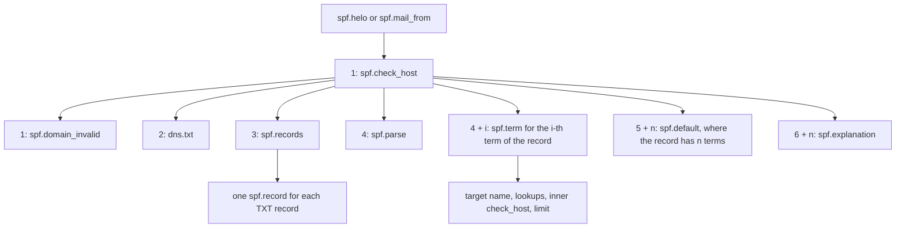
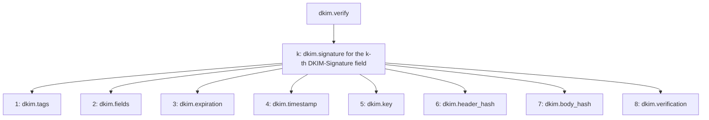
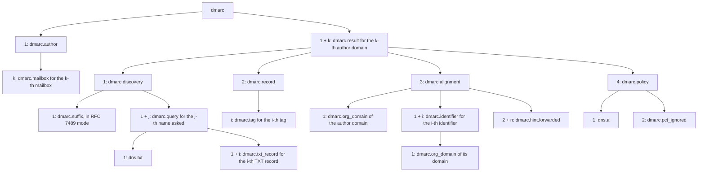

# Trace codes

The codes that trace events carry, and the slots under the root of the tree (TRC-011, [ADR 0034](../adr/0034-trace-step-codes-are-strings-listed-in-a-reference-page.md)). [Trace format](trace-format.md) describes the events themselves.

## Contents

- [How to read an entry](#how-to-read-an-entry)
- [Rules](#rules)
- [Slots under the root](#slots-under-the-root)
- [Codes](#codes)
  - [`trace`](#trace)
- [SPF](#spf)
  - [The SPF tree](#the-spf-tree)
  - [`spf.helo` and `spf.mail_from`](#spfhelo-and-spfmail_from)
  - [`spf.check_host`](#spfcheck_host)
  - [`spf.domain_invalid`](#spfdomain_invalid)
  - [`spf.records`](#spfrecords)
  - [`spf.record`](#spfrecord)
  - [`spf.parse`](#spfparse)
  - [`spf.term`](#spfterm)
  - [`spf.target`](#spftarget)
  - [`spf.limit.lookups`](#spflimitlookups)
  - [`spf.limit.void_lookups`](#spflimitvoid_lookups)
  - [`spf.limit.mx`](#spflimitmx)
  - [`spf.limit.check`](#spflimitcheck)
  - [`spf.default`](#spfdefault)
  - [`spf.explanation`](#spfexplanation)
- [DKIM verification](#dkim-verification)
  - [The DKIM tree](#the-dkim-tree)
  - [`dkim.verify`](#dkimverify)
  - [`dkim.signature`](#dkimsignature)
  - [`dkim.tags` and `dkim.tag`](#dkimtags-and-dkimtag)
  - [`dkim.fields`](#dkimfields)
  - [`dkim.expiration` and `dkim.timestamp`](#dkimexpiration-and-dkimtimestamp)
  - [`dkim.key`](#dkimkey)
  - [`dkim.key_record`](#dkimkey_record)
  - [`dkim.header_hash`](#dkimheader_hash)
  - [`dkim.h_name`](#dkimh_name)
  - [`dkim.signature_field`](#dkimsignature_field)
  - [`dkim.body_hash`](#dkimbody_hash)
  - [`dkim.l_exceeds`](#dkiml_exceeds)
  - [`dkim.verification`](#dkimverification)
  - [`dkim.header_changed`](#dkimheader_changed)
  - [DKIM cautions](#dkim-cautions)
- [DMARC](#dmarc)
  - [The DMARC tree](#the-dmarc-tree)
  - [`dmarc`](#dmarc-1)
  - [`dmarc.author`](#dmarcauthor)
  - [`dmarc.mailbox`](#dmarcmailbox)
  - [`dmarc.result`](#dmarcresult)
  - [`dmarc.discovery`](#dmarcdiscovery)
  - [`dmarc.suffix`](#dmarcsuffix)
  - [`dmarc.query`](#dmarcquery)
  - [`dmarc.txt_record`](#dmarctxt_record)
  - [`dmarc.record`](#dmarcrecord)
  - [`dmarc.tag`](#dmarctag)
  - [`dmarc.alignment`](#dmarcalignment)
  - [`dmarc.org_domain`](#dmarcorg_domain)
  - [`dmarc.identifier`](#dmarcidentifier)
  - [`dmarc.policy`](#dmarcpolicy)
  - [`dmarc.pct_ignored`](#dmarcpct_ignored)
- [DKIM signing](#dkim-signing)
  - [The signing tree](#the-signing-tree)
  - [`dkim.sign`](#dkimsign)
  - [`dkim.sign.signature`](#dkimsignsignature)
  - [`dkim.sign.h`](#dkimsignh)
  - [`dkim.sign.body_hash`](#dkimsignbody_hash)
  - [`dkim.sign.request`](#dkimsignrequest)
  - [`dkim.sign.check`](#dkimsigncheck)
  - [`dkim.sign.field`](#dkimsignfield)
- [Header section](#header-section)
  - [`header.section`](#headersection)
  - [`header.bare_cr_lf`](#headerbare_cr_lf)
  - [`header.no_line_ending`](#headerno_line_ending)
  - [`header.rebuilt`](#headerrebuilt)
  - [`header.malformed`](#headermalformed)
- [Body](#body)
  - [`body.cut`](#bodycut)
  - [`body.empty_lines`](#bodyempty_lines)
  - [`body.crlf_added`](#bodycrlf_added)
  - [`body.wsp_runs` and `body.wsp_trailing`](#bodywsp_runs-and-bodywsp_trailing)
  - [`body.bare_cr_lf`](#bodybare_cr_lf)
- [DNS](#dns)
  - [`dns.txt`](#dnstxt)
  - [`dns.a` and `dns.aaaa`](#dnsa-and-dnsaaaa)
  - [`dns.mx`](#dnsmx)
  - [`dns.ptr`](#dnsptr)
- [Hints](#hints)
  - [`dkim.hint.body_changed`](#dkimhintbody_changed)
  - [`dkim.hint.list_header_change`](#dkimhintlist_header_change)
  - [`dkim.hint.simple_header_change`](#dkimhintsimple_header_change)
  - [`dkim2.hint.quoted_local_part`](#dkim2hintquoted_local_part)
  - [`dmarc.hint.forwarded`](#dmarchintforwarded)

## How to read an entry

Each code has an entry with these fields:

| Field | Meaning |
|---|---|
| Kind | `fact`, `caution` or `hint` (TRC-003) |
| Position | The step's place in the tree |
| Parameters | Each parameter's name and type ([Trace format](trace-format.md#values)), in the order they appear in `params`, and for a data value who controls it |
| Outcomes | The outcomes the step can have, or none |
| Cites | The sections the step cites, or none |
| English | The text that the library's English renderer makes, with parameter names in braces |
| Requirement | The requirement that calls for the step, when one names it |

## Rules

- A code is lowercase ASCII, with parts joined by `.` and words within a part joined by `_`. The first part names the area: `trace`, `spf`, `dkim`, `dkim2`, `dmarc`, `dns`, `header` or `body`.
- An outcome is lowercase. Results keep the names that their specification gives them, such as `permerror` (RFC 7208 §2.6) or `permfail` (RFC 6376 §3.9).
- The human-readable strings of draft-09 §14 go in a parameter named `draft_text`, in the words the draft gives them (DK2-013, TRC-011).
- A code is never reused or renamed. Adding a code, an outcome or a parameter is a minor version change, and removing or changing one is a major one ([Trace format](trace-format.md#versions)).
- A code enters this page with the scenarios that need it, before the code that records it is written.
- A test checks this page against the list of codes in the crate.

## Slots under the root

Each kind of check has a fixed slot under the root, which it keeps whether or not the other checks run in the same call, and the header section has one too. So a position names the same step in every call (GEN-001, DMC-005).

| Position | Code | Step |
|---|---|---|
| `[]` | `trace` | The root of every trace |
| `[1]` | `spf.helo` | The SPF check of the HELO identity (SPF-002, RFC 7208 §2.3) |
| `[2]` | `spf.mail_from` | The SPF check of the MAIL FROM identity (SPF-001, RFC 7208 §2.4) |
| `[3]` | `dkim.verify` | DKIM verification, with each signature as a child in the order of the header section |
| `[4]` | `dkim2.verify` | DKIM2 verification |
| `[5]` | `dmarc` | DMARC evaluation |
| `[6]` | `dkim.sign` | DKIM signing, with each signature it makes as a child |
| `[7]` | `dkim2.sign` | DKIM2 signing |
| `[8]` | `header.section` | The header section, when a check in the call reads it |

The entries for these checks and for the steps below them come with each check's scenarios. [SPF](#spf) has the first two, [DKIM verification](#dkim-verification) the third, [DMARC](#dmarc) the fifth, [DKIM signing](#dkim-signing) the sixth, and [Header section](#header-section) the eighth.

## Codes

### `trace`

| Field | Value |
|---|---|
| Kind | `fact` |
| Position | `[]` |
| Parameters | `level`: keyword, `summary` or `full`; `events`: count; `cut_short`: boolean |
| Outcomes | none |
| Cites | none |
| English | "Trace at the {level} level, with {events} events." When `cut_short` is true, the renderer adds "A size limit cut the trace short." |

## SPF

The steps of an SPF check (RFC 7208), as [SPF](design/spf.md) describes them. Scenarios STEP-010, STEP-013, STEP-021, STEP-022 and STEP-080 to STEP-093 in [trace.md](../testing/trace.md), and the SPF record scenarios, check them.

### The SPF tree

Each identity has its slot under the root, and its first child is the outermost `check_host()`. An `include` or a `redirect` puts an inner `check_host()` under its term. Within a `check_host()` step, each child has a fixed number, so the number of a step depends only on the record (TRC-012). A step that didn't happen leaves its number unused.

| Parent | Child number | Step |
|---|---|---|
| `spf.helo`, `spf.mail_from` | 1 | `spf.check_host`, the outermost |
| `spf.check_host` | 1 | `spf.domain_invalid`, when the domain fails initial processing |
| `spf.check_host` | 2 | `dns.txt`, the record lookup |
| `spf.check_host` | 3 | `spf.records`, the record selection |
| `spf.check_host` | 4 | `spf.parse` |
| `spf.check_host` | 4 + i | `spf.term` for the i-th term of the record, mechanism or modifier, counted from 1. A term that didn't run, such as one after the term that matched, has no step |
| `spf.check_host` | 5 + n | `spf.default`, where the record has n terms |
| `spf.check_host` | 6 + n | `spf.explanation`, under the `check_host()` whose `exp=` applies (RFC 7208 §6.2) |
| `spf.term`, `spf.explanation` | 1, 2, … | In the order that RFC 7208 evaluates the term: a limit that stops it before any question, `spf.target`, the lookups in the order the term asks them, with the exchanges of an MX answer and the names of a PTR answer in answer order, an inner `spf.check_host`, and a limit that an answer reached |
| `spf.target` | 1, 2, … | The lookups that `%{p}` makes, in the order it asks them |

An answer that several steps read sits under each of them (TRC-008).

### `spf.helo` and `spf.mail_from`

| Field | Value |
|---|---|
| Kind | `fact` |
| Position | `[1]` for `spf.helo`, `[2]` for `spf.mail_from` |
| Parameters | `ip`: address, the client; `sender`: data, from the sender, the `<sender>` of `check_host()`; `domain`: data, from the sender, its `<domain>` |
| Outcomes | `none`, `neutral`, `pass`, `fail`, `softfail`, `temperror`, `permerror` |
| Cites | `RFC 7208 §2.3` for `spf.helo`, `RFC 7208 §2.4` for `spf.mail_from` |
| English | "SPF for the HELO identity {sender}, from {ip}: {outcome}." and "SPF for the MAIL FROM identity {sender}, from {ip}: {outcome}." |
| Requirement | SPF-001, SPF-002, ADS-023 |

### `spf.check_host`

| Field | Value |
|---|---|
| Kind | `fact` |
| Position | Child 1 of `spf.helo` or `spf.mail_from`, or a child of the `include` or `redirect` term that started it |
| Parameters | `domain`: data, the `<domain>`, from the sender at the top and from the parties of its target name below an `include` or a `redirect` |
| Outcomes | `none`, `neutral`, `pass`, `fail`, `softfail`, `temperror`, `permerror` |
| Cites | `RFC 7208 §4` |
| English | "check_host() for {domain}: {outcome}." |
| Requirement | SPF-001 |

### `spf.domain_invalid`

| Field | Value |
|---|---|
| Kind | `fact` |
| Position | Child 1 of `spf.check_host` |
| Parameters | `rule`: keyword, `single_label` for a HELO name that isn't a multi-label domain name, `no_lookup_form`, `empty_label`, `label_length` or `name_length` |
| Outcomes | `none` |
| Cites | `RFC 7208 §4.3`, and `RFC 7208 §2.3` for `single_label` |
| English | "The domain isn't a valid domain name ({rule}), so the result is none." |
| Requirement | ADS-004, ADS-023 |

### `spf.records`

| Field | Value |
|---|---|
| Kind | `fact` |
| Position | Child 3 of `spf.check_host`, present when the TXT lookup found records. Each `spf.record` is a child, in the order of the answer |
| Parameters | `selected`: count, the records left after selection |
| Outcomes | `one`, `none`, `several` |
| Cites | `RFC 7208 §4.5` |
| English | "{selected} of the TXT records are SPF records." |
| Requirement | SPF-007, REC-001 |

### `spf.record`

| Field | Value |
|---|---|
| Kind | `fact` |
| Position | A child of `spf.records`, one for each TXT record, in the order of the answer |
| Parameters | `record`: data, from DNS, the record with its strings joined (DNS-006); `version`: data, from DNS, the record up to its first space, as published |
| Outcomes | `selected`, `dropped` |
| Cites | `RFC 7208 §4.5` |
| English | "The record {record} is selected." or "The record {record} is dropped: it begins with {version}, not v=spf1." |
| Requirement | SPF-007, REC-001, [ADR 0021](../adr/0021-spf-reads-v-spf1-without-regard-to-case-and-allows-c-r-and-t-only-in-explanations.md) |

### `spf.parse`

| Field | Value |
|---|---|
| Kind | `fact` |
| Position | Child 4 of `spf.check_host` |
| Parameters | When the outcome is `permerror`: `rule`: keyword, the ABNF rule of RFC 7208 that failed, or `redirect` or `exp` for a modifier that appears twice; `offset`: count, the byte offset in the record |
| Outcomes | `parsed`, `permerror` |
| Cites | `RFC 7208 §4.6`, and `RFC 7208 §6` for a modifier that appears twice |
| English | "The record parses." or "The record doesn't parse: {rule} at byte {offset}." |
| Requirement | REC-010 to REC-013, PAR-001 |

### `spf.term`

| Field | Value |
|---|---|
| Kind | `fact` |
| Position | Child 4 + i of `spf.check_host`, for the i-th term of the record |
| Parameters | `text`: data, from DNS, the term as written; `name`: keyword, the mechanism or modifier in lowercase, or `unknown` for a modifier that hallmark ignores; `qualifier`: keyword, for a mechanism only, the result it gives: `pass`, `fail`, `softfail` or `neutral`; `lookups`: count, the terms that caused DNS lookups so far, this one included; `void_lookups`: count, the void lookups so far |
| Outcomes | `match` and `no_match` for a mechanism, `applied` and `ignored` for a modifier, and `temperror` and `permerror` for a term that stopped the evaluation |
| Cites | The section of its mechanism or modifier: `RFC 7208 §5.1` to `RFC 7208 §5.7`, `RFC 7208 §6.1` for `redirect`, `RFC 7208 §6` for an unknown modifier. An ignored `redirect` also cites `RFC 7208 §5.1` |
| English | "The term {text}: {outcome}. Lookups so far: {lookups}, void lookups: {void_lookups}." An ignored `redirect` adds "The record holds all, so redirect has no effect." |
| Requirement | SPF-004, REC-011, TRC-002 |

`exp=` gets no term step. Its effect is the `spf.explanation` step.

### `spf.target`

| Field | Value |
|---|---|
| Kind | `fact` |
| Position | Child 1 of a term or of `spf.explanation` that names a target |
| Parameters | `spec`: data, from DNS, the `domain-spec` as written, or the default domain of the term; `name`: data, the target name after macro expansion and the cut to 253 characters, from DNS, and from the sender too when a macro expanded a value from the envelope; `rule`: keyword, when the outcome is `invalid`: `empty_label` or `label_length` |
| Outcomes | `valid`, `invalid` |
| Cites | `RFC 7208 §7.3`, and `RFC 7208 §4.3` when the name is invalid |
| English | "The target {spec} expands to {name}." When the name is invalid, the renderer adds "The name is invalid ({rule}), so no question goes out for it." |
| Requirement | SPF-005, REC-014, REC-015, TRC-013, [ADR 0022](../adr/0022-an-spf-target-name-that-macro-expansion-makes-invalid-matches-nothing.md) |

### `spf.limit.lookups`

| Field | Value |
|---|---|
| Kind | `fact` |
| Position | The first child of the term that went over the limit |
| Parameters | `term`: position, the term; `count`: count, the terms that cause DNS lookups, this one included |
| Outcomes | `permerror` |
| Cites | `RFC 7208 §4.6.4` |
| English | "This is term {count} that causes a DNS lookup, over the limit of 10." |
| Requirement | SPF-006 |

### `spf.limit.void_lookups`

| Field | Value |
|---|---|
| Kind | `fact` |
| Position | The last child of the term whose answer went over the limit |
| Parameters | `term`: position, the term; `count`: count, the void lookups; `limit`: count, the value of `spf_void_lookups` |
| Outcomes | `permerror` |
| Cites | `RFC 7208 §4.6.4` |
| English | "This is void lookup {count}, over the limit of {limit}." |
| Requirement | SPF-006 |

### `spf.limit.mx`

| Field | Value |
|---|---|
| Kind | `fact` |
| Position | The child after the `dns.mx` step of an `mx` term |
| Parameters | `term`: position, the term; `count`: count, the MX records in the answer |
| Outcomes | `permerror` |
| Cites | `RFC 7208 §4.6.4` |
| English | "The MX answer has {count} records, over the limit of 10." |
| Requirement | SPF-006, REC-017 |

### `spf.limit.check`

| Field | Value |
|---|---|
| Kind | `fact` |
| Position | A child of the term that reached the limit, where the limit stopped it |
| Parameters | `term`: position, the term; `limit`: keyword, the limit reached, such as `dns_questions` ([Limits](design/limits.md)) |
| Outcomes | `permerror` |
| Cites | none |
| English | "The term reached the limit {limit}." |
| Requirement | SAF-002 |

### `spf.default`

| Field | Value |
|---|---|
| Kind | `fact` |
| Position | Child 5 + n of `spf.check_host`, where the record has n terms |
| Parameters | none |
| Outcomes | `neutral` |
| Cites | `RFC 7208 §4.7` |
| English | "No mechanism matched and no redirect applies, so the result is neutral." |
| Requirement | SPF-003 |

### `spf.explanation`

| Field | Value |
|---|---|
| Kind | `fact` |
| Position | Child 6 + n of the `spf.check_host` whose `exp=` applies |
| Parameters | `text`: data, from DNS, the TXT record as fetched, when there was one record; `explanation`: data, the text after macro expansion, from DNS, and from the sender too when a macro expanded a value from the envelope; `reason`: keyword, when the outcome is `unexplained`: `invalid_target`, `dns_error`, `no_record`, `several_records`, `not_ascii` or `syntax` |
| Outcomes | `explained`, `unexplained` |
| Cites | `RFC 7208 §6.2` |
| English | "A third party explains the result: {explanation}" or "The result has no explanation ({reason})." |
| Requirement | REC-016, TRC-013 |

A reader shows `explanation` as text from a third party, as RFC 7208 §6.2 asks.

## DKIM verification

The steps of DKIM verification (RFC 6376 §6), as [DKIM](design/dkim.md) and [Canonicalization](design/canonicalization.md) describe them. The scenarios in the DKIM sections of [trace.md](../testing/trace.md), STEP-100 to STEP-110 among them, and the key record and canonicalization scenarios that name a trace step, check them.

### The DKIM tree

`dkim.verify` holds one `dkim.signature` for each DKIM-Signature field, in header order. Within a signature, each child has a fixed number, and a step that didn't happen leaves its number unused.

| Parent | Child number | Step |
|---|---|---|
| `dkim.verify` | k | `dkim.signature` for the k-th DKIM-Signature field, counted from the top of the header section |
| `dkim.signature` | 1 | `dkim.tags` |
| `dkim.signature` | 2 | `dkim.fields`, the field checks other than time |
| `dkim.signature` | 3 | `dkim.expiration`, when the field has `x=` |
| `dkim.signature` | 4 | `dkim.timestamp`, when the field has `t=` |
| `dkim.signature` | 5 | `dkim.key` |
| `dkim.signature` | 6 | `dkim.header_hash` |
| `dkim.signature` | 7 | `dkim.body_hash` |
| `dkim.signature` | 8 | `dkim.verification` |
| `dkim.tags` | 1, 2, … | `dkim.tag` for each tag, in the order of the field |
| `dkim.key` | 1 | `dns.txt`, the key lookup |
| `dkim.key` | 1 + j | `dkim.key_record` for the j-th TXT record, counted in ascending order of the record's octets, so the order of the answer changes no position (REC-052) |
| `dkim.key` | 2 + r | `dkim.caution.several_key_records`, where the answer has r records |
| `dkim.header_hash` | 1 to m | `dkim.h_name` for each name in `h=`, in order |
| `dkim.header_hash` | m + 1 | `dkim.signature_field` |
| `dkim.header_hash` | m + 2 | `dkim.caution.from_not_oversigned` |
| `dkim.h_name` | 1 | `dkim.caution.own_field` |
| `dkim.body_hash` | 1 to 6 | `body.cut`, `body.empty_lines`, `body.crlf_added`, `body.wsp_runs`, `body.wsp_trailing`, `body.bare_cr_lf` |
| `dkim.body_hash` | 7 | `dkim.l_exceeds` |
| `dkim.body_hash` | 8 | `dkim.caution.l_tag` |
| `dkim.body_hash` | 9 | `dkim.hint.body_changed` |
| `dkim.verification` | 1 | `dkim.header_changed` |
| `dkim.verification` | 2 | `dkim.hint.list_header_change` |
| `dkim.verification` | 3 | `dkim.hint.simple_header_change` |
| `dkim.verification` | 4 | `dkim.caution.short_key` |

### `dkim.verify`

| Field | Value |
|---|---|
| Kind | `fact` |
| Position | `[3]` |
| Parameters | `signatures`: count, when the outcome is `checked`, the DKIM-Signature fields in the header section; `limit`: keyword, when the outcome is `permerror`, the header limit that stopped DKIM, such as `header_fields` |
| Outcomes | `checked`, `permerror` |
| Cites | `RFC 6376 §6` |
| English | "DKIM verification of {signatures} signatures." or "A header limit ({limit}) stopped DKIM before any signature." |
| Requirement | DKV-001, DKV-004, SAF-002 |

### `dkim.signature`

| Field | Value |
|---|---|
| Kind | `fact` |
| Position | Child k of `dkim.verify`, for the k-th DKIM-Signature field |
| Parameters | `domain`: data, from the sender, `d=` when the field gives a valid one; `selector`: data, from the sender, `s=`; `algorithm`: data, from the sender, `a=` as written; `limit`: keyword, `dkim_signatures`, when the field comes after the limit and isn't checked |
| Outcomes | `success`, `permfail`, `tempfail` |
| Cites | `RFC 6376 §6.1` |
| English | "The signature by {domain} with the selector {selector}: {outcome}." |
| Requirement | DKV-001, DKV-004 |

### `dkim.tags` and `dkim.tag`

| Field | `dkim.tags` | `dkim.tag` |
|---|---|---|
| Kind | `fact` | `fact` |
| Position | Child 1 of `dkim.signature` | A child of `dkim.tags`, one for each tag, in the order of the field |
| Parameters | When the outcome is `permfail`: `rule`: keyword, the rule of the tag list that failed; `offset`: count, the byte offset in the raw field | `name`: data, from the sender; `value`: data, from the sender, as written; `start` and `end`: counts, the byte range of the value in the raw field, `end` not included (PAR-002) |
| Outcomes | `parsed`, `permfail` | none |
| Cites | `RFC 6376 §3.2`, `RFC 6376 §6.1.1` | none |
| English | "The tag list parses." or "The tag list doesn't parse: {rule} at byte {offset}." | "{name}={value}" |
| Requirement | HDR-006, PAR-001, PAR-002 | PAR-002 |

### `dkim.fields`

| Field | Value |
|---|---|
| Kind | `fact` |
| Position | Child 2 of `dkim.signature` |
| Parameters | `check`: keyword, when the outcome is `permfail`, the check that failed: `missing_tag`, `version`, `algorithm`, `domain_mismatch`, `from_not_signed`, `time_order` or `name`, as `DkimFieldCheck` names them |
| Outcomes | `passed`, `permfail` |
| Cites | `RFC 6376 §6.1.1`, and `RFC 8301 §3.1` for `algorithm`, `RFC 6376 §3.5` for `time_order` |
| English | "The field checks pass." or "The field check {check} fails." |
| Requirement | DKV-002, ADS-013, TIM-003 |

### `dkim.expiration` and `dkim.timestamp`

| Field | `dkim.expiration` | `dkim.timestamp` |
|---|---|---|
| Kind | `fact` | `fact` |
| Position | Child 3 of `dkim.signature`, when the field has `x=` | Child 4 of `dkim.signature`, when the field has `t=` |
| Parameters | `x`: number, as written; `time`: count, the verification time in seconds since 1970; `would`: keyword, when the outcome is `skipped`, what the check would have given: `passed` or `permfail` | `t`: number, as written; `time`: count; `would`: keyword, as for `dkim.expiration` |
| Outcomes | `passed`, `permfail`, `skipped` | `passed`, `permfail`, `skipped` |
| Cites | `RFC 6376 §3.5`, `RFC 6376 §6.1.1` | `RFC 6376 §3.5` |
| English | "The signature expires at {x}, and the verification time is {time}: {outcome}." When skipped: "Time checks are off. The check would have given {would}." | "The signature was made at {t}, and the verification time is {time}: {outcome}." When skipped, as for `dkim.expiration` |
| Requirement | TIM-001, TIM-002, TIM-004, HDR-013 | TIM-001, TIM-002, TIM-004, HDR-013 |

A `t=` or `x=` of more than 12 digits counts as infinite (HDR-013), and the parameter keeps the digits as written.

### `dkim.key`

| Field | Value |
|---|---|
| Kind | `fact` |
| Position | Child 5 of `dkim.signature` |
| Parameters | `selected`: count, the records left after hallmark dropped those that don't apply; `limit`: keyword, `key_records`, when there are more records than the limit |
| Outcomes | `found`, `no_key`, `tempfail`, `permfail` |
| Cites | `RFC 6376 §3.6.2.2`, `RFC 6376 §6.1.2` |
| English | "The key lookup: {outcome}, with {selected} records." When the limit stopped it: "The selector has more records than the limit {limit}." |
| Requirement | DKV-005, REC-050, REC-052, SAF-002 |

### `dkim.key_record`

| Field | Value |
|---|---|
| Kind | `fact` |
| Position | Child 1 + j of `dkim.key`, for the j-th record in ascending order of its octets |
| Parameters | `record`: data, from DNS, the record with its strings joined (DNS-006); `flags`: list of keywords, the `t=` flags hallmark knows, `y` and `s`, in that order; `form`: keyword, `rsa_public_key`, `subject_public_key_info` or `ed25519`, when the key data decodes; `bits`: count, the bits of an RSA modulus; `reason`: keyword, for `dropped`: `version` or `service`, for `permfail`: the check that failed, as `DkimKeyCheck` names it, such as `revoked`, and for `failed`: `body_hash` or `signature` |
| Outcomes | `verified`, `failed`, `permfail`, `dropped` |
| Cites | `RFC 6376 §3.6.1`, `RFC 6376 §6.1.2` |
| English | "The key record {record}: {outcome}." |
| Requirement | DKV-005, REC-050, REC-051, REC-052, [ADR 0025](../adr/0025-a-dkim-selector-with-several-key-records-passes-if-any-of-them-verifies-the-signature.md), [ADR 0026](../adr/0026-rsa-keys-in-key-records-may-be-rsapublickey-or-subjectpublickeyinfo.md) |

### `dkim.header_hash`

| Field | Value |
|---|---|
| Kind | `fact` |
| Position | Child 6 of `dkim.signature`, or child 3 of `dkim.sign.signature` |
| Parameters | `canonicalization`: keyword, `simple` or `relaxed`; `hash`: hash, the SHA-256 hash of the header hash input |
| Outcomes | none |
| Cites | `RFC 6376 §3.7` |
| English | "The header hash, with {canonicalization} canonicalization: {hash}." |
| Requirement | HCN-001 to HCN-003, HCN-009 |

### `dkim.h_name`

| Field | Value |
|---|---|
| Kind | `fact` |
| Position | Child i of `dkim.header_hash`, for the i-th name in `h=` |
| Parameters | `name`: data, the name as written in `h=`, from the sender in verification and from the caller in signing; `instance`: count, when a field was selected, its place among the fields of that name, counted from the bottom of the header section; `field`: data, from the sender, the selected field in canonical form |
| Outcomes | `selected`, `none`, `own_field` |
| Cites | `RFC 6376 §5.4`, and `RFC 6376 §3.5` for `none` |
| English | "{name} selects {field}." or "{name} has no field left, so it adds nothing." or "{name} selects the signature's own field." |
| Requirement | DKV-011, HCN-004, HCN-009, [ADR 0028](../adr/0028-dkim-h-selection-counts-the-signatures-own-dkim-signature-field.md) |

### `dkim.signature_field`

| Field | Value |
|---|---|
| Kind | `fact` |
| Position | Child m + 1 of `dkim.header_hash`, where `h=` has m names |
| Parameters | `field`: data, the DKIM-Signature field in canonical form, with the `b=` value and the white space around it deleted, from the sender in verification and from the caller in signing |
| Outcomes | none |
| Cites | `RFC 6376 §3.7` |
| English | "The signature field as hashed: {field}" |
| Requirement | HCN-003, HCN-009 |

### `dkim.body_hash`

| Field | Value |
|---|---|
| Kind | `fact` |
| Position | Child 7 of `dkim.signature` |
| Parameters | `canonicalization`: keyword, `simple` or `relaxed`; `computed`: hash; `stated`: data, from the sender, `bh=` as written; `octets`: count, the canonical octets hashed; `l`: number, `l=` as written, when the field has one; `unsigned`: count, the canonical octets after the `l=` cut, when the field has `l=` |
| Outcomes | `match`, `mismatch` |
| Cites | `RFC 6376 §3.4.3`, `RFC 6376 §3.4.4`, `RFC 6376 §6.1.3` |
| English | "The body hash, with {canonicalization} canonicalization over {octets} octets: {outcome}." |
| Requirement | DKV-001, DKV-006, TRC-010 |

### `dkim.l_exceeds`

| Field | Value |
|---|---|
| Kind | `fact` |
| Position | Child 7 of `dkim.body_hash` |
| Parameters | `l`: number, `l=` as written; `octets`: count, the canonical body's length; `excess`: count, how many octets `l=` exceeds it by, left out when `l=` is too large to hold (HDR-013) |
| Outcomes | none |
| Cites | `RFC 6376 §3.5` |
| English | "l= exceeds the canonical body by {excess} octets, which RFC 6376 §3.5 forbids signers to do." |
| Requirement | DKV-008, [ADR 0009](../adr/0009-a-dkim-l-tag-larger-than-the-body-gets-no-special-rule.md) |

### `dkim.verification`

| Field | Value |
|---|---|
| Kind | `fact` |
| Position | Child 8 of `dkim.signature`, when the body hash matched |
| Parameters | `key`: position, the `dkim.key_record` that verified the signature, or the one whose reason the signature takes |
| Outcomes | `verified`, `failed` |
| Cites | `RFC 6376 §6.1.3` |
| English | "The signature over the header hash: {outcome}." |
| Requirement | DKV-001, REC-052 |

### `dkim.header_changed`

| Field | Value |
|---|---|
| Kind | `fact` |
| Position | Child 1 of `dkim.verification`, when the body hash matched and the signature failed |
| Parameters | none |
| Outcomes | none |
| Cites | `RFC 6376 §6.1.3` |
| English | "The body is unchanged, and the signature over the header hash failed: a signed header field, the DKIM-Signature field or the key changed after signing. DKIM keeps nothing that tells which field changed." |
| Requirement | DKV-012 |

### DKIM cautions

A caution never changes the result (TRC-003). The first three fire only on a signature that passes.

| Code | Position | Parameters | Cites | English | Requirement |
|---|---|---|---|---|---|
| `dkim.caution.short_key` | Child 4 of `dkim.verification` | `bits`: count | `RFC 8301 §3.2` | "The signature passed with a {bits}-bit RSA key." | DKV-010 |
| `dkim.caution.l_tag` | Child 8 of `dkim.body_hash` | `unsigned`: count | `RFC 6376 §8.2` | "The signature passed with l=, and {unsigned} octets of the body are unsigned." | DKV-010 |
| `dkim.caution.from_not_oversigned` | Child m + 2 of `dkim.header_hash` | none | `RFC 6376 §5.4`, `RFC 6376 §8.15` | "h= names From only as many times as the message has From fields, so a From field added later leaves the signature valid." | DKV-010 |
| `dkim.caution.several_key_records` | Child 2 + r of `dkim.key` | `records`: count | `RFC 6376 §3.6.2.2`, `draft-ietf-dkim-dkim2-dns-03 §3` | "The selector has {records} key records." | REC-052 |
| `dkim.caution.own_field` | Child 1 of `dkim.h_name` | none | `RFC 6376 §3.5`, `RFC 6376 §3.7`, `RFC 6376 §5.4` | "The signer broke the MUST NOT of RFC 6376, unless a DKIM-Signature field below this one was removed or moved after signing." | HCN-004 |

Each caution has the kind `caution` and no outcomes.

## DMARC

The steps of a DMARC check, in RFC 9989 mode or RFC 7489 mode, as [DMARC](design/dmarc.md) describes them. Scenarios STEP-020, STEP-044, STEP-074 to STEP-077 and STEP-130 to STEP-150, and the DMARC record, test mode and address scenarios that name a trace step, check them. A cite that differs between the modes gives the RFC 9989 section first and the RFC 7489 section after it.

### The DMARC tree

`dmarc` holds the step that reads the From fields, then one `dmarc.result` for each author domain. When the From fields give no author domain to evaluate, one `dmarc.result` still says why DMARC wasn't applied. Each result's position is the `position` of its `DmarcResult` (DMC-005).

| Parent | Child number | Step |
|---|---|---|
| `dmarc` | 1 | `dmarc.author` |
| `dmarc.author` | k | `dmarc.mailbox` for the k-th mailbox, in the order of the From fields and of the mailboxes in each |
| `dmarc` | 1 + k | `dmarc.result` for the k-th author domain, in the order of the From fields. With no author domain to evaluate, one `dmarc.result` at child 2 |
| `dmarc.result` | 1 | `dmarc.discovery` |
| `dmarc.result` | 2 | `dmarc.record`, when discovery found a record |
| `dmarc.result` | 3 | `dmarc.alignment`, when alignment ran |
| `dmarc.result` | 4 | `dmarc.policy`, when discovery found a record |
| `dmarc.discovery`, `dmarc.org_domain` | 1 | `dmarc.suffix`, in RFC 7489 mode, when the step needed the organizational domain |
| `dmarc.discovery`, `dmarc.org_domain` | 1 + j | `dmarc.query` for the j-th name asked |
| `dmarc.query` | 1 | `dns.txt` |
| `dmarc.query` | 1 + i | `dmarc.txt_record` for the i-th TXT record, in the order of the answer |
| `dmarc.record` | i | `dmarc.tag` for the i-th tag, in the order of the record |
| `dmarc.alignment` | 1 | `dmarc.org_domain` of the author domain, when relaxed alignment compares it with a different domain |
| `dmarc.alignment` | 1 + i | `dmarc.identifier` for the i-th authenticated identifier: the SPF identifier first, then the DKIM identifiers in the order of their result positions |
| `dmarc.identifier` | 1 | `dmarc.org_domain` of the identifier's domain, when relaxed alignment compares it with a different author domain |
| `dmarc.alignment` | 2 + n | `dmarc.hint.forwarded`, where the step checked n identifiers |
| `dmarc.policy` | 1 | `dns.a`, the question whether the author domain exists ([ADR 0050](../adr/0050-dmarc-asks-whether-the-author-domain-exists-when-np-can-change-the-policy-and-needs-the-answer-only-for-a-message-that-fails.md)) |
| `dmarc.policy` | 2 | `dmarc.pct_ignored` |

An answer that several steps read sits under each of them (TRC-008). In RFC 9989 mode, a tree walk for an organizational domain repeats the `dmarc.query` steps of the names that discovery already asked, and in RFC 7489 mode, every step that reads a public suffix answer has its own `dmarc.suffix`.

### `dmarc`

| Field | Value |
|---|---|
| Kind | `fact` |
| Position | `[5]` |
| Parameters | `mode`: keyword, `rfc9989` or `rfc7489`; `results`: count, the `dmarc.result` children |
| Outcomes | none |
| Cites | `RFC 9989 §5.3`, `RFC 7489 §6.6` |
| English | "DMARC under {mode}, with {results} results." |
| Requirement | DMC-001, DMC-002 |

### `dmarc.author`

| Field | Value |
|---|---|
| Kind | `fact` |
| Position | Child 1 of `dmarc` |
| Parameters | `from_fields`: count, the From fields of the message; `domains`: list of data, from the sender, the distinct author domains in lookup form, in the order of the From fields; `case`: keyword, when the outcome is `none`: `no_from`, `from_unparsable`, `no_mailbox`, `domain_literal` or `no_lookup_form`; `limit`: keyword, `author_domains`, when the outcome is `limit` |
| Outcomes | `one`; `each`, for several domains that hallmark evaluates one by one because `several_author_domains` is on; `several`, for several domains with the option off; `none`; `limit`, for more domains than `author_domains` |
| Cites | `RFC 9989 §5.3.1`, `RFC 7489 §6.6.1`, and `RFC 9989 §11.5` for `each` and `several` |
| English | "{from_fields} From fields give the author domains {domains}: {outcome}." |
| Requirement | DMC-002, ADS-012, SAF-002 |

### `dmarc.mailbox`

| Field | Value |
|---|---|
| Kind | `fact` |
| Position | Child k of `dmarc.author`, for the k-th mailbox |
| Parameters | `field`: count, the From field that holds the mailbox, from 1 in the order of the header section; `display_name`: data, from the sender, as written, when the mailbox has one; `local_part`: data, from the sender, as written; `domain`: data, from the sender, the domain or the domain literal as written; `lookup`: data, from the sender, the lookup form, when the outcome is `lookup_form`; `unicode`: keyword, `12.0.0`, the Unicode version of the conversion tables, when the domain holds a non-ASCII label ([ADR 0055](../adr/0055-the-idna-tables-use-unicode-12-0-0.md)); `rule`: keyword, when the outcome is `invalid`: `no_lookup_form`, `empty_label`, `label_length` or `name_length`, as for `spf.domain_invalid` |
| Outcomes | `lookup_form`, `domain_literal`, `invalid` |
| Cites | `RFC 5322 §3.4`, and `RFC 5891 §5` when the domain holds a non-ASCII label |
| English | "From field {field} holds {local_part}@{domain}: {outcome}." |
| Requirement | ADS-002, ADS-005, ADS-030 |

### `dmarc.result`

| Field | Value |
|---|---|
| Kind | `fact` |
| Position | Child 1 + k of `dmarc`, for the k-th author domain |
| Parameters | `domain`: data, from the sender, the author domain in lookup form, absent when there is none; `reason`: keyword, the case of `DmarcReason`: `aligned_pass`, `no_aligned_pass`, `no_record`, `temporary_failure`, `suffix_unavailable` or `limit`, and for `not_applied` the case of `NotApplied`: `no_from`, `from_unparsable`, `no_mailbox`, `domain_literal`, `no_lookup_form`, `several_author_domains`, `author_domain_limit`, `several_records` or `no_valid_policy`; `identifier`: position, for `aligned_pass`, the SPF or DKIM result of the first identifier that aligned; `limit`: keyword, for `limit`, the limit reached, such as `dns_questions` ([Limits](design/limits.md)); `testing_keys`: boolean, for `pass`, true when the pass rests only on DKIM keys with `t=y` (DMC-008) |
| Outcomes | `pass`, `fail`, `none`, `temperror`, `permerror`, `not_applied` |
| Cites | `RFC 9989 §5.3.5`, `RFC 7489 §6.6.2`, and `RFC 9989 §5.3.6` for `temperror` |
| English | "DMARC for {domain}: {outcome}, {reason}." |
| Requirement | DMC-002, DMC-006, DMC-008, GEN-004 |

### `dmarc.discovery`

| Field | Value |
|---|---|
| Kind | `fact` |
| Position | Child 1 of `dmarc.result` |
| Parameters | `found_at`: data, from the sender, the domain whose `_dmarc` name held the record that applies, when the outcome is `found` |
| Outcomes | `found`, `no_record`, `tempfail`, `several_records` for more than one record at a name in RFC 7489 mode, `suffix_unavailable` |
| Cites | `RFC 9989 §4.10.1`, `RFC 7489 §6.6.3` |
| English | "Policy discovery: {outcome}." When a record applies: "The record at _dmarc.{found_at} applies." |
| Requirement | DMC-003, REC-030, DMC-011 |

### `dmarc.suffix`

| Field | Value |
|---|---|
| Kind | `fact` |
| Position | Child 1 of `dmarc.discovery` or `dmarc.org_domain`, in RFC 7489 mode |
| Parameters | `domain`: data, from the sender, the domain asked about; `labels`: count, the labels of the public suffix, the x of RFC 7489 §3.2 step 3, when the outcome is `suffix`; `list`: data, from the caller, the name of the list, when the caller gave one; `organizational`: data, from the sender, when the outcome is `suffix`, the organizational domain: the last x + 1 labels, or the domain itself when x is its number of labels; `description`: data, from the caller, when the outcome is `unavailable` and the caller described why; `limit`: keyword, `answer_size`, when the description went over that limit and the step leaves it out |
| Outcomes | `suffix`, `unavailable` |
| Cites | `RFC 7489 §3.2` |
| English | "The public suffix of {domain} has {labels} labels, so its organizational domain is {organizational}." When x is the number of labels: "{domain} is a public suffix, so it is its own organizational domain." For `unavailable`: "No public suffix is available for {domain}.", followed by the description when there is one. |
| Requirement | DMC-010, DMC-011, TRC-008, SAF-004 |

A snapshot takes its suffix answers from these steps ([Trace format](trace-format.md#snapshots)).

### `dmarc.query`

| Field | Value |
|---|---|
| Kind | `fact` |
| Position | Child 1 + j of `dmarc.discovery` or `dmarc.org_domain`, for the j-th name asked |
| Parameters | `name`: data, from the sender, `_dmarc.` and the domain; `psd`: keyword, `y` or `n`, when the record found has a valid `psd` tag with that value, which stops the tree walk (RFC 9989 mode) |
| Outcomes | `found`, for one DMARC record; `none`, for no DMARC record; `discarded`, for several DMARC records in RFC 9989 mode, which the tree walk discards; `several`, for several DMARC records in RFC 7489 mode; `tempfail` |
| Cites | `RFC 9989 §4.10`, `RFC 7489 §6.6.3` |
| English | "DMARC records at {name}: {outcome}." |
| Requirement | REC-030, TRC-008 |

### `dmarc.txt_record`

| Field | Value |
|---|---|
| Kind | `fact` |
| Position | Child 1 + i of `dmarc.query`, for the i-th TXT record, in the order of the answer |
| Parameters | `record`: data, from DNS, the record with its strings joined (DNS-006); `reason`: keyword, when the outcome is `not_dmarc`: `v_not_first`, when the first tag isn't `v`, or `version`, when the value of `v` isn't exactly `DMARC1` |
| Outcomes | `dmarc`, `not_dmarc` |
| Cites | `RFC 9989 §4.7`, `RFC 7489 §6.3` |
| English | "The TXT record {record}: {outcome}." |
| Requirement | REC-030 |

### `dmarc.record`

| Field | Value |
|---|---|
| Kind | `fact` |
| Position | Child 2 of `dmarc.result`, when discovery found a record |
| Parameters | `record`: data, from DNS, the record that applies, with its strings joined (DNS-006) |
| Outcomes | none |
| Cites | `RFC 9989 §4.7`, `RFC 9989 §4.8`, `RFC 7489 §6.3`, `RFC 7489 §6.4` |
| English | "The record {record}." |
| Requirement | REC-031, DMC-004 |

### `dmarc.tag`

| Field | Value |
|---|---|
| Kind | `fact` |
| Position | Child i of `dmarc.record`, for the i-th tag |
| Parameters | `name`: data, from DNS; `value`: data, from DNS, as published, without the white space at either end; `start` and `end`: counts, the byte range of the value in the record, `end` not included (PAR-002); `default`: keyword, the default value the tag took, when the outcome is `invalid` or `repeated` and the tag has one (REC-032); `invalid_uris`: list of counts, for `rua` and `ruf`, the entries that aren't valid URIs, from 1 (REC-033) |
| Outcomes | `valid`; `invalid`; `unknown`, for a tag that the mode doesn't read; `repeated`, for each copy of a tag that appears more than once; `ignored`, for a `v` tag after the first |
| Cites | `RFC 9989 §4.8`, `RFC 7489 §6.4` |
| English | "{name}={value}: {outcome}." |
| Requirement | REC-031, REC-032, REC-033, PAR-002, [ADR 0024](../adr/0024-dmarc-tag-names-keep-their-case-white-space-around-a-value-is-not-part-of-it-and-a-repeated-tag-is-invalid.md) |

### `dmarc.alignment`

| Field | Value |
|---|---|
| Kind | `fact` |
| Position | Child 3 of `dmarc.result`, when alignment ran |
| Parameters | `aspf`: keyword, `relaxed` or `strict`; `adkim`: keyword, `relaxed` or `strict`; `identifiers`: count, the authenticated identifiers checked |
| Outcomes | `aligned_pass`; `no_aligned_pass`; `unknown`, when an organizational domain that the result depends on is unknown and no identifier aligned |
| Cites | `RFC 9989 §4.4`, `RFC 9989 §5.3.4`, `RFC 7489 §3.1` |
| English | "{identifiers} authenticated identifiers, with aspf={aspf} and adkim={adkim}: {outcome}." |
| Requirement | DMC-005 |

### `dmarc.org_domain`

| Field | Value |
|---|---|
| Kind | `fact` |
| Position | Child 1 of `dmarc.alignment` for the author domain, or child 1 of `dmarc.identifier` for the identifier's domain |
| Parameters | `domain`: data, from the sender; `organizational`: data, from the sender, when the outcome is `found` |
| Outcomes | `found`, `unknown` |
| Cites | `RFC 9989 §4.10.2`, `RFC 7489 §3.2` |
| English | "The organizational domain of {domain} is {organizational}." or "The organizational domain of {domain} is unknown." |
| Requirement | DMC-003, DMC-011 |

### `dmarc.identifier`

| Field | Value |
|---|---|
| Kind | `fact` |
| Position | Child 1 + i of `dmarc.alignment`, for the i-th authenticated identifier |
| Parameters | `result`: position, the SPF result or the DKIM signature, in this call's trace or in the trace of the call that gave it (DMC-005); `domain`: data, from the sender, the MAIL FROM domain, the HELO name when MAIL FROM is null, or the `d=` domain; `mode`: keyword, `relaxed` or `strict`; `testing`: boolean, for a DKIM identifier, true when its key has `t=y` (DMC-008) |
| Outcomes | `aligned`, `not_aligned`, `unknown` |
| Cites | `RFC 9989 §4.4.1` for DKIM and `RFC 9989 §4.4.2` for SPF, `RFC 7489 §3.1.1` for DKIM and `RFC 7489 §3.1.2` for SPF |
| English | "The identifier {domain} from {result}, in {mode} alignment: {outcome}." |
| Requirement | DMC-005, DMC-008 |

### `dmarc.policy`

| Field | Value |
|---|---|
| Kind | `fact` |
| Position | Child 4 of `dmarc.result`, when discovery found a record |
| Parameters | `tag`: keyword, `p`, `sp` or `np`, the tag that applied, absent under the rule of RFC 9989 §4.10.1 and for `undetermined`; `value`: data, from DNS, the tag's value as published, when `tag` is present; `policy`: keyword, `none`, `quarantine` or `reject`, when the outcome is `applied`: the tag's value in lowercase, or `none` under the rule of RFC 9989 §4.10.1; `rule`: keyword, `author_domain` for the author domain's own record, `subdomain` for a subdomain that exists or whose record has no `np` that applies, `nonexistent` for a subdomain that doesn't exist and whose record has a valid `np`, or `invalid_tag` for the rule of RFC 9989 §4.10.1; `test_mode`: keyword, `t` or `pct`, when the record asks for test mode |
| Outcomes | `applied`; `undetermined`, when the question whether the author domain exists failed and an identifier aligned and passed; `not_applied`, under the rule of RFC 9989 §4.10.1 with no valid `rua` |
| Cites | `RFC 9989 §4.10.1`, `RFC 7489 §6.6.3`, `RFC 9989 §3.2.13` for `nonexistent`, and `RFC 9989 §4.7` for `test_mode` |
| English | "The policy {policy}, from {tag}={value} by the rule {rule}: {outcome}." For the rule `invalid_tag`: "The record has no valid policy tag, so the rule for an invalid policy tag applies: {outcome}." For `undetermined`: "The question whether the author domain exists failed, and the result doesn't need its answer, because an identifier aligned and passed." |
| Requirement | DMC-006, DMC-007, REC-032, [ADR 0023](../adr/0023-dmarc-follows-rfc-9989-section-4-10-1-for-invalid-policy-tags-and-section-4-7-for-nonexistent-subdomains.md), [ADR 0050](../adr/0050-dmarc-asks-whether-the-author-domain-exists-when-np-can-change-the-policy-and-needs-the-answer-only-for-a-message-that-fails.md) |

### `dmarc.pct_ignored`

| Field | Value |
|---|---|
| Kind | `fact` |
| Position | Child 2 of `dmarc.policy`, in RFC 7489 mode, when `pct` holds a valid value other than 0 and 100 |
| Parameters | `pct`: data, from DNS, the value as published |
| Outcomes | none |
| Cites | `RFC 9989 Appendix A.6` |
| English | "pct={pct} reads as if pct were absent, which means 100: hallmark supports only pct=0 and pct=100." |
| Requirement | DMC-007, [ADR 0020](../adr/0020-test-modes-are-reported-and-the-caller-decides-what-they-mean.md) |

## DKIM signing

The steps of DKIM signing (RFC 6376 §5), as [DKIM](design/dkim.md#signing) describes them. Scenarios STEP-066, STEP-123 to STEP-127 and the signing scenarios check them. No step holds a byte of a private key (SEC-002, SIGN-019).

### The signing tree

`dkim.sign` holds one `dkim.sign.signature` for each `DkimSigning` of the options, in their order.

| Parent | Child number | Step |
|---|---|---|
| `dkim.sign` | k | `dkim.sign.signature` for the k-th `DkimSigning` |
| `dkim.sign.signature` | 1 | `dkim.sign.h`, the `h=` list |
| `dkim.sign.signature` | 2 | `dkim.sign.body_hash`, with the `body.*` steps as its children 1 to 6 |
| `dkim.sign.signature` | 3 | `dkim.header_hash`, with a `dkim.h_name` for each name in `h=` and the `dkim.signature_field` |
| `dkim.sign.signature` | 4 | `dkim.sign.request` |
| `dkim.sign.signature` | 5 | `dkim.sign.check` |
| `dkim.sign.signature` | 6 | `dkim.sign.field` |

### `dkim.sign`

| Field | Value |
|---|---|
| Kind | `fact` |
| Position | `[6]` |
| Parameters | `signatures`: count, the `DkimSigning` entries; `error`: keyword, when the outcome is `stopped`, the code of the `SigningError` that stopped signing, such as `signing.signer_failed` |
| Outcomes | `written`, `stopped` |
| Cites | `RFC 6376 §5` |
| English | "DKIM signing with {signatures} signatures: {outcome}." |
| Requirement | DKS-001, DKS-002, DKS-005, SGN-004 |

### `dkim.sign.signature`

| Field | Value |
|---|---|
| Kind | `fact` |
| Position | Child k of `dkim.sign`, for the k-th `DkimSigning` |
| Parameters | `domain`: data, from the caller, `d=`; `selector`: data, from the caller, `s=`; `algorithm`: keyword, `rsa-sha256` or `ed25519-sha256` |
| Outcomes | `written`, `stopped` |
| Cites | `RFC 6376 §5` |
| English | "The signature by {domain} with the selector {selector}: {outcome}." |
| Requirement | DKS-001, DKS-002 |

### `dkim.sign.h`

| Field | Value |
|---|---|
| Kind | `fact` |
| Position | Child 1 of `dkim.sign.signature` |
| Parameters | `names`: list of data, from the caller, the names in `h=`, in order; `oversigned`: count, the names that `h=` holds once more than the message has fields of that name |
| Outcomes | none |
| Cites | `RFC 6376 §5.4` |
| English | "h= names {names}." |
| Requirement | DKS-003, DKS-006 |

### `dkim.sign.body_hash`

| Field | Value |
|---|---|
| Kind | `fact` |
| Position | Child 2 of `dkim.sign.signature` |
| Parameters | `canonicalization`: keyword, `simple` or `relaxed`; `hash`: hash, the body hash that `bh=` gets; `octets`: count, the canonical octets hashed |
| Outcomes | none |
| Cites | `RFC 6376 §3.4.3`, `RFC 6376 §3.4.4`, `RFC 6376 §3.7` |
| English | "The body hash, with {canonicalization} canonicalization over {octets} octets: {hash}." |
| Requirement | DKS-004, TRC-010 |

### `dkim.sign.request`

| Field | Value |
|---|---|
| Kind | `fact` |
| Position | Child 4 of `dkim.sign.signature` |
| Parameters | `algorithm`: keyword, `rsa-sha256` or `ed25519-sha256`; `hash`: hash, the SHA-256 hash that the signer gets (SGN-002) |
| Outcomes | `answered`, `failed` |
| Cites | `RFC 6376 §3.3`, `RFC 8463 §3` for `ed25519-sha256` |
| English | "The signer got the hash {hash}: {outcome}." |
| Requirement | SGN-001, SGN-002, SGN-004 |

The trace leaves out the signer's description of a failure, which only the `SigningError` holds (SEC-002).

### `dkim.sign.check`

| Field | Value |
|---|---|
| Kind | `fact` |
| Position | Child 5 of `dkim.sign.signature`, when the signer answered with a signature |
| Parameters | `size`: count, the octets of the signature; `expected`: count, the octets its algorithm and key give; `verified`: boolean, present when the caller turned verification on |
| Outcomes | `passed`, `wrong_size`, `not_verified` |
| Cites | none |
| English | "The signature has {size} octets, as {expected} are expected: {outcome}." |
| Requirement | SGN-004, SGN-006 |

### `dkim.sign.field`

| Field | Value |
|---|---|
| Kind | `fact` |
| Position | Child 6 of `dkim.sign.signature` |
| Parameters | `field`: data, from the caller, the DKIM-Signature field that hallmark writes, in the form the caller asked for (STR-009) |
| Outcomes | none |
| Cites | `RFC 6376 §3.5` |
| English | "The field to add: {field}" |
| Requirement | DKS-005, STR-009 |

## Header section

The steps of the header section that the checks of a call read, as [Header section](design/header-section.md) describes them. The slot `[8]` appears when DKIM, DKIM2, DMARC or signing runs, and a check that names a header step names it by its position. Scenarios STEP-120 to STEP-122 and the header field and canonicalization scenarios that name a trace step check them.

| Parent | Child number | Step |
|---|---|---|
| `header.section` | 1 | `header.bare_cr_lf` |
| `header.section` | 2 | `header.no_line_ending` |
| `header.section` | 3 | `header.rebuilt`, for fields that came one at a time |
| `header.section` | 3 + j | `header.malformed` for the j-th malformed line, in the order of the header section |

### `header.section`

| Field | Value |
|---|---|
| Kind | `fact` |
| Position | `[8]` |
| Parameters | `input`: keyword, `whole_message`, `header_section` or `header_field`, the call that gave it; `fields`: count, the header fields; `malformed`: count, the malformed lines; `limit`: keyword, when the outcome is `permerror`, the header limit that stopped the splitter, such as `header_fields` |
| Outcomes | `split`, `permerror` |
| Cites | `RFC 5322 §2.2` |
| English | "The header section holds {fields} fields and {malformed} malformed lines." or "The header section reached the limit {limit}." |
| Requirement | HDR-001, HDR-004, SAF-002 |

### `header.bare_cr_lf`

| Field | Value |
|---|---|
| Kind | `caution` |
| Position | Child 1 of `header.section`, when the header section holds a bare CR or LF |
| Parameters | `cr`: count; `lf`: count; `places`: list of places in the raw header section, the first ones up to `trace_places`; `cut_short`: boolean |
| Outcomes | none |
| Cites | `RFC 5322 §2.2`, `RFC 5321 §2.3.8`, and also `RFC 6376 §5.3` when DKIM signing runs in the call, and `draft-ietf-dkim-dkim2-spec-09 §17` when DKIM2 signing runs |
| English | "The header section holds {cr} bare CR and {lf} bare LF octets, which stay octets of the lines that hold them." |
| Requirement | HDR-012, [ADR 0051](../adr/0051-a-bare-cr-or-lf-in-the-header-section-is-an-octet-of-the-line-that-holds-it.md) |

### `header.no_line_ending`

| Field | Value |
|---|---|
| Kind | `fact` |
| Position | Child 2 of `header.section`, when the input ended inside the last line of the header section |
| Parameters | `line`: count, the line, from 1 |
| Outcomes | none |
| Cites | `RFC 5322 §2.2` |
| English | "Line {line}, the last of the header section, has no line ending. Canonicalization ends it with CRLF." |
| Requirement | HCN-008, [ADR 0030](../adr/0030-a-last-header-line-without-a-line-ending-is-a-header-field-that-canonicalization-ends-with-crlf.md) |

### `header.rebuilt`

| Field | Value |
|---|---|
| Kind | `fact` |
| Position | Child 3 of `header.section`, when the fields came one at a time |
| Parameters | `folds`: keyword, `lf` or `crlf`, from `field_form`; `leading_space`: keyword, `removed` or `kept`, from `field_form`; `assumed`: count, the fields that got one SP after the colon because the receiving side removed it |
| Outcomes | none |
| Cites | none |
| English | "The fields were rebuilt from their names and values. One leading space was assumed after the colon in {assumed} fields." |
| Requirement | STR-008 |

### `header.malformed`

| Field | Value |
|---|---|
| Kind | `fact` |
| Position | Child 3 + j of `header.section`, for the j-th malformed line |
| Parameters | `raw`: data, from the sender, the line as it arrived; `line`: count, the line, from 1 |
| Outcomes | none |
| Cites | `RFC 5322 §2.2` |
| English | "Line {line} isn't a header field: {raw}" |
| Requirement | HDR-004, [ADR 0010](../adr/0010-header-parsers-follow-the-abnf-and-never-repair-input.md) |

## Body

The steps that describe a body under a body hash step (TRC-010, [ADR 0041](../adr/0041-the-trace-records-places-in-the-body-and-a-separate-api-streams-the-canonical-body.md)). They hold places, counts and hashes, never body content. A place has the members of [The body](trace-format.md#the-body). Lists of places stop at the limit `trace_places`, and `cut_short` says when they did (TRC-005).

### `body.cut`

| Field | Value |
|---|---|
| Kind | `fact` |
| Position | Child 1 of a body hash step, when the signature has `l=` and the body is longer. Signing writes no `l=` (DKS-004) |
| Parameters | `place`: place, where the `l=` cut falls |
| Outcomes | none |
| Cites | `RFC 6376 §3.5` |
| English | "l= cuts the body at {place}." |
| Requirement | TRC-010, DKV-006 |

### `body.empty_lines`

| Field | Value |
|---|---|
| Kind | `fact` |
| Position | Child 2 of a body hash step, when the body ends with empty lines |
| Parameters | `place`: place, where the first empty line at the end starts; `lines`: count, the empty lines |
| Outcomes | none |
| Cites | `RFC 6376 §3.4.3`, `RFC 6376 §3.4.4` |
| English | "{lines} empty lines at the end, from {place}, aren't hashed." |
| Requirement | TRC-010 |

### `body.crlf_added`

| Field | Value |
|---|---|
| Kind | `fact` |
| Position | Child 3 of a body hash step, when canonicalization added a CRLF at the end |
| Parameters | none |
| Outcomes | none |
| Cites | `RFC 6376 §3.4.3`, `RFC 6376 §3.4.4` |
| English | "The body doesn't end with CRLF, so canonicalization added one." |
| Requirement | TRC-010 |

### `body.wsp_runs` and `body.wsp_trailing`

| Field | Value |
|---|---|
| Kind | `fact` |
| Position | Child 4 (`body.wsp_runs`) and child 5 (`body.wsp_trailing`) of a body hash step, when `relaxed` changed the body that way |
| Parameters | `count`: count; `places`: list of places, the first ones; `cut_short`: boolean |
| Outcomes | none |
| Cites | `RFC 6376 §3.4.4` |
| English | "Relaxed canonicalization turned {count} runs of white space into one space." and "Relaxed canonicalization removed white space at the end of {count} lines." |
| Requirement | TRC-010 |

### `body.bare_cr_lf`

| Field | Value |
|---|---|
| Kind | `caution` |
| Position | Child 6 of a body hash step, when the body holds a bare CR or LF |
| Parameters | `cr`: count; `lf`: count; `places`: list of places, the first ones; `cut_short`: boolean |
| Outcomes | none |
| Cites | `RFC 5322 §2.3`, `RFC 5321 §2.3.8` |
| English | "The body holds {cr} bare CR and {lf} bare LF octets, which canonicalization keeps as octets." |
| Requirement | STR-011, [ADR 0037](../adr/0037-the-core-takes-crlf-line-endings-only-and-a-bare-cr-or-lf-in-the-body-is-an-octet.md) |

## DNS

A DNS lookup step holds one question and the answer to it, as the resolver gave it, under the step that read the answer (TRC-008). It never holds the question's identifier (DNS-007). The outcomes keep the names of the [snapshot](trace-format.md#snapshots) results. Scenarios RUN-004, RES-004, RES-020, API-125 and STEP-080 to STEP-093 check them.

Each lookup code has these parameters first, then its records:

| Parameter | Type | Present | Meaning |
|---|---|---|---|
| `name` | data | always | The name asked, from the parties of the value it was built from. A reverse name under `in-addr.arpa` or `ip6.arpa`, built from the client address, is from the sender |
| `description` | data, from DNS | when the outcome is `tempfail` and the resolver described the failure | The resolver's description, as it gave it (DNS-009) |
| `limit` | keyword | when the outcome is `tempfail` because the answer reached a limit | The limit, such as `answer_size` ([Limits](design/limits.md)) |

| Outcome | Meaning |
|---|---|
| `records` | Records found |
| `nxdomain` | The name doesn't exist |
| `nodata` | No records of the type asked |
| `tempfail` | A temporary failure (GEN-005) |

### `dns.txt`

| Field | Value |
|---|---|
| Kind | `fact` |
| Position | A child of the step that read the answer |
| Parameters | `name`, `description`, `limit`; `records`: list of lists of data, from DNS, each record's strings in order and not joined (DNS-006) |
| Outcomes | `records`, `nxdomain`, `nodata`, `tempfail` |
| Cites | none |
| English | "TXT {name}: {outcome}." |
| Requirement | DNS-002, DNS-006, TRC-008 |

### `dns.a` and `dns.aaaa`

| Field | Value |
|---|---|
| Kind | `fact` |
| Position | A child of the step that read the answer |
| Parameters | `name`, `description`, `limit`; `records`: list of addresses |
| Outcomes | `records`, `nxdomain`, `nodata`, `tempfail` |
| Cites | none |
| English | "A {name}: {outcome}." and "AAAA {name}: {outcome}." |
| Requirement | DNS-002, DNS-006, TRC-008 |

### `dns.mx`

| Field | Value |
|---|---|
| Kind | `fact` |
| Position | A child of the step that read the answer |
| Parameters | `name`, `description`, `limit`; `preferences`: list of counts; `exchanges`: list of data, from DNS. The n-th preference and the n-th exchange form the n-th record, in the order of the answer |
| Outcomes | `records`, `nxdomain`, `nodata`, `tempfail` |
| Cites | none |
| English | "MX {name}: {outcome}." |
| Requirement | DNS-002, DNS-006, TRC-008 |

### `dns.ptr`

| Field | Value |
|---|---|
| Kind | `fact` |
| Position | A child of the step that read the answer |
| Parameters | `name`, `description`, `limit`; `records`: list of data, from DNS, the names in the order of the answer |
| Outcomes | `records`, `nxdomain`, `nodata`, `tempfail` |
| Cites | none |
| English | "PTR {name}: {outcome}." |
| Requirement | DNS-002, DNS-006, TRC-008 |

## Hints

A hint is a labeled guess about the cause of a result, and it never changes the result (TRC-003). Each hint sits under the step that recorded the fact it rests on, and fires only when that fact holds. The first release has these five.

### `dkim.hint.body_changed`

| Field | Value |
|---|---|
| Kind | `hint` |
| Position | Child 9 of `dkim.body_hash` |
| Parameters | none |
| Outcomes | none |
| Cites | `RFC 6377 §3.3`, `RFC 7960 §3.1.2.1`, `RFC 7960 §3.2.3` |
| English | "A mediator may have changed the body after signing, such as a mailing list that added or removed lines or MIME parts, or an MTA that re-encoded 8-bit content as 7-bit." |
| Requirement | DKV-013 |

### `dkim.hint.list_header_change`

| Field | Value |
|---|---|
| Kind | `hint` |
| Position | Child 2 of `dkim.verification` |
| Parameters | `fields`: list of keywords, from `subject`, `reply-to` and `sender`, in that order |
| Outcomes | none |
| Cites | `RFC 6377 §3.3`, `RFC 7960 §3.2.3` |
| English | "A mailing list may have changed a signed header field: {fields}." |
| Requirement | DKV-012 |

### `dkim.hint.simple_header_change`

| Field | Value |
|---|---|
| Kind | `hint` |
| Position | Child 3 of `dkim.verification` |
| Parameters | none |
| Outcomes | none |
| Cites | `RFC 6376 §3.4`, `RFC 7960 §2.3`, `RFC 7960 §3.1.2.2` |
| English | "A relay may have refolded, re-spaced or rewritten a signed header field, which simple header canonicalization doesn't tolerate." |
| Requirement | DKV-014 |

### `dkim2.hint.quoted_local_part`

| Field | Value |
|---|---|
| Kind | `hint` |
| Position | A child of the chain-of-custody step that compared the two paths |
| Parameters | `recorded`: data, from the sender, the local part that `mf=` or `rt=` recorded; `envelope`: data, from the sender, the local part in MAIL FROM or RCPT TO |
| Outcomes | none |
| Cites | `RFC 5321 §4.1.2`, `draft-ietf-dkim-dkim2-spec-09 §14.4` |
| English | "The local parts {recorded} and {envelope} differ only in quoting, and RFC 5321 §4.1.2 treats them as one mailbox." |
| Requirement | ADS-024 |

### `dmarc.hint.forwarded`

| Field | Value |
|---|---|
| Kind | `hint` |
| Position | Child 2 + n of `dmarc.alignment`, where the step checked n identifiers |
| Parameters | `spf`: position, the SPF result for MAIL FROM; `dkim`: position, the aligned DKIM signature that passed |
| Outcomes | none |
| Cites | `RFC 7960 §2.2`, `RFC 7960 §3.2.1` |
| English | "The message may have been forwarded by a mediator that kept the original MAIL FROM: SPF failed, but an aligned DKIM signature passed." |
| Requirement | DMC-009 |
